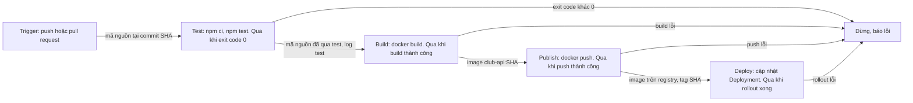

# Walkthrough tuần 8 – CI/CD Fundamentals và GitHub Actions

> **Tóm tắt:** Hướng dẫn giải tuần 8: thiết kế pipeline Club API, pipeline giả lập, workflow GitHub Actions có cache và matrix, kèm gợi ý bài tập và hướng dẫn chấm cho mentor.

## Cách dùng tài liệu này

Chỉ đọc sau khi bạn đã tự làm bài lab và bài tập. Hãy đối chiếu để tìm chỗ lệch, không chép nguyên văn: mentor chấm bằng source, log và link run thật, rồi hỏi vấn đáp về chính bài bạn nộp.

Phần pipeline giả lập (Buổi 15) đã được chạy thử trên máy với Node 22, Docker Engine 29.x: script chạy xanh, bản test đỏ dừng trước stage build với `exit code: 1`, và bản `|| true` vẫn in `PIPELINE OK`. Phần GitHub Actions (Buổi 16) chạy trên hạ tầng của GitHub nên đáp án dưới đây dựa trên cú pháp và hành vi đã được tài liệu hóa, chưa được chạy trên một repo thật; thông báo log chính xác có thể khác theo phiên bản action. Hai bài lab liên quan: [Buổi 15](../../labs/week-08/session-15.md) và [Buổi 16](../../labs/week-08/session-16.md); đề bài tập: [Bài tập tuần 8](../../assignments/weekly/week-08.md).

## Lời giải theo buổi

### Buổi 15 – CI/CD Fundamentals

#### Đáp án các nhiệm vụ L1

Chuẩn bị: tạo `~/devops-labs/lab-15/{source,screenshots,evidence}`, đặt `starter-project/` (không có `node_modules`) vào `source/`, và tạo `.gitignore` ở gốc repo với `node_modules/` và `.env`.

Phần 1 – sơ đồ pipeline. Điểm mấu chốt là mỗi mũi tên phải ghi cái gì chảy qua nó. Một `pipeline.mmd` đạt yêu cầu:



Phần 2 – `pipeline-spec.md` đủ 4 stage, không ô nào để trống, có thêm tag, secret và song song:

```markdown
| Stage | Lệnh chính | Runner cần | Input | Output (artifact) | Điều kiện qua |
| --- | --- | --- | --- | --- | --- |
| Test | npm ci; npm test | Node 22 | mã nguồn backend tại commit | log test | exit code 0, `# fail 0` |
| Build | docker build -t club-api:SHA . | Docker | mã nguồn + Dockerfile | image club-api:SHA | build thành công |
| Publish | docker push | Docker + đăng nhập registry | image club-api:SHA | image trên registry | push thành công |
| Deploy | cập nhật Deployment sang tag SHA | truy cập cluster | tên image + tag SHA | Pod mới Ready | rollout xong, `/ready` trả 200 |

- Tag image: commit SHA ngắn (trên CI là github.sha); có thể thêm tag phiên bản khi phát hành, không dùng `latest` làm định danh duy nhất.
- Secret cần (chỉ tên): token đăng nhập registry, kubeconfig hoặc credential của cluster. Không ghi giá trị.
- Song song: lint hoặc kiểm tra cú pháp YAML có thể chạy song song với test; Build phải chờ Test; Publish chờ Build; Deploy chờ Publish.
```

Phần 3 – chạy `run-pipeline.sh` (đúng script trong lab) bằng `./source/run-pipeline.sh 2>&1 | tee evidence/command-output.txt`. Log đúng phải có theo thứ tự: `=== STAGE: test ===`, `# pass 1` và `# fail 0`, `=== STAGE: build ===`, `=== STAGE: verify-artifact ===` với dòng `image=[club-api:1.0.0 club-api:2026...] size=...` (tag cụ thể từ `docker image inspect`, thứ tự tag có thể khác), `=== STAGE: publish (mô phỏng) ===`, và dòng cuối `PIPELINE OK: club-api:2026...`. `set -euo pipefail` làm script dừng ngay ở lệnh lỗi đầu tiên, giống một runner CI; `npm ci` thay `npm install` để cài đúng theo lock file.

Phần 4 (Nhiệm vụ 2) – chứng minh gate:

```bash
cd ~/devops-labs/lab-15/source/starter-project/backend
cp tests/health.test.js /tmp/health.test.js.bak
# sửa "healthy" thành "unhealthy" TRONG deepEqual (không sửa tên test)
cd ~/devops-labs/lab-15
./source/run-pipeline.sh 2>&1 | tee -a evidence/command-output.txt
echo "exit code: ${PIPESTATUS[0]}"
cd source/starter-project/backend && cp /tmp/health.test.js.bak tests/health.test.js && npm test
```

Kết quả đúng (đã kiểm chứng): log có `=== STAGE: test ===` với `# fail 1` và đoạn `expected: status 'unhealthy'` so với `actual: status 'healthy'`; không có dòng `=== STAGE: build ===`; `exit code: 1`. Sau khi hoàn tác, `npm test` in `# pass 1`, `# fail 0` và `git diff` thư mục `tests` trống. `report.md` (2 đến 3 câu): stage test đứng trước build theo nguyên tắc fail fast, vì test rẻ và nhanh hơn build; nếu build trước, một lần test đỏ vẫn tốn thời gian build và tạo ra image từ mã lỗi.

Hai chi tiết để tự kiểm tra: chỉ đổi tên test (chuỗi `"GET /health returns healthy"`) thì test vẫn xanh, gate không bị kích hoạt; và `exit code` phải lấy từ `PIPESTATUS[0]` vì `$?` sau `tee` là mã của `tee`, luôn 0.

`report.md` về Delivery và Deployment (2 đến 3 câu): Continuous Delivery luôn sẵn sàng deploy nhưng production cần con người duyệt; Continuous Deployment tự deploy mọi thay đổi qua test, không cần duyệt.

#### Lời giải L2

1. Ba môi trường (`environments.md`). Cách tiếp cận: mỗi môi trường tăng dần mức rủi ro và mức kiểm soát.

   ```markdown
   | Môi trường | Trigger deploy | Gate | Rollback |
   | --- | --- | --- | --- |
   | dev | merge vào nhánh chính | npm test pass, build thành công | deploy lại tag cũ |
   | staging | dev deploy xong | `/health` và `/ready` trả 200 trong 60 giây | deploy lại tag cũ |
   | production | tag phiên bản vX.Y.Z | approval của mentor + staging ổn định | deploy lại tag phiên bản trước |
   ```

2. Chọn Continuous Delivery cho production. Ba lý do dựa trên rủi ro: test mới chỉ phủ `/health` nên một bản qua CI chưa chắc an toàn; dữ liệu thành viên là dữ liệu thật; CLB nhỏ nên một lần duyệt tay rẻ hơn một sự cố. Cũng chấp nhận chọn Deployment nếu có lập luận chặt chẽ và điều kiện kèm theo (smoke test sau deploy, rollback tự động).
3. Build một lần. Điểm dễ sai: `docker build` không tự in dòng lệnh ra log, nên nếu chỉ `grep -c "docker build"` trên log của script gốc sẽ ra 0. Cần in lệnh ra:

   ```bash
   IMAGE_TAG="$IMAGE:$SHA"
   echo "+ docker build -t $IMAGE_TAG ."
   docker build -t "$IMAGE_TAG" .
   for env in dev staging production; do
     echo "deploy $IMAGE_TAG to $env"
   done
   ```

   Kiểm tra: `grep -c "^+ docker build" evidence/command-output.txt` ra `1`. Cách khác: `set -x` và đếm dòng `+ docker build`.
4. Hai gate bổ sung (mẫu): `docker compose config --quiet` chặn lỗi cú pháp và biến thiếu trong Compose; kiểm tra `/ready` sau deploy (smoke test) chặn lỗi kết nối DB hoặc cấu hình sai mà `/health` không phát hiện. Phương án khác: quét lỗ hổng image (chặn dependency có lỗ hổng đã biết), test tích hợp với postgres.

#### Lời giải phần Phá lỗi và debug: pipeline xanh nhưng bản deploy lỗi

Triệu chứng: script in `PIPELINE OK` và image được tạo dù log có `# fail 1` (đã kiểm chứng).

Cây điều tra:

1. Đọc log từ trên xuống, tìm `# fail` lớn hơn 0 trong stage test: có, vậy kết quả cuối không phản ánh trạng thái thật.
2. Hỏi vì sao script không dừng: tìm lệnh `|| true` hoặc `set +e`. Ở đây `npm test || true` biến mọi mã thoát thành 0.
3. Xác nhận bằng cách chạy riêng `npm test; echo $?`: in `1`.
4. Kiểm tra thứ tự stage: build có đứng trước test không. Nếu đứng trước thì image đã được tạo từ mã lỗi trước khi test chạy.

Nguyên nhân gốc: gate bị vô hiệu hóa vì mã thoát của test bị nuốt (và có thể thêm thứ tự stage sai). Sửa: bỏ `|| true`, giữ `set -euo pipefail`, đưa test lên trước build. Phòng tránh: không bao giờ nuốt mã thoát của lệnh kiểm tra, branch protection bắt buộc check xanh mới merge, review mọi thay đổi vào file định nghĩa pipeline.

#### Những hiểu lầm hay gặp

- Nhầm Delivery với Deployment: khác nhau ở đúng một chỗ, có cổng duyệt tay trước production hay không.
- Nhầm artifact với cache: artifact là kết quả cần giữ (image `club-api`, báo cáo test); cache chỉ tăng tốc (`node_modules`) và mất đi pipeline vẫn đúng.
- Nghĩ mọi job chia sẻ thư mục: mỗi job chạy trên runner riêng; dữ liệu giữa job đi qua artifact hoặc registry.
- Dùng `latest` làm định danh duy nhất nên không truy vết được image về commit và không rollback chính xác được.
- Cho rằng pipeline xanh là an toàn. Gate yếu (chỉ test `/health`) hoặc bị nuốt mã thoát cho cảm giác an toàn giả.
- Dùng `$?` sau `| tee` để lấy exit code của script; phải dùng `PIPESTATUS[0]`.
- Quên hoàn tác file test sau khi thử gate.

### Buổi 16 – GitHub Actions Basics

#### Đáp án các nhiệm vụ L1

Chuẩn bị: tạo `lab-16/source`, `lab-16/evidence`, `lab-16/screenshots` và `.github/workflows` trong repo cá nhân; sao chép `starter-project/backend` vào `lab-16/source/` (có `package-lock.json`, không có `node_modules`); chạy `npm ci` và `npm test` cục bộ trước, ghi log vào `lab-16/evidence/command-output.txt`. Chạy được ở local trước để khi CI đỏ biết lỗi nằm ở cấu hình workflow.

Phần 1 – workflow `hello.yml` dùng `workflow_dispatch`. Nút Run workflow chỉ hiện khi file đã nằm trên nhánh mặc định. Log đúng: tên repo, `OS: Linux`, và `ls` không in gì vì chưa checkout (runner là máy trống).

Phần 2 – `ci.yml` L1 (Nhiệm vụ 3): dùng đúng file trong lab, gồm `on` với `push` (nhánh `main` và `master`) và `pull_request`, `permissions: contents: read`, các step `actions/checkout@v4`, `actions/setup-node@v4` với `node-version: 22`, `npm ci`, `npm test`; hai step `npm` đặt `working-directory: lab-16/source`. Giải thích trong `report.md`:

- Cần checkout vì runner là máy mới, không có mã nguồn; không có checkout thì không có `package.json`.
- `working-directory` là `lab-16/source` vì `package.json` nằm ở đó, không phải gốc repo; nếu không đặt, `npm` chạy ở gốc repo và không tìm thấy `package.json`.

Bằng chứng: log local, `git log --oneline` có commit thêm workflow, link run xanh, đoạn log step Run tests có `# pass` và `# fail 0`, và `source/ci.yml.copy` trùng file thật (`diff .github/workflows/ci.yml lab-16/source/ci.yml.copy` không in gì).

Phần 3 – cache (Nhiệm vụ 4): step Setup Node.js thêm `cache: npm` và `cache-dependency-path: lab-16/source/package-lock.json`:

```yaml
      - name: Setup Node.js
        uses: actions/setup-node@v4
        with:
          node-version: 22
          cache: npm
          cache-dependency-path: lab-16/source/package-lock.json
```

Chạy lần đầu rồi Re-run all jobs. Cần thấy khác biệt trong log step Setup Node.js: lần đầu báo không tìm thấy cache (cache được lưu ở cuối job), lần hai báo khôi phục cache từ key tính theo hash của lock file. Ghi thời gian step `npm ci` của hai lần bằng số giây thật (dự án nhỏ nên chênh lệch có thể chỉ vài giây). Giải thích artifact so với cache bằng ví dụ Club API: image `club-api` hoặc báo cáo test là artifact; thư mục npm cache là cache.

Tách job `validate` (không có `needs`, chạy song song):

```yaml
  validate:
    runs-on: ubuntu-latest
    steps:
      - uses: actions/checkout@v4
      - name: Kiểm tra package.json hợp lệ
        run: node -e "JSON.parse(require('fs').readFileSync('lab-16/source/package.json','utf8')); console.log('package.json OK')"
```

Trang run phải hiển thị ít nhất hai job `test` và `validate`, cả hai xanh, không có mũi tên phụ thuộc giữa chúng.

#### Lời giải L2

Thử thách 1 – matrix, `needs`, `build-image`. Workflow đầy đủ:

```yaml
name: CI

on:
  push:
    branches: [main, master]
  pull_request:

permissions:
  contents: read

jobs:
  test:
    runs-on: ubuntu-latest
    strategy:
      fail-fast: false
      matrix:
        node-version: [22, 24]
    steps:
      - uses: actions/checkout@v4
      - uses: actions/setup-node@v4
        with:
          node-version: ${{ matrix.node-version }}
          cache: npm
          cache-dependency-path: lab-16/source/package-lock.json
      - name: Install dependencies
        working-directory: lab-16/source
        run: npm ci
      - name: Run tests
        working-directory: lab-16/source
        run: npm test

  validate:
    runs-on: ubuntu-latest
    steps:
      - uses: actions/checkout@v4
      - name: Kiểm tra package.json hợp lệ
        run: node -e "JSON.parse(require('fs').readFileSync('lab-16/source/package.json','utf8')); console.log('package.json OK')"

  build-image:
    runs-on: ubuntu-latest
    needs: [test, validate]
    steps:
      - uses: actions/checkout@v4
      - name: Build Docker image
        working-directory: lab-16/source
        run: docker build -t club-api:ci .
```

Matrix `node-version: [22, 24]` tạo 2 job (`test (22)`, `test (24)`), cộng `validate` và `build-image` thành 4 job. `fail-fast: false` để một biến thể đỏ không hủy biến thể còn lại, giúp thấy đủ kết quả khi học. Chứng minh `needs`: tạo một run mà `test` đỏ (đổi `"healthy"` thành `"unhealthy"` trong `tests/health.test.js` trên nhánh riêng), job `build-image` hiển thị `skipped`; kèm link run và ảnh.

Thử thách 2 – PR đỏ và Tình huống 06. Nhánh `feature/break-test`, sửa assertion, push, mở pull request: check đỏ ở step Run tests; sửa lại trên cùng PR để thấy xanh. Báo cáo Tình huống 06 theo năm mục (triệu chứng, nguyên nhân gốc, cách xác minh, giải pháp, phòng tránh). Quy trình điều tra chung (xem phần Phá lỗi bên dưới): tìm step đỏ đầu tiên, đọc dòng lỗi đầu tiên, phân loại lỗi xảy ra trước `npm` hay trong `npm`, đối chiếu `git ls-files`, tái hiện bằng bản clone sạch. Tình huống 06 trong thư mục examples có workflow nhiều lỗi nối tiếp, nên sau khi sửa một lỗi hãy đọc lại log vì lỗi mới có thể ở job hoặc step khác. Phần xác minh phải trích đúng dòng log đầu tiên báo lỗi và nói rõ lỗi xảy ra trước hay trong lệnh `npm`; bằng chứng tái hiện là `git clone` vào thư mục mới rồi `npm ci` hoặc `git ls-files`.

Thử thách 3 – xem lời giải L2 của Buổi 15 (môi trường, build một lần, hai gate).

#### Lời giải phần Phá lỗi và debug: Tình huống 06

Hai cách phá và quy trình điều tra:

1. Cách 1 – đổi `working-directory` thành `lab-16/src`. Step `npm ci` đỏ ngay, log báo thư mục không tồn tại (`No such file or directory`) trước khi chạy `npm`. Lỗi nằm ở đường dẫn, không phải ở npm.
2. Cách 2 – thêm `lab-16/source/package-lock.json` vào `.gitignore` rồi `git rm --cached`, commit và push. Nếu đã bật `cache: npm` thì step Setup Node.js đỏ trước vì không tìm thấy lock file theo `cache-dependency-path`; nếu chưa bật cache thì step `npm ci` đỏ vì cần `package-lock.json`.

Cây điều tra chung:

1. Mở run đỏ, tìm step có dấu X đầu tiên và đọc từ dòng lỗi đầu tiên, không đọc từ cuối.
2. Phân loại: lỗi trước khi chạy `npm` (đường dẫn, checkout) hay trong `npm` (lock file, test).
3. Đối chiếu repo: `git ls-files lab-16/source | head` cho thấy file nào thực sự được commit.
4. Tái hiện trên bản clone sạch: `git clone` vào thư mục mới, `cd` đúng thư mục, `npm ci`. Lỗi lặp lại nghĩa là vấn đề nằm ở dữ liệu repo, không phải GitHub.
5. Sửa, push, xác nhận run xanh.

Nguyên nhân gốc: runner chỉ có những gì đã commit và những gì workflow khai báo. Đường dẫn sai hoặc file bị `.gitignore` làm môi trường CI khác máy bạn. Phòng tránh: luôn commit `package-lock.json`, dùng `defaults.run.working-directory` để không lặp đường dẫn, kiểm tra bằng clone sạch trước khi đổ lỗi cho CI.

#### Những hiểu lầm hay gặp

- Quên `actions/checkout` rồi thắc mắc không thấy file. Runner là máy trống.
- Dùng `npm install` trong CI. Nên dùng `npm ci` vì cài đúng theo lock file và báo lỗi khi lock lệch hoặc thiếu.
- Ignore `package-lock.json` hoặc quên commit nó.
- Sai `cache-dependency-path` nên cache không bao giờ được khôi phục; lock file không nằm ở gốc repo.
- Nghĩ cache là artifact, hoặc nghĩ cache mất đi thì pipeline sai. Cache chỉ tăng tốc.
- Không hiểu `fail-fast`: mặc định true nên một biến thể đỏ hủy các biến thể đang chạy; bài lab đặt false để thấy đủ kết quả.
- Đặt `needs` giữa `test` và `validate` rồi nói hai job chạy song song.
- Không pin phiên bản action hoặc cấp `permissions` rộng hơn nhu cầu (CI chỉ đọc code thì `contents: read` là đủ).
- Sai thụt lề YAML hoặc dùng tab; workflow không được nhận hoặc chạy sai.

## Bài tập và chấm bài

### Bài tập tuần

Phần này gợi ý cách tiếp cận cho từng nhiệm vụ của [bài tập tuần 8](../../assignments/weekly/week-08.md). Nhiệm vụ 1 và 2 nằm ở `lab-15/`, nhiệm vụ 3 và 4 ở `lab-16/`.

#### Nhiệm vụ L1

Nhiệm vụ 1 (thiết kế và giả lập). Dùng sơ đồ, `pipeline-spec.md` và `run-pipeline.sh` ở Buổi 15. Tiêu chí kiểm: spec không ô trống; evidence có `=== STAGE: test ===`, `=== STAGE: build ===`, `# fail 0`, `PIPELINE OK`, và tên image kèm tag cụ thể lấy từ `docker image inspect`; mỗi mũi tên của sơ đồ ghi cái gì chảy qua.

Nhiệm vụ 2 (gate dừng khi fail). Chuỗi lệnh ở phần Đáp án Buổi 15, Phần 4. Evidence đúng: lần đỏ có `# fail` lớn hơn 0, không có `=== STAGE: build ===` sau đó, `exit code` khác 0 (thường là 1); lần xanh sau hoàn tác có `# fail 0`; `git diff` của thư mục `tests` trống khi nộp. Giải thích fail fast: stage rẻ và nhanh đứng trước stage đắt; build trước test thì lãng phí thời gian build và tạo artifact từ mã lỗi.

Nhiệm vụ 3 (workflow CI thật). Dùng `ci.yml` L1 ở Buổi 16. Điểm kiểm: YAML thụt 2 dấu cách, đủ 4 step, có `permissions` và action pin theo `@v4`; hai step `npm` có `working-directory: lab-16/source`; link run xanh và đoạn log step Run tests (có `# pass` và `# fail 0`); `ci.yml.copy` trùng workflow thật; `git log --oneline` có commit thêm workflow. Log của run lấy từ trang run (Download log archive) hoặc `gh run view --log` nếu đã cài GitHub CLI.

Nhiệm vụ 4 (cache và tách job). Dùng đoạn cache và job `validate` ở Buổi 16. Cần log Setup Node.js của cả hai lần chạy trong `report.md`, lần hai có dòng khôi phục cache; thời gian `npm ci` hai lần bằng số giây thật; trang run có `test` và `validate` song song. Artifact so với cache: artifact là kết quả cần giữ và truyền đi (image `club-api`, báo cáo test), cache chỉ để tăng tốc (npm cache) và mất đi thì kết quả vẫn đúng.

#### Nhiệm vụ L2

- Thử thách 1: workflow đầy đủ ở lời giải L2 Buổi 16; cần link run chứng minh `build-image` bị `skipped` khi `test` đỏ, và nêu số job từ matrix (2) cùng lợi ích của `fail-fast: false`.
- Thử thách 2: PR đỏ rồi xanh trên cùng PR, báo cáo 5 phần, trích đúng dòng log đầu tiên báo lỗi, bằng chứng clone sạch.
- Thử thách 3: `environments.md`, script build một lần với đúng một dòng `+ docker build` trong log, hai gate bổ sung có nêu loại lỗi chặn được.

#### Đáp án 5 câu hỏi kiểm tra

1. CI tự động build và test mỗi thay đổi. Continuous Delivery giữ một cổng duyệt tay trước production. Continuous Deployment bỏ cổng đó và tự deploy mọi thay đổi qua test. Với Club API chỉ có test cho `/health`, chọn Continuous Delivery cho production vì độ phủ test thấp, dữ liệu thành viên là thật và chi phí duyệt tay nhỏ so với một sự cố.
2. Workflow là cả file YAML; job là nhóm step chạy trên một runner; step là một lệnh `run` hoặc một action `uses`; runner là máy ảo thực thi job. Hai job chạy trên hai runner khác nhau, không chia sẻ hệ thống file; dữ liệu đi qua artifact (upload ở job trước, download ở job sau), cache hoặc registry.
3. `npm ci` cài đúng theo lock file, xóa `node_modules` trước khi cài và báo lỗi nếu thiếu hoặc lệch lock file, nên tái lập được; `npm install` có thể sửa lock file. Nếu quên commit `package-lock.json`, `npm ci` fail (và nếu có `cache: npm` thì Setup Node.js fail vì không tìm thấy lock file).
4. Key cache tính từ hash của lock file. Thêm dependency làm lock file đổi, hash đổi nên lần chạy kế không khớp cache cũ và cache mới được tạo ở cuối job. Cache chỉ tăng tốc; artifact là kết quả cần giữ.
5. Ba việc theo thứ tự: (a) đọc dòng lỗi đầu tiên của step đỏ để biết lỗi nằm trước hay trong `npm`; (b) kiểm tra `working-directory` và `git ls-files` xem `package-lock.json` có được commit không; (c) `git clone` vào thư mục mới và chạy `npm ci` để xác định vấn đề do dữ liệu repo hay do cấu hình workflow. Có thể thêm (d) so phiên bản Node với local.

### Hướng dẫn chấm cho mentor

Mentor kiểm chứng bằng cách đọc workflow trong repo, mở link run và đối chiếu với log học viên dán, chạy lại `run-pipeline.sh` và đọc lịch sử commit. Link run không truy cập được hoặc log không khớp workflow trong repo thì hỏi lại trực tiếp.

| Tiêu chí | Bằng chứng cần thấy trong evidence/ | Dấu hiệu bài chép hoặc không hiểu | Câu hỏi vấn đáp |
| --- | --- | --- | --- |
| Nhiệm vụ 1 – thiết kế và giả lập | `pipeline-spec.md` đủ ô; log `run-pipeline.sh` có đủ stage, `# fail 0`, `PIPELINE OK`, tag cụ thể; sơ đồ có nhãn trên mũi tên | Spec giữ nguyên bảng mẫu của lab, không thêm tag, secret, song song; log không có mốc thời gian khác nhau giữa các lần chạy | Output của stage Build là gì và đi đâu tiếp? Vì sao tag bằng commit SHA tốt hơn `latest`? Secret nào cần và lưu ở đâu? |
| Nhiệm vụ 2 – gate dừng khi fail | Log đỏ: `# fail` lớn hơn 0, không có stage build, `exit code` khác 0; log `npm test` xanh sau hoàn tác; `git diff` thư mục `tests` trống | Chỉ có lần chạy xanh; `exit code` lấy bằng `$?` nên luôn 0; để lại test hỏng | Vì sao `exit code` phải lấy từ `PIPESTATUS[0]`? Nếu em thêm `|| true` sau `npm test` thì chuyện gì xảy ra? Build trước test lãng phí gì? |
| Nhiệm vụ 3 – workflow CI | `ci.yml` và `ci.yml.copy` giống nhau; `permissions`, pin action, `working-directory`; link run xanh khớp với commit; log step Run tests | Link run thuộc repo khác hoặc commit không khớp; log đã chỉnh tay; thiếu checkout; dùng `npm install` | Nếu bỏ checkout thì step nào đỏ đầu tiên và vì sao? Vì sao `working-directory` là `lab-16/source`? Vì sao `contents: read` là đủ? |
| Nhiệm vụ 4 – cache và tách job | Log Setup Node.js hai lần, lần hai khôi phục cache; thời gian `npm ci` hai lần; run có `test` và `validate` song song | Hai đoạn log giống hệt nhau; `cache-dependency-path` sai mà không nhận ra; `validate` có `needs` | Key của cache lấy từ đâu? Thêm dependency thì chuyện gì xảy ra? Cache khác artifact thế nào, cho ví dụ của Club API? |
| README và report | 7 câu theo template, nêu nguyên nhân gốc khi có lỗi | Sao chép đề bài, chung chung | Chọn một lỗi em gặp: em đọc log ở đâu đầu tiên và xác minh bằng lệnh nào? |
| Câu hỏi kiểm tra kiến thức | 5 câu đúng ý, có lệnh hoặc YAML dẫn chứng | Trùng câu chữ với lab; không có dẫn chứng | Hỏi câu 5 với một tình huống mới (PR đỏ ở step `npm test` chỉ trên Node 24) |
| Vệ sinh và quy trình | Có `package-lock.json`, không có `node_modules`, `.env`, token; PR có reviewer | `git ls-files` thấy `node_modules`; thiếu lock file; không có phản hồi review | Em làm gì nếu lỡ commit token (thu hồi token trước, rồi mới xóa khỏi lịch sử)? |
| L2-1 matrix, `needs`, `build-image` | YAML có `strategy.matrix` (2 phiên bản), `fail-fast: false`, `needs`; link run `build-image` bị skipped | Có YAML nhưng không có run chứng minh; không biết matrix tạo mấy job | Matrix tạo mấy job? Khi `test (24)` đỏ thì `build-image` ra sao và vì sao? |
| L2-2 PR đỏ và Tình huống 06 | Link PR đỏ rồi xanh; báo cáo 5 phần; dòng log đầu tiên báo lỗi; bằng chứng clone sạch | Chỉ có kết luận, không trích log; sửa nhiều thứ một lúc không biết cái nào có tác dụng | Lỗi xảy ra trước khi chạy `npm` hay trong `npm`? Em biết bằng dòng log nào? |
| L2-3 môi trường và build một lần | `environments.md` đủ trigger, gate, rollback; `grep -c` ra 1 với dòng lệnh build được in ra log; hai gate có lý do | Log có nhiều hơn một lệnh build; lý do chung chung ("cho an toàn") | Nếu production cần quay lui, em deploy lại cái gì? Vì sao điều đó chỉ làm được khi tag bất biến? |
