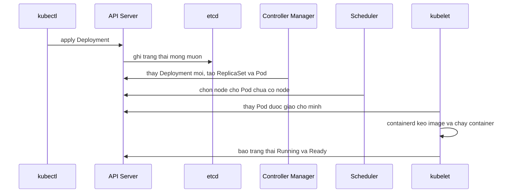

# Walkthrough tuần 11 – Kubernetes Setup và Workloads

::: warning Dành cho mentor và học viên đã nộp bài
Trang này là đáp án đối chiếu: mentor dùng để chấm, học viên chỉ mở sau khi đã nộp bài của mình.
:::

> **Tóm tắt:** Hướng dẫn giải buổi 21 (dựng cluster kind) và buổi 22 (Pods, Deployments, rolling update, ImagePullBackOff), kèm bài tập tuần và bảng chấm cho mentor.

## Cách dùng tài liệu này

- Đọc sau khi bạn đã tự làm lab và bài tập. Mục đích là đối chiếu cách nghĩ và tìm ra chỗ mình hiểu sai, không phải chép lại lệnh.
- Output thật trên máy bạn luôn khác (hash của ReplicaSet, tên Pod, IP, phiên bản Kubernetes). Đừng dán output trong tài liệu này vào evidence.
- Mọi lệnh bên dưới lấy từ bài lab và bài tập. Phần "lời giải" thường có nhiều cách đúng; nếu cách của bạn khác nhưng có bằng chứng và giải thích được, đó vẫn là lời giải tốt.
- Bài lab: [buổi 21](../../labs/week-11/session-21.md), [buổi 22](../../labs/week-11/session-22.md). Bài tập: [bài tập tuần 11](../../assignments/weekly/week-11.md).

### Buổi 21 – Kubernetes Introduction

#### Đáp án các nhiệm vụ L1

1. Cài công cụ, ghi phiên bản. Hai lệnh cần thấy trong evidence:

   ```bash
   kubectl version --client
   kind version
   ```

   Điểm cần kiểm: `kind v0.23.0` trở lên (bài pin đúng bản này), `Client Version: v1.3x.x`. Nếu `command not found`, kiểm tra `ls /usr/local/bin` và bước `sudo mv` hoặc `sudo install`.

2. Tạo cluster 1 node, kiểm tra context và node:

   ```bash
   kind create cluster --name club-lab
   kubectl config current-context
   kubectl get nodes
   ```

   Kết quả đúng: context `kind-club-lab`, một node `club-lab-control-plane` có `STATUS Ready`, `ROLES control-plane`. `Ready` nghĩa là kubelet của node báo khỏe với API Server.

3. Node là container Docker:

   ```bash
   docker ps --filter name=club-lab --format 'table {{.Names}}\t{{.Status}}'
   ```

   Phải thấy đúng một container `club-lab-control-plane` trạng thái `Up`. Đây là bằng chứng cốt lõi của bài: `docker ps` và `kubectl get nodes` nhìn cùng một hệ thống từ hai phía.

4. Pod hệ thống và namespace:

   ```bash
   kubectl get pods -n kube-system
   kubectl get namespaces
   ```

   Pod cần thấy `Running`: `etcd-`, `kube-apiserver-`, `kube-scheduler-`, `kube-controller-manager-`, `coredns-` (thường 2 Pod), `kube-proxy-`, `kindnet-`. Namespace: `default`, `kube-system`, `kube-public`, `kube-node-lease`, `local-path-storage`. Vai trò tối thiểu học viên phải nói được: `kube-apiserver` là cổng duy nhất của cluster (xác thực, phân quyền, kiểm tra hợp lệ); `etcd` lưu toàn bộ trạng thái và chỉ API Server nói chuyện trực tiếp với nó.

5. Xóa cluster: `kind delete cluster --name club-lab`, rồi `kind get clusters` không còn `club-lab`.

#### Lời giải L2

**Thử thách 1 – cluster 3 node.** Tự viết file, ví dụ `source/kind-3-nodes.yaml`:

```yaml
kind: Cluster
apiVersion: kind.x-k8s.io/v1alpha4
nodes:
  - role: control-plane
  - role: worker
  - role: worker
```

```bash
kind create cluster --name club-lab-3 --config source/kind-3-nodes.yaml
kubectl get nodes -o wide
kubectl get pods -A -o wide
kubectl describe node club-lab-3-control-plane | grep -i taints
kubectl describe node club-lab-3-worker | grep -i taints
```

Cách đọc kết quả:

- Ba node `Ready`: `club-lab-3-control-plane`, `club-lab-3-worker`, `club-lab-3-worker2`.
- Cột NODE của `get pods -A -o wide`: `etcd`, `kube-apiserver`, `kube-scheduler`, `kube-controller-manager` chỉ nằm trên control plane; `kube-proxy` và `kindnet` mỗi node một Pod (DaemonSet). `coredns` có thể nằm ở node nào cũng được, vì nó có toleration cho taint của control plane.
- Control plane có taint `node-role.kubernetes.io/control-plane:NoSchedule`, worker là `<none>`. Pod ứng dụng không khai báo toleration tương ứng nên scheduler không đặt chúng lên control plane. Pod hệ thống chạy được ở đó vì chúng là static Pod hoặc có toleration.
- Lưu ý hay bị hỏi: với cluster kind 1 node (như `club-lab` hay cluster `club` của buổi 22) kind gỡ taint này, nếu không thì không có chỗ nào chạy được Pod ứng dụng.

Vì sao chọn cách này: file tối thiểu chỉ khai báo vai trò node, không `image`, nên kind dùng node image mặc định của phiên bản kind đang cài. Cách khác: thêm `image: kindest/node:v1.30.x` để pin phiên bản Kubernetes (cần biết tag tồn tại).

**Thử thách 2 – chỉ dùng kubectl.**

```bash
kubectl version
kubectl get --raw '/readyz?verbose' | head -20
```

`kubectl version` in cả `Client Version` và `Server Version`; phần server do API Server trả lời. `/readyz?verbose` liệt kê từng kiểm tra sức khỏe của API Server, trong đó có dòng `etcd ok` (kiểm tra kết nối etcd), kết thúc bằng `readyz check passed`. Điểm mấu chốt: cả hai lệnh đều là yêu cầu HTTPS tới API Server, không hề đụng tới Docker.

**Thử thách 3 – so sánh với file của starter-project.** Đoạn 3-5 câu đạt yêu cầu cần có các ý sau:

- `starter-project/k8s/kind-config.yaml` chỉ có 1 node control-plane (không có worker), còn file của bạn có 3 node.
- Nhãn `ingress-ready=true` (đặt qua `kubeadmConfigPatches` cho kubelet) để Ingress controller của kind chọn đúng node đang có cổng được map ra host.
- `extraPortMappings` map cổng 80 và 443 của container node ra cổng 80 và 443 của máy host, để sau này truy cập `club.localhost` mà không cần `port-forward`.
- Rủi ro: nếu máy đã có tiến trình dùng cổng 80 hoặc 443 (hoặc đang có cluster khác map cùng cổng) thì tạo cluster báo `address already in use`.

Học viên chỉ nói "file kia có thêm cấu hình" mà không giải thích mục đích hai khối đó là chưa đạt.

#### Lời giải phần Phá lỗi / Debug

Tình huống: `docker stop club-lab-3-control-plane` rồi `kubectl get nodes` báo `connection refused` hoặc timeout.

Cây điều tra:

1. Lỗi là gì và ở đâu? Thông báo có `127.0.0.1:<port>`, tức kubectl đang cố nói chuyện với API Server của kind qua cổng Docker publish ra máy host. Chưa kết luận gì về cluster.
2. `kubectl config current-context` cho `kind-club-lab-3`: context đúng, loại trừ sai cluster.
3. `docker ps -a --filter name=club-lab-3`: container `club-lab-3-control-plane` ở trạng thái `Exited`; hai worker vẫn `Up`.
4. Kết luận: API Server nằm trong container control plane nên không còn ai trả lời.

Nguyên nhân gốc: node của kind là container, dừng container tương đương tắt máy chủ control plane. Worker vẫn sống nhưng không có API Server để điều phối.

Sửa:

```bash
docker start club-lab-3-control-plane
kubectl get nodes
```

Chờ 30-60 giây. Nếu vẫn lỗi vì cổng publish đã đổi sau khi container khởi động lại, chạy `kind export kubeconfig --name club-lab-3` rồi thử lại. Thứ tự điều tra đúng là Docker trước, context sau, không "cài lại kubectl".

Dọn dẹp: `kind delete cluster --name club-lab-3` (buổi 22 dùng cluster `club` riêng).

#### Những hiểu lầm hay gặp

- Nghĩ kind là "máy ảo": thực ra chỉ là container, nên khởi động lại Docker Desktop là khởi động lại cả cluster.
- Nghĩ kubectl nói chuyện trực tiếp với node hoặc etcd. Tất cả đi qua API Server.
- Nhầm cluster đã xóa với cluster đang chạy: `kubectl config use-context kind-club-lab` sau khi xóa cluster sẽ lỗi vì context vẫn còn trong kubeconfig nhưng cluster đã mất. `kind delete cluster` thường dọn context tương ứng, nhưng hãy kiểm tra bằng `kubectl config get-contexts`.
- Cho rằng xóa Pod `kube-scheduler` bằng kubectl sẽ tắt scheduler. Đây là bản phản chiếu (mirror Pod) của static Pod do kubelet quản lý nên nó tự quay lại.
- Làm lab trong `/mnt/c` hoặc để Docker thiếu RAM rồi kết luận "kind lỗi".

### Buổi 22 – Pods và Deployments

#### Đáp án các nhiệm vụ L1

Chuẩn bị đúng: context `kind-club`, cluster tạo từ `k8s/kind-config.yaml` (cổng 80 và 443 rảnh).

1. Build và nạp image, kiểm tra trong node:

   ```bash
   docker build -t club-api:1.0.0 ./backend
   kind load docker-image club-api:1.0.0 --name club
   docker exec club-control-plane crictl images | grep club-api
   ```

   Phải thấy `docker.io/library/club-api   1.0.0`. Tag cố định giúp manifest tái lập; node kind không thấy image trong Docker Desktop nên phải nạp.

2. Dựng nền theo thứ tự: namespace, ConfigMap, Secret, Postgres, bảng `members`:

   ```bash
   kubectl apply -f k8s/namespace.yaml
   kubectl apply -f k8s/configmap.yaml
   read -rsp "DB password (local): " DB_PASS; echo
   kubectl create secret generic club-secrets -n club --from-literal=db-password="$DB_PASS"
   unset DB_PASS
   kubectl apply -f k8s/postgres.yaml
   kubectl rollout status statefulset/postgres -n club --timeout=120s
   kubectl exec -i -n club postgres-0 -- psql -U club -d clubdb < database/init.sql
   ```

   Mật khẩu không nằm trong file nào. `init.sql` phải chạy thì `/api/members` mới không trả 500; kết quả đúng là `CREATE TABLE` và `INSERT 0 2` (chạy lần hai là `NOTICE ... already exists` và `INSERT 0 0` vì có `IF NOT EXISTS` và `ON CONFLICT DO NOTHING`).

3. Đọc manifest và trả lời ba câu của lab:

   - Label nối Deployment với Pod: `app: club-api` (`spec.selector.matchLabels` khớp `spec.template.metadata.labels`).
   - Probe chặn Pod nhận traffic: `readinessProbe` vào `/ready` cổng 3000. Readiness quyết định Pod có nằm trong Endpoints của Service hay không; `livenessProbe` `/health` quyết định có restart container hay không.
   - `DB_HOST` đến từ ConfigMap `club-config` qua `envFrom.configMapRef` (giá trị `postgres`, tên Service của Postgres).

4. Deploy và kiểm chứng:

   ```bash
   kubectl apply -f k8s/backend.yaml
   kubectl rollout status deployment/club-api -n club --timeout=120s
   kubectl get deployment,replicaset,pod -n club -l app=club-api
   ```

   Kết quả đúng: Deployment READY 2/2, một ReplicaSet DESIRED 2 và READY 2, hai Pod `1/1 Running`. Sau đó `port-forward` và `curl`:

   ```bash
   kubectl port-forward -n club svc/backend 3000:3000
   curl -s localhost:3000/health; echo
   curl -s localhost:3000/ready; echo
   curl -s localhost:3000/api/members; echo
   ```

   Ba output đúng: `{"status":"healthy","service":"club-api"}`, `{"status":"ready"}`, mảng JSON gồm Alice và Bob.

5. Rolling update lên 1.0.1 (build sau khi sửa nhẹ `app.js` hoặc `docker tag club-api:1.0.0 club-api:1.0.1`):

   ```bash
   docker build -t club-api:1.0.1 ./backend
   kind load docker-image club-api:1.0.1 --name club
   kubectl set image deployment/club-api api=club-api:1.0.1 -n club
   kubectl annotate deployment/club-api -n club kubernetes.io/change-cause="update api to 1.0.1" --overwrite
   kubectl rollout status deployment/club-api -n club
   kubectl get replicaset -n club -l app=club-api
   kubectl rollout history deployment/club-api -n club
   ```

   Tên container là `api` (đúng với `containers[0].name` trong manifest), đó là vế trái của `api=club-api:1.0.1`. Kết quả đúng: hai ReplicaSet, bản mới 2 Pod, bản cũ 0 Pod; history có REVISION 1 và 2.

6. Rollback:

   ```bash
   kubectl rollout undo deployment/club-api -n club
   kubectl rollout status deployment/club-api -n club
   kubectl get deployment club-api -n club -o jsonpath='{.spec.template.spec.containers[0].image}'; echo
   ```

   Dòng cuối phải là `club-api:1.0.0`. `undo` tái sử dụng ReplicaSet của revision trước. Hệ quả mentor có thể hỏi: sau undo history chỉ còn revision 2 và 3, vì ReplicaSet cũ được đánh số lại thành revision mới nhất.

7. ImagePullBackOff: xem phần Phá lỗi bên dưới.

#### Lời giải L2

**Thử thách 1 – Deployment canary.** Lời giải trong lab đã đầy đủ; những điểm cần hiểu sâu:

- Khung tự viết gồm `apiVersion: apps/v1`, `kind: Deployment`, `metadata`, `spec.replicas: 1`, `selector.matchLabels` (`app: club-api`, `track: canary`) và template có đúng hai label đó. Selector phải là tập con của label trong template.
- Service `backend` chỉ chọn `app: club-api`, nên Pod canary được thêm vào EndpointSlice ngay khi `readinessProbe` `/ready` qua. Không phải sửa Service, vì Service không biết gì về Deployment.
- Kiểm tra:

  ```bash
  kubectl apply -f source/club-api-canary.yaml
  kubectl rollout status deployment/club-api-canary -n club
  kubectl get endpointslices -n club -l kubernetes.io/service-name=backend -o wide
  ```

  Kỳ vọng ba địa chỉ trong cùng EndpointSlice (hai Pod chính, một canary), khớp IP trong `kubectl get pods -n club -l app=club-api -o wide`.
- Rủi ro cần nêu: Deployment chính cũng có selector `app: club-api`. Vì mỗi ReplicaSet còn thêm nhãn `pod-template-hash` và Pod đã có owner nên không bị "cướp", nhưng thực hành tốt là thêm nhãn phân biệt (ví dụ `track: stable`) vào cả selector của Deployment chính. Selector không sửa được sau khi tạo nên phải xóa và tạo lại Deployment đó.
- Dọn: `kubectl delete deployment club-api-canary -n club`.

**Thử thách 2 – rolling update có kiểm soát.** Cách làm: chép `k8s/backend.yaml` thành `source/backend-l2.yaml`, thêm khối sau vào `spec` ngang hàng `replicas`:

```yaml
spec:
  replicas: 4
  revisionHistoryLimit: 3
  strategy:
    type: RollingUpdate
    rollingUpdate:
      maxSurge: 1
      maxUnavailable: 0
```

Sửa dòng `image:` sang `club-api:1.0.1` rồi `kubectl apply -f source/backend-l2.yaml` (không dùng `kubectl set image` hay `edit`, để file và cluster khớp nhau), trong lúc đó chạy `kubectl get pods -n club -l app=club-api -w | tee evidence/watch.txt` ở terminal khác.

Phép tính: tối đa Pod = replicas + maxSurge = 4 + 1 = 5; tối thiểu Pod sẵn sàng = replicas - maxUnavailable = 4 - 0 = 4. Vòng lặp: tạo 1 Pod mới (tổng 5), chờ Ready, xóa 1 Pod cũ (tổng 4), lặp lại. Cách khác: dùng phần trăm (`25%`) cho kết quả khác vì làm tròn (maxSurge lên, maxUnavailable xuống).

Lưu ý tài nguyên: 4 replica mỗi Pod request 100m CPU và 128Mi, cộng một Pod surge, vẫn vừa node kind thông thường. Nếu Pod `Pending` với `Insufficient cpu`, giảm requests hoặc replicas.

#### Lời giải phần Phá lỗi / Debug – ImagePullBackOff

Phá: `kubectl set image deployment/club-api api=club-api:1.0.9 -n club`.

Cây điều tra:

1. Triệu chứng: `kubectl rollout status ... --timeout=30s` báo `timed out waiting for the condition`; `kubectl get pods -n club -l app=club-api` có một Pod `ErrImagePull` rồi `ImagePullBackOff`, hai Pod cũ vẫn `1/1 Running`.
2. Chưa sửa vội, xem Events:

   ```bash
   kubectl describe pod -n club -l app=club-api | sed -n '/Events:/,$p'
   kubectl get events -n club --sort-by=.lastTimestamp | tail -8
   ```

   Dòng cần chỉ ra (nội dung chính xác phụ thuộc phiên bản): `Failed to pull image "club-api:1.0.9"` kèm lý do kiểu `pull access denied, repository does not exist` và `Back-off pulling image`.
3. Giả thuyết "node không có image": `docker exec club-control-plane crictl images | grep club-api` chỉ có `1.0.0` và `1.0.1`, không có `1.0.9`. Đây là bằng chứng loại trừ lỗi mạng hoặc credential: kubelet đi pull từ Docker Hub vì tag không có sẵn trong node.
4. Nguyên nhân gốc: tag `1.0.9` chưa được build và nạp vào node (và cũng không tồn tại trên registry công khai).
5. Vì sao dịch vụ không sập: Deployment dùng RollingUpdate với `maxUnavailable` làm tròn xuống 0 (2 replicas); Pod mới không bao giờ Ready nên Pod cũ không bị xóa. Cần nêu số Pod Ready tại thời điểm đó (2).
6. Sửa tùy nguyên nhân thật:

   ```bash
   kubectl rollout undo deployment/club-api -n club
   kubectl rollout status deployment/club-api -n club
   ```

   hoặc, nếu tag đúng nhưng quên nạp: `kind load docker-image club-api:1.0.9 --name club`, thêm `kubectl rollout restart deployment/club-api -n club` để khỏi chờ back-off.
7. Phòng tránh: nạp ngay sau khi build, dùng tag cố định (không `latest`), luôn chạy `rollout status` và coi timeout là tín hiệu phải điều tra, dùng registry (GHCR) và `imagePullSecrets` ở môi trường thật.

Giải thích bắt buộc trong bài tập: kind không cần registry vì có thể nạp image trực tiếp vào runtime của node, nhưng node có runtime riêng nên image trong Docker Desktop không tự xuất hiện; không nạp thì kubelet quay sang pull từ registry.

#### Những hiểu lầm hay gặp

- "Pod ở trạng thái Running tức là ứng dụng khỏe": chỉ khi `READY 1/1` và probe đúng. Pod `0/1 Running` là chưa nhận traffic.
- Tưởng `kubectl delete pod` của Pod thuộc Deployment là "xóa ứng dụng": ReplicaSet tạo lại ngay.
- Dùng `latest` hoặc không đổi tag giữa hai phiên bản nên Deployment không thấy Pod template đổi và không có rolling update.
- Quên `--name club` khi `kind load docker-image`: image vào cluster mặc định `kind`, Pod vẫn ImagePullBackOff. Kiểm tra bằng `kind get clusters` và `docker exec club-control-plane crictl images`.
- `port-forward` gắn chặt vào một Pod cụ thể. Sau rolling update hoặc rollback, phiên cũ có thể đứt (`lost connection to pod`) hoặc vẫn trỏ Pod cũ; chạy lại `port-forward` rồi mới `curl` để thấy phiên bản mới. Đây là lý do một số bài "không thấy thay đổi" dù rollout thành công.
- Trộn `kubectl set image` với `kubectl apply -f`: lần apply sau sẽ ghi đè về image trong file.
- Cho rằng `kubectl rollout undo` tạo ReplicaSet mới: nó dùng lại ReplicaSet cũ; `revisionHistoryLimit: 0` làm mất khả năng rollback.
- Đặt mật khẩu thật vào `secret.example.yaml` rồi commit.

### Bài tập tuần

Phạm vi và tên riêng theo đề: cluster `club-hw11`, tag `1.0.0` và `1.0.1`. Xem [bài tập tuần 11](../../assignments/weekly/week-11.md).

#### Gợi ý lời giải các nhiệm vụ L1

**Nhiệm vụ 1 – cluster 3 node.** File `lab-21/source/kind-hw11.yaml` cùng dạng với file 3 node ở buổi 21 (1 control-plane, 2 worker). Lệnh: `kind create cluster --name club-hw11 --config lab-21/source/kind-hw11.yaml`. Evidence phải có `kubectl get nodes -o wide` (tên bắt đầu `club-hw11-`), `kubectl config current-context` (`kind-club-hw11`), `docker ps --filter name=club-hw11` (3 container `Up`), phần Taints của `kubectl describe node`, phiên bản `kubectl` và `kind` (từ 0.23). Report giải thích taint: control plane có `NoSchedule` nên Pod thường chỉ được đặt lên worker, trừ Pod có toleration.

**Nhiệm vụ 2 – bản đồ cluster.** Bảng phải khớp output `kubectl get pods -n kube-system -o wide` của chính học viên, ví dụ:

| Thành phần | Chạy ở đâu | Vai trò |
| --- | --- | --- |
| kube-apiserver | Pod `kube-apiserver-club-hw11-control-plane`, node control-plane | Cổng duy nhất của cluster, xác thực và ghi trạng thái vào etcd |
| etcd | Pod `etcd-club-hw11-control-plane`, node control-plane | Kho key-value lưu trạng thái cluster |
| kube-scheduler | Pod `kube-scheduler-club-hw11-control-plane`, node control-plane | Chọn node cho Pod chưa có node |
| kube-controller-manager | Pod `kube-controller-manager-club-hw11-control-plane`, node control-plane | Chạy các controller đưa trạng thái thật về mong muốn |
| kubelet | Tiến trình trên mỗi node, không phải Pod trong `kube-system` | Chạy Pod được giao, báo trạng thái về API Server |
| kube-proxy | Một Pod `kube-proxy-...` trên mỗi node (DaemonSet) | Cài luật mạng đưa traffic của Service tới đúng Pod |

Điểm dễ sai: kubelet không xuất hiện trong `kubectl get pods` vì nó là tiến trình của node (trong kind là tiến trình bên trong container node). Sơ đồ mermaid mẫu đạt yêu cầu:



**Nhiệm vụ 3 – deploy Club API.** Làm đúng chuỗi lệnh của buổi 22 nhưng với `--name club-hw11` ở `kind load docker-image` và context `kind-club-hw11`. Ba lệnh `curl` lưu vào `evidence/test-results.txt`. Về Secret: có hai cách đều đạt, một là `kubectl create secret generic ... --from-literal`, hai là sao chép `secret.example.yaml` thành `secret.yaml` với giá trị tự đặt rồi liệt kê `secret.yaml` trong `.gitignore`. Bằng chứng: `git ls-files | grep -i secret` chỉ ra file example. Ba câu hỏi về manifest trả lời như phần buổi 22 ở trên.

**Nhiệm vụ 4 – rolling update và rollback.** Sửa `backend/app.js` để `/health` trả thêm trường `version` (hoặc đổi chuỗi `service`), build `club-api:1.0.1`, nạp vào `club-hw11`, `set image`, `rollout status`. Evidence: image `club-api:1.0.1` từ jsonpath, `curl` thấy thay đổi, `rollout history` có 2 revision, sau `undo` image về `club-api:1.0.0` và `curl` không còn thay đổi (nhớ chạy lại `port-forward`). Giải thích hai ReplicaSet: mỗi lần Pod template đổi, Deployment tạo ReplicaSet mới và giữ ReplicaSet cũ để rollback; sau rollback ReplicaSet của 1.0.1 có DESIRED 0.

**Nhiệm vụ 5 – ImagePullBackOff.** Học viên chọn tag riêng (ví dụ `club-api:9.9.9`, không dùng `1.0.9`). Cần đủ: `get pods` có `ErrImagePull` hoặc `ImagePullBackOff`; Events nêu lý do pull thất bại; số Pod Ready lúc lỗi (2); báo cáo ba mục; lệnh khôi phục và `get pods` cho thấy `2/2`; giải thích `kind load`.

#### Gợi ý lời giải L2

- Thử thách 1 (Deployment `club-api-extra`): giống lời giải canary, đổi tên và `track: extra`, 3 địa chỉ trong EndpointSlice. Nếu đổi label `app` của Pod này, Pod rời khỏi Service và ReplicaSet của nó tạo Pod mới (vì Pod không còn khớp selector `app: club-api, track: extra`).
- Thử thách 2: như phần L2 buổi 22, với phép tính 4+1 và 4-0 cụ thể, có file `get pods -w`.
- Thử thách 3 (readinessProbe sai đường dẫn, ví dụ `/ready-x`): Pod mới `0/1 Running` (container chạy nhưng probe nhận 404), Pod cũ vẫn `1/1`; `kubectl rollout status --timeout=60s` thất bại với mã thoát khác 0, đó là tín hiệu phát hiện sớm trong pipeline; khôi phục bằng `kubectl rollout undo`. An toàn vì `maxUnavailable` là 0 nên Pod cũ không bị xóa trước khi Pod mới Ready.

#### Đáp án 5 câu hỏi kiểm tra

1. Node của kind là container Docker nên `docker ps` thấy chúng và `kubectl get nodes` thấy cùng các node đó dưới góc nhìn Kubernetes. Dừng container control plane là tắt API Server: kubectl báo `connection refused` hoặc timeout dù worker vẫn chạy.
2. Pod đang chạy vẫn chạy (kubelet tự quản lý). Pod mới tạo ra (Deployment mới, scale, thay Pod chết) ở `Pending` vì không ai gán node, cho tới khi scheduler hoạt động lại.
3. Pod là đơn vị chạy container, tạm thời và không tự quay lại; ReplicaSet giữ đúng N Pod theo selector; Deployment quản lý ReplicaSet và thêm rolling update, rollback. Pod trần không có controller nên chết là mất, không scale, không cập nhật có kiểm soát.
4. Readiness probe quyết định Pod được thêm vào Endpoints của Service. Nếu probe luôn thất bại, Pod mới không bao giờ Ready, rollout bị kẹt (timeout) còn Pod cũ vẫn phục vụ (khi `maxUnavailable` là 0).
5. `kubectl get pods` xem trạng thái, `kubectl describe pod` đọc Events để thấy lý do pull; kiểm tra tên và tag trong spec; với kind xem image có trong node không (`docker exec <node> crictl images`) và đã `kind load docker-image ... --name <cluster>` đúng cluster chưa; cuối cùng mới tới registry và `imagePullSecrets` (không áp dụng với image local).

### Hướng dẫn chấm cho mentor

Bảng chấm cho từng nhiệm vụ bắt buộc. Tổng L1 là 100 điểm theo barem trong đề; L2 chỉ chấm khi L1 từ 70 điểm.

| Tiêu chí | Bằng chứng cần thấy trong evidence/ | Dấu hiệu bài chép hoặc không hiểu | Câu hỏi vấn đáp |
| --- | --- | --- | --- |
| NV1: cluster 3 node (15) | `kind-hw11.yaml` tự viết; `get nodes -o wide` với tên `club-hw11-*`; `docker ps` 3 container; Taints; phiên bản kind từ 0.23 | File giống hệt `examples/kubernetes/kind-3-nodes.yaml` (kể cả `extraPortMappings` thừa) hoặc giống bạn khác từng dòng; tên cluster vẫn là `club-lab-3`; taint nói chung chung | Nếu bỏ một dòng role: worker thì chuyện gì xảy ra? Vì sao Pod Club API không lên control plane? Muốn Pod lên control plane thì cần gì? |
| NV2: bản đồ cluster (15) | `get pods -n kube-system -o wide` khớp bảng (đúng tên Pod, đúng node); sơ đồ đủ 4 bước chính | Bảng có kubelet ở dạng Pod; tên Pod trong bảng không có trong output; thiếu bước ghi etcd | Vì sao không thấy Pod kubelet? Scheduler chết thì Pod đang chạy ra sao? Vì sao chỉ API Server nói chuyện với etcd? |
| NV3: deploy Club API (20) | `rollout status` thành công; Deployment READY 2/2; ba `curl` đúng; `git ls-files` chỉ có file example | `/api/members` thành công nhưng không có bước `init.sql`; mật khẩu trong file commit; context sai | Label nào nối Deployment với Pod? Probe nào quyết định nhận traffic? Nếu sai mật khẩu DB, Pod ở trạng thái nào và vì sao? |
| NV4: rolling update và rollback (20) | `rollout history` có 2 revision; image 1.0.1 rồi 1.0.0; `get replicaset` hai dòng; diff mã nguồn; `curl` trước, sau, sau rollback | `curl` sau rollback vẫn thấy thay đổi nhưng không giải thích (port-forward cũ); image giữ nguyên tag nhưng tuyên bố đã update | Vì sao còn ReplicaSet cũ? Rollback tạo ReplicaSet mới hay dùng lại? Với 2 replicas, vì sao luôn có 2 Pod Ready? |
| NV5: ImagePullBackOff (15) | `get pods` có `ErrImagePull` hoặc `ImagePullBackOff`; Events có dòng `Failed to pull image` với tag của học viên; số Pod Ready lúc lỗi; khôi phục `2/2` | Dùng đúng tag `1.0.9` của lab; chỉ ghi "sai tag" không có Events; không có bước khôi phục | Nếu tag đúng nhưng bạn quên bước nạp image thì sửa thế nào? Vì sao kubelet đi pull từ Docker Hub? Làm sao chứng minh image không có trong node? |
| Report và 5 câu hỏi (10) | `report.md` có đủ mục, trả lời đúng, có lý do | Trả lời sao nguyên văn lab; sai khái niệm (ví dụ cho rằng scheduler chết thì Pod đang chạy bị xóa) | Chọn một câu của học viên và yêu cầu giải thích lại bằng ví dụ khác |
| Quy trình nộp (5) | PR đúng cấu trúc, có review với ít nhất hai nhận xét cụ thể, đúng hạn | Review chung chung ("ok"), PR không có commit nhỏ | Nhận xét review nào đã được sửa và sửa ở file nào? |

Gợi ý chấm nhanh:

- Mở `evidence/command-output.txt`, tìm dòng `$ lệnh`. Output tự gõ thường có hash ReplicaSet và AGE không nhất quán (ví dụ Pod có hash `6f7c9d8b5` đúng như lab, AGE đẹp tròn). Hai Pod cùng tên hậu tố với tài liệu mẫu là dấu hiệu dán từ lab.
- Với bản tham khảo mẫu, tên Pod và hash trong tài liệu này và trong lab chỉ là ví dụ; bài thật phải khớp với nhau giữa các lệnh (cùng hash ReplicaSet giữa `get pods` và `get replicaset`).
- Nếu có secret hoặc kubeconfig trong repo, áp dụng quy định trừ điểm trong barem chung.
- Điểm L2: thử thách 1 và 2 tối đa 3 điểm mỗi bài, thử thách 3 tối đa 4 điểm.

### Bổ sung sau khi chuẩn hóa môi trường

Bổ sung này đi kèm bản bài học đã rút gọn. Phần trên giữ nguyên để đối chiếu; khi đọc, áp dụng các quy ước mới sau.

- Cluster thống nhất là `club` (context `kind-club`, node `club-control-plane`), tạo từ `starter-project/k8s/kind-config.yaml` ở buổi 21 và dùng tiếp ở buổi 22. Các tên cũ `club-lab`, `club-lab-3`, `club-hw11` nay chỉ còn ý nghĩa tham khảo; cluster 3 node đổi tên thành `club-3` và là thử thách L2 ([Buổi 21 – Thử thách thêm](../../labs/week-11/session-21-challenge.md)). Mọi lệnh `kind load docker-image ... --name club-hw11` trong phần bài tập tuần nay là `--name club`.
- Bản bài học không còn lời giải đầy đủ của Deployment canary; lời giải nằm ngay dưới đây. Học viên chỉ nhận gợi ý từng bậc ở [Buổi 22 – Thử thách thêm](../../labs/week-11/session-22-challenge.md).

#### Lời giải đầy đủ: Deployment canary (thử thách 1 buổi 22)

Tên Deployment trong lab là `club-api-canary` (bài tập tuần dùng `club-api-extra` với `track: extra`; đáp án chỉ khác tên):

```yaml
apiVersion: apps/v1
kind: Deployment
metadata:
  name: club-api-canary
  namespace: club
spec:
  replicas: 1
  selector:
    matchLabels:
      app: club-api
      track: canary
  template:
    metadata:
      labels:
        app: club-api
        track: canary
    spec:
      containers:
        - name: api
          image: club-api:1.0.1
          imagePullPolicy: IfNotPresent
          ports:
            - containerPort: 3000
          env:
            - name: PORT
              value: "3000"
            - name: DB_PASSWORD
              valueFrom:
                secretKeyRef:
                  name: club-secrets
                  key: db-password
          envFrom:
            - configMapRef:
                name: club-config
          resources:
            requests:
              cpu: 50m
              memory: 64Mi
            limits:
              memory: 256Mi
          readinessProbe:
            httpGet:
              path: /ready
              port: 3000
            initialDelaySeconds: 5
            periodSeconds: 10
```

Áp dụng bằng `kubectl apply -f club-api-canary.yaml`. Khung tự viết là `apiVersion`, `kind`, `metadata`, selector, template; phần `env`, `envFrom`, `readinessProbe` có thể chép từ `k8s/backend.yaml` sau khi học viên đã tự viết khung. Deployment chính `club-api` có selector `app: club-api` trùng một phần với label của Pod canary: an toàn vì Pod canary đã có owner là ReplicaSet của canary, nhưng thực hành tốt là thêm nhãn phân biệt vào cả selector của Deployment chính (selector không sửa được nên phải xóa và tạo lại Deployment đó). Dọn dẹp: `kubectl delete deployment club-api-canary -n club`.

#### Ghi chú thêm cho thử thách rolling update

Khi học viên chép `k8s/backend.yaml` thành `source/backend-l2.yaml`, selector không đổi nên `kubectl apply` an toàn. Để đổi image, sửa dòng `image:` trong file rồi apply lại; nếu dùng `kubectl set image` thì lần apply sau ghi đè về image trong file. `revisionHistoryLimit: 3` giữ tối đa 3 ReplicaSet cũ để rollback. Phép tính vẫn như trên: tối đa 5 Pod, tối thiểu 4 Pod Ready.

#### Ghi chú về cluster 1 node và taint

Cluster `club` có 1 node nên kind gỡ taint `NoSchedule` của control plane; vì vậy câu hỏi về taint chỉ kiểm tra được khi học viên làm thử thách cluster `club-3` (3 node). Với cluster 1 node, bảng thành phần ở bài tập tuần có mọi Pod nằm trên `club-control-plane`; ý "kube-proxy mỗi node một Pod" chỉ kiểm tra được ở `club-3`.
