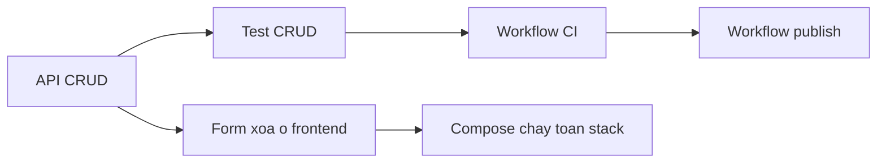

# Đáp án tuần 15 – Capstone: lập kế hoạch và triển khai

::: warning Đáp án đối chiếu: học viên chỉ xem sau khi đã nộp bài tuần này
Mentor dùng để chấm và hướng dẫn. Capstone là bài làm nhóm: mỗi nhóm có repo, ADR, backlog và sơ đồ riêng nên không có đáp án duy nhất. Trang này nêu cách tiếp cận, các mốc kiểm chứng và những chỗ nhóm hay sai; hãy dùng để đối chiếu, không chép.
:::

> **Tóm tắt:** Đáp án buổi 29 (kiến trúc, backlog, ADR) và buổi 30 (CRUD có test, Compose, CI, GHCR) cho Capstone Club Management, kèm lời giải L2, cách chẩn đoán lỗi tích hợp, hiểu lầm hay gặp và đáp án năm câu hỏi kiểm tra.

Lệnh và kết quả mong đợi lấy từ hai bài lab: [buổi 29](../../labs/week-15/session-29.md) và [buổi 30](../../labs/week-15/session-30.md). Bài tập tuần ở [Bài tập tuần 15](../../assignments/weekly/week-15.md). Cách chấm: [Hướng dẫn chấm tuần 15](../grading/week-15.md).

- Nếu kết quả của nhóm khác trang này, đừng sửa kết quả cho giống. Hãy tìm lý do khác nhau, vì đó thường là nội dung đáng ghi vào `report.md`.
- Đoạn mã gợi ý đầy đủ của API (`members-repo.js`, `app.js`, `tests/members.test.js`) nằm ở [Buổi 30 – Mã gợi ý và thử thách](../../labs/week-15/session-30-challenge.md); trang này không chép lại mà chỉ giải thích vì sao nó được viết như vậy.

Mức kiểm chứng: mã API trong lab buổi 30 đã chạy trên Node.js 22 với PostgreSQL 17 (container tạm): 8 test pass và các mã trạng thái 201, 400, 404, 409, 200, 204 đúng như bảng ở mục vai trò A. Phần Kubernetes, GitHub Actions và GHCR dựa trên manifest và workflow của starter-project, nên chạy thử trước khi chấm.

## Buổi 29 – Architecture & Planning

### Đáp án các phần lab

**Chuẩn bị – thư mục và schema.** Dùng `cp -a starter-project/. ~/club-management/` (có dấu chấm cuối) để copy cả file ẩn. Đọc `database/init.sql` để biết bảng `members` có `id`, `name VARCHAR(100)`, `email VARCHAR(150) UNIQUE NOT NULL`, `created_at`. Hệ quả cho validation: tên không rỗng và tối đa 100 ký tự, email hợp lệ, tối đa 150 ký tự, và email trùng sẽ vi phạm ràng buộc UNIQUE.

**Phần 1 – `docs/requirements.md`.** Mỗi dòng phải có cột kiểm chứng đo được. Một bản tham khảo:

| Mã | Requirement | Cách kiểm chứng | Owner |
| --- | --- | --- | --- |
| F1 | Danh sách thành viên có dữ liệu mẫu | `curl -s localhost:3000/api/members` trả mảng JSON có Alice, Bob | A |
| F2 | Xem một thành viên | `curl -i .../api/members/1` trả 200; `.../999` trả 404 với JSON có trường `message` | A |
| F3 | Thêm thành viên | `POST` hợp lệ trả 201; tên rỗng hoặc email sai trả 400; có test tự động | A |
| F4 | Sửa thành viên | `PUT` hợp lệ trả 200; id không có trả 404 | A |
| F5 | Xóa thành viên | `DELETE` trả 204 không có body; lần hai trả 404 | A |
| F6 | Health check | `/health` trả 200; tắt PostgreSQL thì `/ready` trả 503 | C |
| F7 | Giao diện web | Mở cổng 8080, thêm và xóa được thành viên, gọi qua `/api/` | B |
| F8 | Dữ liệu bền vững | `docker compose down` rồi `up`, `GET` lại vẫn có bản ghi đã thêm | C |
| NF1 | Không có secret trong Git | `git ls-files` không có `.env`; `git check-ignore -v .env` có output | C |
| NF2 | CI chặn merge khi đỏ | PR có test đỏ không bấm merge được | D |
| NF3 | Scale 2 lên 3 replicas không lỗi | `kubectl scale`, `kubectl rollout status` thành công, `curl` vẫn 200 | D |

Cách tự kiểm tra: gạch dưới mọi động từ đánh giá ("tốt", "nhanh", "ổn định"). Nếu còn từ nào mà chưa có con số hay mã trạng thái đi kèm thì viết lại.

**Phần 2 – Repo sạch.** Thứ tự đúng là `cp .env.example .env`, `git init -b main`, `git check-ignore -v .env`, rồi mới `git add .`. Kết quả mong đợi của lệnh kiểm tra là `.gitignore:1:.env` ở dòng đầu, vì trong starter-project `.env` là dòng 1 của `.gitignore`. Bằng chứng thứ hai là `git status --short | grep -E "\.env$|node_modules"` không in gì (`.env.example` không khớp mẫu `\.env$`, nên vẫn được commit như mong muốn).

Branch protection: yêu cầu PR, 1 approval, status check. Check `test` chỉ xuất hiện trong danh sách chọn sau khi workflow đã chạy ít nhất một lần, nên ở buổi 29 nhóm thường chưa chọn được; quay lại bật sau buổi 30. Nếu gói tài khoản không cho phép, ghi cam kết vào README và để lịch sử PR làm bằng chứng.

**Phần 3 – Sơ đồ kiến trúc và phân vai.** Sơ đồ chỉ đạt khi mỗi mũi tên trả lời được "dữ liệu gì đi qua". Bảng đối chiếu mẫu để mentor hỏi:

| Mũi tên | Dữ liệu đi qua | Kiểm chứng trong repo |
| --- | --- | --- |
| Browser tới Ingress | HTTP tới host `club.localhost` | `k8s/ingress.yaml`, `host: club.localhost` |
| Nginx tới backend | Request có đường dẫn bắt đầu `/api/` | `frontend/nginx.conf`, `proxy_pass http://backend:3000` |
| Backend tới PostgreSQL | SQL tham số hóa qua cổng 5432 | `k8s/configmap.yaml`: `DB_HOST: postgres`; `compose.yaml`: `DB_HOST: postgres` |
| CI tới GHCR | Image đã build, tag theo SHA | `.github/workflows/publish.yml` |
| PostgreSQL tới PVC | Dữ liệu bảng | `k8s/postgres.yaml`: `postgres-pvc`; `compose.yaml`: volume `postgres-data` |

Một thành phần nhóm tự bổ sung (ví dụ bước quét Trivy) phải đặt đúng chỗ trong luồng: sau khi build image và trước khi push, để image có lỗ hổng nghiêm trọng bị chặn trước khi tới registry.

Vòng review khép kín: A do D duyệt, B do A duyệt, C do B duyệt, D do C duyệt.

**Phần 4 – Backlog.** Tối thiểu 12 Issue, chia theo lát cắt kết quả. Ví dụ danh sách đạt yêu cầu:

| Issue | Size | Milestone | Tiêu chí hoàn thành (rút gọn) |
| --- | --- | --- | --- |
| Tách tầng dữ liệu và thêm `GET /api/members/:id` | M | M2 | 200, 404, 400; có test |
| Thêm `POST /api/members` có validation | M | M2 | 201, 400, 409; có test |
| Thêm `PUT` và `DELETE` | M | M2 | 200, 204, 404; có test |
| Form thêm và xóa trên giao diện | M | M2 | Thêm, xóa được; lỗi hiển thị trên trang |
| Dockerfile backend chạy non-root, có `.dockerignore` | S | M2 | `docker run --rm club-api:1.0.0 id` không phải root |
| Compose có healthcheck và volume | S | M2 | `docker compose ps` thấy `healthy`; dữ liệu còn sau `down` và `up` |
| `.env.example` và README chạy từ đầu | S | M2 | Người mới chạy được theo README |
| Workflow CI ba lớp trên PR | M | M2 | Ba job xanh trên PR |
| Workflow publish lên GHCR | M | M2 | Image tag `sha-` trên Packages |
| Manifest k8s chạy được trên kind | L tách nhỏ | M3 | Pod `Running`, Ingress truy cập được |
| Runbook và troubleshooting log | M | M3 | Đủ 5 mục; ít nhất 3 sự cố |
| Kịch bản demo và video dự phòng | M | M4 | Chạy thử có bấm giờ |

Một Issue size L (như "chạy trên kind") phải tách thành "cluster và Ingress", "Secret và ConfigMap", "manifest backend, frontend" trước khi nhận việc.

**Phần 5 – Ba ADR.** Mỗi ADR phải so sánh ít nhất hai phương án thật. Hướng đáp án cho hai chủ đề ngoài chủ đề tag image:

- Lưu PostgreSQL trên Kubernetes: Deployment kèm PVC, StatefulSet kèm PVC, hoặc cơ sở dữ liệu ngoài cluster. StatefulSet cho Pod tên ổn định (`postgres-0`) và gắn PVC ổn định, phù hợp với một instance có trạng thái; Deployment dễ viết hơn nhưng không đảm bảo danh tính ổn định khi mở rộng. Hệ quả khó hơn: không scale được PostgreSQL chỉ bằng `kubectl scale` và `init.sql` không tự chạy.
- Truy cập từ ngoài cluster: Ingress với `club.localhost`, `kubectl port-forward`, hoặc NodePort. Ingress gần với môi trường thật nhất nhưng cần ingress-nginx và ánh xạ cổng 80 trong `kind-config.yaml`; port-forward dễ nhất nhưng chỉ tạm thời và gắn với một terminal.

### Lời giải L2

**Thử thách 1 – ADR về chiến lược test.** Quyết định hợp lý: mock ở tầng `repo` cho test đơn vị (nhanh, chạy offline, không cần service container trong CI), cộng một smoke test bằng Compose để bắt lỗi SQL thật. Rủi ro của mock: test xanh nhưng SQL sai (ví dụ sai tên cột). Rủi ro của DB thật trong CI: chậm hơn, cần service container và dữ liệu khởi tạo. Phần Hệ quả phải nêu việc ở buổi 30: viết tối thiểu 5 test, thiết kế `createApp(repo)` để truyền được `repo` giả. Điểm mentor để ý: ADR có comment của reviewer và nhóm đã trả lời.

**Thử thách 2 – Đường găng.** Chuỗi dài nhất thường là API, test, CI, publish. Hai cách giảm thời gian chờ có thể chấp nhận: (1) chốt hợp đồng API (đường dẫn, mã trạng thái, tên trường JSON) ngay từ đầu để frontend làm song song với dữ liệu giả; (2) tách Issue CI thành "chạy test" và "build thử image" để người phụ trách CI bắt đầu từ ngày đầu thay vì đợi test xong. Bài đạt khi sơ đồ chỉ ra một điểm nghẽn thật của nhóm, không phải sơ đồ chép lại từ lab. Sơ đồ phụ thuộc mẫu để đối chiếu:



**Thử thách 3 – Kế hoạch rủi ro.** Ví dụ bảng đạt yêu cầu (rút gọn):

| Rủi ro | Tín hiệu cảnh báo | Biện pháp giảm thiểu | Dự phòng | Phụ trách |
| --- | --- | --- | --- | --- |
| Một thành viên vắng một buổi | Thẻ `In progress` đứng im quá 2 ngày | Vòng review chéo, tài liệu đủ để tiếp quản | Người review nhận việc tiếp | Trưởng nhóm |
| Ingress trên kind không chạy | `curl club.localhost` lỗi sau khi Pod đã Ready | Kiểm tra `extraPortMappings` ngay ở M3 | `kubectl port-forward` | D |
| GHCR từ chối push | Job publish đỏ ở bước login hoặc push | Đặt `packages: write` đúng chỗ, dùng `GITHUB_TOKEN` | Build và `kind load` cục bộ | D |
| Cổng 8080 hoặc 3000 bị chiếm | `docker compose up` báo port allocated | `docker ps` trước mỗi lần chạy | Đổi `WEB_PORT` | C |
| Merge muộn làm vỡ stack | CI đỏ sau merge, giao diện trống | PR nhỏ, rebase thường xuyên, smoke test | Revert PR gây lỗi | A |

### Điều tra secret bị commit

Cây điều tra, đi từ ngoài vào trong:

1. `git ls-files | grep -E "(^|/)\.env$"`: có kết quả nghĩa là file đang được theo dõi.
2. `git check-ignore -v .env`: không in gì nghĩa là không có quy tắc chặn nào. Nếu file đã được theo dõi thì `.gitignore` không có tác dụng, nên kết quả này chỉ trả lời "vì sao nó lọt vào".
3. `git log --oneline --all -- .env`: commit nào đã thêm file; đây là phạm vi lịch sử cần xử lý.
4. `git show HEAD:.env` (chỉ làm trên repo thử nghiệm): xác nhận giá trị nào đã lộ.

Nguyên nhân gốc: thiếu quy tắc chặn `.env` và không có bước kiểm tra trước commit. `git add .` chỉ là cái cớ.

Cách sửa, theo thứ tự ưu tiên:

1. Coi mật khẩu đã lộ và đổi ngay ở nơi nó được dùng. Với PostgreSQL trong Compose: biến `POSTGRES_PASSWORD` chỉ có tác dụng khi khởi tạo volume lần đầu, nên đổi `.env` thôi chưa đủ; phải đổi mật khẩu trong database (ví dụ lệnh `ALTER USER`) hoặc tạo lại volume khi đang ở môi trường thử nghiệm.
2. `git rm --cached .env`, thêm `.env` vào `.gitignore`, commit.
3. Chỉ làm sạch lịch sử bằng công cụ chuyên dụng khi mentor hướng dẫn. Xóa file ở commit sau không xóa nó khỏi lịch sử.

Sai lầm hay gặp trong bài nộp: dừng ở bước 2 và coi như xong; hoặc làm sạch lịch sử mà không đổi mật khẩu.

### Hiểu lầm hay gặp ở buổi 29

| Hiểu lầm | Thực tế |
| --- | --- |
| "Thêm `.env` vào `.gitignore` là hết lộ secret" | `.gitignore` không ảnh hưởng file đã được theo dõi, và không xóa lịch sử cũ |
| "Chia việc theo công cụ cho rõ ràng" | Lỗi tích hợp bị dồn về cuối; chia theo lát cắt kết quả để review và demo sớm |
| "ADR là tài liệu thiết kế dài" | Mỗi quyết định một file, tối đa một trang, so sánh lựa chọn thật |
| "Sơ đồ đẹp là đủ" | Sơ đồ phải khớp `compose.yaml` và `k8s/`, mỗi mũi tên có nhãn dữ liệu |
| "Branch protection bật ngay được check `test`" | Check chỉ hiện sau lần chạy đầu của workflow |

## Buổi 30 – Implementation

### Đáp án các phần lab

**Phần 1 – Vai trò A: tách tầng dữ liệu, CRUD và test.** Ba file (`members-repo.js`, `app.js`, `tests/members.test.js`) được thiết kế để khớp với nhau. Những điểm cần hiểu, không chỉ gõ lại:

- `createApp(repo, db)` nhận phụ thuộc qua tham số: production dùng `pgMembersRepo`, test truyền repo giả trong bộ nhớ. Vì vậy `npm test` không cần PostgreSQL.
- `parseId` chỉ chấp nhận số nguyên dương trong giới hạn kiểu `INTEGER`; id như `abc`, `0`, `99999999999` trả 400 thay vì làm PostgreSQL báo lỗi tràn số và rơi thành 500.
- Lỗi PostgreSQL mã `23505` (vi phạm UNIQUE) được middleware lỗi đổi thành 409. Express 5 tự chuyển promise bị reject của handler async vào middleware này.
- Giá trị người dùng luôn đi qua `$1`, `$2`; chỉ danh sách cột là hằng số của lập trình viên mới được nối chuỗi.

Kết quả khi chạy `npm test` trong `backend/`:

```text
# tests 8
# pass 8
# fail 0
```

Tám test gồm bảy test của `members.test.js` cộng `health.test.js` cũ. Chạy với PostgreSQL 17 thật, các lời gọi `curl` cho kết quả sau:

| Lệnh | Mã trạng thái |
| --- | --- |
| `POST` hợp lệ | 201, body có `id` mới |
| `POST` tên rỗng, email sai | 400 |
| `POST` email đã có | 409, `{"message":"Email already exists"}` |
| `GET /api/members/999` | 404 |
| `GET /api/members/abc` | 400 |
| `PUT` hợp lệ | 200 |
| `PUT` email trùng người khác | 409 |
| `PUT` id không có | 404 |
| `DELETE` lần một, lần hai | 204 rồi 404 |
| `POST` JSON sai cú pháp | 400, `Invalid JSON body` |

Khi nộp evidence, chạy `npm test` lúc chưa bật `postgres` và ghi rõ điều đó, vì yêu cầu là test chạy được mà không cần DB.

**Phần 2 – Vai trò B: giao diện.** Các điểm bắt buộc: dùng `textContent` thay vì `innerHTML` (chống XSS khi tên chứa thẻ HTML); hiển thị `body.message` khi API trả lỗi để thấy được 409; thêm `<th></th>` cho cột nút Delete; `DELETE` trả 204 không có body nên hàm `api` phải trả `null` thay vì gọi `res.json()`; mỗi lần sửa HTML phải `docker compose up -d --build` và tải lại bằng Ctrl+F5. Cách thử nhanh XSS: thêm thành viên có tên chứa thẻ `script` hoặc `img` và xác nhận trang hiển thị chuỗi nguyên văn thay vì thực thi.

**Phần 3 – Vai trò C: Compose và dữ liệu bền vững.** Chuỗi lệnh đúng:

```bash
curl -s -X POST http://localhost:3000/api/members \
  -H "Content-Type: application/json" \
  -d '{"name":"Persist Check","email":"persist@example.com"}'
docker compose down
docker compose up -d
until curl -sf http://localhost:3000/ready > /dev/null; do sleep 2; done
curl -s http://localhost:3000/api/members
```

Kết quả: bản ghi còn nguyên. Bước chờ `/ready` là bắt buộc vì sau `up` backend có thể chưa kết nối được PostgreSQL; đọc quá sớm sẽ thấy lỗi và dễ kết luận sai. Quan sát thêm: nếu PostgreSQL bị ngắt kết nối đột ngột trong lúc backend đang chạy, tiến trình Node.js có thể thoát vì connection pool của starter-project chưa xử lý sự kiện `error`. Compose có `restart: unless-stopped` nên container tự dựng lại; đó là lý do vòng `until` hữu ích. Nhóm muốn bền hơn có thể thêm bộ lắng nghe `error` cho pool và ghi vào danh sách cải tiến.

Về `init.sql`: file chỉ chạy khi volume trống. Thêm cột `phone` mà không xóa volume thì API báo `column "phone" does not exist`. Với môi trường local dùng `docker compose down -v` rồi `up`; với dữ liệu cần giữ, chạy `ALTER TABLE` thủ công và về lâu dài dùng migration có version.

**Phần 4 – Vai trò D: CI và publish.**

- `publish.yml` lấy từ giáo trình phải được sửa tiền tố: `context: starter-project/backend` thành `context: backend` và tương tự cho frontend. Sau lệnh `sed`, `grep -n "context:"` phải in đúng hai dòng.
- `ci.yml` có ba job (`test`, `validate-compose`, `build-images`). `DB_PASSWORD: ci-only-password` chỉ là giá trị giả để `docker compose config` không báo thiếu biến; nó không phải secret. `push: false` nghĩa là build để kiểm tra, nên không cần đăng nhập registry.
- `publish.yml` cần `permissions: packages: write` ở cấp job và đăng nhập bằng `GITHUB_TOKEN`. Lý do dùng `GITHUB_TOKEN`: token sinh tự động cho mỗi lần chạy, hết hạn khi job kết thúc và chỉ có quyền đã khai báo, khác với Personal Access Token tồn tại lâu và có thể bị lộ.
- Tag `type=sha` của `docker/metadata-action` cho ra dạng `sha-xxxxxxx`. Đó là thứ phải thấy trên trang Packages.

**Phần 5 – Review chéo, tích hợp và bản clone sạch.** Thứ tự merge: A trước, rồi B, C, D, mỗi người rebase lên `main` mới nhất, vì frontend và test của người khác phụ thuộc vào hình dạng API. Trước khi chạy `docker compose up` trong `~/clean-check`, phải `docker compose down` ở thư mục cũ vì hai stack cùng dùng cổng 3000 và 8080; đây là lỗi cổng bị chiếm hay gặp nhất.

### Lời giải L2

**Thử thách A – Chặn merge khi test đỏ.** Gợi ý của lab (đổi tạm giá trị mong đợi từ 201 sang 200) làm đúng một test đỏ. Bằng chứng cần có: link PR, ảnh hoặc output cho thấy nút merge bị khóa vì check `test` thất bại, rồi commit sửa và check xanh. Điểm cần phân tích: ba check hiện tại bắt lỗi ở bước nào (test thất bại ở job `test`, Dockerfile hỏng ở `build-images`, thiếu biến ở `validate-compose`) và loại lỗi cả ba bỏ sót (SQL sai tên cột vì test dùng repo giả, manifest Kubernetes sai biến môi trường, lỗi chỉ xảy ra khi chạy lâu).

**Thử thách B – Tag truy vết được.** Quy trình: `git tag v1.1.0` rồi `git push origin v1.1.0`; workflow kích hoạt bởi tag sinh cả tag `sha-xxxxxxx` lẫn `v1.1.0` cho cùng một lần build (cùng digest). Chứng minh cùng digest bằng `docker manifest inspect` hoặc `docker pull` rồi so sánh `Digest`. Giải thích vì sao không dùng mỗi `latest`: `latest` di chuyển theo lần push cuối, nên không cho biết image đang chạy tương ứng commit nào và không thể rollback chính xác về một bản cũ. Rollback: đổi `image` trong manifest về tag cũ (ưu tiên tag SHA hoặc semver), `kubectl apply`, `kubectl rollout status`; hoặc `kubectl rollout undo` nếu bản cũ vẫn nằm trong lịch sử rollout. Câu trả lời tốt nối với ADR chiến lược tag của nhóm.

**Thử thách C – Chạy thử trên kind.** Chuỗi lệnh đáp án (thay `club` bằng tên cluster của học viên, xem bằng `kind get clusters`):

```bash
docker build -t club-api:1.1.0 ./backend
kind load docker-image club-api:1.1.0 --name club
kubectl set image deployment/club-api api=club-api:1.1.0 -n club
kubectl rollout status deployment/club-api -n club
kubectl exec -i -n club postgres-0 -- psql -U club -d clubdb < database/init.sql
kubectl port-forward -n club svc/backend 3000:3000
```

Mở terminal khác và chạy `curl -i -X POST http://localhost:3000/api/members ...` như phần demo. Sau khi xong, sửa `image` trong `k8s/backend.yaml` để khớp với những gì đang chạy, tránh lệch giữa manifest và cluster. Cổng 3000 chỉ cần rảnh trong lúc port-forward; nếu bận, đổi cổng bên trái, ví dụ `3100:3000`. Các bẫy thường gặp: tên container trong Deployment là `api` (không phải `club-api`); `kind load docker-image` phải có `--name` nếu cluster không có tên mặc định; `init.sql` không tự chạy trên Kubernetes nên phải nạp bằng `kubectl exec -i ... psql`. Hai khác biệt Compose và Kubernetes nên ghi vào `report.md`: cách khởi tạo database (volume gắn `init.sql` so với nạp thủ công) và cách nạp image (build trong Compose so với `kind load`), mỗi điểm kèm một lệnh hoặc dòng log làm bằng chứng.

### Điều tra đổi tên trường API làm trống giao diện

1. DevTools, tab Network: `/api/members` trả 200 và có dữ liệu. Vậy lỗi không nằm ở mạng, Nginx hay backend sập.
2. So tên trường trong JSON (`full_name`) với tên frontend đọc (`m.name`): lệch nhau, nên cột Name trống.
3. `git log -p -- backend/members-repo.js`: tìm commit đổi truy vấn thành `name AS full_name`.
4. Hỏi: có test nào khẳng định hình dạng JSON không?

Nguyên nhân gốc: hợp đồng API bị đổi mà không thông báo và không có kiểm tra bảo vệ. Sửa: khôi phục câu truy vấn (hoặc cập nhật frontend nếu đổi là chủ ý, trong cùng một PR), build lại backend và frontend.

Phần dễ sai nhất: lab gợi ý thêm assertion về tên trường vào test, nhưng test dùng `repo` giả không đi qua `members-repo.js`, nên đổi alias trong SQL vẫn qua mặt được test. Phòng tránh đầy đủ gồm hai lớp: (1) test handler khẳng định hình dạng JSON; (2) smoke test với PostgreSQL thật sau `docker compose up` (ví dụ `curl` rồi kiểm tra có chuỗi `"name"`). Nhóm chỉ trả lời lớp (1) là hiểu chưa đủ.

### Hiểu lầm hay gặp ở buổi 30

| Hiểu lầm | Thực tế |
| --- | --- |
| "CI xanh nghĩa là hệ thống chạy được" | CI chỉ chạy test với repo giả, validate compose và build image; không kiểm tra SQL thật hay Kubernetes |
| "`docker compose down -v` để dọn cho sạch rồi kiểm tra dữ liệu bền" | `-v` xóa volume; kiểm tra bền phải dùng `down` không có `-v` |
| "Email trùng trả 500 cũng là lỗi" | Đó là lỗi chưa xử lý mã `23505`; hợp đồng đúng là 409 |
| "`DELETE` trả 200 kèm JSON cho tiện" | Hợp đồng của đề bài là 204, không có body |
| "Chỉ đổi tag trong `publish.yml` là xong tag semver" | Cần đẩy tag Git `v*` để workflow chạy theo tag |
| "Workflow đúng vì copy từ giáo trình" | Còn tiền tố `starter-project/` trong `context` là lỗi phổ biến nhất |
| "Test cần PostgreSQL mới đáng tin" | Cần cả hai lớp: test nhanh không cần DB và smoke test với DB thật |

## Bài tập tuần

Gợi ý cách làm cho từng nhiệm vụ của [Bài tập tuần 15](../../assignments/weekly/week-15.md), không thay thế bằng chứng của riêng nhóm.

1. **Requirement và repo sạch.** Dùng bảng requirement ở buổi 29 làm mẫu rồi điền theo hệ thống của nhóm. Bằng chứng gồm ba lệnh: `git check-ignore -v .env` (chạy trước commit đầu), `git ls-files | grep -E "(^|/)\.env$"` (kết quả rỗng; thêm một dòng `echo` giải thích), và `git log --format="%h %an %s"`.
2. **Kiến trúc, phân vai, backlog.** Làm bảng đối chiếu ở Phần 3 buổi 29 với ít nhất ba chi tiết và lệnh `grep` tương ứng, ví dụ `grep -n "proxy_pass" frontend/nginx.conf`, `grep -n "DB_HOST" compose.yaml k8s/configmap.yaml`, `grep -n "networks:" -A2 compose.yaml`. Xuất danh sách Issue bằng `gh issue list --limit 30 --state all`.
3. **Ba ADR.** Bám cấu trúc bốn phần của template. Với mỗi ADR, kiểm tra ba điều: có hai phương án thật, Hệ quả nêu cả điều khó hơn, và PR có comment của reviewer cùng câu trả lời của nhóm.
4. **CRUD, test và stack.** So với kết quả ở mục vai trò A. Với 409: PostgreSQL báo vi phạm ràng buộc UNIQUE bằng mã lỗi `23505` khi `INSERT` hoặc `UPDATE` trùng email; middleware lỗi của `app.js` đổi mã đó thành 409. Với dữ liệu bền vững: nhớ chờ `/ready`.
5. **CI và GHCR.** Evidence tối thiểu: `gh run list --limit 5`, link một run CI xanh trên PR và một run publish thành công trên `main`, và trang Packages có `club-api`, `club-web` với tag `sha-`. Một lỗi tích hợp tốt để viết: sai `context` trong `publish.yml` (còn `starter-project/`) với triệu chứng job publish đỏ ở bước build, bằng chứng là log của bước đó, nguyên nhân gốc là đường dẫn không tồn tại trong repo nhóm, sửa bằng `sed` hoặc sửa tay, phòng tránh bằng cách chạy `grep -n "context:"` sau khi copy workflow.

### Đáp án năm câu hỏi kiểm tra

1. "API chạy tốt" không có cách đo thống nhất, mỗi người hiểu một kiểu. Viết lại: "`DELETE /api/members/999` trả 404; `DELETE /api/members/3` trả 204 không body và `GET /api/members/3` sau đó trả 404".
2. Handler chỉ phụ thuộc vào đối tượng `repo` truyền vào nên test đưa repo giả trong bộ nhớ. Test kiểu này không bắt được lỗi trong câu SQL thật (sai tên cột, sai kiểu), lỗi ràng buộc của DB thật, hay lỗi kết nối.
3. PostgreSQL báo vi phạm UNIQUE bằng mã `23505`. Middleware lỗi cuối `app.js` kiểm tra `err.code === "23505"` và trả 409; nếu thiếu nhánh đó lỗi rơi xuống nhánh mặc định và thành 500.
4. `down` xóa container và network nhưng giữ volume `postgres-data`; `down -v` xóa cả volume nên mất dữ liệu. `init.sql` chỉ được entrypoint của PostgreSQL chạy khi thư mục dữ liệu còn trống, nên DB cũ không nhận cột mới.
5. Ba điều kiểm tra đầu tiên: log của bước thất bại trong run publish; `context` và tên image khớp cấu trúc repo; `permissions: packages: write` và bước đăng nhập. Trigger khác nhau vì CI chạy trên `pull_request` (có thể là code của nhánh) còn publish chạy trên `push` vào `main` hoặc tag (có quyền ghi registry, và dùng code sau merge).
