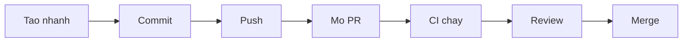
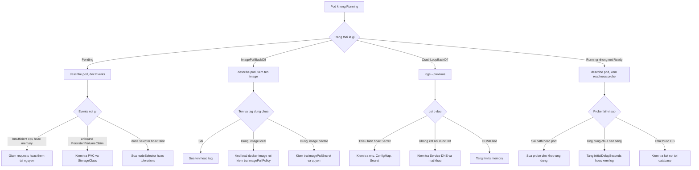

# Cheatsheets

Tờ tóm tắt lệnh dùng xuyên suốt khóa học. Mỗi lệnh có một dòng chú thích, nhóm theo tác vụ. Tất cả lệnh giả định bạn làm việc trong WSL2 Ubuntu, trong filesystem của WSL (ví dụ `~/devops-labs`), không dùng `/mnt/c`.

Khi cần chi tiết hơn, xem [Tài liệu chính thức](documentation.md) và [Thuật ngữ](glossary.md). Cách cài môi trường: [Hướng dẫn cài đặt môi trường](setup-guide.md). Mới làm quen terminal: [Terminal 101](terminal-101.md).

Trong các ví dụ, phần trong dấu `<` `>` như `<pod>` là chỗ bạn thay bằng giá trị thật.

::: tip Mục lục nhảy
1. [Linux CLI và quản trị cơ bản](#linux) (buổi 03 đến 04)
2. [Git và GitHub](#git) (buổi 06)
3. [Networking](#networking) (buổi 05)
4. [Docker CLI](#docker-cli) (buổi 07 đến 08)
5. [Dockerfile](#dockerfile) (buổi 09 đến 10)
6. [Docker Compose](#compose) (buổi 13 đến 14)
7. [GitHub Actions](#actions) (buổi 15 đến 19)
8. [kubectl và YAML mẫu](#kubectl) (buổi 21 đến 28), gồm [kind và context kind-club](#kind-context)
9. [Gỡ lỗi Kubernetes](#debug-k8s) (buổi 28)
10. [YAML tips](#yaml-tips)
:::

::: warning Lệnh có thể làm mất dữ liệu
Các lệnh sau xóa thật, không hoàn tác được. Đọc kỹ trước khi chạy, và thử trên đối tượng thử, không thử trên dữ liệu bạn cần: `docker volume prune`, `docker compose down -v` (mất dữ liệu database), `kubectl delete ...`, `kind delete cluster`. Với lệnh `rm -rf`, `sudo`, `chmod` hãy xem hộp cảnh báo ở [Terminal 101](terminal-101.md).
:::

## 1. Linux CLI và quản trị cơ bản {#linux}

Dùng chính từ buổi 03 và 04 ([buổi 03](../labs/week-02/session-03.md), [buổi 04](../labs/week-02/session-04.md)).

### Điều hướng và xem file

```bash
pwd                      # in thư mục hiện tại
ls -la                   # liệt kê chi tiết, gồm file ẩn
cd ~/devops-labs         # chuyển thư mục
mkdir -p lab-01/notes    # tạo thư mục, tạo luôn thư mục cha nếu thiếu
cat file.txt             # in toàn bộ nội dung file
less file.txt            # xem file dài, thoát bằng q
head -n 20 file.txt      # 20 dòng đầu
tail -n 50 app.log       # 50 dòng cuối
tail -f app.log          # theo dõi log theo thời gian thực, thoát bằng Ctrl+C
```

### Tạo, sao chép, xóa

```bash
touch a.txt              # tạo file rỗng hoặc cập nhật thời gian sửa
cp a.txt b.txt           # sao chép file
cp -r dir1 dir2          # sao chép thư mục
mv a.txt notes/          # di chuyển hoặc đổi tên
rm a.txt                 # xóa file (không có thùng rác)
rm -r dir1               # xóa thư mục và nội dung bên trong, kiểm tra kỹ đường dẫn trước khi chạy
```

### Tìm kiếm và xử lý văn bản

```bash
grep -rn "ERROR" .       # tìm chuỗi trong mọi file, kèm số dòng
grep -i "warn" app.log   # tìm không phân biệt hoa thường
find . -name "*.yaml"    # tìm file theo tên
wc -l app.log            # đếm số dòng
sort file.txt | uniq -c  # đếm số lần xuất hiện của từng dòng
cut -d: -f1 /etc/passwd  # lấy cột đầu tiên, phân tách bằng dấu hai chấm
```

### Pipe và redirect

```bash
cmd > out.txt            # ghi stdout ra file, ghi đè
cmd >> out.txt           # nối thêm vào cuối file
cmd 2> err.txt           # ghi stderr ra file
cmd > all.txt 2>&1       # gộp stderr vào stdout rồi ghi ra file
cmd1 | cmd2              # đưa stdout của cmd1 làm stdin của cmd2
```

### Quyền và người dùng

```bash
ls -l                    # xem quyền: rwx cho user, group, others
chmod 640 secret.env     # user đọc/ghi, group đọc, others không có quyền
chmod +x script.sh       # cấp quyền thực thi
chown user:group file    # đổi chủ sở hữu (thường cần sudo)
whoami                   # tên user hiện tại
id                       # uid, gid và các group của user
sudo apt update          # chạy lệnh với quyền root
```

### Process và tài nguyên

```bash
ps aux                   # liệt kê mọi process
ps aux | grep node       # lọc process theo tên
top                      # theo dõi tài nguyên, thoát bằng q
kill <pid>               # gửi SIGTERM (yêu cầu dừng nhẹ nhàng)
kill -9 <pid>            # gửi SIGKILL (buộc dừng, chỉ dùng khi cần)
df -h                    # dung lượng đĩa
du -sh *                 # dung lượng từng mục trong thư mục hiện tại
free -h                  # RAM và swap
uname -a                 # thông tin kernel
```

### Biến môi trường và shell script

```bash
export APP_ENV=dev       # đặt biến môi trường cho shell hiện tại và process con
echo "$APP_ENV"          # in giá trị biến
env | sort               # liệt kê biến môi trường
which docker             # đường dẫn tới lệnh
```

```bash
#!/usr/bin/env bash
set -euo pipefail        # dừng khi lỗi, khi dùng biến chưa đặt, khi lệnh trong pipe lỗi

echo "Disk usage:"
df -h /
```

## 2. Git và GitHub {#git}

Dùng chính từ buổi 05 và 06 ([buổi 06](../labs/week-03/session-06.md)).

### Thiết lập ban đầu

```bash
git config --global user.name "Ten Cua Ban"        # tên hiển thị trong commit
git config --global user.email "ban@example.com"   # email trong commit
git config --global init.defaultBranch main        # nhánh mặc định khi git init
git init                                           # tạo repo mới
git clone https://github.com/OWNER/REPO.git        # sao chép repo về máy
```

### Làm việc hằng ngày

```bash
git status                       # trạng thái thay đổi
git diff                         # thay đổi chưa stage
git diff --staged                # thay đổi đã stage
git add -p                       # chọn từng đoạn thay đổi để stage
git add .                        # stage mọi thay đổi trong thư mục hiện tại
git commit -m "feat: add health check"   # tạo commit
git log --oneline --graph -n 15  # lịch sử rút gọn dạng đồ thị
```

### Nhánh và đồng bộ

```bash
git switch -c feature/x          # tạo và chuyển sang nhánh mới
git switch main                  # quay về nhánh main
git branch -a                    # liệt kê nhánh local và remote
git push -u origin feature/x     # đẩy nhánh lần đầu và theo dõi remote
git fetch origin                 # tải thay đổi từ remote, chưa gộp
git pull                         # fetch rồi merge vào nhánh hiện tại
git merge main                   # gộp main vào nhánh hiện tại
git rebase main                  # dời commit của nhánh hiện tại lên trên main
```

### Hoàn tác và xử lý conflict

```bash
git restore file.txt             # bỏ thay đổi chưa stage của file
git restore --staged file.txt    # bỏ stage nhưng giữ thay đổi
git revert <commit>              # tạo commit mới đảo ngược một commit (an toàn với nhánh chung)
git stash                        # cất tạm thay đổi đang làm dở
git stash pop                    # lấy lại thay đổi vừa cất
git merge --abort                # hủy merge đang conflict
```

Khi gặp conflict: mở file, tìm các dấu `<<<<<<<`, `=======`, `>>>>>>>`, chọn nội dung đúng, xóa các dấu đó, rồi `git add` và `git commit`.

### Quy trình Pull Request



### Không commit secret

```bash
echo ".env" >> .gitignore        # bỏ qua file chứa secret
git rm --cached .env             # gỡ file đã lỡ commit khỏi index (vẫn còn trong lịch sử)
```

Nếu secret thật đã bị đẩy lên GitHub, hãy coi như đã lộ: thu hồi và tạo secret mới, không chỉ xóa file.

## 3. Networking {#networking}

Dùng chính từ buổi 05 ([buổi 05](../labs/week-03/session-05.md)) và buổi 11.

```bash
ping -c 4 example.com            # kiểm tra kết nối ICMP, gửi 4 gói
curl -I https://example.com      # chỉ lấy HTTP header
curl -s http://localhost:8080/health   # gọi API, im lặng phần tiến trình
curl -sS -o /dev/null -w "%{http_code}\n" http://localhost:8080/   # chỉ in mã HTTP
curl -X POST -H "Content-Type: application/json" -d '{"name":"An"}' http://localhost:3000/api/members   # gọi POST với JSON
dig example.com                  # truy vấn DNS chi tiết (gói dnsutils)
dig +short example.com           # chỉ in địa chỉ
nslookup example.com             # truy vấn DNS đơn giản
ss -tulpn                        # liệt kê cổng đang lắng nghe và process (cần sudo để thấy tên process)
ss -tulpn | grep 8080            # tìm ai đang dùng cổng 8080
ip addr                          # địa chỉ IP của các interface
ip route                         # bảng định tuyến
cat /etc/resolv.conf             # DNS server đang dùng
```

Cổng thường gặp trong khóa học:

| Cổng | Dịch vụ |
| --- | --- |
| 80 | HTTP, Nginx trong container frontend |
| 3000 | Backend Express |
| 5432 | PostgreSQL |
| 8080 | Cổng web trên máy bạn (biến `WEB_PORT`) |

Thứ tự gỡ lỗi mạng: tên có phân giải được không (`dig`), cổng có mở không (`ss`), dịch vụ có trả lời không (`curl`), cuối cùng mới xem firewall.

## 4. Docker CLI {#docker-cli}

Dùng chính từ buổi 07 và 08 ([buổi 07](../labs/week-04/session-07.md), [buổi 08](../labs/week-04/session-08.md)).

### Chạy và quản lý container

```bash
docker run -d --name web -p 8081:80 nginx:1.27-alpine   # chạy nền, map cổng máy:container
docker run --rm -it alpine:3.20 sh   # chạy tương tác, tự xóa khi thoát
docker run -d --name db -e POSTGRES_PASSWORD=change-me postgres:17-alpine   # truyền biến môi trường (dùng giá trị giả, không dùng secret thật)
docker ps                        # container đang chạy
docker ps -a                     # gồm cả container đã dừng
docker stop web                  # dừng container (SIGTERM, rồi SIGKILL sau thời gian chờ)
docker start web                 # chạy lại container đã dừng
docker restart web               # khởi động lại
docker rm web                    # xóa container đã dừng
docker rm -f web                 # buộc dừng và xóa
```

### Quan sát và gỡ lỗi

```bash
docker logs web                  # xem log
docker logs -f --tail 100 web    # theo dõi 100 dòng cuối rồi tiếp tục
docker exec -it web sh           # mở shell trong container đang chạy
docker inspect web               # toàn bộ cấu hình JSON
docker inspect -f '{{.State.ExitCode}}' web   # lấy một trường: mã thoát
docker stats --no-stream         # CPU, RAM theo từng container (một lần)
docker top web                   # process trong container
docker port web                  # cổng đã publish
docker diff web                  # file đã thay đổi so với image
```

### Image

```bash
docker pull nginx:1.27-alpine    # tải image
docker images                    # liệt kê image local
docker build -t club-api:1.0.0 ./backend   # build image từ Dockerfile trong ./backend
docker build -f Dockerfile.dev -t club-api:dev .   # chỉ định Dockerfile khác
docker tag club-api:1.0.0 ghcr.io/OWNER/club-api:1.0.0   # đặt thêm tên cho image
docker push ghcr.io/OWNER/club-api:1.0.0   # đẩy lên registry (cần docker login trước)
docker history club-api:1.0.0    # các layer và kích thước
docker rmi club-api:1.0.0        # xóa image
```

### Network và volume

```bash
docker network ls                # liệt kê network
docker network create club-net   # tạo network bridge do người dùng định nghĩa
docker network inspect club-net  # xem container nào đang gắn vào
docker run -d --name api --network club-net club-api:1.0.0   # gắn container vào network
docker volume ls                 # liệt kê volume
docker volume create pgdata      # tạo volume
docker volume inspect pgdata     # xem vị trí và thông tin volume
docker run -d --name db -v pgdata:/var/lib/postgresql/data -e POSTGRES_PASSWORD=change-me postgres:17-alpine   # gắn named volume
```

### Dọn dẹp

```bash
docker system df                 # dung lượng Docker đang dùng
docker container prune           # xóa mọi container đã dừng (có hỏi xác nhận)
docker image prune               # xóa image dangling
docker volume prune              # xóa volume không container nào dùng (mất dữ liệu, cẩn thận)
```

Registry: đăng nhập GHCR bằng token đặt trong biến môi trường, không gõ token vào lịch sử shell.

```bash
echo "$GHCR_TOKEN" | docker login ghcr.io -u OWNER --password-stdin   # đăng nhập GHCR an toàn hơn
```

## 5. Dockerfile {#dockerfile}

Dùng chính từ buổi 09 và 10 ([buổi 09](../labs/week-05/session-09.md), [buổi 10](../labs/week-05/session-10.md)).

| Chỉ thị | Ý nghĩa |
| --- | --- |
| `FROM` | Image nền, bắt đầu một stage |
| `WORKDIR` | Thư mục làm việc cho các lệnh sau |
| `COPY` | Chép file từ build context vào image |
| `RUN` | Chạy lệnh khi build, tạo ra một layer |
| `ENV` | Đặt biến môi trường mặc định |
| `ARG` | Biến chỉ có khi build |
| `EXPOSE` | Ghi chú cổng ứng dụng lắng nghe (không tự publish) |
| `USER` | Chạy các lệnh sau (và container) bằng user này |
| `HEALTHCHECK` | Lệnh kiểm tra container còn khỏe |
| `ENTRYPOINT` | Lệnh cố định khi chạy container |
| `CMD` | Lệnh mặc định hoặc tham số mặc định, dễ bị ghi đè |

Mẫu multi-stage cho ứng dụng Node.js (minh họa, xem Dockerfile thật trong `starter-project/backend`):

```dockerfile
FROM node:22-alpine AS deps
WORKDIR /app
COPY package*.json ./
RUN npm ci --omit=dev

FROM node:22-alpine
WORKDIR /app
ENV NODE_ENV=production
COPY --from=deps /app/node_modules ./node_modules
COPY . .
USER node
EXPOSE 3000
CMD ["node", "server.js"]
```

Quy tắc tối ưu:

- Chép `package*.json` và cài dependency trước khi chép mã nguồn, để tận dụng cache layer.
- Dùng file `.dockerignore` để loại `node_modules`, `.git`, `.env`.
- Dùng image nền nhỏ và ghim phiên bản (ví dụ `node:22-alpine`), không dùng `latest`.
- Chạy bằng user không phải root.
- Dùng dạng exec cho `CMD` và `ENTRYPOINT`: `CMD ["node", "server.js"]`, để tín hiệu dừng đến đúng process.

## 6. Docker Compose {#compose}

Dùng chính từ buổi 13 và 14 ([buổi 13](../labs/week-07/session-13.md), [buổi 14](../labs/week-07/session-14.md)). Cú pháp là `docker compose` (v2), file `compose.yaml`.

```bash
docker compose config            # in cấu hình đã gộp biến, dùng để kiểm tra lỗi
docker compose config --quiet    # chỉ kiểm tra hợp lệ, không in gì nếu đúng
docker compose up -d             # tạo và chạy các service ở chế độ nền
docker compose up -d --build     # build lại image trước khi chạy
docker compose ps                # trạng thái các service
docker compose logs -f backend   # theo dõi log một service
docker compose exec backend sh   # mở shell trong service đang chạy
docker compose exec postgres psql -U club -d clubdb   # vào psql trong service postgres
docker compose restart backend   # khởi động lại một service
docker compose stop              # dừng, giữ nguyên container
docker compose down              # dừng và xóa container, network; giữ volume
docker compose down -v           # xóa cả volume (mất dữ liệu database)
```

Mẫu rút gọn:

```yaml
services:
  api:
    build: ./backend
    environment:
      DB_HOST: db
      DB_PASSWORD: ${DB_PASSWORD:?Set DB_PASSWORD in .env}   # bắt buộc đặt trong .env
    depends_on:
      db:
        condition: service_healthy
    restart: unless-stopped
  db:
    image: postgres:17-alpine
    environment:
      POSTGRES_PASSWORD: ${DB_PASSWORD:?Set DB_PASSWORD in .env}
    volumes:
      - pgdata:/var/lib/postgresql/data
    healthcheck:
      test: ["CMD-SHELL", "pg_isready -U postgres"]
      interval: 5s
      timeout: 3s
      retries: 5
volumes:
  pgdata:
```

Ghi chú: `.env` đặt cạnh `compose.yaml` và không được commit. Chỉ commit file mẫu như `.env.example` với giá trị giả.

## 7. GitHub Actions {#actions}

Dùng chính từ buổi 15 đến 20 ([buổi 15](../labs/week-08/session-15.md), [buổi 17](../labs/week-09/session-17.md), [buổi 19](../labs/week-10/session-19.md)).

### Cú pháp workflow

```yaml
name: CI                          # tên hiển thị trên tab Actions

on:                               # sự kiện kích hoạt
  push:
    branches: [main]
  pull_request:
  workflow_dispatch:              # cho phép chạy tay

permissions:
  contents: read                  # quyền tối thiểu cho GITHUB_TOKEN

concurrency:
  group: ci-${{ github.ref }}     # chỉ một run mỗi nhánh
  cancel-in-progress: true        # hủy run cũ khi có commit mới

jobs:
  test:
    runs-on: ubuntu-latest
    timeout-minutes: 10
    steps:
      - uses: actions/checkout@v4
      - uses: actions/setup-node@v4
        with:
          node-version: 22
          cache: npm
          cache-dependency-path: starter-project/backend/package-lock.json
      - name: Install
        working-directory: starter-project/backend
        run: npm ci
      - name: Test
        working-directory: starter-project/backend
        run: npm test
```

### Expressions và context

```yaml
env:
  IMAGE: ghcr.io/${{ github.repository_owner }}/club-api   # context github
steps:
  - run: echo "Branch ${{ github.ref_name }}, SHA ${{ github.sha }}"   # thông tin run
  - if: github.event_name == 'push' && github.ref == 'refs/heads/main'  # chạy có điều kiện
    run: echo "Chỉ chạy khi push lên main"
  - if: failure()                                    # chạy khi step trước lỗi
    run: echo "Có bước bị lỗi"
  - run: echo "Token có sẵn"
    env:
      TOKEN: ${{ secrets.MY_SECRET }}                # secret cấu hình trong repo settings
```

### Job phụ thuộc, matrix, artifact

```yaml
jobs:
  build:
    runs-on: ubuntu-latest
    outputs:
      version: ${{ steps.meta.outputs.version }}     # truyền giá trị sang job khác
    steps:
      - id: meta
        run: echo "version=1.0.0" >> "$GITHUB_OUTPUT"
  deploy:
    needs: build                                     # chờ job build xong
    runs-on: ubuntu-latest
    steps:
      - run: echo "Deploy ${{ needs.build.outputs.version }}"
  matrix-test:
    runs-on: ubuntu-latest
    strategy:
      matrix:
        node: [20, 22]                               # chạy song song nhiều phiên bản
    steps:
      - uses: actions/setup-node@v4
        with:
          node-version: ${{ matrix.node }}
```

```yaml
      - uses: actions/upload-artifact@v4
        with:
          name: report
          path: reports/                             # tải file kết quả lên run
```

### Publish image lên GHCR

```yaml
permissions:
  contents: read
  packages: write                 # cần để đẩy image lên GHCR

steps:
  - uses: actions/checkout@v4
  - uses: docker/login-action@v3
    with:
      registry: ghcr.io
      username: ${{ github.actor }}
      password: ${{ secrets.GITHUB_TOKEN }}
  - uses: docker/build-push-action@v6
    with:
      context: starter-project/backend
      push: true
      tags: ghcr.io/${{ github.repository_owner }}/club-api:${{ github.sha }}
```

Lưu ý bảo mật:

- Đặt `permissions` ở mức thấp nhất; chỉ mở `packages: write` ở job cần push.
- Không in secret ra log, không đưa secret vào lệnh `echo`.
- Với workflow từ fork, secret không được truyền vào; đừng thiết kế pipeline phụ thuộc vào điều đó.
- Ghim action bằng phiên bản chính (`@v4`); môi trường yêu cầu chặt hơn thì ghim theo commit SHA.

## 8. kubectl và YAML mẫu {#kubectl}

Dùng chính từ buổi 21 đến 28 ([buổi 21](../labs/week-11/session-21.md), [buổi 23](../labs/week-12/session-23.md), [buổi 25](../labs/week-13/session-25.md)).

### kind và context {#kind-context}

Cluster của khóa tên `club`, nên context phải là `kind-club`. Trước mỗi lệnh `kubectl apply` hoặc `kubectl delete`, kiểm tra đang trỏ đúng cluster:

```bash
kubectl config current-context   # kết quả mong đợi: kind-club
kubectl config use-context kind-club   # nếu đang là cluster khác (ví dụ docker-desktop)
```

Các lệnh dưới đây chạy trong thư mục `~/devops-course` (đường dẫn `starter-project/...` tính từ đó):

```bash
kind create cluster --name club --config starter-project/k8s/kind-config.yaml   # tạo cluster local
kind get clusters                # liệt kê cluster kind
kind load docker-image club-api:1.0.0 --name club   # nạp image local vào node của kind
kind delete cluster --name club  # xóa cluster
kubectl config get-contexts      # liệt kê context
kubectl config current-context   # context đang dùng (kind có tên kind-club)
kubectl config set-context --current --namespace=club   # đặt namespace mặc định
kubectl cluster-info             # kiểm tra API server
```

### Xem tài nguyên

```bash
kubectl get nodes                # các node
kubectl get pods -n club         # Pod trong namespace club
kubectl get pods -n club -o wide # kèm node và IP
kubectl get all -n club          # các tài nguyên chính
kubectl get deploy,svc,ingress -n club   # nhiều loại cùng lúc
kubectl describe pod <pod> -n club       # chi tiết và Events của Pod
kubectl get events -n club --sort-by=.metadata.creationTimestamp   # sự kiện theo thời gian
kubectl get pod <pod> -n club -o yaml    # xem YAML đầy đủ
kubectl explain deployment.spec.strategy # tra cứu field ngay trong terminal
```

### Tạo, sửa, xóa

```bash
kubectl apply -f k8s/            # áp dụng mọi manifest trong thư mục
kubectl apply -f k8s/backend.yaml --dry-run=client   # kiểm tra phía client, chưa gửi thay đổi
kubectl diff -f k8s/backend.yaml # xem khác biệt so với cluster
kubectl delete -f k8s/backend.yaml       # xóa theo file
kubectl delete pod <pod> -n club         # xóa Pod, Deployment sẽ tạo Pod mới
kubectl create secret generic club-secrets -n club --from-literal=db-password='change-me'   # tạo Secret từ giá trị giả
kubectl label pod <pod> tier=backend -n club   # gắn label
```

### Logs, exec, port-forward

```bash
kubectl logs <pod> -n club               # log của Pod
kubectl logs <pod> -n club --previous    # log của lần chạy trước (sau khi crash)
kubectl logs -f deploy/club-api -n club  # theo dõi log Deployment
kubectl exec -it <pod> -n club -- sh     # mở shell trong Pod
kubectl port-forward -n club svc/club-web 8080:80   # mở Service ra localhost:8080
kubectl top pods -n club                 # CPU, RAM (cần metrics-server, kind mặc định không có)
```

### Triển khai và rollout

```bash
kubectl scale deployment club-api --replicas=3 -n club   # đổi số bản sao
kubectl set image deployment/club-api api=club-api:1.0.1 -n club   # cập nhật image (api là tên container, kiểm tra trong manifest)
kubectl rollout status deployment/club-api -n club       # theo dõi tiến trình rollout
kubectl rollout history deployment/club-api -n club      # lịch sử revision
kubectl rollout undo deployment/club-api -n club         # quay về revision trước
kubectl rollout restart deployment/club-api -n club      # khởi động lại các Pod lần lượt
```

### YAML mẫu: Deployment và Service

```yaml
apiVersion: apps/v1
kind: Deployment
metadata:
  name: demo-api
  namespace: club
spec:
  replicas: 2
  selector:
    matchLabels:
      app: demo-api
  template:
    metadata:
      labels:
        app: demo-api
    spec:
      containers:
        - name: api
          image: club-api:1.0.0
          imagePullPolicy: IfNotPresent
          ports:
            - containerPort: 3000
          env:
            - name: DB_PASSWORD
              valueFrom:
                secretKeyRef:
                  name: club-secrets
                  key: db-password
          readinessProbe:
            httpGet:
              path: /ready
              port: 3000
            initialDelaySeconds: 5
            periodSeconds: 5
          livenessProbe:
            httpGet:
              path: /health
              port: 3000
            initialDelaySeconds: 10
            periodSeconds: 10
          resources:
            requests:
              cpu: 100m
              memory: 128Mi
            limits:
              memory: 256Mi
---
apiVersion: v1
kind: Service
metadata:
  name: demo-api
  namespace: club
spec:
  selector:
    app: demo-api            # phải khớp label của Pod
  ports:
    - port: 3000             # cổng của Service
      targetPort: 3000       # cổng container
```

### YAML mẫu: ConfigMap, Ingress, PVC

```yaml
apiVersion: v1
kind: ConfigMap
metadata:
  name: demo-config
  namespace: club
data:
  DB_HOST: postgres
  DB_NAME: clubdb
---
apiVersion: v1
kind: PersistentVolumeClaim
metadata:
  name: demo-data
  namespace: club
spec:
  accessModes: ["ReadWriteOnce"]
  resources:
    requests:
      storage: 1Gi
---
apiVersion: networking.k8s.io/v1
kind: Ingress
metadata:
  name: demo
  namespace: club
spec:
  ingressClassName: nginx
  rules:
    - host: club.localhost
      http:
        paths:
          - path: /
            pathType: Prefix
            backend:
              service:
                name: club-web
                port:
                  number: 80
```

## 9. Gỡ lỗi Kubernetes {#debug-k8s}

Dùng chính từ buổi 27 và 28 ([buổi 27](../labs/week-14/session-27.md), [buổi 28](../labs/week-14/session-28.md)) và 10 tình huống trong `examples/troubleshooting`.

Quy trình chung: nhìn trạng thái (`get`), đọc sự kiện (`describe`), đọc log (`logs`), rồi mới sửa. Mỗi lần chỉ đổi một thứ.



### Bảng tra nhanh

| Triệu chứng | Lệnh đầu tiên | Nguyên nhân thường gặp |
| --- | --- | --- |
| `Pending` | `kubectl describe pod <pod> -n club` | Thiếu tài nguyên, PVC chưa bind, nodeSelector không khớp |
| `ImagePullBackOff` | `kubectl describe pod <pod> -n club` | Sai tên hoặc tag, chưa `kind load`, registry private |
| `CrashLoopBackOff` | `kubectl logs <pod> -n club --previous` | Ứng dụng thoát lỗi, thiếu cấu hình, không nối được DB |
| `Running` nhưng `0/1` Ready | `kubectl describe pod <pod> -n club` | Readiness probe sai path/port hoặc dependency chưa sẵn sàng |
| Service không có endpoint | `kubectl get endpoints <svc> -n club` | Selector của Service không khớp label của Pod |
| `OOMKilled` | `kubectl describe pod <pod> -n club` | Vượt `limits.memory` |

```bash
kubectl get endpoints backend -n club            # Service có trỏ tới Pod nào không
kubectl get pod <pod> -n club -o jsonpath='{.status.containerStatuses[0].lastState}'   # lý do lần chạy trước kết thúc
kubectl run tmp --rm -it --restart=Never --image=busybox:1.36 -n club -- sh   # Pod tạm để thử DNS và kết nối
```

Bên trong Pod tạm: `nslookup backend` kiểm tra DNS, `wget -qO- http://backend:3000/health` kiểm tra API.

Với Docker và Compose, quy trình tương tự: `docker ps -a` (trạng thái, mã thoát), `docker logs` (nguyên nhân), `docker inspect` (cấu hình), rồi sửa một thứ và thử lại.

## 10. YAML tips {#yaml-tips}

- Dùng 2 dấu cách để thụt lề, tuyệt đối không dùng tab.
- Thụt lề quyết định cấu trúc: một lệch dòng là một lỗi khác nghĩa.
- Danh sách dùng dấu gạch đầu dòng: `- item`. Map dùng `key: value` (sau dấu hai chấm phải có dấu cách).
- Chuỗi có ký tự đặc biệt (`:`, `#`, bắt đầu bằng `*` hoặc `&`) nên đặt trong dấu nháy.
- Cẩn thận với giá trị bị hiểu thành kiểu khác: `"8080"` là chuỗi, `8080` là số; `yes`, `no`, `on`, `off` có thể bị hiểu là boolean trong YAML 1.1, hãy đặt trong nháy khi muốn là chuỗi.
- Nhiều tài liệu trong một file ngăn cách bằng dòng `---`.
- Chuỗi nhiều dòng: `|` giữ nguyên xuống dòng, `>` gộp các dòng thành một.
- Chú thích bắt đầu bằng `#`.
- Kiểm tra trước khi áp dụng: `docker compose config --quiet` cho Compose, `kubectl apply --dry-run=client -f file.yaml` cho Kubernetes, và `kubectl explain` để tra field.

```yaml
# Ví dụ thể hiện các kiểu giá trị
name: club-api            # chuỗi
replicas: 2               # số
enabled: true             # boolean
port: "3000"              # chuỗi, cố ý đặt trong nháy
tags:                     # danh sách
  - web
  - api
script: |                 # chuỗi nhiều dòng, giữ xuống dòng
  echo one
  echo two
```
