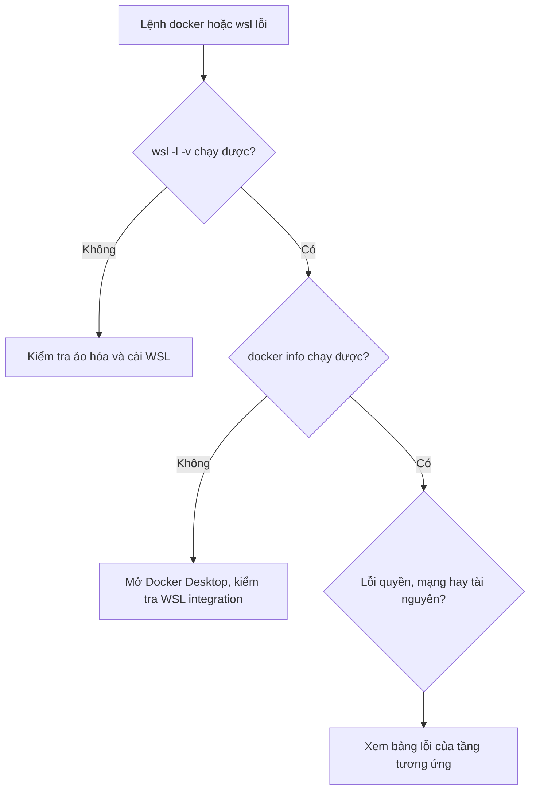

# Xử lý sự cố cài đặt môi trường

Trang này gom các lỗi thường gặp khi dựng môi trường theo [Hướng dẫn cài đặt môi trường](setup-guide.md), nhóm theo tầng: WSL, Git, Docker, Kubernetes. Không nên chỉ chép lệnh sửa lỗi: cần đọc kỹ thông báo lỗi, xác định lỗi thuộc tầng nào rồi mới sửa.

> **Tóm tắt:** Tuần 1 chỉ cần xem 3 mục: ảo hóa, WSL, SSH. Sau đó chẩn đoán theo tầng từ dưới lên: WSL, Git, Docker, Kubernetes. Cần chạy check-env trước và đính kèm kết quả khi hỏi mentor.

::: tip Tuần 1 chỉ cần xem 3 mục
Người mới bắt đầu có thể bỏ qua phần còn lại của trang này. Chỉ có 3 mục liên quan đến tuần 1 và 2:

1. [Ảo hóa bị tắt](#ao-hoa)
2. [WSL không cài được hoặc chạy sai](#wsl-loi)
3. [SSH tới GitHub báo lỗi](#ssh-github)

Các tầng Docker và Kubernetes chỉ cần khi đến buổi 07 và buổi 21.
:::

## Quy trình chẩn đoán nhanh



Cần thu thập thông tin trước khi sửa. Trong Ubuntu (thêm số buổi đang học, ví dụ `2`, `7` hoặc `21`):

```bash
bash resources/check-env.sh 2
```

Trong PowerShell:

```powershell
wsl --status
wsl -l -v
```

## Tầng WSL và Windows {#wsl}

| Triệu chứng | Nguyên nhân thường gặp | Cách xử lý |
| --- | --- | --- |
| `WslRegisterDistribution failed with error: 0x80370102` hoặc "Please enable the Virtual Machine Platform Windows feature and ensure virtualization is enabled in the BIOS" | Ảo hóa tắt trong BIOS, hoặc chưa bật Virtual Machine Platform | Bật VT-x/SVM trong BIOS (xem [Ảo hóa bị tắt](#ao-hoa)), sau đó bật tính năng bằng `wsl --install --no-distribution` và khởi động lại máy |
| `wsl --install` không nhận lệnh hoặc chỉ in trợ giúp | Windows quá cũ | Cập nhật Windows lên bản mới (Windows 11 hoặc Windows 10 bản gần đây), sau đó chạy lại trong PowerShell Admin |
| WSL báo cần cập nhật kernel hoặc lỗi kernel cũ | Gói WSL cũ | `wsl --update`, sau đó tắt và mở lại WSL (xem [Dùng wsl --shutdown đúng cách](#wsl-shutdown)) |
| Distro hiện `VERSION 1` | Cài hoặc import ở chế độ WSL1 | `wsl --set-version Ubuntu-24.04 2` (dùng đúng tên trong `wsl -l -v`) |
| Máy chậm, `Vmmem` hoặc `VmmemWSL` chiếm nhiều RAM | WSL2 giữ RAM đã cấp | Đặt giới hạn trong `.wslconfig` (xem [Máy 8 GB và giới hạn RAM](setup-guide.md#may-8-gb-va-gioi-han-ram)), sau đó tắt WSL |
| Ổ C: đầy, file `ext4.vhdx` rất lớn | Image, container, volume Docker và cache tích tụ; VHDX không tự co lại | Xem [Thu nhỏ đĩa ảo VHDX](#vhdx) |
| `npm install` hoặc `docker build` rất chậm | Mã nguồn đặt trong `/mnt/c/...` | Chuyển dự án vào `~/` của WSL (`cp -r` hoặc `git clone` lại trong WSL) |
| Script `.sh` báo `$'\r': command not found` | File có kết thúc dòng CRLF của Windows | `sed -i 's/\r$//' ten-file.sh`. Đặt `git config --global core.autocrlf input` rồi clone lại |
| Đồng hồ trong WSL lệch giờ, `apt update` báo lỗi chứng chỉ hoặc chữ ký | Đồng hồ WSL lệch sau khi máy ngủ | `sudo hwclock -s`, hoặc tắt và mở lại WSL |
| Nhập mật khẩu `sudo` nhưng không thấy ký tự nào | Không phải lỗi: Linux không hiển thị ký tự khi nhập mật khẩu | Nhập đủ mật khẩu rồi nhấn Enter |

### Ảo hóa bị tắt {#ao-hoa}

Triệu chứng: Task Manager (tab Hiệu suất, mục CPU) hiển thị Ảo hóa là Disabled, hoặc `wsl --install` và Docker Desktop báo lỗi ảo hóa.

1. Khởi động lại, vào BIOS/UEFI (phím tùy hãng: `F2`, `F10`, `Del`, `Esc`).
2. Tìm mục Intel Virtualization Technology (VT-x) hoặc SVM Mode (AMD) và chuyển sang Enabled. Ở một số máy, mục này nằm ở Advanced > CPU Configuration.
3. Lưu, khởi động lại, kiểm tra lại Task Manager.

Nếu máy do công ty hoặc trường quản lý và BIOS bị khóa, cần liên hệ quản trị viên. Nếu đã bật mà vẫn lỗi, kiểm tra các tính năng Windows: Start > "Turn Windows features on or off", bật **Virtual Machine Platform** và **Windows Subsystem for Linux** (hoặc dùng `wsl --install --no-distribution` trong PowerShell Admin), rồi khởi động lại.

### WSL không cài được hoặc chạy sai {#wsl-loi}

Chạy trong PowerShell để xem trạng thái:

```powershell
wsl --status
wsl -l -v
```

- Nếu không có distro nào trong danh sách: chạy lại `wsl --install -d Ubuntu-24.04` trong PowerShell Admin.
- Nếu cột `VERSION` là `1`: xem bảng trên và dùng `wsl --set-version`.
- Nếu cửa sổ Ubuntu đóng ngay khi mở: chạy `wsl --update` rồi thử lại. Nếu vẫn lỗi, ghi lại thông báo lỗi và hỏi mentor.

### Dùng wsl --shutdown đúng cách {#wsl-shutdown}

`wsl --shutdown` tắt toàn bộ máy ảo WSL2 (kể cả distro nội bộ của Docker Desktop). Lệnh này được dùng khi sửa `.wslconfig`, khi WSL bị treo, khi Docker không kết nối được hoặc khi cần giải phóng RAM.

::: danger Lệnh này tắt mọi thứ đang chạy trong WSL
Trước khi chạy, cần lưu công việc và dừng các thao tác đang ghi dữ liệu (build, copy, `apt`). Mọi cửa sổ Ubuntu sẽ đóng và mọi container sẽ dừng. Volume vẫn còn, nhưng cluster kind cần Docker chạy lại.

```powershell
wsl --shutdown
wsl -l -v
```
:::

Kết quả mong đợi: các distro ở trạng thái `Stopped`. Mở lại Ubuntu để khởi động lại WSL.

### Thu nhỏ đĩa ảo VHDX {#vhdx}

Trước hết dọn dẹp trong Docker (chỉ khi chắc chắn không cần dữ liệu đó; xem trước bằng `docker system df`):

```bash
docker system df
docker container prune
docker image prune
docker builder prune
```

::: danger Lệnh xóa mạnh: chỉ chạy khi hiểu rõ
`docker system prune -a --volumes` xóa mọi image không dùng và cả volume không dùng, do đó có thể làm mất dữ liệu cơ sở dữ liệu. Chỉ chạy khi chắc chắn không còn dữ liệu quan trọng, và xem trước bằng `docker system df` và `docker volume ls`.
:::

Sau khi dọn dẹp, VHDX vẫn không tự nhỏ lại. Thu nhỏ thủ công bằng `diskpart` là thao tác ở mức đĩa:

::: danger diskpart thao tác trực tiếp trên đĩa
Nhập sai đường dẫn hoặc sai lệnh trong `diskpart` có thể làm hỏng đĩa ảo hoặc đĩa thật. Chỉ thực hiện khi thật sự cần, sao lưu dữ liệu quan trọng trước, đọc kỹ từng dòng và hỏi mentor nếu không chắc chắn. Chỉ dùng đúng các lệnh `select vdisk`, `attach vdisk readonly`, `compact vdisk`, `detach vdisk` bên dưới; không dùng `clean`, `format`, `delete`.

Mở PowerShell Admin (tên và đường dẫn tùy máy, kiểm tra tài liệu WSL nếu khác):

```powershell
wsl --shutdown
diskpart
```

Trong cửa sổ `diskpart`:

```text
select vdisk file="C:\Users\TEN-BAN\AppData\Local\Packages\<thư mục distro>\LocalState\ext4.vhdx"
attach vdisk readonly
compact vdisk
detach vdisk
exit
```
:::

Thay `TEN-BAN` và thư mục distro theo máy đang dùng. Với Ubuntu cài từ Microsoft Store, thư mục thường có dạng `CanonicalGroupLimited.Ubuntu24.04LTS_...`. Đĩa của Docker Desktop (distro `docker-desktop`) thường nằm trong `%LOCALAPPDATA%\Docker\wsl\disk\docker_data.vhdx`. Một số bản WSL mới hỗ trợ đĩa sparse (`wsl --manage <distro> --set-sparse true`); cần kiểm tra tài liệu chính thức https://learn.microsoft.com/en-us/windows/wsl/disk-space trước khi dùng.

## Tầng Git và SSH {#git}

| Triệu chứng | Nguyên nhân thường gặp | Cách xử lý |
| --- | --- | --- |
| `ssh -T git@github.com` báo `Permission denied (publickey)` | Chưa thêm khóa công khai vào GitHub, hoặc dùng sai khóa | Làm lại theo [Tài khoản GitHub và repo devops-labs](setup-github.md#dang-nhap), mục SSH key. Chẩn đoán bằng `ssh -vT git@github.com` |
| `git commit` báo `Please tell me who you are` | Chưa đặt `user.name` và `user.email` | `git config --global user.name "Họ Tên"` và `git config --global user.email "email"` |
| `git clone` báo `Repository not found` | Sai tên, hoặc repo Private và chưa đăng nhập | Kiểm tra chính tả; đặt repo `devops-labs` thành Public; đăng nhập bằng `gh auth login` |
| `Host key verification failed` | Fingerprint GitHub đã lưu bị lệch, hoặc đã nhập `no` khi được hỏi xác nhận | Chạy lại `ssh -T git@github.com` và nhập `yes` khi được hỏi |
| Script `.sh` vừa clone chạy báo `$'\r'` | Kết thúc dòng CRLF | Xem bảng tầng WSL ở trên |

### SSH tới GitHub báo lỗi {#ssh-github}

```bash
ls -l ~/.ssh
ssh -vT git@github.com
```

- Nếu không thấy file `id_ed25519.pub`: khóa chưa được tạo. Thực hiện bước "Cách A: SSH key" ở [Tài khoản GitHub và repo devops-labs](setup-github.md#dang-nhap).
- Nếu có file nhưng vẫn báo `Permission denied (publickey)`: nội dung của `cat ~/.ssh/id_ed25519.pub` chưa được thêm vào GitHub (**Settings > SSH and GPG keys**), hoặc đã dán nhầm khóa riêng. Chỉ dán nội dung file `.pub`.
- Việc bị hỏi passphrase ở mỗi lần dùng là bình thường. Để chỉ nhập một lần mỗi phiên, dùng `ssh-agent` (xem hướng dẫn của GitHub: "Generating a new SSH key and adding it to the ssh-agent").
- Không gửi file `id_ed25519` (khóa riêng) cho bất kỳ ai, kể cả mentor.

## Tầng Docker {#docker}

Chỉ cần từ buổi 07.

| Triệu chứng | Nguyên nhân thường gặp | Cách xử lý |
| --- | --- | --- |
| Docker Desktop báo "Docker Desktop is starting..." mãi hoặc "docker daemon is not running" | Docker Desktop chưa khởi động xong, WSL treo | Chờ 1 đến 2 phút. Nếu không được: thoát Docker Desktop, tắt WSL (xem [Dùng wsl --shutdown đúng cách](#wsl-shutdown)), mở lại Docker Desktop |
| Trong Ubuntu: `Cannot connect to the Docker daemon at unix:///var/run/docker.sock` | Docker Desktop không chạy, hoặc chưa bật WSL integration | Mở Docker Desktop, vào Settings > Resources > WSL integration, bật cho distro, chọn Apply & restart, rồi mở terminal Ubuntu mới |
| `permission denied while trying to connect to the Docker daemon socket` | User chưa có quyền với socket (thường khi đã cài Docker Engine riêng trong distro) | Kiểm tra `ls -l /var/run/docker.sock`. Nếu dùng Docker Desktop, bật lại WSL integration. Nếu dùng engine riêng, xem [Permission denied với docker.sock](#docker-sock) |
| `docker: command not found` trong Ubuntu | Integration chưa bật hoặc terminal mở trước khi bật | Bật WSL integration, mở terminal mới. Kiểm tra `which docker` |
| `docker compose` không nhận (`'compose' is not a docker command`) | Dùng nhầm lệnh `docker-compose` kiểu cũ, hoặc Docker quá cũ | Dùng `docker compose` (có dấu cách) và cập nhật Docker Desktop |
| `Bind for 0.0.0.0:8080 failed: port is already allocated` | Cổng đã có container hoặc tiến trình khác dùng | Xem [Cổng bị chiếm](#cong-bi-chiem). Hoặc đổi `WEB_PORT` trong `.env` |
| `docker pull` timeout, `x509: certificate signed by unknown authority`, `proxyconnect` | Mạng trường/công ty có proxy hoặc chặn TLS | Xem [Proxy và mạng](#proxy) |

### Docker daemon not running {#docker-daemon}

```bash
docker info
```

- Nếu lệnh in `Cannot connect to the Docker daemon`: Docker Desktop chưa chạy. Mở Docker Desktop và chờ biểu tượng cá voi ổn định.
- Nếu Docker Desktop mở nhưng bị kẹt: thoát hẳn (nhấp chuột phải biểu tượng khay hệ thống, chọn Quit), tắt WSL (xem [Dùng wsl --shutdown đúng cách](#wsl-shutdown)), mở lại Docker Desktop.
- Nếu vẫn lỗi: Docker Desktop > Troubleshoot > Restart. **Reset to factory defaults** chỉ là phương án cuối cùng vì sẽ xóa image và container hiện có.

### Permission denied với docker.sock {#docker-sock}

```bash
ls -l /var/run/docker.sock
id
```

Với Docker Desktop, socket được tạo khi bật WSL integration; thường không cần thêm user vào nhóm `docker`. Cần bật lại integration cho distro và mở terminal mới. Chỉ khi Docker Engine được cài riêng trong distro mới cần chạy:

```bash
sudo usermod -aG docker $USER
```

Sau đó đóng hẳn terminal, tắt WSL ([cách tắt](#wsl-shutdown)) và mở lại Ubuntu. Không dùng `sudo docker ...` làm giải pháp thường xuyên, vì lệnh này che lỗi cấu hình và tạo file thuộc root trong thư mục dự án.

### Cổng bị chiếm {#cong-bi-chiem}

Trong WSL:

```bash
ss -ltnp | grep ':8080'
docker ps --format 'table {{.Names}}\t{{.Ports}}'
```

Trong PowerShell (tìm tiến trình Windows giữ cổng):

```powershell
netstat -ano | findstr :8080
Get-Process -Id <PID>
```

Thay `<PID>` bằng số ở cột cuối của `netstat`. Cách xử lý: dừng container cũ (`docker compose down` trong dự án đã tạo container đó), hoặc đổi cổng publish (biến `WEB_PORT` trong `.env`). Không tắt tiến trình hệ thống khi chưa hiểu rõ chức năng của tiến trình.

### Docker Desktop dùng nhiều RAM {#docker-ram}

1. Đặt `memory` trong `.wslconfig` (xem [Máy 8 GB và giới hạn RAM](setup-guide.md#may-8-gb-va-gioi-han-ram)), sau đó tắt WSL.
2. Dừng container không dùng: `docker ps`, `docker compose down`.
3. Không chạy đồng thời Compose và kind trên máy 8 GB.
4. Tắt "Start Docker Desktop when you sign in" khi không cần.
5. Khi không học, thoát hẳn Docker Desktop và tắt WSL.

## Tầng Kubernetes {#kubernetes}

Chỉ cần từ buổi 21. Cluster của khóa học có tên `club` và context là `kind-club`.

| Triệu chứng | Nguyên nhân thường gặp | Cách xử lý |
| --- | --- | --- |
| `kind create cluster` treo hoặc báo `failed to create cluster` | Thiếu RAM, Docker chưa chạy, hoặc cluster cũ trùng tên | Kiểm tra `docker info` và `free -m`. Xóa cluster cũ bằng `kind delete cluster --name club`. Dừng Compose trước (máy 8 GB) |
| `kubectl` báo `The connection to the server localhost:8080 was refused` | Chưa có kubeconfig hoặc chưa tạo cluster | Chạy `kind get clusters`, rồi `kubectl config current-context`. Tạo cluster nếu chưa có |
| `Unable to connect to the server: dial tcp 127.0.0.1:xxxxx: connect: connection refused` | Cluster kind đã dừng (restart máy, Docker dừng) | Khởi động lại Docker Desktop và kiểm tra `docker ps` còn container `club-control-plane` hay không. Nếu không còn, tạo lại cluster |
| `kubectl` chạy nhưng thấy tài nguyên lạ hoặc không thấy namespace `club` | Context đang là cluster khác (ví dụ `docker-desktop`) | Kiểm tra bằng `kubectl config current-context`; đổi bằng `kubectl config use-context kind-club` |

## Mạng và proxy (mọi tầng) {#proxy}

Triệu chứng: `docker pull`, `apt update`, `npm install` timeout hoặc lỗi chứng chỉ khi dùng mạng trường/công ty.

- Thử đổi mạng (hotspot điện thoại) để xác định nguyên nhân có phải do mạng hay không.
- Docker Desktop: nhập proxy tại Settings > Resources > Proxies (nếu mạng yêu cầu). Địa chỉ chính xác do quản trị mạng cung cấp.
- Trong WSL, đặt biến cho phiên hiện tại (thay bằng địa chỉ proxy thật, không commit vào repository):

```bash
export HTTP_PROXY="http://proxy.example.local:3128"
export HTTPS_PROXY="http://proxy.example.local:3128"
export NO_PROXY="localhost,127.0.0.1"
```

- Lỗi DNS trong WSL: `cat /etc/resolv.conf`, thử `ping -c 2 1.1.1.1` (kiểm tra mạng) và `ping -c 2 github.com` (kiểm tra DNS). Nếu ping được địa chỉ IP nhưng không ping được tên miền, nguyên nhân nằm ở DNS.
- VPN cũng có thể làm hỏng mạng của WSL2: thử tắt VPN, tắt WSL ([cách tắt](#wsl-shutdown)) rồi mở lại.

## Khi vẫn chưa giải quyết được

Đặt câu hỏi trên kênh của lớp theo mẫu ở mục [Cách xin giúp đỡ](../curriculum/how-to-learn.md#cach-xin-giup), gồm triệu chứng, lệnh đã chạy, log đầy đủ và các cách đã thử. Đính kèm kết quả của `check-env.sh` và `check-env.ps1`.
