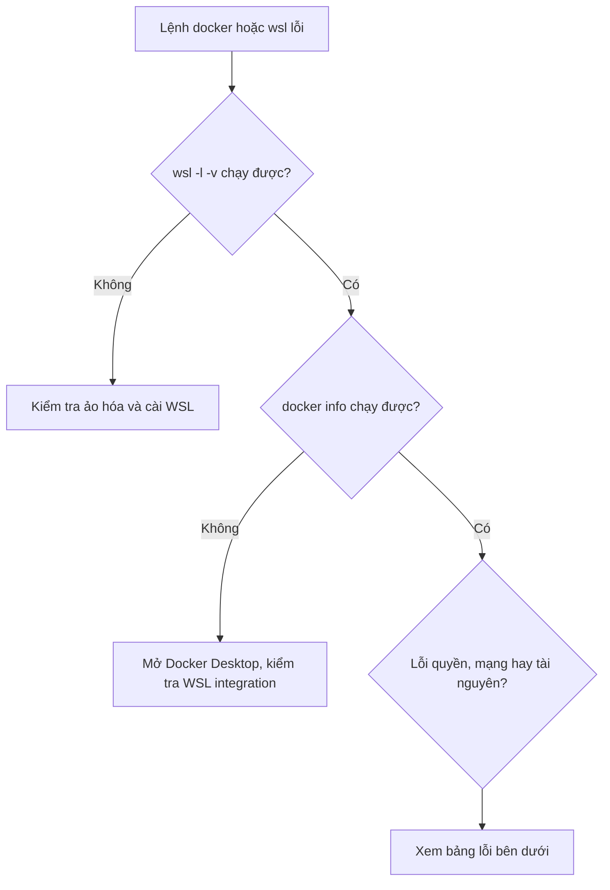

# Xử lý sự cố cài đặt môi trường

Trang này gom các lỗi thường gặp khi dựng môi trường theo [Setup Guide](setup-guide.md). Đừng chỉ chép lệnh: đọc kỹ thông báo lỗi, xác định nó thuộc tầng nào (BIOS, Windows, WSL, Docker, mạng) rồi mới sửa.

> **Tóm tắt:** Chẩn đoán theo tầng từ dưới lên: ảo hóa, WSL, Docker daemon, quyền, mạng, tài nguyên. Chạy `check-env.ps1` và `check-env.sh` trước, đính kèm kết quả khi hỏi mentor.

## Quy trình chẩn đoán nhanh



Thu thập thông tin trước khi sửa:

```bash
bash resources/check-env.sh
```

```powershell
wsl --status
wsl -l -v
```

## Bảng lỗi thường gặp

| Triệu chứng | Nguyên nhân thường gặp | Cách xử lý |
| --- | --- | --- |
| `WslRegisterDistribution failed with error: 0x80370102` hoặc "Please enable the Virtual Machine Platform Windows feature and ensure virtualization is enabled in the BIOS" | Ảo hóa tắt trong BIOS, hoặc chưa bật Virtual Machine Platform | Bật VT-x/SVM trong BIOS (xem [mục 2 của setup guide](setup-guide.md)). Rồi bật tính năng: `wsl --install --no-distribution`, khởi động lại máy |
| `wsl --install` không nhận lệnh hoặc chỉ in trợ giúp | Windows quá cũ | Cập nhật Windows lên bản mới (Windows 11 hoặc Windows 10 bản gần đây), rồi chạy lại trong PowerShell Admin |
| WSL báo cần cập nhật kernel hoặc lỗi kernel cũ | Gói WSL cũ | `wsl --update`, sau đó `wsl --shutdown` và mở lại |
| Distro hiện `VERSION 1` | Cài hoặc import ở chế độ WSL1 | `wsl --set-version Ubuntu-24.04 2` (dùng đúng tên trong `wsl -l -v`) |
| Docker Desktop báo "Docker Desktop is starting..." mãi hoặc "docker daemon is not running" | Docker Desktop chưa khởi động xong, WSL treo | Đợi 1 đến 2 phút. Nếu không được: thoát Docker Desktop, `wsl --shutdown`, mở lại Docker Desktop |
| Trong Ubuntu: `Cannot connect to the Docker daemon at unix:///var/run/docker.sock` | Docker Desktop không chạy, hoặc chưa bật WSL integration | Mở Docker Desktop, vào Settings > Resources > WSL integration, bật cho distro, Apply & restart. Mở terminal Ubuntu mới |
| `permission denied while trying to connect to the Docker daemon socket` | User chưa có quyền với socket (thường khi đã cài Docker Engine riêng trong distro) | Kiểm tra `ls -l /var/run/docker.sock`. Nếu dùng Docker Desktop, bật lại WSL integration. Nếu dùng engine riêng: `sudo usermod -aG docker $USER`, rồi đóng và mở lại terminal (hoặc `newgrp docker`) |
| `docker: command not found` trong Ubuntu | Integration chưa bật hoặc terminal mở trước khi bật | Bật WSL integration, mở terminal mới. Kiểm tra `which docker` |
| `docker compose` không nhận (`'compose' is not a docker command`) | Gõ nhầm `docker-compose` kiểu cũ, hoặc Docker quá cũ | Dùng `docker compose` (có dấu cách). Cập nhật Docker Desktop |
| `Bind for 0.0.0.0:8080 failed: port is already allocated` | Cổng đã có container hoặc tiến trình khác dùng | Xem mục "Cổng bị chiếm" bên dưới. Hoặc đổi `WEB_PORT` trong `.env` |
| Máy chậm, `Vmmem` hoặc `VmmemWSL` chiếm nhiều RAM | WSL2 giữ RAM đã cấp | Đặt giới hạn trong `.wslconfig` (xem setup guide), rồi `wsl --shutdown`. Xem thêm mục "Docker Desktop dùng nhiều RAM" |
| Ổ C: đầy, file `ext4.vhdx` rất lớn | Image, container, volume Docker và cache tích tụ; VHDX không tự co lại | Xem mục "Thu nhỏ đĩa ảo VHDX" bên dưới |
| `docker pull` timeout, `x509: certificate signed by unknown authority`, `proxyconnect` | Mạng trường/công ty có proxy hoặc chặn TLS | Xem mục "Proxy và mạng" bên dưới |
| `npm install` hoặc `docker build` rất chậm | Mã nguồn đặt trong `/mnt/c/...` | Chuyển dự án vào `~/` của WSL (`cp -r` hoặc `git clone` lại trong WSL) |
| Script `.sh` báo `$'\r': command not found` | File có kết thúc dòng CRLF của Windows | `sed -i 's/\r$//' ten-file.sh`. Đặt `git config --global core.autocrlf input` rồi clone lại |
| `kind create cluster` treo hoặc báo `failed to create cluster` | Thiếu RAM, Docker chưa chạy, hoặc cluster cũ trùng tên | Kiểm tra `docker info`, `free -m`. Xóa cluster cũ: `kind delete cluster --name club`. Dừng Compose trước (máy 8 GB) |
| `kubectl` báo `The connection to the server localhost:8080 was refused` | Chưa có kubeconfig hoặc chưa tạo cluster | Chạy `kind get clusters`, rồi `kubectl config current-context`. Tạo cluster nếu chưa có |
| `Unable to connect to the server: dial tcp 127.0.0.1:xxxxx: connect: connection refused` | Cluster kind đã dừng (restart máy, Docker dừng) | Khởi động lại Docker Desktop, kiểm tra `docker ps` còn container `club-control-plane` không. Nếu mất, tạo lại cluster |
| Đồng hồ trong WSL lệch giờ, `apt update` báo lỗi chứng chỉ hoặc chữ ký | Đồng hồ WSL lệch sau khi máy ngủ | `sudo hwclock -s` hoặc `wsl --shutdown` rồi mở lại |
| `ssh -T git@github.com` báo `Permission denied (publickey)` | Chưa thêm khóa công khai vào GitHub, hoặc dùng sai khóa | `cat ~/.ssh/id_ed25519.pub` và thêm vào GitHub. Debug: `ssh -vT git@github.com` |

## Chi tiết các lỗi hay gặp

### Virtualization disabled

Triệu chứng: Task Manager hiện Virtualization là Disabled, `wsl --install` hoặc Docker Desktop báo lỗi ảo hóa.

1. Khởi động lại, vào BIOS/UEFI (phím tùy hãng: `F2`, `F10`, `Del`, `Esc`).
2. Tìm mục Intel Virtualization Technology (VT-x) hoặc SVM Mode (AMD), chuyển sang Enabled. Với một số máy nó nằm ở Advanced > CPU Configuration.
3. Lưu, khởi động lại, kiểm tra lại Task Manager.

Nếu máy do công ty/trường quản lý và BIOS bị khóa, hỏi quản trị viên. Nếu đã bật mà vẫn lỗi, kiểm tra các tính năng Windows: Start > "Turn Windows features on or off", bật **Virtual Machine Platform** và **Windows Subsystem for Linux** (hoặc dùng `wsl --install --no-distribution` trong PowerShell Admin), khởi động lại.

### Docker daemon not running

```bash
docker info
```

- Nếu in `Cannot connect to the Docker daemon`: Docker Desktop chưa chạy. Mở Docker Desktop, chờ biểu tượng cá voi ổn định.
- Nếu Docker Desktop mở nhưng kẹt: thoát hẳn (chuột phải biểu tượng khay hệ thống, Quit), chạy `wsl --shutdown` trong PowerShell, mở lại Docker Desktop.
- Nếu vẫn lỗi: Docker Desktop > Troubleshoot > Restart. Chọn **Reset to factory defaults** chỉ là phương án cuối vì sẽ xóa image và container hiện có.

### Permission denied với docker.sock

```bash
ls -l /var/run/docker.sock
id
```

Với Docker Desktop, socket được tạo khi bật WSL integration; thường không cần thêm user vào nhóm `docker`. Hãy bật lại integration cho distro và mở terminal mới. Chỉ khi bạn tự cài Docker Engine trong distro mới cần:

```bash
sudo usermod -aG docker $USER
```

Sau đó đóng hẳn terminal, chạy `wsl --shutdown` trong PowerShell, mở lại Ubuntu. Tránh `sudo docker ...` làm giải pháp thường xuyên vì nó che lỗi cấu hình và sinh file thuộc root trong thư mục dự án.

### Dùng wsl --shutdown đúng cách

`wsl --shutdown` tắt toàn bộ máy ảo WSL2 (kể cả distro nội bộ của Docker Desktop). Dùng khi: sửa `.wslconfig`, WSL treo, Docker không kết nối được, cần giải phóng RAM. Trước khi chạy, lưu công việc và dừng các thao tác đang ghi dữ liệu. Container sẽ dừng; volume vẫn còn, nhưng cluster kind cần Docker chạy lại.

```powershell
wsl --shutdown
wsl -l -v
```

Kết quả mong đợi: các distro ở trạng thái `Stopped`. Mở lại Ubuntu để khởi động lại.

### Cổng bị chiếm

Trong WSL:

```bash
ss -ltnp | grep ':8080'
docker ps --format 'table {{.Names}}\t{{.Ports}}'
```

Trong PowerShell (tìm tiến trình Windows giữ cổng):

```powershell
netstat -ano | findstr :8080
Get-Process -Id <PID>
```

Thay `<PID>` bằng số ở cột cuối của `netstat` (đây là lệnh trong code block nên không bị lỗi định dạng). Cách xử lý: dừng container cũ (`docker compose down` trong dự án đã tạo nó), hoặc đổi cổng publish (biến `WEB_PORT` trong `.env`). Không tắt tiến trình hệ thống mà bạn chưa hiểu.

### Thu nhỏ đĩa ảo VHDX

Trước hết dọn trong Docker (chỉ khi chắc không cần dữ liệu đó; xem trước bằng `docker system df`):

```bash
docker system df
docker container prune
docker image prune
docker builder prune
```

`docker system prune -a --volumes` xóa mạnh tay, kể cả volume không dùng: chỉ chạy khi bạn hiểu rõ nó xóa gì. Sau khi dọn, VHDX vẫn không tự nhỏ lại. Thu nhỏ thủ công (PowerShell Admin; tên và đường dẫn tùy máy, kiểm tra tài liệu WSL nếu khác):

```powershell
wsl --shutdown
diskpart
```

Trong cửa sổ `diskpart`:

```text
select vdisk file="C:\Users\TEN-BAN\AppData\Local\Packages\<thư mục distro>\LocalState\ext4.vhdx"
attach vdisk readonly
compact vdisk
detach vdisk
exit
```

Thay `TEN-BAN` và thư mục distro theo máy của bạn. Với Ubuntu cài từ Microsoft Store, thư mục thường có dạng `CanonicalGroupLimited.Ubuntu24.04LTS_...`. Đĩa của Docker Desktop (distro `docker-desktop`) thường nằm trong `%LOCALAPPDATA%\Docker\wsl\disk\docker_data.vhdx`. Một số bản WSL mới hỗ trợ đĩa sparse (`wsl --manage <distro> --set-sparse true`); kiểm tra tài liệu chính thức https://learn.microsoft.com/en-us/windows/wsl/disk-space trước khi dùng.

### Docker Desktop dùng nhiều RAM

1. Đặt `memory` trong `.wslconfig` (xem [setup guide](setup-guide.md)), rồi `wsl --shutdown`.
2. Dừng container không dùng: `docker ps`, `docker compose down`.
3. Không chạy đồng thời Compose và kind trên máy 8 GB.
4. Tắt "Start Docker Desktop when you sign in" nếu không cần.
5. Khi không học, thoát hẳn Docker Desktop và chạy `wsl --shutdown`.

### Proxy và mạng

Triệu chứng: `docker pull`, `apt update`, `npm install` timeout hoặc lỗi chứng chỉ khi dùng mạng trường/công ty.

- Thử đổi mạng (hotspot điện thoại) để xác định nguyên nhân có phải mạng hay không.
- Docker Desktop: Settings > Resources > Proxies để nhập proxy (nếu mạng yêu cầu). Hỏi quản trị mạng địa chỉ chính xác.
- Trong WSL, đặt biến cho phiên hiện tại (thay bằng địa chỉ proxy thật của bạn, không commit vào repo):

```bash
export HTTP_PROXY="http://proxy.example.local:3128"
export HTTPS_PROXY="http://proxy.example.local:3128"
export NO_PROXY="localhost,127.0.0.1"
```

- Lỗi DNS trong WSL: `cat /etc/resolv.conf`, thử `ping -c 2 1.1.1.1` (kiểm tra mạng) và `ping -c 2 github.com` (kiểm tra DNS). Nếu IP ping được nhưng tên thì không, nguyên nhân nằm ở DNS.
- VPN cũng có thể làm hỏng mạng của WSL2: thử tắt VPN, `wsl --shutdown`, mở lại.

## Khi vẫn chưa giải quyết được

Hỏi trên kênh của lớp theo mẫu ở mục 7 của [Hướng dẫn học khóa này](../curriculum/getting-started.md): nêu triệu chứng, lệnh đã chạy, log đầy đủ và những gì đã thử. Đính kèm kết quả `check-env.sh` và `check-env.ps1`.
