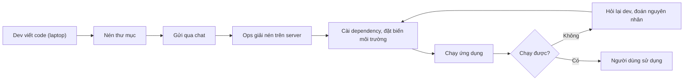
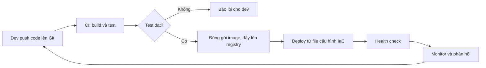

# Slide buổi 01 – DevOps Introduction

> **Tóm tắt:** Hiểu DevOps là văn hóa và quy trình, vẽ đường đi của code từ laptop đến server bằng Mermaid, chỉ ra điểm nghẽn thủ công và cách tự động hóa bằng CI/CD và IaC. Bài lab tương ứng: [Buổi 01 – DevOps Introduction](../../labs/week-01/session-01.md). Kịch bản dạy: [Kịch bản mentor Buổi 01](../../mentors/sessions/session-01.md).

## Slide 1: Mục tiêu buổi học

- Giải thích DevOps là gì và không phải là gì
- Phân biệt CI, Continuous Delivery, Continuous Deployment
- Vẽ deployment workflow bằng Mermaid: mỗi bước có ai làm, đầu vào, đầu ra
- Chỉ ra ít nhất 3 điểm nghẽn của quy trình thủ công
- Nộp bài đúng cấu trúc `lab-01/`

---

## Slide 2: Vấn đề – "chạy được trên máy tôi"

- Nam viết xong tính năng, nén thư mục, gửi qua Zalo cho Lan
- Lan cài Node.js khác phiên bản, quên biến môi trường `DB_PASSWORD`
- Ứng dụng lỗi, hai bạn mất một buổi tối để đoán nguyên nhân, lần sau lặp lại y hệt
- Gốc rễ nằm ở quy trình, không ở code:
  - Không ai viết ra các bước triển khai
  - Môi trường mỗi nơi một kiểu
  - Không có kiểm thử trước khi đưa lên server
  - Hai người ở hai đầu không chung trách nhiệm

---

## Slide 3: SDLC – vòng đời phần mềm

| Giai đoạn | Ví dụ với ứng dụng CLB |
| --- | --- |
| Plan | Ban chủ nhiệm cần danh sách thành viên |
| Code | Viết endpoint `GET /api/members` |
| Build | Cài dependency, đóng gói image |
| Test | Chạy test cho `GET /health` |
| Release | Gắn tag `1.0.0` |
| Deploy | Chạy trên server của CLB |
| Operate và Monitor | Xem log, kiểm tra `/ready` |

---

## Slide 4: Dev và Ops – hai mục tiêu mâu thuẫn

| | Dev | Ops |
| --- | --- | --- |
| Mục tiêu | Ra tính năng nhanh | Hệ thống ổn định |
| Sợ | Bị chặn không được phát hành | Thay đổi làm sập hệ thống |
| Khi tách rời | Ném code qua tường | Từ chối thay đổi |

- DevOps đặt chung một mục tiêu: giao giá trị nhanh và an toàn

---

## Slide 5: Văn hóa DevOps – 4 nguyên tắc

- Cộng tác: dev và ops cùng sở hữu sản phẩm
- Tự động hóa: việc lặp lại giao cho máy
- Đo lường: quyết định dựa trên số liệu
- Phản hồi nhanh, học từ lỗi: không đi tìm người chịu trách nhiệm
- Hiểu nhầm: DevOps không phải Docker/Kubernetes, không phải một người làm hết

---

## Slide 6: CI, Continuous Delivery, Continuous Deployment

| Thuật ngữ | Ý nghĩa | Ai bấm nút cuối |
| --- | --- | --- |
| CI | Mỗi lần push, tự build và test | Không áp dụng |
| Continuous Delivery | Bản qua test luôn sẵn sàng deploy | Người duyệt |
| Continuous Deployment | Bản qua test tự deploy | Không ai, máy tự làm |

- Khóa này: GitHub Actions cho CI, GHCR chứa image
- Deploy vào máy cá nhân dùng script, không expose ra Internet

---

## Slide 7: Infrastructure as Code

- Mô tả hạ tầng và môi trường bằng file văn bản trong Git
- Ví dụ: `compose.yaml` mô tả frontend, backend, postgres
- Sau này `k8s/` mô tả cùng hệ thống trên Kubernetes
- Lợi ích: tái lập được, review như code, khôi phục nhanh

```yaml
services:
  backend:
    image: club-api:1.0.0
```

---

## Slide 8: Sơ đồ quy trình thủ công



- Vòng lặp E, F, G, H là chi phí ẩn

---

## Slide 9: Sơ đồ quy trình tự động hóa



- Push: thay đổi có lịch sử và người chịu trách nhiệm
- CI: cùng một quy trình mỗi lần, hết "khác máy"
- Cổng test: test fail thì dừng, không có image lỗi nào phát hành
- Registry: artifact bất biến, có phiên bản
- Health check: xác nhận sống thật (`/health`, `/ready`)

---

## Slide 10: Demo – sơ đồ là text, git diff cho thấy đúng dòng đổi

- Viết một sơ đồ Mermaid 4 bước thành file `.mmd`, dán vào mermaid.live để thấy hình
- Commit file, thêm một dòng "Chạy test", rồi xem `git diff`
- Điểm cần nhớ: sơ đồ là text, nằm trong Git, review được
- Mã commit của bạn sẽ khác mentor, đó là bình thường

---

## Slide 11: Lab của buổi

- L1 (bắt buộc, 60 phút): bảng 9 bước, sơ đồ thủ công, 3 điểm nghẽn, sơ đồ tự động, bằng chứng
- L2 (tùy chọn, ở nhà): đề xuất DevOps workflow cho một dự án CLB thật, có số liệu ước lượng, rủi ro và 2 chỉ số đo
- Làm theo bài [Buổi 01 – DevOps Introduction](../../labs/week-01/session-01.md); thử thách ở [Buổi 01 – Thử thách thêm](../../labs/week-01/session-01-challenge.md)

---

## Slide 12: Lỗi thường gặp

- Mermaid báo Syntax error: nhãn có dấu ngoặc nhưng không đặt trong nháy kép
- Nguyên nhân: ngoặc là ký hiệu hình dạng nút, parser hiểu sai. Cách sửa: luôn đặt nhãn trong nháy kép
- Sơ đồ chỉ có hộp, không biết ai làm: thêm "Ai: việc" vào nhãn
- Quy trình đúng trên giấy, sai ngoài thực tế: bạn cùng bàn hỏi "lệnh nào, Node bản mấy, mật khẩu ở đâu"
- Mỗi câu hỏi là một thông tin ngầm chưa viết ra. Cách phòng: ghi vào README, `compose.yaml`, `.env.example`

---

## Slide 13: Challenge

- Nhóm của bạn push 15 lần mỗi ngày, mỗi lần deploy tay mất 10 phút
- Tính chi phí mỗi tuần (5 ngày)
- Bước nào nên tự động hóa trước, vì sao?

<details><summary>Gợi ý</summary>

15 lần x 10 phút x 5 ngày = 750 phút, tức 12,5 giờ mỗi tuần. Bước deploy lặp nhiều nhất và tốn thời gian nhất nên tự động hóa trước.

</details>

---

## Slide 14: Recap

- DevOps là văn hóa cộng tác cộng tự động hóa, không phải công cụ hay chức danh
- CI build và test mỗi lần push; Delivery cần người duyệt, Deployment thì tự động
- IaC đưa hạ tầng vào Git để tái lập và review
- Mỗi bước có người làm, đầu vào và đầu ra
- Bắt đầu từ điểm nghẽn, không bắt đầu từ công cụ
- Bài tiếp theo: dựng WSL2, Git và SSH key ([Slide buổi 02](session-02.md))
