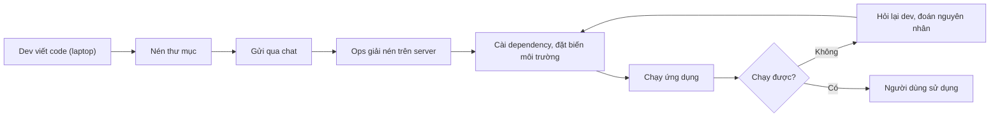
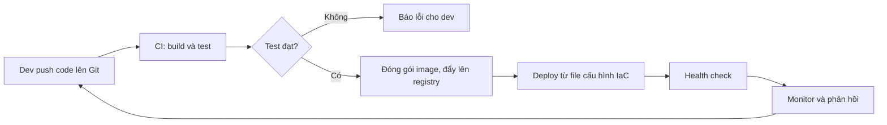

# Slide buổi 01 – DevOps Introduction

> **Tóm tắt:** Hiểu DevOps là văn hóa và quy trình, vẽ đường đi của code từ laptop đến server bằng Mermaid, chỉ ra điểm nghẽn thủ công và cách tự động hóa bằng CI/CD và IaC. Bài lab tương ứng: [Buổi 01](../../labs/week-01/session-01.md).

## Slide 1: Mục tiêu buổi học

- Giải thích DevOps là gì và không phải là gì
- Phân biệt CI, Continuous Delivery, Continuous Deployment
- Vẽ deployment workflow bằng Mermaid: mỗi bước có ai làm, đầu vào, đầu ra
- Chỉ ra ít nhất 3 điểm nghẽn của quy trình thủ công
- Nộp bài đúng cấu trúc `lab-01/`

::: details Ghi chú giảng viên
Mở buổi trong 2 phút. Nói rõ buổi này chưa cài gì, chỉ cần Git và một repo trống tên `devops-labs`. Hỏi lớp: ai đã từng "gửi file zip qua Zalo cho bạn chạy thử"?
:::

---

## Slide 2: Vấn đề – "chạy được trên máy tôi"

- Nam viết xong tính năng, nén thư mục, gửi qua Zalo cho Lan
- Lan cài Node.js khác phiên bản, quên biến môi trường `DB_PASSWORD`
- Ứng dụng lỗi, hai bạn mất một buổi tối để đoán nguyên nhân
- Lần deploy sau lặp lại y hệt

::: details Ghi chú giảng viên
Kể câu chuyện khoảng 2 phút, giọng thật. Câu hỏi cho lớp: bước nào dễ sai nhất, và ai biết bước đó? Chờ 2 đến 3 câu trả lời trước khi sang slide sau.
:::

---

## Slide 3: Gốc rễ nằm ở quy trình, không ở code

- Không ai viết ra các bước triển khai
- Môi trường mỗi nơi một kiểu
- Không có kiểm thử trước khi đưa lên server
- Hai người ở hai đầu không chung trách nhiệm
- DevOps giải quyết đúng những điểm này

::: details Ghi chú giảng viên
Nhấn mạnh: code của Nam không sai. Câu hỏi: nếu Nam nghỉ học thì ai biết cách deploy? Dẫn sang khái niệm tribal knowledge, sẽ gặp lại ở phần Phá lỗi.
:::

---

## Slide 4: SDLC – vòng đời phần mềm

| Giai đoạn | Ví dụ với ứng dụng CLB |
| --- | --- |
| Plan | Ban chủ nhiệm cần danh sách thành viên |
| Code | Viết endpoint `GET /api/members` |
| Build | Cài dependency, đóng gói image |
| Test | Chạy test cho `GET /health` |
| Release | Gắn tag `1.0.0` |
| Deploy | Chạy trên server của CLB |
| Operate và Monitor | Xem log, kiểm tra `/ready` |

::: details Ghi chú giảng viên
Đi nhanh một vòng, 2 phút. Điểm cần nói: hiện đại là vòng lặp, phản hồi từ Operate quay về Plan. Waterfall chỉ đi một chiều.
:::

---

## Slide 5: Dev và Ops – hai mục tiêu mâu thuẫn

| | Dev | Ops |
| --- | --- | --- |
| Mục tiêu | Ra tính năng nhanh | Hệ thống ổn định |
| Sợ | Bị chặn không được phát hành | Thay đổi làm sập hệ thống |
| Khi tách rời | Ném code qua tường | Từ chối thay đổi |

- DevOps đặt chung một mục tiêu: giao giá trị nhanh và an toàn

::: details Ghi chú giảng viên
Hỏi lớp: nếu bạn là Ops và nhận 10 bản code mỗi ngày không có test, bạn phản ứng thế nào? Dẫn tới việc "ops tham gia từ sớm, dev hiểu cách chạy thật".
:::

---

## Slide 6: Văn hóa DevOps – 4 nguyên tắc

- Cộng tác: dev và ops cùng sở hữu sản phẩm
- Tự động hóa: việc lặp lại giao cho máy
- Đo lường: quyết định dựa trên số liệu
- Phản hồi nhanh, học từ lỗi: không đi tìm người chịu trách nhiệm
- Hiểu nhầm: DevOps không phải Docker/Kubernetes, không phải một người làm hết

::: details Ghi chú giảng viên
Hỏi: DevOps là chức danh hay văn hóa? Nhiều bạn sẽ trả lời "DevOps là Docker". Sửa nhẹ nhàng: Docker là công cụ, văn hóa mới là gốc.
:::

---

## Slide 7: CI, Continuous Delivery, Continuous Deployment

| Thuật ngữ | Ý nghĩa | Ai bấm nút cuối |
| --- | --- | --- |
| CI | Mỗi lần push, tự build và test | Không áp dụng |
| Continuous Delivery | Bản qua test luôn sẵn sàng deploy | Người duyệt |
| Continuous Deployment | Bản qua test tự deploy | Không ai, máy tự làm |

- Khóa này: GitHub Actions cho CI, GHCR chứa image
- Deploy vào máy cá nhân dùng script, không expose ra Internet

::: details Ghi chú giảng viên
Đây là slide học viên hay nhầm nhất, dành 3 phút. Ví dụ: nút "Approve" trong workflow là Delivery; merge xong tự lên production là Deployment. Hỏi lại cuối buổi.
:::

---

## Slide 8: Infrastructure as Code

- Mô tả hạ tầng và môi trường bằng file văn bản trong Git
- Ví dụ: `compose.yaml` mô tả frontend, backend, postgres
- Sau này `k8s/` mô tả cùng hệ thống trên Kubernetes
- Lợi ích: tái lập được, review như code, khôi phục nhanh

```yaml
services:
  backend:
    image: club-api:1.0.0
```

::: details Ghi chú giảng viên
Chưa đi sâu cú pháp, chỉ cho thấy hạ tầng có thể là một file. Câu hỏi: nếu server hỏng, bạn dựng lại từ trí nhớ hay từ file?
:::

---

## Slide 9: Sơ đồ quy trình thủ công



- Vòng lặp E, F, G, H là chi phí ẩn

::: details Ghi chú giảng viên
Chỉ vào vòng lặp lỗi. Hỏi: bước nào phụ thuộc trí nhớ của một người? Bước nào chờ người khác?
:::

---

## Slide 10: Sơ đồ quy trình tự động hóa



::: details Ghi chú giảng viên
Đây là đích đến của 16 tuần. Mỗi hộp là một buổi hoặc một cụm buổi. Không cần giải thích công cụ ở đây.
:::

---

## Slide 11: Quy trình tự động hoạt động thế nào

- Push: thay đổi có lịch sử và người chịu trách nhiệm
- CI: cùng một quy trình mỗi lần, hết "khác máy"
- Cổng test: test fail thì dừng, không có image lỗi nào phát hành
- Registry: artifact bất biến, có phiên bản
- Health check: xác nhận sống thật (`/health`, `/ready`)

::: details Ghi chú giảng viên
Mỗi dòng gắn với một điểm đau ở slide 9. Hỏi lớp: dòng nào giải quyết lỗi "thiếu biến môi trường"? (Gợi ý: IaC và health check.)
:::

---

## Slide 12: Demo – sơ đồ là text

```bash
mkdir -p ~/demo-lab-01 && cd ~/demo-lab-01
cat > workflow.mmd <<'EOF'
flowchart LR
    A["Dev viết code"] --> B["Nén thư mục"]
    B --> C["Ops giải nén trên server"]
    C --> D["Chạy ứng dụng"]
EOF
cat workflow.mmd
```

Kết quả mong đợi: in lại đúng 4 dòng sơ đồ. Dán vào mermaid.live để thấy hình.

::: details Ghi chú giảng viên
Khoảng 4 phút. Nhấn mạnh: sơ đồ nằm trong Git, review được, đây là tư duy "as code" đầu tiên. Câu hỏi: sơ đồ này thiếu thông tin gì?
:::

---

## Slide 13: Demo – git diff cho thấy đúng dòng đổi

```bash
git init -q
git add workflow.mmd
git -c user.name=demo -c user.email=demo@example.com commit -q -m "Add manual workflow"
echo '    D --> E["Chạy test"]' >> workflow.mmd
git diff --stat
git log --oneline
```

```text
 workflow.mmd | 1 +
 1 file changed, 1 insertion(+)
3f2a9c1 Add manual workflow
```

- Mã commit của bạn sẽ khác, đó là bình thường

::: details Ghi chú giảng viên
Khoảng 3 phút. Nếu Git báo "Author identity unknown", dùng `-c user.name` như trên hoặc cấu hình ở bài lab. Câu hỏi: nếu deploy 10 lần một ngày, bước nào muốn giao cho máy?
:::

---

## Slide 14: Lab L1 – Foundation

- Chuẩn bị: clone `devops-labs`, tạo `lab-01/{source,screenshots,evidence}`
- Phần 1: `steps.md`, bảng 9 dòng với 4 cột Bước, Ai làm, Đầu vào, Đầu ra
- Phần 2: `manual-workflow.mmd`, chụp ảnh sơ đồ
- Phần 3: `bottlenecks.md`, chọn 3 điểm nghẽn
- Phần 4: `automated-workflow.mmd`, thay mỗi điểm nghẽn bằng một bước tự động
- Phần 5: ghi `evidence/command-output.txt`, commit và push

```bash
mkdir -p lab-01/source lab-01/screenshots lab-01/evidence
ls lab-01
```

```text
evidence  screenshots  source
```

::: details Ghi chú giảng viên
60 phút: 10 phút bảng, 15 phút sơ đồ thủ công, 10 phút điểm nghẽn, 15 phút sơ đồ tự động, 10 phút bằng chứng. Đi vòng kiểm tra bảng "ai, đầu vào, đầu ra" vì đó là chỗ học viên làm qua loa nhất.
:::

---

## Slide 15: Lab L2 – Engineering

- Đề xuất DevOps workflow cho một dự án CLB thật (website, bot Discord, điểm danh)
- Sơ đồ Mermaid: workflow hiện tại và đề xuất
- 3 điểm nghẽn có số liệu ước lượng (ví dụ deploy tay 20 phút, 3 lần mỗi tuần)
- Mỗi điểm nghẽn: cách tự động hóa, công cụ, buổi dạy trong `curriculum/syllabus.md`
- Một rủi ro của chính giải pháp, hai chỉ số đo cải thiện

::: details Ghi chú giảng viên
Gợi ý cho học viên: bắt đầu từ câu "lần deploy gần nhất mất bao lâu và vì sao". Chọn giải pháp nhỏ nhất giải được vấn đề, ví dụ một workflow chạy test mỗi lần push.
:::

---

## Slide 16: Lỗi thường gặp – Mermaid báo Syntax error

- Nhãn có dấu ngoặc nhưng không đặt trong nháy kép

```text
E --> F[Ops: chạy (production) ứng dụng]
```

- Triệu chứng: mermaid.live báo "Syntax error in text"
- Nguyên nhân: ngoặc là ký hiệu hình dạng nút, parser hiểu sai
- Cách sửa: luôn đặt nhãn trong nháy kép

```text
E --> F["Ops: chạy (production) ứng dụng"]
```

::: details Ghi chú giảng viên
Cho học viên tự phá lỗi này trong 3 phút. Cách điều tra: đọc số dòng báo lỗi, xóa từng dòng gần đó, kiểm tra ký tự đặc biệt.
:::

---

## Slide 17: Lỗi thường gặp – Git và quy trình

- `Author identity unknown`: chạy hai lệnh `git config user.name` và `user.email`
- `git push` báo no upstream: dùng `git push -u origin HEAD`
- Sơ đồ chỉ có hộp, không biết ai làm: thêm "Ai: việc" vào nhãn
- Ảnh chụp lộ thông tin cá nhân: cắt ảnh, chỉ chụp phần sơ đồ
- Không nêu điểm nghẽn mà đã chọn công cụ: quay lại Phần 3

::: details Ghi chú giảng viên
Nhắc: không dán token vào bất kỳ file nào trong repo. Nếu push cần đăng nhập, dùng Git Credential Manager hoặc đợi sau Buổi 02 khi có SSH key.
:::

---

## Slide 18: Phá lỗi – quy trình đúng trên giấy, sai ngoài thực tế

- Đưa sơ đồ thủ công cho bạn cùng bàn, nhờ họ "triển khai"
- Bạn chỉ được trả lời bằng thông tin có trong sơ đồ
- Họ sẽ hỏi: chạy bằng lệnh nào, Node bản mấy, mật khẩu ở đâu
- Mỗi câu hỏi là một thông tin ngầm chưa được viết ra
- Cách phòng: ghi vào README, `compose.yaml`, `.env.example`

::: details Ghi chú giảng viên
Hoạt động 5 phút theo cặp. Kết luận: kiến thức nằm trong đầu một người là rủi ro, đưa nó vào Git là bước đầu của IaC.
:::

---

## Slide 19: Challenge

- Nhóm của bạn push 15 lần mỗi ngày, mỗi lần deploy tay mất 10 phút
- Tính chi phí mỗi tuần (5 ngày)
- Bước nào nên tự động hóa trước, vì sao?

<details><summary>Gợi ý</summary>

15 lần x 10 phút x 5 ngày = 750 phút, tức 12,5 giờ mỗi tuần. Bước deploy lặp nhiều nhất và tốn thời gian nhất nên tự động hóa trước.

</details>

::: details Ghi chú giảng viên
Cho lớp 2 phút tính, rồi mở gợi ý. Mở rộng: sau khi tự động, cần đo gì để chứng minh cải thiện?
:::

---

## Slide 20: Recap

- DevOps là văn hóa cộng tác cộng tự động hóa, không phải công cụ hay chức danh
- CI build và test mỗi lần push; Delivery cần người duyệt, Deployment thì tự động
- IaC đưa hạ tầng vào Git để tái lập và review
- Mỗi bước có người làm, đầu vào và đầu ra
- Bắt đầu từ điểm nghẽn, không bắt đầu từ công cụ
- Bài tiếp theo: dựng WSL2, Git và SSH key ([Slide buổi 02](session-02.md))

::: details Ghi chú giảng viên
Hỏi nhanh 3 câu để chốt: DevOps có phải chức danh không? Delivery khác Deployment ở đâu? IaC giải quyết vấn đề gì? Nhắc hạn nộp `lab-01/`.
:::
