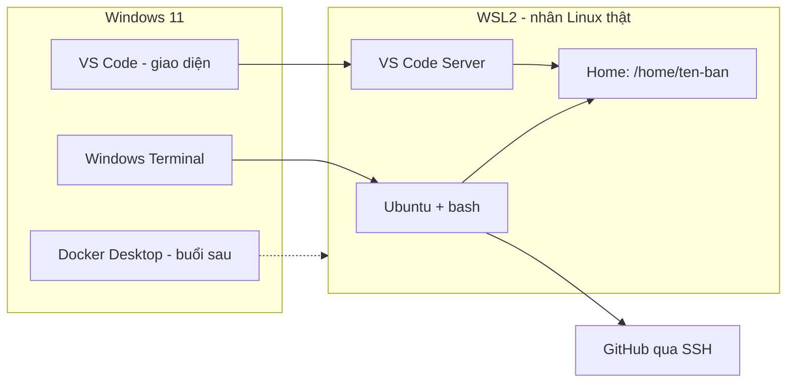
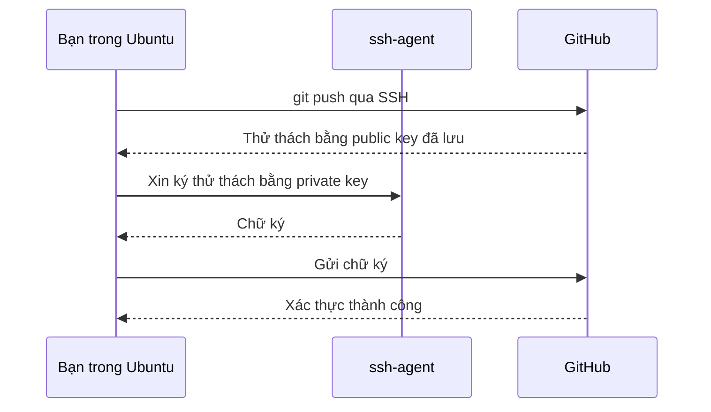

# Slide buổi 02 – Development Environment

> **Tóm tắt:** Dựng môi trường Linux thật trên Windows 11 bằng WSL2 Ubuntu, VS Code Remote WSL, Git và SSH key GitHub, rồi kiểm tra bằng script check-env. Bài lab tương ứng: [Buổi 02](../../labs/week-01/session-02.md).

## Slide 1: Mục tiêu buổi học

- Giải thích WSL2 là gì, khác WSL1 và máy ảo ở điểm nào
- Cài WSL2 + Ubuntu, xác minh VERSION 2
- Phân biệt `~` với `/mnt/c` và chọn đúng nơi làm việc
- Cấu hình Git, tạo SSH key ed25519, xác thực với GitHub
- Mở dự án bằng VS Code Remote WSL, chạy script kiểm tra môi trường

::: details Ghi chú giảng viên
2 phút. Nói rõ: từ Buổi 03 trở đi mọi lab giả định bạn đang ở terminal Ubuntu của WSL2, nên buổi này là nền móng. Yêu cầu học viên mở sẵn trang GitHub.
:::

---

## Slide 2: Vấn đề – 20 máy, 20 môi trường

- Windows 10, Windows 11, macOS lẫn lộn
- Cùng lệnh `docker compose up`, người chạy được, người báo not found
- Script có ký tự xuống dòng Windows gây lỗi `\r: command not found`
- Mất 40 phút đầu mỗi buổi chỉ để "làm cho máy giống nhau"

::: details Ghi chú giảng viên
Hỏi lớp: ai đã gặp lỗi `\r`? Dẫn dắt: server thật gần như luôn là Linux, nên luyện tập trên Linux giúp lệnh chạy y hệt từ laptop lên CI.
:::

---

## Slide 3: WSL2 là gì

- Chạy môi trường Linux ngay trên Windows, không cần dual-boot
- WSL2 dùng nhân Linux thật trong một máy ảo nhẹ do Windows quản lý
- Windows tự khởi động và tắt máy ảo khi cần
- Docker Desktop ở các buổi sau tích hợp với WSL2

::: details Ghi chú giảng viên
Không cần giải thích Hyper-V chi tiết. Câu hỏi: khác gì cài VirtualBox? Trả lời: không phải cấu hình RAM, đĩa, mạng thủ công.
:::

---

## Slide 4: WSL1, WSL2 và máy ảo

| Tiêu chí | WSL1 | WSL2 | Máy ảo |
| --- | --- | --- | --- |
| Nhân Linux | Lớp dịch syscall | Nhân thật | Nhân thật |
| Filesystem Linux | Trung bình | Nhanh | Nhanh |
| Truy cập `/mnt/c` | Nhanh hơn | Chậm | Không áp dụng |
| Docker | Hạn chế | Tốt | Tốt |
| Dùng trong khóa | Không | Có | Không |

::: details Ghi chú giảng viên
Chỉ nhấn hai hàng: nhân thật và `/mnt/c` chậm. Hàng sau là lý do của quy tắc "code nằm trong `~`".
:::

---

## Slide 5: Terminal, shell, bash

| Thuật ngữ | Là gì | Ví dụ |
| --- | --- | --- |
| Terminal | Cửa sổ nhập và xem chữ | Windows Terminal |
| Shell | Chương trình đọc và chạy lệnh | `bash`, `zsh`, PowerShell |
| Lệnh | Chương trình được gọi | `ls`, `git`, `cd` |

- Bash đọc `~/.bashrc` mỗi lần mở shell tương tác

::: details Ghi chú giảng viên
Hỏi: Windows Terminal đang mở tab Ubuntu thì đâu là terminal, đâu là shell? Câu trả lời đúng: Windows Terminal là terminal, bash là shell.
:::

---

## Slide 6: Hai thế giới filesystem

| Vùng | Trong WSL | Dùng để |
| --- | --- | --- |
| Linux (ext4) | `/home/TEN_BAN` hay `~` | Mã nguồn, Docker build, mọi lab |
| Ổ Windows | `/mnt/c/Users/...` | Chỉ trao đổi file |

- Quy tắc: mã nguồn luôn nằm trong `~`
- `/mnt/c` chậm với nhiều file nhỏ (`npm install`, `git status`)
- `/mnt/c` còn gây lỗi quyền file và xuống dòng

::: details Ghi chú giảng viên
Đây là quy tắc quan trọng nhất của buổi. Từ Windows, xem file Linux qua `\\wsl$\Ubuntu\home\TEN_BAN`. Sẽ có demo đo tốc độ ở slide 13.
:::

---

## Slide 7: Package manager apt

- Ubuntu cài phần mềm qua `apt` từ kho đã ký số
- Luôn đi cặp: `sudo apt update` rồi `sudo apt install TEN_GOI`
- `update` làm mới danh sách gói, không nâng cấp phần mềm
- `sudo` chạy lệnh với quyền root

```bash
sudo apt update
sudo apt install -y tree
```

::: details Ghi chú giảng viên
Câu hỏi: tại sao phải update trước install? Trả lời: không có danh sách mới, apt có thể không tìm thấy gói hoặc cài bản cũ.
:::

---

## Slide 8: SSH key – public và private

- Private key `~/.ssh/id_ed25519`: ở lại máy bạn, không chia sẻ, không commit
- Public key `~/.ssh/id_ed25519.pub`: dán lên GitHub
- GitHub dùng public key để thử thách máy bạn
- Chỉ người giữ private key mới trả lời đúng

::: details Ghi chú giảng viên
Ví dụ so sánh: public key như ổ khóa, private key như chìa khóa. Câu hỏi: file nào được dán lên GitHub, file nào không? Nhấn mạnh đuôi `.pub`.
:::

---

## Slide 9: Kiến trúc môi trường



::: details Ghi chú giảng viên
Giải thích: giao diện VS Code ở Windows nhưng terminal, extension, debugger chạy trong Linux. Docker Desktop cài ở buổi sau, giờ chỉ chuẩn bị nền.
:::

---

## Slide 10: SSH tới GitHub hoạt động thế nào



::: details Ghi chú giảng viên
Private key không bao giờ rời máy, chỉ có chữ ký đi qua mạng. ssh-agent giữ key đã mở khóa để không gõ passphrase liên tục.
:::

---

## Slide 11: Từng bước dựng môi trường

- Bước 1: `wsl --install -d Ubuntu-24.04`, khởi động lại
- Bước 2: tạo user Linux, kiểm tra `wsl --list --verbose`
- Bước 3: `sudo apt update && sudo apt upgrade -y`
- Bước 4: cài extension WSL của VS Code, chạy `code .`
- Bước 5: cấu hình Git, tạo SSH key, thêm lên GitHub
- Bước 6: viết và chạy `check-env.sh`

::: details Ghi chú giảng viên
Đây là bản đồ của 60 phút lab. Học viên chưa bật ảo hóa trong BIOS sẽ gặp lỗi ở bước 1, xem slide 20. Dặn trước: không làm trong `/mnt/c`.
:::

---

## Slide 12: Demo – hai filesystem

```bash
pwd
ls /mnt/c | head -5
cd ~ && mkdir -p demo && cd demo && pwd
```

```text
/home/mentor
'$Recycle.Bin'
'Documents and Settings'
...
/home/mentor/demo
```

- Tên người dùng và danh sách trong `/mnt/c` sẽ khác tùy máy

::: details Ghi chú giảng viên
Câu hỏi: hai đường dẫn này nằm trên ổ nào? Vì sao không để code trong `/mnt/c`? Chưa trả lời ngay, để slide sau minh họa bằng số đo.
:::

---

## Slide 13: Demo – đo tốc độ ext4 và /mnt/c

```bash
mkdir -p ~/demo/io-test /mnt/c/Users/Public/io-test
cd ~/demo/io-test
time (for i in $(seq 1 2000); do echo x > f$i.txt; done)
cd /mnt/c/Users/Public/io-test
time (for i in $(seq 1 2000); do echo x > f$i.txt; done)
cd ~ && rm -rf ~/demo/io-test /mnt/c/Users/Public/io-test
```

- Kỳ vọng: lần trong `~` nhanh hơn rõ rệt, thường vài lần trở lên
- Số chính xác tùy máy, xu hướng mới quan trọng
- Chỉ xóa đúng thư mục `io-test` vừa tạo

::: details Ghi chú giảng viên
Chiếu hai kết quả `real` cạnh nhau. Câu hỏi: `npm install` tạo hàng chục nghìn file nhỏ thì chuyện gì xảy ra? Nhắc không dùng `rm f*.txt` trong thư mục có dữ liệu.
:::

---

## Slide 14: Lab phần 1 – cài WSL2 và Ubuntu

Mở PowerShell bằng quyền Administrator:

```powershell
wsl --status
wsl --install -d Ubuntu-24.04
wsl --list --verbose
```

```text
  NAME            STATE           VERSION
* Ubuntu-24.04    Running         2
```

- Cài xong cần khởi động lại Windows
- Tên distro không tìm thấy: chạy `wsl --list --online`
- VERSION là 1: `wsl --set-version Ubuntu-24.04 2`

::: details Ghi chú giảng viên
Khoảng 15 phút, nhiều người chờ tải. Trong lúc chờ, giảng slide 6 và 8. Mật khẩu Linux gõ không hiện ký tự, đó là bình thường, nhắc trước kẻo học viên tưởng máy treo.
:::

---

## Slide 15: Lab phần 2 – VS Code Remote WSL

```bash
mkdir -p ~/devops-labs/lab-02/{source,screenshots,evidence}
cd ~/devops-labs/lab-02
code .
uname -a
```

- Cài extension "WSL" của Microsoft trước
- Kỳ vọng: góc dưới trái ghi "WSL: Ubuntu-24.04"
- `uname -a` chứa `microsoft-standard-WSL2`
- Lần đầu mở cần vài chục giây tải VS Code Server

::: details Ghi chú giảng viên
Câu hỏi: terminal trong VS Code đang chạy trên Windows hay Linux, làm sao biết? Đáp án: nhìn nhãn góc dưới trái và kết quả `uname -a`. `code: command not found` thì chạy `wsl --shutdown` rồi mở lại Ubuntu.
:::

---

## Slide 16: Lab phần 3 – Git và SSH key

```bash
git config --global user.name "Ho Ten Cua Ban"
git config --global user.email "email-github-cua-ban@example.com"
git config --global core.autocrlf input
ssh-keygen -t ed25519 -C "email-github-cua-ban@example.com"
eval "$(ssh-agent -s)"
ssh-add ~/.ssh/id_ed25519
cat ~/.ssh/id_ed25519.pub
```

- Dán nội dung file `.pub` vào GitHub: Settings, SSH and GPG keys
- Kiểm tra bằng `ssh -T git@github.com`

```text
Hi TEN_GITHUB! You've successfully authenticated, but GitHub does not provide shell access.
```

::: details Ghi chú giảng viên
Nên đặt passphrase. Lần đầu SSH hỏi fingerprint, đối chiếu với tài liệu GitHub rồi gõ yes. Mã thoát 1 của `ssh -T` là bình thường. Chỉ chia sẻ file `.pub`, không bao giờ chụp màn hình private key.
:::

---

## Slide 17: Lab phần 4 – script check-env.sh

```bash
check() {
  name="$1"; cmd="$2"; flag="${3:---version}"
  if command -v "$cmd" >/dev/null 2>&1; then
    printf 'OK    %-10s %s\n' "$name" "$($cmd "$flag" 2>&1 | head -n 1)"
  else
    printf 'THIEU %-10s chua cai\n' "$name"
  fi
}
check git git
check ssh ssh -V
```

```text
OK    git        git version 2.43.0
OK    ssh        OpenSSH_9.6p1 Ubuntu-3ubuntu13, OpenSSL 3.0.13 30 Jan 2024
```

- Docker báo THIEU ở buổi này là chấp nhận được
- `ssh` dùng `-V`, không có `--version`

::: details Ghi chú giảng viên
Đây là phần rút gọn, bản đầy đủ nằm trong bài lab. Giải thích `set -u` và `chmod +x`. Lưu mã thoát ngay sau khi chạy: `code=$?`, đừng đi qua `tee`.
:::

---

## Slide 18: Lab – checklist L1 và L2

- L1: `wsl --list --verbose` thấy VERSION 2
- L1: `lab-02` nằm trong `~`, `code .` hiện "WSL: Ubuntu"
- L1: `ssh -T git@github.com` xác thực thành công
- L1: `evidence/command-output.txt` chứa output các lệnh
- L2: mở rộng script (node, npm, make, đếm công cụ thiếu, kiểm tra quyền key 600, mã thoát khác 0)
- L2: thư mục dotfiles với `install.sh` chạy hai lần không lỗi

::: details Ghi chú giảng viên
Ai xong L1 sớm chuyển sang L2. Nhắc nộp: không có private key hay token trong repo, chỉ public key được phép.
:::

---

## Slide 19: Lỗi thường gặp – quyền file SSH key

```bash
ssh-add -D
chmod 644 ~/.ssh/id_ed25519
ssh -T git@github.com
```

```text
WARNING: UNPROTECTED PRIVATE KEY FILE!
Permissions 0644 for '/home/tien/.ssh/id_ed25519' are too open.
git@github.com: Permission denied (publickey).
```

- Nguyên nhân: SSH từ chối key mà người khác đọc được
- Sửa: `chmod 700 ~/.ssh` và `chmod 600 ~/.ssh/id_ed25519`, rồi `ssh-add`
- Phải gỡ key khỏi agent trước, nếu không sẽ không thấy lỗi

::: details Ghi chú giảng viên
Cho học viên tự phá và tự sửa. Cách điều tra: đọc dòng "too open", chạy `ls -l ~/.ssh`, `ssh -vT git@github.com`. Phòng tránh: không sao chép key từ ổ Windows.
:::

---

## Slide 20: Lỗi thường gặp – môi trường

| Triệu chứng | Cách xử lý |
| --- | --- |
| Lỗi `0x80370102` khi `wsl --install` | Bật VT-x hoặc SVM trong BIOS, khởi động lại |
| `git status` và `npm install` chậm | Repo đang ở `/mnt/c`, chuyển vào `~` |
| `\r: command not found` | `sed -i 's/\r$//' file.sh`, đặt `core.autocrlf input` |
| `Permission denied (publickey)` | Kiểm tra `ssh-add -l` và public key trên GitHub |
| Port 22 timeout | Mạng chặn, thử SSH qua cổng 443 theo GitHub Docs |

::: details Ghi chú giảng viên
Kiểm tra mục Virtualization trong Task Manager, tab Performance, CPU. Nên nhờ học viên kiểm tra trước buổi học để tránh mất thời gian giữa giờ.
:::

---

## Slide 21: Challenge

- Clone repo vào `/mnt/c/Users/An/code`, `npm install` mất 10 phút, `./run.sh` báo `\r: command not found`
- Bạn xử lý thế nào?
- `ssh -T git@github.com` báo `Permission denied (publickey)`: liệt kê ba điểm kiểm tra đầu tiên

<details><summary>Gợi ý</summary>

Clone lại vào `~`, chuyển script sang LF và đặt `core.autocrlf input`. Với SSH: public key đã dán chưa, `ssh-add -l`, `ssh -vT` và quyền file 600.

</details>

::: details Ghi chú giảng viên
Cho lớp thảo luận 3 phút theo cặp. Khuyến khích đọc output của `ssh -vT` thay vì đoán.
:::

---

## Slide 22: Recap

- WSL2 cho môi trường Linux thật trên Windows, mọi lab chạy trong Ubuntu
- Mã nguồn đặt trong `~`, không đặt trong `/mnt/c`
- Terminal là cửa sổ, shell là chương trình, bash là shell mặc định
- `apt update` rồi `apt install` là quy trình cài gói chuẩn
- SSH key: private giữ kín, public đưa lên GitHub, sai quyền file là lỗi hay gặp nhất
- Bài tiếp theo: Linux CLI ([Slide buổi 03](session-03.md))

::: details Ghi chú giảng viên
Hỏi nhanh: tại sao dùng `~`? Public key khác private key thế nào? Nhắc hạn nộp `lab-02/` và việc `git push` qua SSH.
:::
