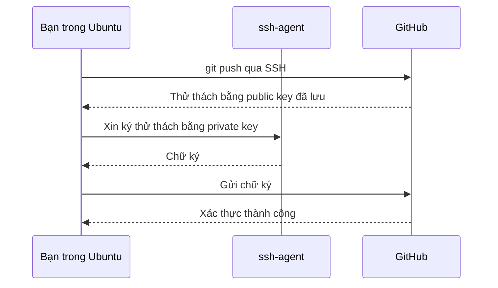
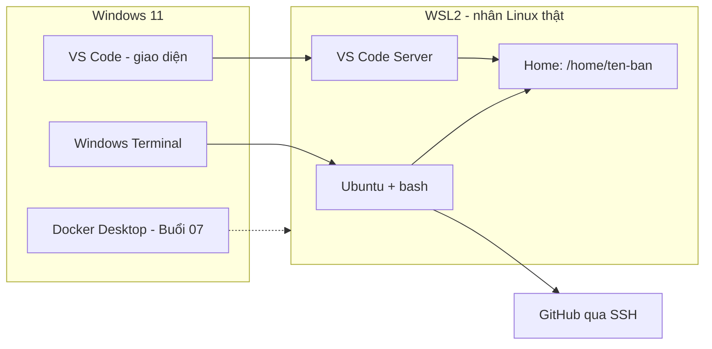

# Slide buổi 02 – Development Environment

> **Tóm tắt:** Dựng môi trường Linux thật trên Windows 11 bằng WSL2 Ubuntu, VS Code Remote WSL, Git và SSH key GitHub, rồi kiểm tra bằng script check-env. Bài lab tương ứng: [Buổi 02 – Development Environment](../../labs/week-01/session-02.md).

## Slide 1: Mục tiêu buổi học

- Giải thích WSL2 là gì, khác WSL1 và máy ảo ở điểm nào
- Cài WSL2 + Ubuntu, xác minh VERSION 2
- Phân biệt `~` với `/mnt/c` và chọn đúng nơi làm việc
- Cấu hình Git, tạo SSH key ed25519, xác thực với GitHub
- Mở dự án bằng VS Code Remote WSL, chạy script kiểm tra môi trường

---

## Slide 2: Vấn đề – 20 máy, 20 môi trường

- Windows 10, Windows 11, macOS lẫn lộn
- Cùng lệnh `docker compose up`, người chạy được, người báo not found
- Script có ký tự xuống dòng Windows gây lỗi `\r: command not found`
- Mất 40 phút đầu mỗi buổi chỉ để "làm cho máy giống nhau"

---

## Slide 3: WSL2 là gì

- Chạy môi trường Linux ngay trên Windows, không cần dual-boot
- WSL2 dùng nhân Linux thật trong một máy ảo nhẹ do Windows quản lý
- Windows tự khởi động và tắt máy ảo khi cần
- Docker Desktop ở các buổi sau tích hợp với WSL2

| Tiêu chí | WSL1 | WSL2 | Máy ảo |
| --- | --- | --- | --- |
| Nhân Linux | Lớp dịch syscall | Nhân thật | Nhân thật |
| Filesystem Linux | Trung bình | Nhanh | Nhanh |
| Truy cập `/mnt/c` | Nhanh hơn | Chậm | Không áp dụng |
| Docker | Hạn chế | Tốt | Tốt |
| Dùng trong khóa | Không | Có | Không |

---

## Slide 4: Terminal, shell, bash

| Thuật ngữ | Là gì | Ví dụ |
| --- | --- | --- |
| Terminal | Cửa sổ nhập và xem chữ | Windows Terminal |
| Shell | Chương trình đọc và chạy lệnh | `bash`, `zsh`, PowerShell |
| Lệnh | Chương trình được gọi | `ls`, `git`, `cd` |

- Bash đọc `~/.bashrc` mỗi lần mở shell tương tác

---

## Slide 5: Hai thế giới filesystem

| Vùng | Trong WSL | Dùng để |
| --- | --- | --- |
| Linux (ext4) | `/home/TEN_BAN` hay `~` | Mã nguồn, Docker build, mọi lab |
| Ổ Windows | `/mnt/c/Users/...` | Chỉ trao đổi file |

- Quy tắc: mã nguồn luôn nằm trong `~`
- `/mnt/c` chậm với nhiều file nhỏ (`npm install`, `git status`)
- `/mnt/c` còn gây lỗi quyền file và xuống dòng

---

## Slide 6: Package manager apt

- Ubuntu cài phần mềm qua `apt` từ kho đã ký số
- Luôn đi cặp: `sudo apt update` rồi `sudo apt install TEN_GOI`
- `update` làm mới danh sách gói, không nâng cấp phần mềm
- `sudo` chạy lệnh với quyền root

---

## Slide 7: SSH key – public và private

- Private key `~/.ssh/id_ed25519`: ở lại máy bạn, không chia sẻ, không commit
- Public key `~/.ssh/id_ed25519.pub`: dán lên GitHub
- GitHub dùng public key để thử thách máy bạn; chỉ người giữ private key mới trả lời đúng

---

## Slide 8: Kiến trúc môi trường

---

## Slide 9: Demo – hai filesystem và đo tốc độ

- Xem `pwd` trong `~` và danh sách `/mnt/c`: hai đường dẫn, hai ổ đĩa khác nhau
- Tạo 2000 file nhỏ trong `~` rồi trong `/mnt/c`, so sánh thời gian `real`
- Kỳ vọng: lần trong `~` nhanh hơn rõ rệt, thường vài lần trở lên
- Số chính xác tùy máy, xu hướng mới quan trọng
- Chỉ xóa đúng thư mục `io-test` vừa tạo

---

## Slide 10: Lab – bản đồ 60 phút ở lớp và việc ở nhà

- Ở lớp: cài WSL2 + Ubuntu (khoảng 30 phút lần đầu, gồm khởi động lại), VS Code Remote WSL, `git config`, chạy `bash resources/check-env.sh 2`
- Ở nhà: tạo SSH key, thêm lên GitHub, nối remote bằng SSH, gom evidence
- Kỳ vọng: `wsl --list --verbose` thấy VERSION 2; góc dưới trái VS Code ghi "WSL: Ubuntu-24.04"; `uname -a` chứa `microsoft-standard-WSL2`
- Các bước cài đặt chi tiết: [Hướng dẫn cài đặt môi trường](../../resources/setup-guide.md)
- Làm theo bài [Buổi 02 – Development Environment](../../labs/week-01/session-02.md)

---

## Slide 11: Checklist L1 và L2

- L1: `wsl --list --verbose` thấy VERSION 2
- L1: `lab-02` nằm trong `~`, `code .` hiện "WSL: Ubuntu"
- L1: `ssh -T git@github.com` xác thực thành công
- L1: `evidence/command-output.txt` chứa output các lệnh và log `check-env.sh`
- L2: tự viết script kiểm tra, mở rộng (node, npm, make, quyền key 600, mã thoát khác 0)
- L2: thư mục dotfiles với `install.sh` chạy hai lần không lỗi

---

## Slide 12: Lỗi thường gặp

| Triệu chứng | Cách xử lý |
| --- | --- |
| Lỗi `0x80370102` khi `wsl --install` | Bật VT-x hoặc SVM trong BIOS, khởi động lại |
| `git status` và `npm install` chậm | Repo đang ở `/mnt/c`, chuyển vào `~` |
| `\r: command not found` | `sed -i 's/\r$//' file.sh`, đặt `core.autocrlf input` |
| `Permission denied (publickey)` | Kiểm tra `ssh-add -l` và public key trên GitHub |
| `UNPROTECTED PRIVATE KEY FILE` | Quyền file key quá rộng: `chmod 600` lên key, `chmod 700 ~/.ssh` |
| Port 22 timeout | Mạng chặn, thử SSH qua cổng 443 theo GitHub Docs |

- SSH từ chối key mà người khác đọc được; tự phá trên một khóa thử, đừng đụng khóa thật

---

## Slide 13: Challenge

- Clone repo vào `/mnt/c/Users/An/code`, `npm install` mất 10 phút, `./run.sh` báo `\r: command not found`
- Bạn xử lý thế nào?
- `ssh -T git@github.com` báo `Permission denied (publickey)`: liệt kê ba điểm kiểm tra đầu tiên

Gợi ý

Clone lại vào `~`, chuyển script sang LF và đặt `core.autocrlf input`. Với SSH: public key đã dán chưa, `ssh-add -l`, `ssh -vT` và quyền file 600.

---

## Slide 14: Recap

- WSL2 cho môi trường Linux thật trên Windows, mọi lab chạy trong Ubuntu
- Mã nguồn đặt trong `~`, không đặt trong `/mnt/c`
- Terminal là cửa sổ, shell là chương trình, bash là shell mặc định
- `apt update` rồi `apt install` là quy trình cài gói chuẩn
- SSH key: private giữ kín, public đưa lên GitHub, sai quyền file là lỗi hay gặp nhất
- Bài tiếp theo: Linux CLI ([Slide buổi 03](session-03.md))
