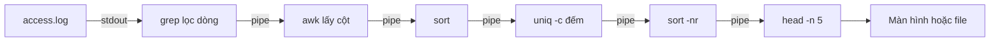

# Slide buổi 03 – Linux CLI

> **Tóm tắt:** Dùng thành thạo pwd, ls, cd, find, grep, cat, less, head, tail và pipe để điều hướng filesystem, tìm file và phân tích access log. Bài lab tương ứng: [Buổi 03](../../labs/week-02/session-03.md).

## Slide 1: Mục tiêu buổi học

- Hiểu cây thư mục Linux, đường dẫn tuyệt đối và tương đối
- Điều hướng và đọc file bằng `pwd`, `ls`, `cd`, `cat`, `less`, `head`, `tail`
- Tìm file bằng `find`, tìm dòng bằng `grep`
- Ghép pipeline `awk | sort | uniq -c | sort -nr` để thống kê access log
- Chẩn đoán lỗi quote đường dẫn, sai đường dẫn, `rm` nhầm chỗ

::: details Ghi chú giảng viên
2 phút. Kiểm tra nhanh `cd ~ && pwd` ra đường dẫn dạng `/home/...`, nếu ra `/mnt/c` thì nhắc học viên `cd ~`.
:::

---

## Slide 2: Vấn đề – web chậm trước giờ demo

- Server chỉ có terminal, log Nginx dài hàng chục nghìn dòng
- Cần biết: IP nào gọi nhiều nhất, bao nhiêu lỗi 5xx, endpoint nào bị gọi nhiều
- Mở bằng Notepad hay đọc bằng mắt đều không khả thi
- Người biết CLI trả lời trong vài chục giây bằng một dòng pipeline

::: details Ghi chú giảng viên
Hỏi lớp: nếu là bạn, bạn bắt đầu từ đâu? Sau này `docker logs` và `kubectl logs` đều dùng đúng kỹ năng này.
:::

---

## Slide 3: Cây thư mục Linux

| Đường dẫn | Ý nghĩa |
| --- | --- |
| `/` | Gốc của toàn bộ cây |
| `~` | Home của bạn, nơi làm việc chính |
| `/etc` | Cấu hình hệ thống |
| `/var/log` | Log hệ thống và dịch vụ |
| `/tmp` | File tạm |
| `.` và `..` | Thư mục hiện tại và thư mục cha |

- Không có ổ `C:`, ổ Windows nằm dưới `/mnt/c` (tránh trong khóa này)
- Linux phân biệt chữ hoa chữ thường

::: details Ghi chú giảng viên
Câu hỏi: gõ `cd /` rồi `ls` thấy gì? Ổ C nằm ở đâu? Phân biệt tuyệt đối (bắt đầu bằng `/` hoặc `~`) và tương đối (tính từ chỗ đang đứng).
:::

---

## Slide 4: Lệnh điều hướng và đọc file

| Lệnh | Công dụng |
| --- | --- |
| `pwd` | In thư mục hiện tại |
| `ls -la` | Liệt kê dài, có file ẩn |
| `cd`, `cd ..`, `cd -` | Đổi thư mục, lên cha, quay lại |
| `mkdir -p` | Tạo thư mục kể cả cha |
| `cat`, `less` | In cả file, xem cuộn (thoát bằng `q`) |
| `head -n`, `tail -n` | Xem đầu, cuối file |
| `wc -l` | Đếm dòng |

::: details Ghi chú giảng viên
Dạy theo thói quen: trước mọi lệnh nguy hiểm, chạy `pwd` và `ls`. `less`: gõ `/chuoi` để tìm, `q` để thoát.
:::

---

## Slide 5: find tìm file, grep tìm dòng

| Lệnh | Ý nghĩa |
| --- | --- |
| `find . -name "*.log"` | File có tên kết thúc bằng .log |
| `find . -type d` | Chỉ thư mục (`-type f` là file) |
| `find . -size +1M` | File lớn hơn 1 MiB |
| `grep "ERROR" file` | Dòng chứa ERROR |
| `grep -i`, `-v`, `-c`, `-n` | Không phân biệt hoa thường, đảo, đếm, số dòng |
| `grep -r "mau" thu-muc` | Tìm đệ quy |

::: details Ghi chú giảng viên
Câu hỏi nhanh: tìm file nào dùng gì, tìm chữ trong file dùng gì? Luôn đặt mẫu có ký tự đặc biệt như `*` trong nháy kép.
:::

---

## Slide 6: Pipe và redirect

- Mỗi lệnh làm một việc nhỏ: đọc stdin, ghi stdout
- `|` nối stdout của lệnh trước vào stdin của lệnh sau
- `>` ghi đè file, `>>` ghi nối thêm, `2>` ghi riêng lỗi
- Công cụ hay dùng: `awk '{print $1}'`, `sort`, `uniq -c`, `head -n 5`

```bash
printf '%s\n' 'line one' 'line two ERROR' 'line three' > sample.txt
grep ERROR sample.txt
cat sample.txt | wc -l
```

```text
line two ERROR
3
```

::: details Ghi chú giảng viên
Giải thích vì sao `wc -l sample.txt` in tên file còn khi đọc từ stdin thì không: `wc` không biết tên file. Nhắc `>` dễ mất dữ liệu.
:::

---

## Slide 7: Định dạng access log

```text
10.0.0.5 - - [21/Oct/2026:09:00:01 +0700] "GET /health HTTP/1.1" 200 15
```

| Cột | Ý nghĩa |
| --- | --- |
| `$1` | IP client |
| `$7` | Đường dẫn |
| `$9` | Mã HTTP |
| `$10` | Số byte |

- `awk` tách theo khoảng trắng, nên `$9` là mã trạng thái

::: details Ghi chú giảng viên
Cho học viên tự đếm cột trên dòng mẫu trong 1 phút. Cột 4 là thời gian có dấu `[`, cột 6 là phương thức có dấu `"`.
:::

---

## Slide 8: Kiến trúc pipeline phân tích log



::: details Ghi chú giảng viên
Mỗi lệnh là một process riêng, dữ liệu chảy theo khối nên xử lý được file rất lớn. `grep` là bước tùy chọn.
:::

---

## Slide 9: Pipeline hoạt động thế nào

- `awk` cắt mỗi dòng thành cột và in cột cần phân tích
- `sort` đưa giá trị giống nhau nằm cạnh nhau
- `uniq -c` gộp các dòng liền kề và đếm
- `sort -nr` sắp xếp theo số lần giảm dần
- `head -n 5` giữ top 5
- Cách xây: thêm từng lệnh một, xem output rồi mới thêm tiếp

::: details Ghi chú giảng viên
Câu hỏi: vì sao `uniq` cần `sort` trước? Để dành câu trả lời cho slide 11, cho lớp đoán trước.
:::

---

## Slide 10: Demo – đếm request theo IP

```bash
awk '{print $1}' mini-access.log | sort | uniq -c | sort -nr
```

```text
      4 10.0.0.5
      3 10.0.0.9
      3 10.0.0.7
```

- Dữ liệu nhỏ 10 dòng, đếm tay được để tự kiểm chứng
- Với số lần bằng nhau, thứ tự có thể khác

::: details Ghi chú giảng viên
Chạy từng đoạn: chỉ `awk`, rồi thêm `sort`, rồi `uniq -c`. Kiểm tra tổng 4+3+3 bằng `wc -l` ra 10.
:::

---

## Slide 11: Demo – quên sort thì sao

```bash
awk '{print $9}' mini-access.log | uniq -c
```

- Triệu chứng: mã 200 xuất hiện nhiều dòng với số đếm nhỏ
- Nguyên nhân: `uniq` chỉ gộp dòng liền nhau
- Cách sửa: thêm `sort` trước `uniq -c`
- Cách kiểm: cộng các số đếm, so với `wc -l`

```bash
awk '{print $9}' mini-access.log | sort | uniq -c | sort -nr
```

```text
      6 200
      2 404
      1 500
      1 405
```

::: details Ghi chú giảng viên
Cho lớp đoán kết quả trước khi chạy. Mở rộng: thử với dữ liệu `a b a`.
:::

---

## Slide 12: Lab – chuẩn bị và dựng cây thư mục

```bash
cd ~
mkdir -p devops-labs/lab-03/{source,screenshots,evidence}
cd devops-labs/lab-03/source
mkdir -p club-site/{src,docs,logs,config}
mkdir -p "club-site/docs/meeting notes"
touch club-site/src/app.js club-site/src/index.html
touch "club-site/docs/meeting notes/week 1.txt"
find club-site | sort
```

- Kỳ vọng: cây gồm `config`, `docs`, `docs/meeting notes`, `logs`, `src`
- Thư mục có khoảng trắng bắt buộc phải đặt trong nháy kép

::: details Ghi chú giảng viên
Khoảng 10 phút. `{a,b}` do bash mở rộng thành nhiều đối số, nên dùng `echo` thử trước nếu học viên thắc mắc.
:::

---

## Slide 13: Lab – find và grep -r

```bash
find club-site -name "*.conf"
find club-site -type f -name "*.txt"
echo "host=localhost" > club-site/config/db.conf
echo "port=5432" >> club-site/config/db.conf
grep -rn "port" club-site/config
```

```text
club-site/config/db.conf:2:port=5432
```

- `find` in được tên file có khoảng trắng nguyên vẹn
- Thử dùng nhầm `>` ở dòng 2, quan sát việc mất dòng `host`

::: details Ghi chú giảng viên
Khoảng 10 phút. Nhấn: `>` ghi đè, `>>` ghi nối. Cho học viên tự phá để nhớ lâu.
:::

---

## Slide 14: Lab – tạo mini-access.log

```bash
cat > mini-access.log <<'EOF'
10.0.0.5 - - [21/Oct/2026:09:00:01 +0700] "GET /health HTTP/1.1" 200 15
10.0.0.5 - - [21/Oct/2026:09:00:02 +0700] "GET /api/members HTTP/1.1" 200 512
10.0.0.7 - - [21/Oct/2026:09:00:03 +0700] "GET /api/members HTTP/1.1" 200 512
10.0.0.9 - - [21/Oct/2026:09:00:04 +0700] "GET /api/members/99 HTTP/1.1" 404 40
10.0.0.5 - - [21/Oct/2026:09:00:05 +0700] "GET /ready HTTP/1.1" 200 15
10.0.0.7 - - [21/Oct/2026:09:00:06 +0700] "POST /api/members HTTP/1.1" 405 30
10.0.0.9 - - [21/Oct/2026:09:00:07 +0700] "GET /api/members HTTP/1.1" 500 60
10.0.0.5 - - [21/Oct/2026:09:00:08 +0700] "GET /health HTTP/1.1" 200 15
10.0.0.7 - - [21/Oct/2026:09:00:09 +0700] "GET /health HTTP/1.1" 200 15
10.0.0.9 - - [21/Oct/2026:09:00:10 +0700] "GET /favicon.ico HTTP/1.1" 404 40
EOF
wc -l mini-access.log
```

```text
10 mini-access.log
```

- Nháy đơn quanh `EOF` ngăn bash mở rộng ký tự đặc biệt

::: details Ghi chú giảng viên
Nếu slide quá dài khi chiếu, cho học viên copy từ bài lab. Đủ 10 dòng thì các con số ở slide 10, 11 và 15 mới khớp.
:::

---

## Slide 15: Lab – lọc lỗi 5xx bằng awk

```bash
awk '$9 ~ /^5/ {print $1, $7, $9}' mini-access.log
grep -c " 404 " mini-access.log
```

```text
10.0.0.9 /api/members 500
2
```

- Dùng `awk` kiểm tra đúng cột 9, `grep " 5"` có thể khớp nhầm số byte hoặc giờ

::: details Ghi chú giảng viên
Câu hỏi: vì sao không dùng `grep " 5"`? Gợi ý: dòng nào có " 512" ở cuối? Ví dụ trong log có byte là 512 sẽ bị khớp.
:::

---

## Slide 16: Lab – checklist L1 và L2

- L1: cây `club-site` khớp `find club-site | sort`
- L1: `find` liệt kê được `*.conf` và file `.txt` có khoảng trắng
- L1: đếm đúng theo IP và theo mã HTTP trên `mini-access.log`
- L1: dùng `less` mở `access.log`, tìm bằng `/`, thoát bằng `q`
- L2: top 5 IP, phân bố mã HTTP, top 3 endpoint lỗi trên file thật
- L2: viết `log-report.sh` nhận đường dẫn file, kiểm tra tham số đầu vào

::: details Ghi chú giảng viên
File thật `examples/linux/access.log` có 260 dòng, copy vào thư mục lab. Tiêu chí L2: pipeline khớp đếm tay trên file mini, không hard-code đường dẫn tuyệt đối.
:::

---

## Slide 17: Lỗi thường gặp – khoảng trắng chưa quote

```bash
rm -r club-site/docs/meeting notes
```

- Triệu chứng: hai lỗi `No such file or directory` cho `meeting` và `notes`
- Điều tra: `printf '[%s]\n' club-site/docs/meeting notes` để thấy bash chia thành mấy đối số
- Nguyên nhân: shell tách đối số theo khoảng trắng
- Sửa: đặt đường dẫn trong nháy kép

```bash
ls "club-site/docs/meeting notes"
```

::: details Ghi chú giảng viên
Lệnh này an toàn vì đối số sai nên `rm` không xóa gì. Thói quen: chạy `ls` hoặc `echo` với cùng đối số trước khi xóa, `pwd` trước `rm`.
:::

---

## Slide 18: Lỗi thường gặp – tổng hợp

| Triệu chứng | Cách xử lý |
| --- | --- |
| `cd: too many arguments` | Quote: `cd "my folder"` |
| `No such file or directory` | `pwd`, `ls`, dùng đường dẫn tuyệt đối |
| `grep` không in gì | Thử `grep -i`, kiểm tra file và mẫu |
| `uniq -c` đếm sai | Thêm `sort` trước |
| File mất nội dung | Dùng `>>` thay cho `>` |
| Script báo `\r` hoặc `bad interpreter` | `sed -i 's/\r$//' file.sh` |

::: details Ghi chú giảng viên
Bảng này làm tài liệu tra cứu, không đọc từng dòng. Cho học viên chụp lại hoặc mở lại bài lab.
:::

---

## Slide 19: Challenge

- Viết pipeline in 3 URL được gọi nhiều nhất từ access log
- Nếu gõ `rm -rf logs /` thay vì `rm -rf logs/` thì chuyện gì có thể xảy ra?
- Đồng đội nói `grep ERROR app.log` không ra gì nhưng chắc có lỗi, bạn kiểm tra gì?

<details><summary>Gợi ý</summary>

Top 3 URL: `awk '{print $7}' access.log | sort | uniq -c | sort -nr | head -n 3`. Với `grep`: thử `-i`, kiểm tra đúng file bằng `pwd`/`ls`, `wc -l`, và `grep -r` trong thư mục log.

</details>

::: details Ghi chú giảng viên
Không chạy lệnh `rm -rf logs /` trên máy thật, chỉ thảo luận. Nhấn thói quen `ls` trước khi xóa.
:::

---

## Slide 20: Recap

- Linux có một cây thư mục từ `/`, làm việc trong `~`
- Kiểm tra bằng `pwd` và `ls` trước khi xóa
- `find` tìm file, `grep` tìm dòng
- Pipe nối lệnh nhỏ thành công cụ phân tích, xây từng đoạn
- Mẫu kinh điển: `awk | sort | uniq -c | sort -nr | head`
- Quote đường dẫn và biến; kiểm chứng bằng dữ liệu nhỏ đếm tay
- Bài tiếp theo: Linux Administration ([Slide buổi 04](session-04.md))

::: details Ghi chú giảng viên
Hỏi nhanh: vì sao phải `sort` trước `uniq -c`? `>` và `>>` khác nhau thế nào? Nhắc hạn nộp `lab-03/`.
:::
