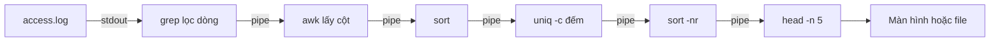

# Slide buổi 03 – Linux CLI

> **Tóm tắt:** Dùng thành thạo pwd, ls, cd, find, grep, cat, less, head, tail và pipe để điều hướng filesystem, tìm file và phân tích access log. Bài học: [Buổi 03 – Linux CLI](../../labs/week-02/session-03.md).

## Slide 1: Mục tiêu buổi học

- Hiểu cây thư mục Linux, đường dẫn tuyệt đối và tương đối
- Điều hướng và đọc file bằng `pwd`, `ls`, `cd`, `cat`, `less`, `head`, `tail`
- Tìm file bằng `find`, tìm dòng bằng `grep`
- Ghép pipeline `awk | sort | uniq -c | sort -nr` để thống kê access log
- Chẩn đoán lỗi quote đường dẫn, sai đường dẫn, `rm` nhầm chỗ

---

## Slide 2: Vấn đề – web chậm trước giờ demo

- Server chỉ có terminal, log Nginx dài hàng chục nghìn dòng
- Cần biết: IP nào gọi nhiều nhất, bao nhiêu lỗi 5xx, endpoint nào bị gọi nhiều
- Mở bằng Notepad hay đọc bằng mắt đều không khả thi
- Người biết CLI trả lời trong vài chục giây bằng một dòng pipeline

---

## Slide 3: Cây thư mục Linux

| Đường dẫn | Ý nghĩa |
| --- | --- |
| `/` | Gốc của toàn bộ cây |
| `~` | Home của bạn, nơi làm việc chính |
| `/etc` | Cấu hình hệ thống |
| `/var/log` | Log hệ thống và dịch vụ |
| `/tmp` | File tạm |
| `.` và `..` | Thư mục hiện tại và thư mục cha |

- Không có ổ `C:`, ổ Windows nằm dưới `/mnt/c` (tránh trong khóa này)
- Linux phân biệt chữ hoa chữ thường

---

## Slide 4: Lệnh điều hướng và đọc file

| Lệnh | Công dụng |
| --- | --- |
| `pwd` | In thư mục hiện tại |
| `ls -la` | Liệt kê dài, có file ẩn |
| `cd`, `cd ..`, `cd -` | Đổi thư mục, lên cha, quay lại |
| `mkdir -p` | Tạo thư mục kể cả cha |
| `cat`, `less` | In cả file, xem cuộn (thoát bằng `q`) |
| `head -n`, `tail -n` | Xem đầu, cuối file |
| `wc -l` | Đếm dòng |

---

## Slide 5: find tìm file, grep tìm dòng

| Lệnh | Ý nghĩa |
| --- | --- |
| `find . -name "*.log"` | File có tên kết thúc bằng .log |
| `find . -type d` | Chỉ thư mục (`-type f` là file) |
| `find . -size +1M` | File lớn hơn 1 MiB |
| `grep "ERROR" file` | Dòng chứa ERROR |
| `grep -i`, `-v`, `-c`, `-n` | Không phân biệt hoa thường, đảo, đếm, số dòng |
| `grep -r "mau" thu-muc` | Tìm đệ quy |

---

## Slide 6: Pipe và redirect

- Mỗi lệnh làm một việc nhỏ: đọc stdin, ghi stdout
- `|` nối stdout của lệnh trước vào stdin của lệnh sau
- `>` ghi đè file, `>>` ghi nối thêm, `2>` ghi riêng lỗi
- Công cụ hay dùng: `awk '{print $1}'`, `sort`, `uniq -c`, `head -n 5`

```bash
printf '%s\n' 'line one' 'line two ERROR' 'line three' > sample.txt
grep ERROR sample.txt
cat sample.txt | wc -l
```

```text
line two ERROR
3
```

---

## Slide 7: Định dạng access log

```text
10.0.0.5 - - [21/Oct/2026:09:00:01 +0700] "GET /health HTTP/1.1" 200 15
```

| Cột | Ý nghĩa |
| --- | --- |
| `$1` | IP client |
| `$7` | Đường dẫn |
| `$9` | Mã HTTP |
| `$10` | Số byte |

- `awk` tách theo khoảng trắng, nên `$9` là mã trạng thái

---

## Slide 8: Kiến trúc pipeline phân tích log



- `awk` cắt mỗi dòng thành cột và in cột cần phân tích
- `sort` đưa giá trị giống nhau nằm cạnh nhau, `uniq -c` gộp các dòng liền kề và đếm
- `sort -nr` sắp xếp giảm dần, `head -n 5` giữ top 5
- Cách xây: thêm từng lệnh một, xem output rồi mới thêm tiếp

---

## Slide 9: Demo – đếm request theo IP

```bash
awk '{print $1}' mini-access.log | sort | uniq -c | sort -nr
```

```text
      4 10.0.0.5
      3 10.0.0.9
      3 10.0.0.7
```

- Dữ liệu nhỏ 10 dòng, đếm tay được để tự kiểm chứng
- Với số lần bằng nhau, thứ tự có thể khác

---

## Slide 10: Demo – quên sort thì sao

```bash
awk '{print $9}' mini-access.log | uniq -c
```

- Triệu chứng: mã 200 xuất hiện nhiều dòng với số đếm nhỏ
- Nguyên nhân: `uniq` chỉ gộp dòng liền nhau
- Cách sửa: thêm `sort` trước `uniq -c`
- Cách kiểm: cộng các số đếm, so với `wc -l`

---

## Slide 11: Lab – bạn sẽ làm gì

- Phần 1: dựng cây thư mục `club-site`, thư mục có khoảng trắng phải đặt trong nháy kép
- Phần 2: `find` theo tên và loại, `grep -r` trong thư mục cấu hình, `>` khác `>>`
- Phần 3: tạo `mini-access.log` rồi đếm theo IP, theo mã HTTP, lọc 5xx bằng `awk` kiểm tra đúng cột 9
- Làm trên file thật `examples/linux/access.log` (260 dòng) bằng `less`
- Toàn bộ lệnh và kết quả mong đợi nằm trong bài lab: [Buổi 03 – Linux CLI](../../labs/week-02/session-03.md)

---

## Slide 12: Lỗi thường gặp – khoảng trắng chưa quote

| Triệu chứng | Cách xử lý |
| --- | --- |
| `cd: too many arguments` | Quote: `cd "my folder"` |
| `No such file or directory` | `pwd`, `ls`, dùng đường dẫn tuyệt đối |
| `uniq -c` đếm sai | Thêm `sort` trước |
| File mất nội dung | Dùng `>>` thay cho `>` |

- Shell tách đối số theo khoảng trắng; thói quen: chạy `ls` hoặc `echo` với cùng đối số trước khi xóa, `pwd` trước `rm`
- Bảng đầy đủ nằm trong mục "Gặp lỗi?" của bài lab

---

## Slide 13: Challenge

- Viết pipeline in 3 URL được gọi nhiều nhất từ access log
- Nếu gõ `rm -rf logs /` thay vì `rm -rf logs/` thì chuyện gì có thể xảy ra?
- Đồng đội nói `grep ERROR app.log` không ra gì nhưng chắc có lỗi, bạn kiểm tra gì?

<details><summary>Gợi ý</summary>

Top 3 URL: `awk '{print $7}' access.log | sort | uniq -c | sort -nr | head -n 3`. Với `grep`: thử `-i`, kiểm tra đúng file bằng `pwd`/`ls`, `wc -l`, và `grep -r` trong thư mục log.

</details>

---

## Slide 14: Recap

- Linux có một cây thư mục từ `/`, làm việc trong `~`
- Kiểm tra bằng `pwd` và `ls` trước khi xóa
- `find` tìm file, `grep` tìm dòng
- Pipe nối lệnh nhỏ thành công cụ phân tích, xây từng đoạn
- Mẫu kinh điển: `awk | sort | uniq -c | sort -nr | head`
- Quote đường dẫn và biến; kiểm chứng bằng dữ liệu nhỏ đếm tay
- Bài tiếp theo: Linux Administration ([Slide buổi 04](session-04.md))
