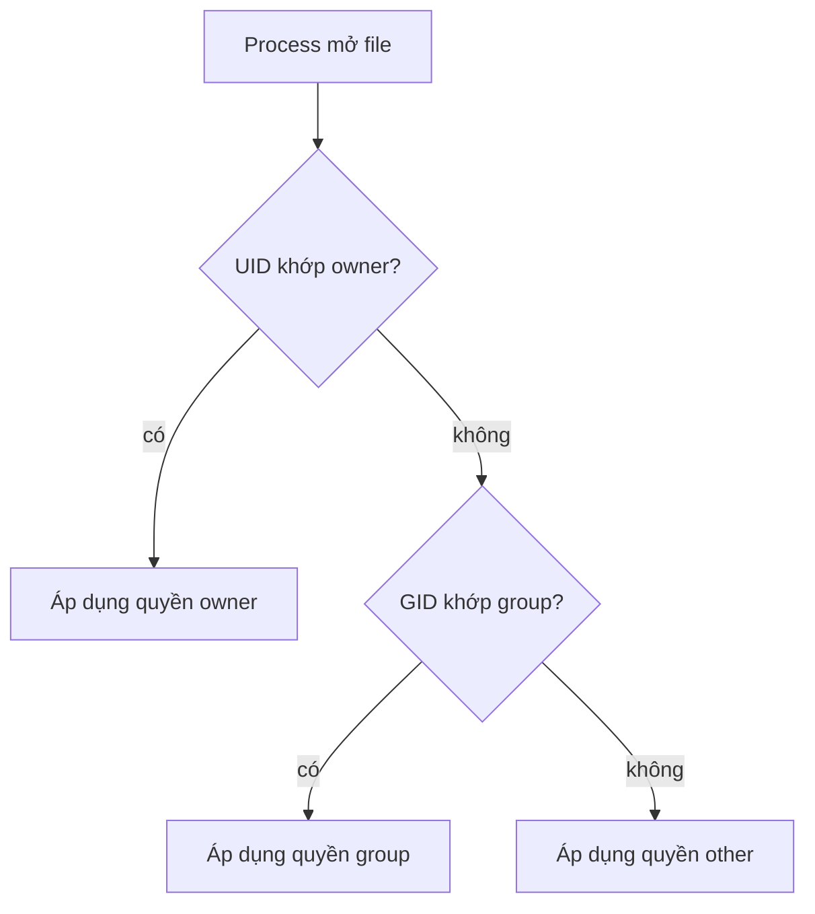
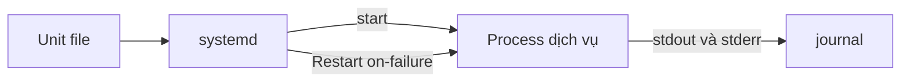

# Slide buổi 04 – Linux Administration

> **Tóm tắt:** Tạo user và group, phân quyền thư mục dùng chung bằng chmod, chown, setgid, quản lý process và biến môi trường, chạy một systemd service trên WSL2 Ubuntu. Bài học: [Buổi 04 – Linux Administration](../../labs/week-02/session-04.md).

## Slide 1: Mục tiêu buổi học

- Giải thích mô hình quyền owner, group, other và ba bit r, w, x
- Tạo user, group, thư mục chung bằng `useradd`, `groupadd`, `chown`, `chmod 2770`
- Tìm và dừng process: `ps`, `pgrep`, `kill`, hiểu SIGTERM và SIGKILL
- Phân biệt biến shell và biến môi trường (`export`)
- Chạy service bằng `systemctl`, đọc log bằng `journalctl`
- Chẩn đoán `Permission denied` mà không dùng `chmod 777`

---

## Slide 2: Vấn đề thực tế

- Cả nhóm dùng chung một tài khoản và `chmod 777` cho nhanh
- Một bạn xóa nhầm `.env` của bạn khác, không ai biết ai làm
- Mọi thao tác mang cùng một tên người dùng, không truy vết được
- Service chạy bằng root: nếu bị khai thác thì mất cả máy
- Mục tiêu: mỗi người một user, nhóm một group, quyền vừa đủ

---

## Slide 3: User, group và UID/GID

- Linux nhận diện bằng số UID, GID; tên chỉ là nhãn
- Mỗi user có một group chính và nhiều group phụ
- File chính: `/etc/passwd`, `/etc/group`, `/etc/shadow` (chỉ root đọc)
- Xem nhanh: `id`, `getent group tên`
- UID 0 là root; user thường từ 1000 trở lên

---

## Slide 4: Quyền file r, w, x

- `ls -l` cho chuỗi 10 ký tự, ví dụ `drwxrws---`
- Ký tự đầu: loại (d thư mục, - file); sau đó owner, group, other
- r = 4, w = 2, x = 1: `chmod 750` nghĩa là rwx, r-x, ---
- Thư mục: r là liệt kê, w là tạo hoặc xóa file, x là đi vào
- Xóa file cần quyền w trên thư mục chứa, không phải trên file

---

## Slide 5: Kernel chọn đúng một nhóm quyền



- Chỉ áp dụng một nhóm, không cộng dồn quyền owner và group
- Group phụ cũng được tính
- Kernel còn kiểm tra bit x của mọi thư mục dọc đường dẫn

---

## Slide 6: setgid, sticky bit, umask

- setgid trên thư mục (`chmod 2770`): file mới thừa hưởng group của thư mục
- sticky bit (`+t`): chỉ owner file được xóa trong thư mục, như `/tmp`
- umask là quyền bị trừ khi tạo file: 022 cho file 644, 007 cho file 660
- Thư mục chung của nhóm: group sở hữu + `2770` + umask 007 hoặc 002

---

## Slide 7: Process và tín hiệu

- Mỗi chương trình đang chạy là một process: PID, UID, PPID
- `ps aux`, `pgrep -a tên` để tìm; `jobs` cho job của shell
- `kill PID` gửi SIGTERM (15): xin process tự dọn dẹp rồi thoát
- `kill -9 PID` gửi SIGKILL (9): kernel giết ngay, không dọn dẹp được
- Quy tắc: thử SIGTERM trước, SIGKILL là phương án cuối

---

## Slide 8: Biến môi trường và systemd

- Biến shell chỉ sống trong shell hiện tại
- Biến `export` được sao chép sang mọi process con
- Ứng dụng starter-project đọc `DB_PASSWORD`, `WEB_PORT` từ môi trường
- systemd quản lý service bằng unit file trong `/etc/systemd/system/`
- `systemctl start|stop|status`, log xem bằng `journalctl -u tên`



---

## Slide 9: Demo 1 – đọc quyền thực tế

```bash
id
ls -ld /tmp /etc/shadow ~
cat /etc/shadow
```

```text
uid=1000(student) gid=1000(student) groups=1000(student),27(sudo)
-rw-r----- 1 root    shadow   1234 Oct 21 09:00 /etc/shadow
drwxr-x--- 8 student student  4096 Oct 21 09:00 /home/student
drwxrwxrwt 12 root   root     4096 Oct 21 09:00 /tmp
cat: /etc/shadow: Permission denied
```

---

## Slide 10: Demo 2 – biến export và tín hiệu

```bash
CLUB=dsc
bash -c 'echo "con thay: [$CLUB]"'
export CLUB
bash -c 'echo "con thay: [$CLUB]"'
```

```text
con thay: []
con thay: [dsc]
```

- Quên `export` thì ứng dụng đọc `DB_PASSWORD` thấy gì?
- Tiếp theo: chạy `sleep 300 &`, tìm bằng `pgrep -a`, dừng bằng `kill`

---

## Slide 11: Lab – bạn sẽ làm gì

- Phần 1: tạo group `clbdev` và ba user, thêm thành viên bằng `usermod -aG` (đừng quên `-a`)
- Phần 2: thư mục chung `/srv/club-shared` với `chmod 2770`, thử từng user, so sánh với thư mục không có setgid
- Phần 3: chạy process nền, dừng bằng `kill`, xử lý process bỏ qua SIGTERM bằng `kill -9`
- Phần 4: so sánh biến shell và biến `export` bằng `bash -c`
- Toàn bộ lệnh và kết quả mong đợi nằm trong bài lab: [Buổi 04 – Linux Administration](../../labs/week-02/session-04.md)

---

## Slide 12: Lỗi thường gặp

| Triệu chứng | Cách xử lý |
| --- | --- |
| Permission denied dù đã thêm vào group | Đăng nhập lại hoặc `newgrp clbdev`, kiểm tra bằng `id` |
| File chung có group là tên cá nhân | `sudo chmod g+s thư-mục`, file cũ sửa bằng `chgrp` |
| Dev khác chỉ đọc được file | Dùng umask 002 hoặc 007 |
| `usermod -G` làm mất group khác | Luôn dùng `usermod -aG` |
| `status=203/EXEC` | Kiểm tra đường dẫn tuyệt đối và `chmod 755` |

- Điều tra theo thứ tự: `id`, `ls -ld`, `namei -l`; phiên đang chạy giữ danh sách group cũ

---

## Slide 13: Thử thách tại lớp

- Tình huống: bạn mới báo Permission denied 10 phút sau khi bạn đã chạy `usermod -aG`
- Việc làm đầu tiên là gì? Không được dùng `chmod 777`
- Bonus: giải thích vì sao Dockerfile của backend starter-project chạy bằng user không phải root

<details><summary>Gợi ý</summary>

Chạy `id` trong terminal của bạn ấy, rồi `ls -ld` và `namei -l`.

</details>

<details><summary>Đáp án</summary>

Phiên cũ chưa nạp group mới; yêu cầu đăng nhập lại rồi kiểm tra `id`. Service chạy user riêng theo nguyên tắc quyền tối thiểu.

</details>

---

## Slide 14: Recap

- Quyền xét theo đúng một nhóm: owner, group hoặc other; thư mục cần x để vào, w để thêm hoặc xóa
- Thư mục chung: group sở hữu + `chmod 2770` + umask phù hợp, không `777`
- Sửa group chỉ có hiệu lực với phiên đăng nhập mới
- Dừng process bằng SIGTERM trước, SIGKILL là phương án cuối
- Chỉ biến đã `export` mới truyền sang process con
- Nhớ dọn user, group, thư mục thử nghiệm rồi nộp `lab-04/`
