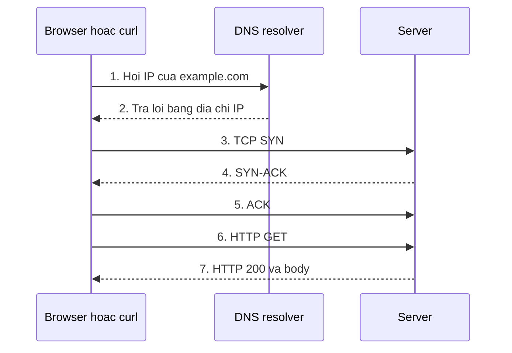
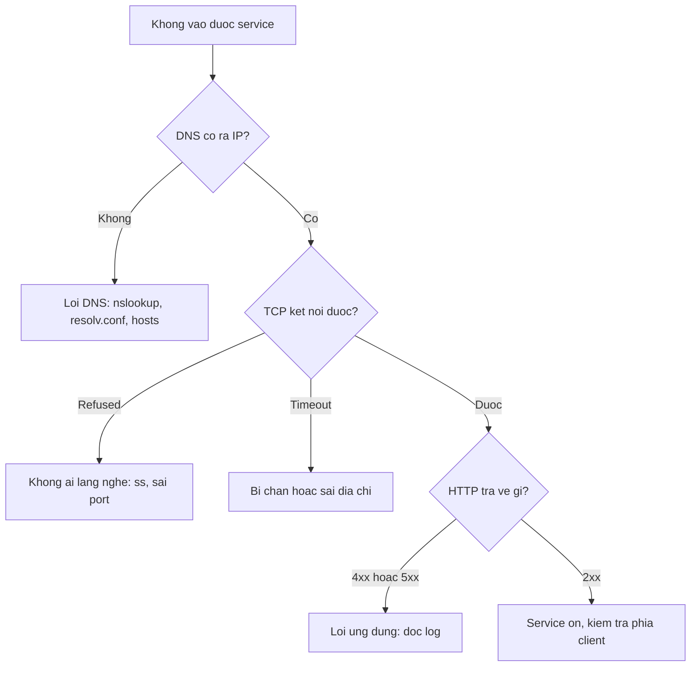

# Slide buổi 05 – Networking Fundamentals

> **Tóm tắt:** Hiểu IP, DNS, TCP, port, HTTP và localhost, rồi dùng ping, curl, nslookup, ss để chẩn đoán một request theo từng tầng.

Lệnh chi tiết của lab nằm trong bài học: [Buổi 05 – Networking Fundamentals](../../labs/week-03/session-05.md). Kịch bản dạy: [Kịch bản mentor buổi 05](../../mentors/sessions/session-05.md).

## Slide 1: Mục tiêu buổi học

- Giải thích đường đi của request: DNS, TCP, TLS, HTTP
- Phân biệt IP, subnet, port, `localhost`, `127.0.0.1`, `0.0.0.0`
- Dùng `ping`, `curl -v`, `nslookup`, `ss -ltnp` và đọc đúng kết quả
- Chẩn đoán ba lỗi: không phân giải được, bị từ chối, timeout
- Xử lý `Address already in use` bằng cách tìm process giữ port
- Hiểu vì sao `localhost` trong container không phải của máy host

---

## Slide 2: Vấn đề thực tế

- Tin nhắn quen thuộc: "Web của em không vào được, API chết rồi anh ơi"
- "Không vào được" có thể là năm lỗi khác nhau
- DNS không ra IP, không ai lắng nghe port, bind sai địa chỉ, firewall chặn, hoặc app trả 500
- Starter-project có ba thành phần nói chuyện qua mạng: Nginx 8080, API 3000, PostgreSQL 5432
- Mọi lỗi kết nối trong Docker, Compose, Kubernetes là lỗi mạng ở một tầng cụ thể

---

## Slide 3: IP, subnet và các dải địa chỉ

- IPv4 gồm 4 số từ 0 đến 255; CIDR `192.168.1.25/24` nghĩa là 24 bit đầu là mạng
- Cùng subnet nói chuyện trực tiếp, khác subnet đi qua gateway
- `127.0.0.0/8`: loopback, chỉ nói chuyện với chính máy
- `10.0.0.0/8`, `172.16.0.0/12`, `192.168.0.0/16`: private; WSL2, Docker, kind đều dùng
- `0.0.0.0` khi bind nghĩa là lắng nghe trên mọi card mạng

---

## Slide 4: DNS

- DNS đổi tên miền thành IP; resolver trong WSL2 ghi ở `/etc/resolv.conf`
- Bản ghi A là IPv4, AAAA là IPv6, CNAME là bí danh
- `/etc/hosts` được tra trước DNS; `localhost` trỏ về `127.0.0.1`
- Kết quả được cache theo TTL
- Lỗi ở bước này: `Could not resolve host`, chưa có gói tin nào tới server

---

## Slide 5: TCP, port và HTTP

- IP đưa gói tin tới đúng máy, port đưa tới đúng chương trình
- TCP: bắt tay ba bước, đảm bảo thứ tự; UDP: không kết nối
- Port quen thuộc: 22 SSH, 53 DNS, 80 và 443 HTTP(S), 5432 PostgreSQL, 3000 API, 8080 frontend
- Một port chỉ có một process lắng nghe trên cùng địa chỉ
- HTTP status: 2xx thành công, 3xx chuyển hướng, 4xx lỗi client, 5xx lỗi server

---

## Slide 6: Bind address và reverse proxy

- Bind `127.0.0.1`: chỉ process trên cùng máy hoặc cùng network namespace
- Bind `0.0.0.0`: mọi giao diện mạng
- Mỗi container có network namespace riêng, nên `localhost` trong container là chính nó
- Vì vậy compose dùng `DB_HOST: postgres` (tên service), không dùng `localhost`
- Nginx là reverse proxy: `/` là file tĩnh, `/api/` chuyển sang `http://backend:3000`

---

## Slide 7: Một request đi qua những bước nào

- Lỗi DNS ở bước 1 và 2, lỗi TCP ở bước 3 và 4, lỗi ứng dụng ở bước 6 và 7
- Với HTTPS, TLS handshake diễn ra sau bước 5

---

## Slide 8: Quy trình chẩn đoán từ dưới lên

---

## Slide 9: Demo – đọc từng tầng bằng công cụ

- Tầng IP: `ip -br addr` cho thấy `lo` (loopback) và `eth0` (card mạng ảo của WSL2)
- Tầng DNS: `nslookup` cho thấy dòng `Server` là resolver đang dùng
- Tầng HTTP: `curl -v` có dòng `*` là kết nối (DNS, TCP), `>` là request, `<` là response
- Tầng port: server cục bộ bind `127.0.0.1:9000` rồi xem bằng `ss -ltnp`
- Câu hỏi: dòng nào chứng minh DNS thành công? Dòng nào chứng minh TCP thành công?

---

## Slide 10: Ba loại lỗi kết nối

| Mã curl | Thông báo | Ý nghĩa |
| --- | --- | --- |
| (7) | Failed to connect ... Couldn't connect | Refused: máy sống, không ai lắng nghe port |
| (28) | Connection timed out | Bị chặn hoặc không có đường đi |
| (6) | Could not resolve host | Lỗi DNS |

- Với mỗi lỗi, lệnh tiếp theo bạn chạy là gì?

---

## Slide 11: Port đã được sử dụng

- Triệu chứng: `OSError: [Errno 98] Address already in use` (Docker: `port is already allocated`)
- Xác nhận port bị chiếm: `ss -ltn 'sport = :9000'` có dòng LISTEN
- Lấy tên và PID từ `users:((...))` của `ss -ltnp`
- Kiểm tra process đó là gì (`ps -p PID`), rồi dừng nhẹ nhàng hoặc đổi port
- Phòng tránh: đặt port bằng biến môi trường như `WEB_PORT`

---

## Slide 12: Lỗi thường gặp

| Triệu chứng | Nguyên nhân | Cách xử lý |
| --- | --- | --- |
| `curl: (6)` | DNS lỗi hoặc sai tên | `nslookup tên`, xem `/etc/resolv.conf` |
| `curl: (7)` | Không ai lắng nghe port | `ss -ltnp` trên máy đích |
| `curl: (28)` | Bị chặn hoặc không có đường đi | Kiểm tra IP, `ip route`, firewall |
| `Address already in use` | Port đang bị giữ | `ss -ltnp 'sport = :PORT'` |
| ping thành công, web lỗi | Service không chạy hoặc sai port | Kiểm tra bằng `ss` và `curl` |

---

## Slide 13: Recap

- Request đi qua DNS, TCP, TLS (nếu HTTPS), HTTP; dùng công cụ đúng tầng
- Không phân giải được tên là DNS, refused là không ai lắng nghe, timeout là bị chặn
- `ping` chỉ chứng minh máy phản hồi ICMP; muốn biết service sống dùng `curl` và `ss`
- `127.0.0.1` chỉ nội bộ, `0.0.0.0` là mọi giao diện, `localhost` trong container là chính container
- Nginx là reverse proxy, chuyển tiếp `/api/` sang backend theo tên service
- Nộp `lab-05/` với bằng chứng dạng text, không dùng ảnh thay log
