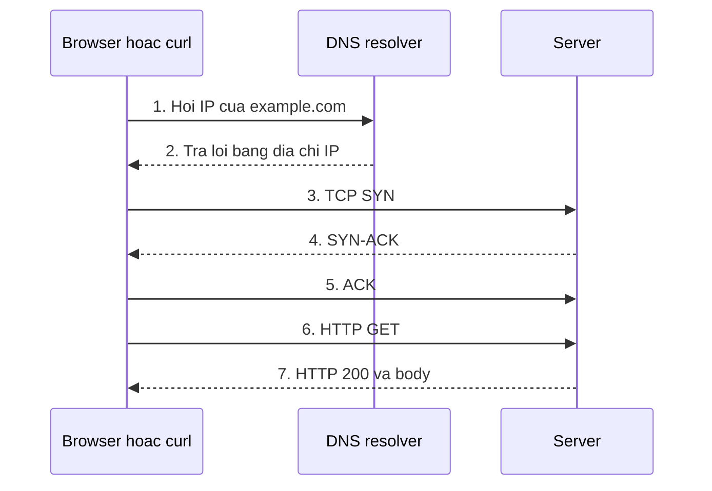
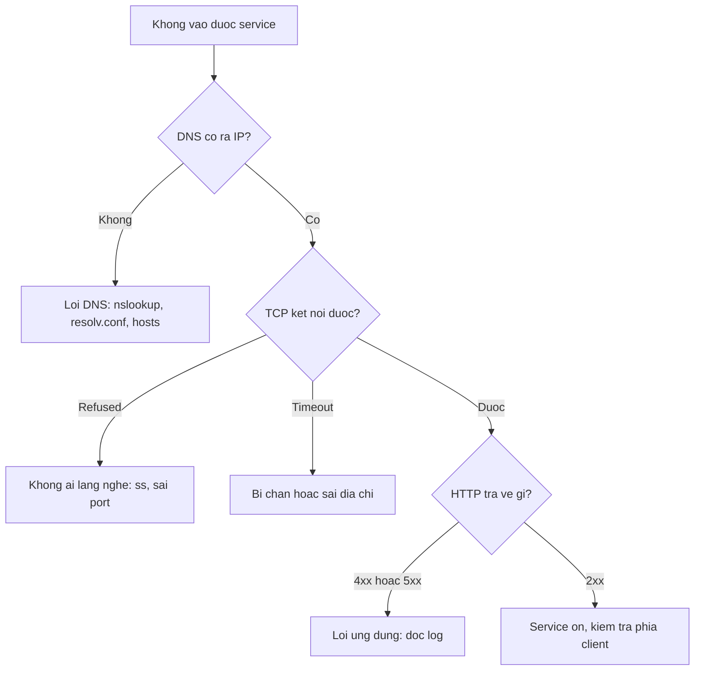

# Slide buổi 05 – Networking Fundamentals

> **Tóm tắt:** Hiểu IP, DNS, TCP, port, HTTP và localhost, rồi dùng ping, curl, nslookup, ss để chẩn đoán một request theo từng tầng.

## Slide 1: Mục tiêu buổi học

- Giải thích đường đi của request: DNS, TCP, TLS, HTTP
- Phân biệt IP, subnet, port, `localhost`, `127.0.0.1`, `0.0.0.0`
- Dùng `ping`, `curl -v`, `nslookup`, `ss -ltnp` và đọc đúng kết quả
- Chẩn đoán ba lỗi: không phân giải được, bị từ chối, timeout
- Xử lý `Address already in use` bằng cách tìm process giữ port
- Hiểu vì sao `localhost` trong container không phải của máy host

::: details Ghi chú giảng viên
Mở đầu 2 phút. Nói rõ: cuối buổi mỗi bạn có một quy trình chẩn đoán "không vào được" theo tầng, thay vì restart lung tung.
:::

---

## Slide 2: Vấn đề thực tế

- Tin nhắn quen thuộc: "Web của em không vào được, API chết rồi anh ơi"
- "Không vào được" có thể là năm lỗi khác nhau
- DNS không ra IP, không ai lắng nghe port, bind sai địa chỉ, firewall chặn, hoặc app trả 500
- Starter-project có ba thành phần nói chuyện qua mạng: Nginx 8080, API 3000, PostgreSQL 5432
- Mọi lỗi kết nối trong Docker, Compose, Kubernetes là lỗi mạng ở một tầng cụ thể

::: details Ghi chú giảng viên
Hỏi lớp: nếu bạn nhận được tin nhắn này, câu hỏi đầu tiên bạn hỏi lại là gì? Dẫn tới việc cần mô hình theo tầng. 2 phút.
:::

---

## Slide 3: IP, subnet và các dải địa chỉ

- IPv4 gồm 4 số từ 0 đến 255; CIDR `192.168.1.25/24` nghĩa là 24 bit đầu là mạng
- Cùng subnet nói chuyện trực tiếp, khác subnet đi qua gateway
- `127.0.0.0/8`: loopback, chỉ nói chuyện với chính máy
- `10.0.0.0/8`, `172.16.0.0/12`, `192.168.0.0/16`: private; WSL2, Docker, kind đều dùng
- `0.0.0.0` khi bind nghĩa là lắng nghe trên mọi card mạng

::: details Ghi chú giảng viên
Ví dụ nhanh: 192.168.1.10/24 và 192.168.2.10/24 có cùng subnet không? (Không.) 3 phút.
:::

---

## Slide 4: DNS

- DNS đổi tên miền thành IP; resolver trong WSL2 ghi ở `/etc/resolv.conf`
- Bản ghi A là IPv4, AAAA là IPv6, CNAME là bí danh
- `/etc/hosts` được tra trước DNS; `localhost` trỏ về `127.0.0.1`
- Kết quả được cache theo TTL
- Lỗi ở bước này: `Could not resolve host`, chưa có gói tin nào tới server

::: details Ghi chú giảng viên
Hỏi: vì sao nslookup trả Non-authoritative answer? (Câu trả lời từ cache của resolver.) 3 phút.
:::

---

## Slide 5: TCP, port và HTTP

- IP đưa gói tin tới đúng máy, port đưa tới đúng chương trình
- TCP: bắt tay ba bước, đảm bảo thứ tự; UDP: không kết nối
- Port quen thuộc: 22 SSH, 53 DNS, 80 và 443 HTTP(S), 5432 PostgreSQL, 3000 API, 8080 frontend
- Một port chỉ có một process lắng nghe trên cùng địa chỉ
- HTTP status: 2xx thành công, 3xx chuyển hướng, 4xx lỗi client, 5xx lỗi server

::: details Ghi chú giảng viên
Nhấn mạnh: process thứ hai bind cùng port sẽ gặp Address already in use, sẽ làm ở lab. 3 phút.
:::

---

## Slide 6: Bind address và reverse proxy

- Bind `127.0.0.1`: chỉ process trên cùng máy hoặc cùng network namespace
- Bind `0.0.0.0`: mọi giao diện mạng
- Mỗi container có network namespace riêng, nên `localhost` trong container là chính nó
- Vì vậy compose dùng `DB_HOST: postgres` (tên service), không dùng `localhost`
- Nginx là reverse proxy: `/` là file tĩnh, `/api/` chuyển sang `http://backend:3000`

::: details Ghi chú giảng viên
Đây là kiến thức nối sang Docker và Compose. Hỏi: API trong container gọi localhost:5432 thì chuyện gì xảy ra? 3 phút.
:::

---

## Slide 7: Một request đi qua những bước nào



- Lỗi DNS ở bước 1 và 2, lỗi TCP ở bước 3 và 4, lỗi ứng dụng ở bước 6 và 7
- Với HTTPS, TLS handshake diễn ra sau bước 5

::: details Ghi chú giảng viên
Đi từng bước 3 phút. Hỏi: nếu máy đích không có process nào lắng nghe port, bước nào thất bại và thấy lỗi gì?
:::

---

## Slide 8: Quy trình chẩn đoán từ dưới lên



::: details Ghi chú giảng viên
Sơ đồ trọng tâm, chụp ảnh lại để làm cheat sheet. Cuối buổi quay lại sơ đồ này để lớp tự điền lệnh cho từng nhánh. 3 phút.
:::

---

## Slide 9: Demo 1 – IP và DNS

```bash
ip -br addr
nslookup example.com
```

Kết quả mong đợi (rút gọn, địa chỉ của bạn sẽ khác):

```text
lo               UNKNOWN        127.0.0.1/8 ::1/128
eth0             UP             172.24.100.5/20
Server:         10.255.255.254
Name:   example.com
Address: 93.184.215.14
```

- `lo` là loopback, `eth0` là card mạng ảo của WSL2
- Dòng `Server` là DNS resolver đang dùng

::: details Ghi chú giảng viên
IP thực tế của example.com có thể khác. Hỏi: hai địa chỉ lo và eth0 khác nhau gì về phạm vi truy cập? 3 phút.
:::

---

## Slide 10: Demo 2 – curl -v đọc từng tầng

```bash
curl -v http://example.com/ -o /dev/null
```

```text
* Host example.com:80 was resolved.
*   Trying 93.184.215.14:80...
* Connected to example.com (93.184.215.14) port 80
> GET / HTTP/1.1
> Host: example.com
< HTTP/1.1 200 OK
```

- Dòng `*` là kết nối (DNS, TCP), `>` là request, `<` là response
- Hỏi lớp: dòng nào chứng minh DNS thành công? Dòng nào chứng minh TCP thành công?

::: details Ghi chú giảng viên
Phiên bản curl khác nhau in hơi khác, không sao. Với HTTPS có thêm dòng SSL connection using. 4 phút.
:::

---

## Slide 11: Demo 3 – Server cục bộ và ss

Terminal thứ hai:

```bash
mkdir -p ~/devops-labs/lab-05/source/site && cd ~/devops-labs/lab-05/source/site
echo "Club Management network demo" > index.html
python3 -m http.server 9000 --bind 127.0.0.1
```

Terminal thứ nhất:

```bash
ss -ltnp | grep 9000
curl -i http://127.0.0.1:9000/
```

```text
LISTEN 0      5      127.0.0.1:9000      0.0.0.0:*    users:(("python3",pid=2310,fd=3))
HTTP/1.0 200 OK
```

::: details Ghi chú giảng viên
Hỏi: nếu bind 0.0.0.0 thì cột Local Address đổi thế nào và ai khác vào được? 4 phút.
:::

---

## Slide 12: Demo 4 – Ba loại lỗi kết nối

```bash
curl http://127.0.0.1:9001/
curl --max-time 3 http://192.0.2.1/
curl http://khong-ton-tai.invalid/
```

```text
curl: (7) Failed to connect to 127.0.0.1 port 9001 after 0 ms: Couldn't connect to server
curl: (28) Connection timed out after 3002 milliseconds
curl: (6) Could not resolve host: khong-ton-tai.invalid
```

- (7) Refused: máy sống, không ai lắng nghe port
- (28) Timeout: bị chặn hoặc không có đường đi
- (6) Không phân giải được tên: lỗi DNS

::: details Ghi chú giảng viên
192.0.2.1 thuộc dải TEST-NET-1 dành cho tài liệu nên không ai trả lời; một số mạng báo Network is unreachable. Hỏi: với mỗi lỗi, lệnh tiếp theo bạn chạy là gì? 3 phút.
:::

---

## Slide 13: Lab – Chuẩn bị và tầng IP

```bash
mkdir -p ~/devops-labs/lab-05/{source,screenshots,evidence}
cd ~/devops-labs/lab-05
echo "# Lab 05 - Networking evidence" > evidence/command-output.txt
ip -br addr | tee -a evidence/command-output.txt
ip route | tee -a evidence/command-output.txt
ping -c 4 127.0.0.1 | tee -a evidence/command-output.txt
ping -c 4 1.1.1.1 | tee -a evidence/command-output.txt
```

```text
default via 172.24.96.1 dev eth0
4 packets transmitted, 4 received, 0% packet loss
```

- Ghi lại IP, prefix và gateway của `eth0`
- Ping IP không cần DNS; nhiều mạng chặn ICMP nên ping lỗi chưa chắc mất mạng

::: details Ghi chú giảng viên
Lab 60 phút: Phần 1 đến 3 khoảng 25 phút. Nhắc dùng `tee -a`. Nếu thiếu lệnh, cài `sudo apt install -y dnsutils iputils-ping`.
:::

---

## Slide 14: Lab – Tầng DNS và HTTP

```bash
cat /etc/resolv.conf | tee -a evidence/command-output.txt
nslookup github.com | tee -a evidence/command-output.txt
nslookup github.com 1.1.1.1 | tee -a evidence/command-output.txt
curl -s -o /dev/null -w "status=%{http_code} dns=%{time_namelookup}s total=%{time_total}s\n" https://example.com/ | tee -a evidence/command-output.txt
```

```text
status=200 dns=0.020s total=0.210s
```

- `nameserver` trong `resolv.conf` trùng dòng `Server` của `nslookup`
- `-w` cho biết thời gian từng giai đoạn: chậm ở DNS, kết nối hay xử lý

::: details Ghi chú giảng viên
Số liệu thời gian khác nhau theo mạng. Gợi ý thêm: `getent hosts localhost` đi qua cơ chế phân giải của hệ điều hành, khác nslookup. 8 phút.
:::

---

## Slide 15: Lab – Tầng port và xung đột port

```bash
python3 -m http.server 9000 --bind 0.0.0.0
```

Ở terminal khác, chạy lại đúng lệnh trên:

```text
OSError: [Errno 98] Address already in use
```

```bash
ss -ltnp 'sport = :9000' | tee -a evidence/command-output.txt
ps -p 2410 -o pid,ppid,etime,cmd
```

- Thay `2410` bằng PID thật trong cột `users:(...)`
- Tìm đúng PID trước, rồi mới quyết định dừng; thử `kill PID`, không kill process không biết là gì
- Ghi vào `report.md` bảng bốn tầng: IP, DNS, TCP/port, HTTP

::: details Ghi chú giảng viên
Cho học viên tự gây lỗi trước, rồi mới hướng dẫn tìm PID. Với Docker, lỗi tương ứng là port is already allocated. 10 phút.
:::

---

## Slide 16: Lab L1 và L2

- L1: ghi IP, gateway; ping hai địa chỉ; nslookup; curl -v; ss; gặp và xử lý `Address already in use`
- L1: hoàn thành bảng bốn tầng trong `report.md`
- L2 (chọn tối thiểu hai): A mô tả đường đi của request, B chứng minh ping không đủ, C dùng `curl --resolve`, D quan sát cổng starter-project
- Thử thách C: có dòng `> Host: demo.club.test:9000` trong output

```bash
curl -v --resolve demo.club.test:9000:127.0.0.1 http://demo.club.test:9000/ -o /dev/null 2>&1 | grep -E 'Host|HTTP/'
```

::: details Ghi chú giảng viên
Server Python phải đang chạy ở terminal khác khi làm thử thách C. Thử thách D cần Docker Desktop và `.env` giả, nhớ `docker compose down` sau khi xong và không commit `.env`.
:::

---

## Slide 17: Lỗi thường gặp

| Triệu chứng | Nguyên nhân | Cách xử lý |
| --- | --- | --- |
| `curl: (6)` | DNS lỗi hoặc sai tên | `nslookup tên`, xem `/etc/resolv.conf` |
| `curl: (7)` | Không ai lắng nghe port | `ss -ltnp` trên máy đích |
| `curl: (28)` | Bị chặn hoặc không có đường đi | Kiểm tra IP, `ip route`, firewall |
| `Address already in use` | Port đang bị giữ | `ss -ltnp 'sport = :PORT'` |
| ping thành công, web lỗi | Service không chạy hoặc sai port | Kiểm tra bằng `ss` và `curl` |

::: details Ghi chú giảng viên
Hỏi: vì sao ping 1.1.1.1 thành công không chứng minh curl https://github.com sẽ thành công? (Còn DNS, TCP 443, TLS, HTTP.)
:::

---

## Slide 18: Phá lỗi – Port đã được sử dụng

```bash
ss -ltn 'sport = :9000'
ss -ltnp 'sport = :9000'
ps -p PID -o pid,ppid,etime,cmd
kill PID
```

1. Xác nhận port bị chiếm: có dòng LISTEN
2. Lấy tên và PID từ `users:((...))`
3. Kiểm tra process đó là gì, có phải server cũ bạn quên tắt không
4. Dừng nhẹ nhàng hoặc đổi port, rồi xác nhận lại bằng `ss`

- Phòng tránh: đặt port bằng biến môi trường như `WEB_PORT`
- Đây là tình huống 01 trong bộ lỗi của khóa

::: details Ghi chú giảng viên
Trong lệnh, PID là chỗ học viên thay bằng số thật. Trên Windows, chương trình phía Windows cũng có thể giữ port mà ss trong WSL không thấy. 4 phút.
:::

---

## Slide 19: Thử thách tại lớp

- API trong container báo không kết nối được PostgreSQL, biến `DB_HOST=localhost`
- Mở `http://localhost:8080/health` nhưng nhận trang frontend thay vì JSON
- Hai tình huống này gợi ý lỗi ở tầng nào và sửa thế nào?

<details><summary>Gợi ý</summary>

`localhost` trong container là chính container. Nginx chỉ chuyển tiếp đường dẫn bắt đầu bằng `/api/`.

</details>

<details><summary>Đáp án</summary>

Đặt `DB_HOST` bằng tên service `postgres`. `/health` không khớp `/api/` nên rơi vào `location /` trả `index.html`; gọi API trực tiếp ở cổng 3000 hoặc dùng `/api/members`.

</details>

::: details Ghi chú giảng viên
Cho 3 phút thảo luận theo cặp. Liên hệ Buổi 11 về Docker network.
:::

---

## Slide 20: Recap

- Request đi qua DNS, TCP, TLS (nếu HTTPS), HTTP; dùng công cụ đúng tầng
- Không phân giải được tên là DNS, refused là không ai lắng nghe, timeout là bị chặn
- `ping` chỉ chứng minh máy phản hồi ICMP; muốn biết service sống dùng `curl` và `ss`
- `127.0.0.1` chỉ nội bộ, `0.0.0.0` là mọi giao diện, `localhost` trong container là chính container
- Nginx là reverse proxy, chuyển tiếp `/api/` sang backend theo tên service
- Nộp `lab-05/` với bằng chứng dạng text, không dùng ảnh thay log

::: details Ghi chú giảng viên
Cho lớp tự vẽ lại sơ đồ chẩn đoán từ trí nhớ trong 1 phút. Buổi sau: Git và GitHub Workflow.
:::
