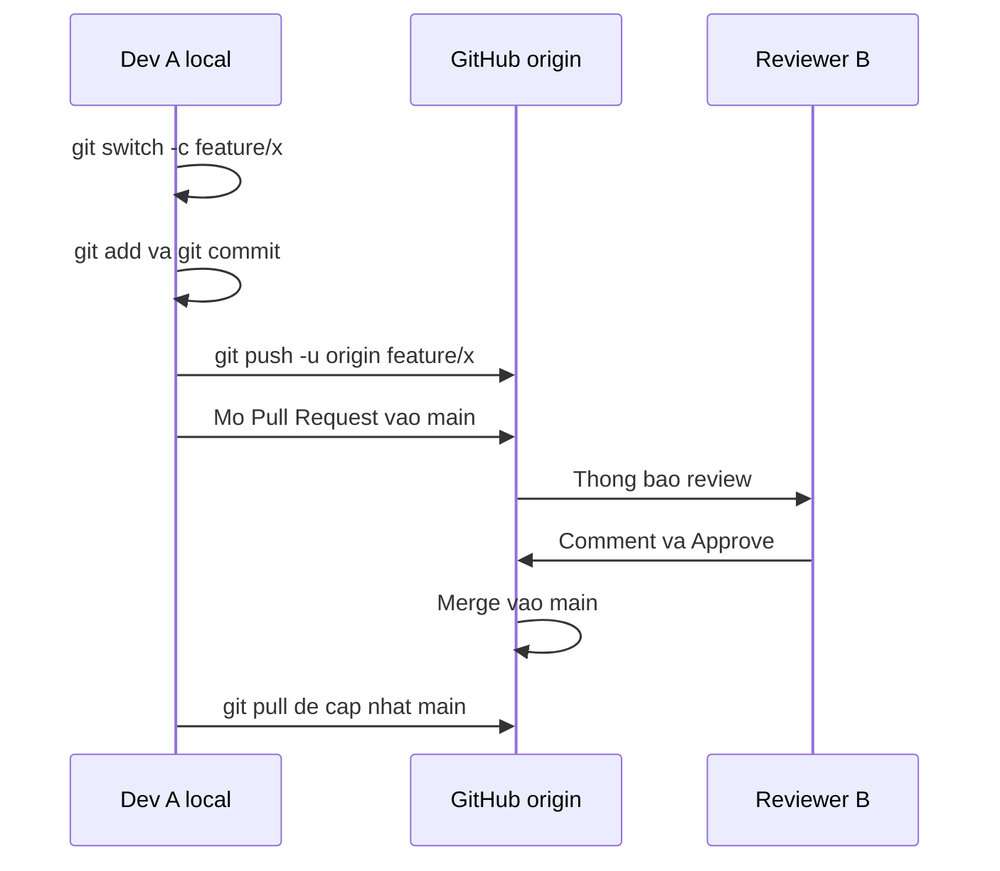
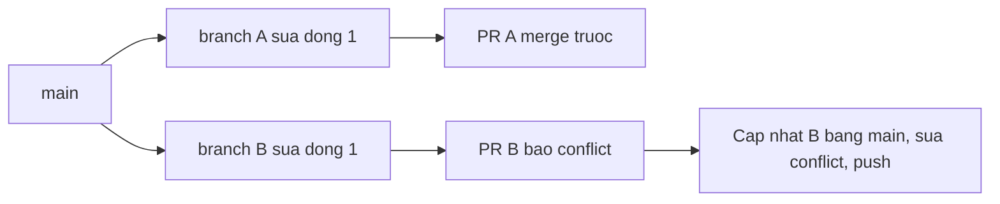

# Slide buổi 06 – Git & GitHub Workflow

> **Tóm tắt:** Làm việc nhóm với feature branch, Pull Request, code review, xử lý merge conflict đúng cách và bảo vệ nhánh main bằng branch protection.

## Slide 1: Mục tiêu buổi học

- Giải thích bốn vùng: working directory, staging, local repo, remote
- Tạo feature branch, commit rõ ràng, push lên GitHub
- Mở Pull Request, review chéo, merge sau khi được duyệt
- Tái hiện và giải quyết merge conflict mà không mất code của người khác
- Viết `.gitignore` để không commit `.env`, `node_modules`
- Bật branch protection yêu cầu PR và một review trước khi vào `main`

::: details Ghi chú giảng viên
Mở đầu 2 phút. Hôm nay làm theo nhóm 2-3 người, nên chia nhóm và chọn Bạn A (chủ repo) ngay từ đầu buổi.
:::

---

## Slide 2: Vấn đề thực tế

- 5 bạn cùng sửa một dự án, ai cũng push thẳng lên `main`
- Một bạn commit nhầm `.env` chứa mật khẩu database
- Một bạn `git push --force` làm mất commit của cả nhóm
- Đến buổi demo, `main` không chạy được và không ai biết commit nào gây lỗi
- Giải pháp: mỗi thay đổi một nhánh, đi qua Pull Request, `main` luôn chạy được

::: details Ghi chú giảng viên
Hỏi lớp: bạn nào từng bị mất code vì ghi đè? Nhấn mạnh quy trình này là nền của CI/CD: GitHub Actions sẽ chạy trên mỗi PR ở các tuần sau. 2 phút.
:::

---

## Slide 3: Bốn vùng của Git

| Vùng | Là gì | Lệnh sang vùng sau |
| --- | --- | --- |
| Working directory | File đang sửa trên đĩa | `git add` |
| Staging area | Thay đổi sẽ vào commit kế tiếp | `git commit` |
| Local repository | Lịch sử commit trên máy | `git push` |
| Remote | Bản trên GitHub (`origin`) | `git fetch`, `git pull` |

::: details Ghi chú giảng viên
Vẽ bốn hộp nối nhau trên bảng. Hỏi: tôi commit rồi nhưng chưa push, đồng đội có thấy không? (Không.) 3 phút.
:::

---

## Slide 4: Commit, branch, merge

- Commit là snapshot có hash, tác giả, thời gian, trỏ tới commit cha
- Branch chỉ là con trỏ có tên tới một commit, tạo rất rẻ
- HEAD cho biết bạn đang đứng ở branch nào
- Merge gộp lịch sử hai branch; cùng sửa một vùng thì báo conflict
- Buổi này dùng merge; rebase viết lại lịch sử nên chưa dùng

::: details Ghi chú giảng viên
Hỏi: nếu đổi một chữ trong commit thì hash có đổi không? (Có, hash tính từ nội dung.) 3 phút.
:::

---

## Slide 5: Pull Request và code review

- PR là tính năng của GitHub, không phải của Git
- Giá trị: chỗ thảo luận, review, chạy kiểm tra tự động, lưu lý do thay đổi
- Reviewer hỏi: đúng mô tả không, có lộ secret không, có file thừa không, có thể lỗi ở đâu
- Review góp ý về code, không phải về con người
- PR nhỏ, một mục đích, dưới khoảng 300 dòng

::: details Ghi chú giảng viên
Cho ví dụ một comment review tốt và một comment kém. Nhắc quy ước đặt tên: `feature/add-member-list`, `fix/readme-typo`; commit dạng câu mệnh lệnh. 3 phút.
:::

---

## Slide 6: .gitignore và quy tắc an toàn

- `.gitignore` chỉ có tác dụng với file chưa được theo dõi
- File đã commit: thêm vào `.gitignore` là chưa đủ, phải `git rm --cached`
- Secret đã lên GitHub coi như đã lộ: phải đổi secret, không chỉ xóa file
- Không bao giờ `git push --force` lên nhánh chung
- Hoàn tác an toàn bằng `git revert`, không dùng `reset --hard` rồi force push

::: details Ghi chú giảng viên
Nhắc câu hỏi: nếu commit .env rồi mới thêm .gitignore thì sao? File vẫn bị theo dõi và vẫn nằm trong lịch sử. 3 phút.
:::

---

## Slide 7: Luồng feature branch đến merge



- Mọi commit nằm trên branch riêng, `main` không bị ảnh hưởng
- `-u` ghi nhớ upstream, về sau chỉ cần `git push`

::: details Ghi chú giảng viên
Đi từng mũi tên 3 phút. Hỏi: bước nào GitHub mới biết có thay đổi của bạn?
:::

---

## Slide 8: Luồng của một conflict



- Người merge sau là người xử lý conflict
- Đưa `main` mới nhất vào branch của mình, sửa ở local, push lại
- Git chỉ đánh dấu chỗ khác nhau; quyết định kết quả là việc của con người

::: details Ghi chú giảng viên
Hỏi: vì sao không được xóa phần của người kia cho nhanh? Chuẩn bị cho phần demo conflict. 3 phút.
:::

---

## Slide 9: Demo 1 – Clone, branch, commit

```bash
mkdir -p ~/work && cd ~/work
git clone git@github.com:MENTOR_USER/git-demo.git
cd git-demo
git switch -c feature/add-members
echo "- Nguyen Van A" >> members.md
git status --short
git add members.md
git commit -m "Add first member"
git log --oneline --graph --all
```

```text
?? members.md
* 9f8e7d6 (HEAD -> feature/add-members) Add first member
* a1b2c3d (origin/main, origin/HEAD, main) Initial commit
```

::: details Ghi chú giảng viên
Thay MENTOR_USER bằng tài khoản thật của mentor. Hỏi: dòng ?? nghĩa là gì? Vì sao main chưa đổi? Hash trong output chỉ để minh họa. 4 phút.
:::

---

## Slide 10: Demo 2 – Push và mở Pull Request

```bash
git push -u origin feature/add-members
```

```text
Create a pull request for 'feature/add-members' on GitHub by visiting: ...
branch 'feature/add-members' set up to track 'origin/feature/add-members'
```

- Mở web, bấm Compare and pull request, base là `main`
- Mô tả: đã đổi gì, vì sao, cách kiểm tra
- Mời một học viên review và Approve ngay trên lớp
- Không thể Approve PR của chính mình

::: details Ghi chú giảng viên
Làm trực tiếp trên GitHub chiếu lên màn hình. Gọi một học viên lên để comment trên một dòng cụ thể. 4 phút.
:::

---

## Slide 11: Demo 3 – .gitignore sai thứ tự

```bash
echo "DB_PASSWORD=dummy" > .env
git add .
git status --short
git restore --staged .env
echo ".env" > .gitignore
git status --short
```

```text
A  .env
?? .gitignore
```

- Lần đầu `.env` bị staged (dòng `A  .env`); sau khi tạo `.gitignore` chỉ còn `?? .gitignore`
- Nếu đã commit `.env` rồi mới thêm `.gitignore`, file vẫn bị theo dõi

::: details Ghi chú giảng viên
Output rút gọn: đúng là lần đầu có dòng A cho .env, lần sau chỉ còn ?? .gitignore. Chỉ dùng giá trị dummy, không bao giờ demo bằng secret thật. 3 phút.
:::

---

## Slide 12: Lab – Chuẩn bị nhóm

- Nhóm 2-3 người: Bạn A tạo repo `club-team-lab` (public, có README), mời B và C làm collaborator
- Clone về WSL trong `~/work`, không dùng `/mnt/c`
- Cấu hình một lần: `git config --global pull.rebase false`

```bash
mkdir -p ~/work && cd ~/work
git clone git@github.com:OWNER/club-team-lab.git
cd club-team-lab
git status
```

```text
On branch main
nothing to commit, working tree clean
```

::: details Ghi chú giảng viên
Thay OWNER bằng tài khoản của Bạn A; ai dùng HTTPS thì dùng URL https. Nếu ssh -T git@github.com lỗi, xử lý xác thực trước khi vào lab. Không dán token vào lệnh hay chat. 5 phút.
:::

---

## Slide 13: Lab L1 – Skeleton và .gitignore (Bạn A)

```bash
mkdir docs
printf '# Club Team Lab\n\nRepo luyen tap Git workflow.\n' > README.md
printf '# Thanh vien\n\n- Ten thanh vien 1\n' > docs/team.md
printf 'DB_PASSWORD=dummy-only-for-lab\n' > .env
printf '.env\nnode_modules/\n*.log\n.DS_Store\n' > .gitignore
git check-ignore -v .env
git add .gitignore README.md docs/team.md
git commit -m "Add project skeleton and gitignore"
git push origin main
```

```text
.gitignore:1:.env	.env
```

- Tạo `.gitignore` trước khi add; add từng file khi chưa chắc
- Đây là lần commit thẳng lên `main` duy nhất; B và C chạy `git pull`

::: details Ghi chú giảng viên
Lab 60 phút: Phần 1 khoảng 10 phút. Giải thích git check-ignore -v cho biết mẫu nào đang chặn file, hữu ích khi debug.
:::

---

## Slide 14: Lab L1 – Feature branch và commit

```bash
git switch main
git pull
git switch -c feature/add-ten-ban
mkdir -p docs/members
echo "# Ten Ban" > docs/members/ten-ban.md
git add docs/members/ten-ban.md
git commit -m "Add Ten Ban profile"
echo "- Vai tro: thanh vien CLB" >> docs/members/ten-ban.md
git diff
git add docs/members/ten-ban.md
git commit -m "Add role to Ten Ban profile"
git push -u origin feature/add-ten-ban
```

- Thay `ten-ban` bằng tên không dấu của bạn
- Mỗi người chỉ thêm file của mình để tránh conflict ngoài ý muốn
- `git diff` trước khi add là lớp review đầu tiên

::: details Ghi chú giảng viên
Nhắc git diff chỉ hiện file đã theo dõi; file mới chỉ thấy trong git status. Mỗi người cần ít nhất 2 commit. 10 phút.
:::

---

## Slide 15: Lab L1 – PR, review, merge

- Mở PR: tiêu đề ngắn, mô tả gồm thay đổi, lý do, cách kiểm tra; chỉ định Reviewer
- Reviewer để ít nhất một comment trên dòng cụ thể rồi Approve
- Tác giả bấm Merge pull request (kiểu mặc định), xóa branch trên GitHub
- Dọn local:

```bash
git switch main
git pull
git branch -d feature/add-ten-ban
git log --oneline --graph -5
```

```text
Deleted branch feature/add-ten-ban
```

::: details Ghi chú giảng viên
Nếu chọn Squash, git branch -d sẽ báo branch chưa merge và phải dùng -D. Phần hoàn tác an toàn bằng git revert trên branch practice làm theo bài lab (Phần 3).
:::

---

## Slide 16: Lab L1 – Tạo và resolve conflict

```bash
git switch main
git pull
git switch -c feature/title-p
sed -i '1s/.*/# Club Team Lab - Phien ban cua P/' README.md
git commit -am "Change title (P)"
git push -u origin feature/title-p
```

- Q làm tương tự với `feature/title-q` và nội dung của Q; P merge PR trước
- Q đưa main vào branch mình:

```bash
git fetch origin
git merge origin/main
```

```text
CONFLICT (content): Merge conflict in README.md
Automatic merge failed; fix conflicts and then commit the result.
```

::: details Ghi chú giảng viên
Nhóm 3 người: C đóng vai reviewer cho cả hai PR. Làm theo cặp 15 phút; đi vòng các nhóm kiểm tra ai đã thấy dấu hiệu conflict.
:::

---

## Slide 17: Đọc dấu conflict và hoàn tất

```text
<<<<<<< HEAD
# Club Team Lab - Phien ban cua Q
=======
# Club Team Lab - Phien ban cua P
>>>>>>> origin/main
```

- Giữa `<<<<<<< HEAD` và `=======` là của bạn; phần còn lại là của `main`
- Thảo luận với tác giả kia, chọn kết quả, xóa cả ba dòng dấu hiệu
- Kiểm tra rồi hoàn tất:

```bash
grep -rn '^<<<<<<<\|^=======\|^>>>>>>>' README.md docs/ || echo "Khong con conflict marker"
git add README.md
git commit -m "Merge main into feature/title-q and resolve title conflict"
git push
```

::: details Ghi chú giảng viên
Nhấn mạnh: xóa sạch phần của người kia là sai. Nếu grep còn in dòng nào, nghĩa là còn marker. Reviewer là P xem phần đã gộp trước khi Approve.
:::

---

## Slide 18: Lab L2 – Thử thách

- Thử thách 1: tạo conflict ở `docs/team.md`, resolve mà không mất dòng của ai, ghi giải thích vào `report.md`
- Thử thách 2: bật branch protection cho `main` (cần 1 approval) và chứng minh push thẳng bị từ chối
- Thử thách 3: lỡ commit `.env` giả bằng `git add -f .env`, rồi dừng theo dõi mà giữ file local
- Bật branch protection sau khi xong các bước push trực tiếp lên `main`

```bash
git rm --cached .env
git commit -m "Stop tracking .env"
git ls-files | grep -c '^.env$' || true
```

::: details Ghi chú giảng viên
Repo private trên gói miễn phí có thể không hỗ trợ branch protection, nên dùng repo public. Chủ repo vẫn push được nghĩa là rule cho phép admin bypass. Lịch sử cũ vẫn chứa .env nên secret thật phải đổi.
:::

---

## Slide 19: Lỗi thường gặp

| Triệu chứng | Cách xử lý |
| --- | --- |
| `Permission denied (publickey)` | `ssh -T git@github.com`, thêm SSH key hoặc dùng HTTPS |
| `.env` xuất hiện trong `git status` | Thêm `.gitignore`; nếu đã tracked thì `git rm --cached` |
| `rejected ... (fetch first)` | `git pull`, xử lý conflict, push lại |
| Marker conflict còn sót | Dùng `grep` kiểm tra trước khi commit |
| `Please tell me who you are` | Cấu hình `user.name` và `user.email` |
| Merge xong main local chưa đổi | `git switch main` rồi `git pull` |

::: details Ghi chú giảng viên
Chọn 2 lỗi hay gặp nhất của lớp để nhấn mạnh. Hỏi: ai gặp Permission denied publickey rồi?
:::

---

## Slide 20: Phá lỗi – Push bị từ chối

```text
! [rejected]        main -> main (fetch first)
hint: Updates were rejected because the remote contains work that you do not have locally.
```

1. Đọc kỹ: `fetch first` nghĩa là remote có commit mà local chưa có, không phải lỗi quyền
2. `git fetch origin` rồi `git log --oneline --graph --all` để thấy lịch sử phân kỳ
3. `git diff main origin/main` xem phần khác nhau
4. `git pull`, resolve conflict nếu có, commit, rồi `git push`

- Không dùng `git push --force` để cho qua: nó ghi đè commit của người kia

::: details Ghi chú giảng viên
Tái hiện: P và Q cùng sửa dòng đầu của docs/team.md ngay trên main local, P push trước, Q push sau. Làm trước khi bật branch protection. 5 phút.
:::

---

## Slide 21: Thử thách tại lớp

- Đồng đội hỏi: "Mình push bị rejected, mình nên `git push --force` đúng không?"
- Bạn trả lời gì, và nên đề xuất quy trình nào thay thế?
- Bonus: bạn là chủ repo, một mình, branch protection yêu cầu 1 approval: chuyện gì xảy ra?

<details><summary>Gợi ý</summary>

Rejected nghĩa là remote có commit mới. Force push sẽ làm gì với commit đó?

</details>

<details><summary>Đáp án</summary>

Không force. `git pull`, xử lý conflict, push thường; tốt hơn là dùng feature branch và PR. Bonus: không tự Approve được PR của mình nên không merge được nếu rule áp dụng cho admin; đó là chủ đích để luôn có người thứ hai xem qua.

</details>

::: details Ghi chú giảng viên
Cho 2 phút thảo luận theo nhóm rồi gọi một nhóm trả lời.
:::

---

## Slide 22: Recap

- Git có bốn vùng; mỗi lệnh chuyển thay đổi sang vùng kế tiếp
- Mỗi thay đổi nằm trên feature branch nhỏ và vào `main` qua Pull Request
- Conflict là bình thường: người merge sau xử lý, bàn với tác giả, không xóa code người khác
- `.gitignore` chỉ ngăn file chưa tracked; secret đã lộ phải được đổi
- Không `push --force` lên nhánh chung; dùng `git revert` để hoàn tác
- Branch protection biến quy ước thành quy tắc, là nền cho CI/CD tuần sau

::: details Ghi chú giảng viên
Nhắc nộp `lab-06/` kèm link PR và ảnh PR đã Approve và merged. Kiểm tra bằng `git ls-files | grep -i env` trước khi push. Buổi sau bắt đầu Docker.
:::
