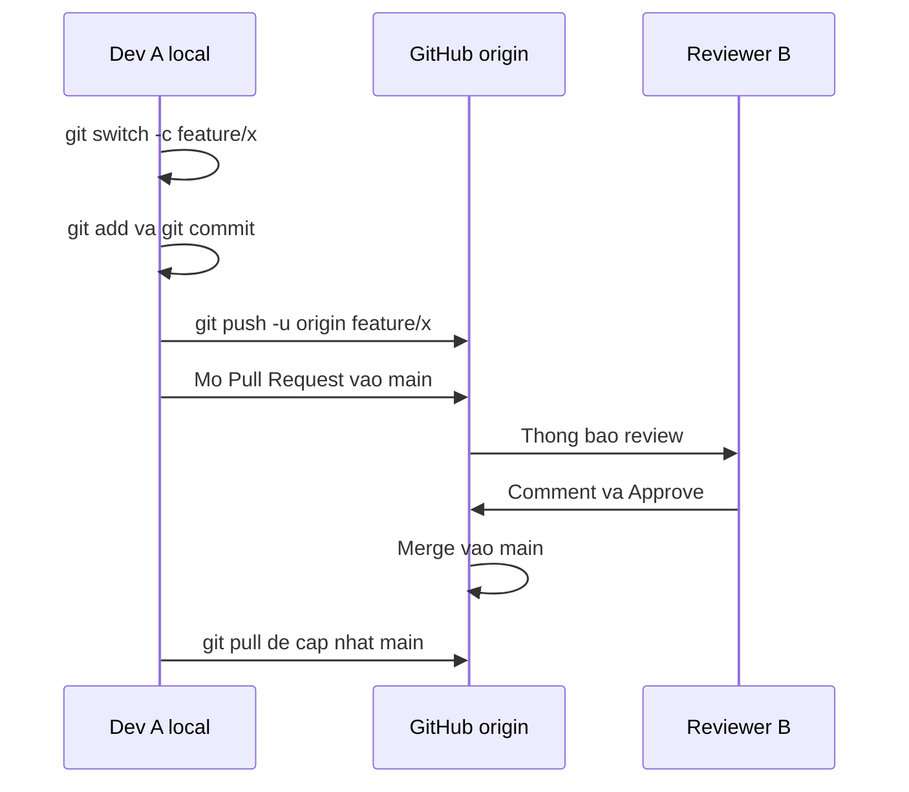
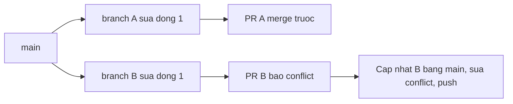

# Slide buổi 06 – Git & GitHub Workflow

> **Tóm tắt:** Làm việc nhóm với feature branch, Pull Request, code review, xử lý merge conflict đúng cách và bảo vệ nhánh main bằng branch protection.

Lệnh chi tiết của lab nằm trong bài học: [Buổi 06 – Git & GitHub Workflow](../../labs/week-03/session-06.md).

## Slide 1: Mục tiêu buổi học

- Giải thích bốn vùng: working directory, staging, local repo, remote
- Tạo feature branch, commit rõ ràng, push lên GitHub
- Mở Pull Request, review chéo, merge sau khi được duyệt
- Tái hiện và giải quyết merge conflict mà không mất code của người khác
- Viết `.gitignore` để không commit `.env`, `node_modules`
- Biết branch protection yêu cầu PR và một review trước khi vào `main`

---

## Slide 2: Vấn đề thực tế

- 5 bạn cùng sửa một dự án, ai cũng push thẳng lên `main`
- Một bạn commit nhầm `.env` chứa mật khẩu database
- Một bạn `git push --force` làm mất commit của cả nhóm
- Đến buổi demo, `main` không chạy được và không ai biết commit nào gây lỗi
- Giải pháp: mỗi thay đổi một nhánh, đi qua Pull Request, `main` luôn chạy được

---

## Slide 3: Bốn vùng của Git

| Vùng | Là gì | Lệnh sang vùng sau |
| --- | --- | --- |
| Working directory | File đang sửa trên đĩa | `git add` |
| Staging area | Thay đổi sẽ vào commit kế tiếp | `git commit` |
| Local repository | Lịch sử commit trên máy | `git push` |
| Remote | Bản trên GitHub (`origin`) | `git fetch`, `git pull` |

---

## Slide 4: Commit, branch, merge

- Commit là snapshot có hash, tác giả, thời gian, trỏ tới commit cha
- Branch chỉ là con trỏ có tên tới một commit, tạo rất rẻ
- HEAD cho biết bạn đang đứng ở branch nào
- Merge gộp lịch sử hai branch; cùng sửa một vùng thì báo conflict
- Buổi này dùng merge; rebase viết lại lịch sử nên chưa dùng

---

## Slide 5: Pull Request và code review

- PR là tính năng của GitHub, không phải của Git
- Giá trị: chỗ thảo luận, review, chạy kiểm tra tự động, lưu lý do thay đổi
- Reviewer hỏi: đúng mô tả không, có lộ secret không, có file thừa không, có thể lỗi ở đâu
- Review góp ý về code, không phải về con người
- PR nhỏ, một mục đích, dưới khoảng 300 dòng

---

## Slide 6: .gitignore và quy tắc an toàn

- `.gitignore` chỉ có tác dụng với file chưa được theo dõi
- File đã commit: thêm vào `.gitignore` là chưa đủ, phải `git rm --cached`
- Secret đã lên GitHub coi như đã lộ: phải đổi secret, không chỉ xóa file
- Không bao giờ `git push --force` lên nhánh chung
- Hoàn tác an toàn bằng `git revert`, không dùng `reset --hard` rồi force push

---

## Slide 7: Luồng feature branch đến merge



- Mọi commit nằm trên branch riêng, `main` không bị ảnh hưởng
- `-u` ghi nhớ upstream, về sau chỉ cần `git push`

---

## Slide 8: Luồng của một conflict



- Người merge sau là người xử lý conflict
- Đưa `main` mới nhất vào branch của mình, sửa ở local, push lại
- Git chỉ đánh dấu chỗ khác nhau; quyết định kết quả là việc của con người

---

## Slide 9: Demo – từ clone đến Pull Request

- Clone repo, tạo branch `feature/add-members`, sửa file, `git status` thấy `??`
- `git add` rồi `git commit`; `git log --oneline --graph --all` cho thấy `main` chưa đổi
- `git push -u origin feature/add-members`, mở PR trên web, base là `main`
- Mô tả PR: đã đổi gì, vì sao, cách kiểm tra; mời một học viên comment trên một dòng và Approve
- Không thể Approve PR của chính mình

---

## Slide 10: Demo – .gitignore sai thứ tự

- `.env` vừa tạo mà `git add .` ngay: `git status --short` có dòng `A  .env`
- Sau khi `git restore --staged .env` và tạo `.gitignore`: chỉ còn `?? .gitignore`
- Nếu đã commit `.env` rồi mới thêm `.gitignore`, file vẫn bị theo dõi và nằm trong lịch sử
- Chỉ demo bằng giá trị giả, không bao giờ bằng secret thật

---

## Slide 11: Đọc dấu conflict

```text
<<<<<<< HEAD
# Club Team Lab - Phien ban cua Q
=======
# Club Team Lab - Phien ban cua P
>>>>>>> origin/main
```

- Giữa `<<<<<<< HEAD` và `=======` là của bạn; phần còn lại là của `main`
- Thảo luận với tác giả kia, chọn kết quả, xóa cả ba dòng dấu hiệu
- Kiểm tra bằng `grep` không còn marker rồi `git add`, `git commit`, `git push`

---

## Slide 12: Lỗi thường gặp

| Triệu chứng | Cách xử lý |
| --- | --- |
| `Permission denied (publickey)` | `ssh -T git@github.com`, thêm SSH key hoặc dùng HTTPS |
| `.env` xuất hiện trong `git status` | Thêm `.gitignore`; nếu đã tracked thì `git rm --cached` |
| `rejected ... (fetch first)` | `git pull`, xử lý conflict, push lại; không `--force` |
| Marker conflict còn sót | Dùng `grep` kiểm tra trước khi commit |
| `Please tell me who you are` | Cấu hình `user.name` và `user.email` |
| Merge xong main local chưa đổi | `git switch main` rồi `git pull` |

---

## Slide 13: Recap

- Git có bốn vùng; mỗi lệnh chuyển thay đổi sang vùng kế tiếp
- Mỗi thay đổi nằm trên feature branch nhỏ và vào `main` qua Pull Request
- Conflict là bình thường: người merge sau xử lý, bàn với tác giả, không xóa code người khác
- `.gitignore` chỉ ngăn file chưa tracked; secret đã lộ phải được đổi
- Không `push --force` lên nhánh chung; dùng `git revert` để hoàn tác
- Branch protection biến quy ước thành quy tắc, là nền cho CI/CD tuần sau
