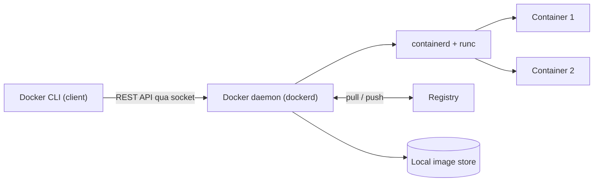
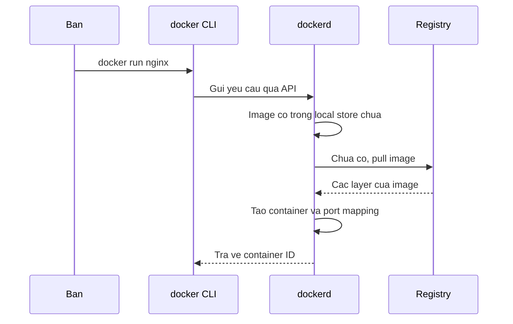

# Slide buổi 07 – Container Fundamentals

> **Tóm tắt:** Phân biệt VM và container, đọc kiến trúc Docker (client, daemon, registry), cài Docker Desktop và chạy, kiểm tra, dọn một container Nginx. Bài lab đầy đủ: [Buổi 07](../../labs/week-04/session-07.md).

## Slide 1: Mục tiêu buổi học

- Giải thích khác biệt VM và container về kernel, tài nguyên, thời gian khởi động.
- Vẽ lại luồng `docker run` qua client, daemon, registry.
- Chạy được `docker version`, `docker info`, `docker run hello-world`.
- Chạy Nginx với port mapping và bind mount.
- Chẩn đoán lỗi `port is already allocated`.

::: details Ghi chú giảng viên
Mở bài 2 phút. Nói rõ: hôm nay chỉ cần container Nginx chạy được và hiểu nền tảng; Dockerfile để buổi 09. Hỏi lớp ai đã cài Docker Desktop trước.
:::

---

## Slide 2: Vấn đề: "máy tôi chạy được mà"

- API Node.js 22 chạy ở máy A, lỗi ở máy B: sai phiên bản Node, thiếu thư viện, cổng bị chiếm.
- Môi trường chạy không được đóng gói cùng ứng dụng.
- Mentor deploy lên máy chung lại lỗi theo kiểu khác.
- Cần một đơn vị đóng gói chạy giống nhau ở mọi nơi.

::: details Ghi chú giảng viên
Kể lại tình huống bằng một ví dụ thật của CLB. Hỏi: "Ai từng gặp câu này?" (3 phút). Dẫn tới: đóng gói app cùng runtime.
:::

---

## Slide 3: Container giải quyết thế nào

- Đóng gói app cùng runtime, thư viện, cấu hình tối thiểu thành một **image**.
- Image chạy giống nhau ở mọi nơi có Docker.
- Máy ảo cũng làm được nhưng nặng: mỗi VM mang cả một hệ điều hành.
- Ứng dụng xuyên suốt khóa: Club Management (backend, frontend, database).

::: details Ghi chú giảng viên
Chưa vào chi tiết kỹ thuật. Nhấn mạnh "đóng gói + chạy giống nhau". 2 phút.
:::

---

## Slide 4: VM và container

| Tiêu chí | VM | Container |
| --- | --- | --- |
| Ảo hóa ở mức | Phần cứng | Hệ điều hành |
| Kernel | Mỗi VM một kernel | Dùng chung kernel host |
| Kích thước | Hàng GB | Vài MB đến vài trăm MB |
| Khởi động | Chục giây đến phút | Dưới vài giây |
| Cô lập | Mạnh | Yếu hơn, đủ cho đa số app |

::: details Ghi chú giảng viên
Chỉ vào dòng Kernel nhiều nhất. Lưu ý: trên Windows, "kernel của host" là kernel Linux của WSL2. Hỏi: "Container Linux có chạy được bằng kernel Windows không?" (không). 4 phút.
:::

---

## Slide 5: Container thực chất là gì

- Một **process Linux bình thường**, không phải "máy ảo nhỏ".
- **Namespaces**: mỗi container thấy PID, network, mount, hostname riêng.
- **cgroups**: giới hạn và đo CPU, RAM.
- **Union filesystem**: layer chỉ đọc của image cộng một lớp ghi mỏng.

::: details Ghi chú giảng viên
Không đi sâu kernel. Chỉ cần học viên nhớ: process được cô lập bằng namespaces và giới hạn bằng cgroups. 3 phút.
:::

---

## Slide 6: Image, container, registry

| Khái niệm | Là gì | Ví dụ |
| --- | --- | --- |
| Image | Gói chỉ đọc (filesystem và metadata) | `nginx:1.27-alpine` |
| Container | Một lần chạy của image, có lớp ghi | `nginx-demo` |
| Registry | Nơi lưu và phân phối image | Docker Hub, GHCR |
| Tag | Nhãn phiên bản | `1.27-alpine` |

- Một image chạy được nhiều container. Xóa container không xóa image.
- Luôn ghim tag cụ thể, không dùng `latest` trong ví dụ cần tái lập.

::: details Ghi chú giảng viên
Ví von: image như class, container như object. Hỏi: "Vì sao `latest` không có nghĩa là mới nhất thật sự?" 3 phút.
:::

---

## Slide 7: Kiến trúc Docker



- CLI chỉ gửi yêu cầu, daemon mới làm việc.
- Docker Desktop gói sẵn daemon trong một VM WSL2.

::: details Ghi chú giảng viên
Câu hỏi: nếu tắt Docker Desktop thì `docker version` mất khối nào? (Server). 3 phút.
:::

---

## Slide 8: Luồng khi gõ docker run



::: details Ghi chú giảng viên
Đi từng mũi tên, dừng ở bước "chưa có thì pull". Liên hệ dòng `Unable to find image locally` ở demo. 3 phút.
:::

---

## Slide 9: Demo 1 – Client và server

```bash
docker version
docker run --rm hello-world
```

Kết quả mong đợi (rút gọn):

```text
Client:
 Version:           27.x.x
Server: Docker Desktop
 Engine:
  Version:          27.x.x
...
Hello from Docker!
```

- Lần chạy đầu có dòng `Unable to find image 'hello-world:latest' locally`.
- Lần hai sẽ không pull lại.

::: details Ghi chú giảng viên
Chạy trên màn hình chiếu, lớp dự đoán trước khi Enter. Nếu chỉ thấy Client và báo lỗi kết nối: Docker Desktop chưa chạy hoặc chưa bật WSL integration. 4 phút.
:::

---

## Slide 10: Demo 2 – Cùng kernel với host

```bash
uname -r
docker run --rm alpine:3.20 uname -r
```

Kết quả mong đợi: hai dòng giống nhau, dạng `5.15.x-microsoft-standard-WSL2` hoặc `6.x.x-microsoft-standard-WSL2`.

- Alpine là distro khác nhưng kernel y hệt host.
- Image chỉ chứa user space, không chứa kernel.

::: details Ghi chú giảng viên
Hỏi: "Điều này nói gì về container so với VM?" Chốt: container dùng chung kernel. 3 phút.
:::

---

## Slide 11: Demo 3 – Nginx, port mapping, bind mount

```bash
mkdir -p demo && cd demo
echo '<h1>Xin chao tu container Nginx</h1>' > index.html
docker run -d --name nginx-demo -p 8081:80 \
  -v "$PWD/index.html:/usr/share/nginx/html/index.html:ro" \
  nginx:1.27-alpine
curl -s http://localhost:8081
```

Kết quả mong đợi: `docker run` in một ID dài, `curl` in nội dung `index.html`.

- `-p 8081:80` là `HOST:CONTAINER`.
- `:ro` là mount chỉ đọc.

::: details Ghi chú giảng viên
Lưu ý khi mount file đơn lẻ: sửa bằng `sed -i` hoặc vim có thể đổi inode nên container vẫn thấy nội dung cũ; sửa bằng `echo ... >` hoặc mount cả thư mục. 4 phút.
:::

---

## Slide 12: Demo 4 – Nhìn vào bên trong

```bash
docker ps
docker top nginx-demo
docker exec nginx-demo ps
docker rm -f nginx-demo
```

- `docker ps` thấy `0.0.0.0:8081->80/tcp`.
- Trong container, `nginx: master process` là PID 1.
- Dọn bằng `docker rm -f` khi xong demo.

::: details Ghi chú giảng viên
Chuyển sang lab. Nhắc: đây là phần Break nhẹ đầu tiên sẽ làm ở slide lỗi. 2 phút.
:::

---

## Slide 13: Hands-on lab – chuẩn bị

```bash
mkdir -p ~/devops-labs/lab-07/{source,screenshots,evidence}
cd ~/devops-labs/lab-07
pwd
```

Kết quả mong đợi: `/home/TEN-BAN/devops-labs/lab-07` (bắt đầu bằng `/home`, không phải `/mnt/c`).

- Bật WSL integration cho Ubuntu trong Docker Desktop.
- Ghi bằng chứng bằng `tee -a evidence/command-output.txt`.

::: details Ghi chú giảng viên
Đi vòng kiểm tra từng bàn: ai báo `docker: command not found` thì chưa bật WSL integration. 10 phút (60 phút lab tổng).
:::

---

## Slide 14: Hands-on lab – L1 Foundation

- Phần 1: `docker version`, `docker info`, `hello-world`.
- Phần 2: pull `nginx:1.27-alpine`, chạy `web-lab07` ở cổng 8081, `curl` và mở trình duyệt Windows.
- Phần 3: `docker logs`, `docker exec -it web-lab07 sh`, chứng minh dữ liệu trong container là tạm thời.
- Phần 4: phân biệt `stop`, `rm`, `rmi`.
- Nộp: `evidence/command-output.txt`, `source/index.html`, ảnh trình duyệt.

::: details Ghi chú giảng viên
Mentor đi quanh lớp. Học viên xong sớm làm L2. Nhắc ghi output vào evidence. 35 phút.
:::

---

## Slide 15: Hands-on lab – L2 Engineering

- Thử thách 1: chứng minh container dùng chung kernel với `alpine:3.20` và `ubuntu:24.04`, giải thích 3 đến 5 câu.
- Thử thách 2: chỉ ra client, daemon, registry bằng ít nhất 3 dòng output (`docker info`, `docker pull busybox:1.36`).
- Thử thách 3: giới hạn tài nguyên và đo.

```bash
docker run -d --name web-limit --memory 64m --cpus 0.5 -p 8082:80 nginx:1.27-alpine
docker stats --no-stream web-limit
```

::: details Ghi chú giảng viên
Gợi ý nếu kẹt: trong `docker info` tìm dòng `Registry`; `docker inspect --format` cho thấy `HostConfig.Memory` bằng `67108864`. Nhắc dọn `docker rm -f web-limit`.
:::

---

## Slide 16: Break – "port is already allocated"

```bash
docker run -d --name web-lab07 -p 8081:80 nginx:1.27-alpine
docker run -d --name web-b -p 8081:80 nginx:1.27-alpine
```

Triệu chứng:

```text
docker: Error response from daemon: ... Bind for 0.0.0.0:8081 failed: port is already allocated.
```

- Container `web-b` vẫn bị tạo ở trạng thái `Created`.
- Tìm thủ phạm: `docker ps --format "table {{.Names}}\t{{.Ports}}"`.
- Không phải container: `ss -ltnp | grep 8081` hoặc `netstat -ano | findstr :8081` trong PowerShell.

::: details Ghi chú giảng viên
Cho lớp tự điều tra 5 phút trước khi giải thích. Nguyên nhân gốc: một cổng host chỉ một process lắng nghe. Sửa: `docker rm web-b`, chạy lại với `-p 8083:80`. Tình huống tương tự: scenario-01.
:::

---

## Slide 17: Lỗi thường gặp

| Triệu chứng | Cách xử lý |
| --- | --- |
| `docker: command not found` trong WSL | Bật WSL integration, mở lại terminal |
| `Cannot connect to the Docker daemon` | Mở Docker Desktop, đợi Running |
| `name is already in use` | `docker rm -f TEN` hoặc đặt tên khác |
| Nginx 403 hoặc 404 | Dùng đường dẫn tuyệt đối như `"$PWD/source/index.html"` |
| Máy chậm, tốn RAM | `docker system df`, `docker container prune` |

::: details Ghi chú giảng viên
Chọn 2 dòng hay gặp nhất trong lớp để nói kỹ. 2 phút.
:::

---

## Slide 18: Challenge

- Đo thời gian khởi động: `time docker run --rm alpine:3.20 true`.
- So với VM Ubuntu (RAM cấp trước, thường từ 1 GB trở lên, boot cả OS).
- Kết luận 3 gạch đầu dòng về chi phí tài nguyên và thời gian khởi động.
- Vẽ sơ đồ client, daemon, registry bằng lời của bạn trong `report.md`.

::: details Ghi chú giảng viên
Giao về nhà hoặc cho nhóm làm nhanh. Tiêu chí: có số liệu đo thật, không chỉ lý thuyết.
:::

---

## Slide 19: Recap

- Container là process Linux cô lập bằng namespaces và cgroups, dùng chung kernel host.
- CLI gửi lệnh, dockerd làm việc, registry lưu image.
- Image chỉ đọc, container là một lần chạy; xóa container không xóa image.
- `-p HOST:CONTAINER`, `-v`, `-d`, `--rm`.
- Dữ liệu trong container là tạm thời, cần volume (buổi 12).
- Khi lỗi: đọc thông báo, `docker ps -a`, `docker logs`, `docker info`.

::: details Ghi chú giảng viên
Gọi 2 học viên tự nhắc lại 1 ý. Nhắc nộp bài vào `lab-07/` theo `templates/lab-template.md`. Buổi sau: Docker CLI. 15 phút review tổng.
:::
