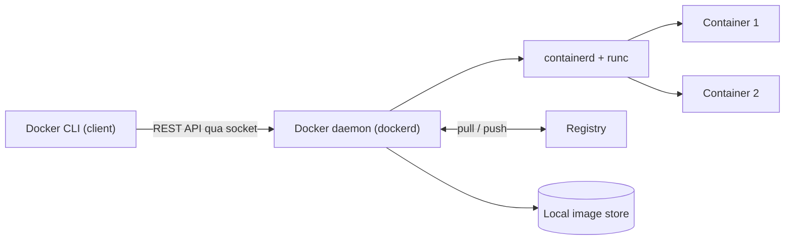
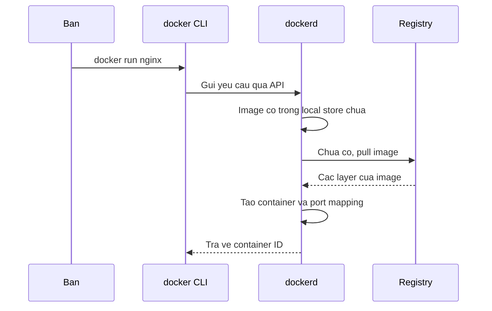

# Slide buổi 07 – Container Fundamentals

> **Tóm tắt:** Phân biệt VM và container, đọc kiến trúc Docker (client, daemon, registry), cài Docker Desktop và chạy, kiểm tra, dọn một container Nginx. Bài lab đầy đủ: [Buổi 07](../../labs/week-04/session-07.md). Kịch bản mentor: [Kịch bản Buổi 07](../../mentors/sessions/session-07.md).

## Slide 1: Mục tiêu buổi học

- Giải thích khác biệt VM và container về kernel, tài nguyên, thời gian khởi động.
- Vẽ lại luồng `docker run` qua client, daemon, registry.
- Chạy Nginx với port mapping và bind mount, mở được từ trình duyệt.
- Chẩn đoán lỗi `port is already allocated`.

---

## Slide 2: Vấn đề: "máy tôi chạy được mà"

- API Node.js 22 chạy ở máy A, lỗi ở máy B: sai phiên bản Node, thiếu thư viện, cổng bị chiếm.
- Môi trường chạy không được đóng gói cùng ứng dụng.
- Mentor deploy lên máy chung lại lỗi theo kiểu khác.
- Cần một đơn vị đóng gói chạy giống nhau ở mọi nơi.

---

## Slide 3: Container giải quyết thế nào

- Đóng gói app cùng runtime, thư viện, cấu hình tối thiểu thành một **image**.
- Ví von: hộp cơm đóng sẵn, mang đi đâu mở ra cũng ăn được như nhau.
- Máy ảo cũng làm được nhưng nặng: mỗi VM mang cả một hệ điều hành.
- Ứng dụng xuyên suốt khóa: Club Management (backend, frontend, database).

---

## Slide 4: VM và container

| Tiêu chí | VM | Container |
| --- | --- | --- |
| Ảo hóa ở mức | Phần cứng | Hệ điều hành |
| Kernel | Mỗi VM một kernel | Dùng chung kernel host |
| Kích thước | Hàng GB | Vài MB đến vài trăm MB |
| Khởi động | Chục giây đến phút | Dưới vài giây |
| Cô lập | Mạnh | Yếu hơn, đủ cho đa số app |

- Trên Windows, "kernel của host" là kernel Linux của WSL2.

---

## Slide 5: Container thực chất là gì

- Một **process Linux bình thường**, không phải "máy ảo nhỏ".
- **Namespaces**: mỗi container thấy PID, network, mount, hostname riêng.
- **cgroups**: giới hạn và đo CPU, RAM.
- **Union filesystem**: layer chỉ đọc của image cộng một lớp ghi mỏng.

---

## Slide 6: Image, container, registry

| Khái niệm | Là gì | Ví von |
| --- | --- | --- |
| Image | Gói chỉ đọc (filesystem và metadata), ví dụ `nginx:1.27-alpine` | Công thức nấu ăn |
| Container | Một lần chạy của image, có lớp ghi | Một suất ăn nấu ra |
| Registry | Nơi lưu và phân phối image (Docker Hub, GHCR) | Kho công thức |
| Tag | Nhãn phiên bản, ví dụ `1.27-alpine` | Số phiên bản |

- Một image chạy được nhiều container. Xóa container không xóa image.
- Luôn ghim tag cụ thể, không dùng `latest` trong ví dụ cần tái lập.

---

## Slide 7: Kiến trúc Docker



- CLI chỉ gửi yêu cầu, daemon mới làm việc.
- Docker Desktop gói sẵn daemon trong một VM WSL2.

---

## Slide 8: Luồng khi gõ docker run



---

## Slide 9: Demo 1 – Client, server, kernel dùng chung

```bash
docker version
docker run --rm hello-world
uname -r
docker run --rm alpine:3.20 uname -r
```

- Hai khối Client và Server; lần chạy đầu có dòng `Unable to find image ... locally`, lần hai không pull lại.
- Hai dòng `uname -r` giống nhau: image chỉ chứa user space, không chứa kernel.

---

## Slide 10: Demo 2 – Nginx, port mapping, bind mount

```bash
docker run -d --name nginx-demo -p 8081:80 \
  -v "$PWD/index.html:/usr/share/nginx/html/index.html:ro" \
  nginx:1.27-alpine
curl -s http://localhost:8081
docker exec nginx-demo ps
```

- `-p 8081:80` là `HOST:CONTAINER`; `:ro` là mount chỉ đọc.
- Trong container, `nginx: master process` là PID 1.

---

## Slide 11: Hands-on lab

- Lab 60 phút, mức L1: kiểm tra cài đặt, chạy Nginx với trang của bạn, quan sát (`logs`, `exec`, `inspect`), chứng minh dữ liệu tạm, dừng và dọn.
- Các lệnh và kết quả mong đợi nằm ở bài lab, không chép lại ở đây: [Buổi 07 – Hands-on lab](../../labs/week-04/session-07.md#hands-on-lab).
- Nộp: `evidence/command-output.txt`, `source/index.html`, `report.md`.

---

## Slide 12: Lỗi hay gặp: "port is already allocated"

```text
docker: Error response from daemon: ... Bind for 0.0.0.0:8081 failed: port is already allocated.
```

- Một cổng host chỉ một process lắng nghe; container `Created` vẫn bị tạo ra.
- Tìm thủ phạm bằng `docker ps`; không phải container thì kiểm tra process host.
- Các lỗi khác (`command not found`, không kết nối daemon, trùng tên): xem bảng Gặp lỗi? trong bài lab.

---

## Slide 13: Thử thách

- Chứng minh kernel dùng chung với `alpine:3.20` và `ubuntu:24.04`.
- Chỉ ra client, daemon, registry bằng ít nhất 3 dòng output.
- Giới hạn RAM và CPU rồi đo; so sánh với VM bằng số liệu thật.

---

## Slide 14: Recap

- Container là process Linux cô lập bằng namespaces và cgroups, dùng chung kernel host.
- CLI gửi lệnh, dockerd làm việc, registry lưu image.
- Image chỉ đọc, container là một lần chạy; xóa container không xóa image.
- `-p HOST:CONTAINER`, `-v`, `-d`, `--rm`; dữ liệu trong container là tạm thời, cần volume (buổi 12).
