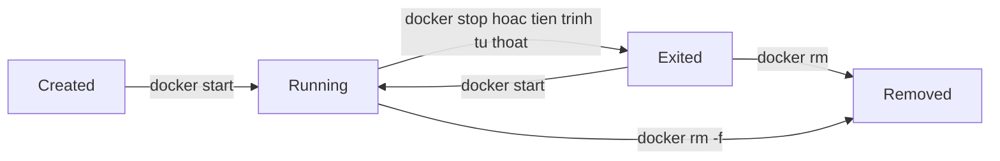

# Slide buổi 08 – Docker CLI

> **Tóm tắt:** Dùng thành thạo Docker CLI để chạy, kiểm tra, debug, dừng, xóa container và đẩy image lên registry cục bộ, rồi chẩn đoán lỗi port bận và container thoát ngay. Bài lab đầy đủ: [Buổi 08](../../labs/week-04/session-08.md). Kịch bản mentor: [Kịch bản Buổi 08](../../mentors/sessions/session-08.md).

## Slide 1: Mục tiêu buổi học

- Giải thích vòng đời container: created, running, exited, removed.
- Chạy container với `-d`, `--name`, `-p`, `-e`, `--rm`.
- Quan sát bằng `docker ps`, `logs`, `exec`, `inspect`.
- Dừng, dọn dẹp an toàn; tag và push image lên registry cục bộ.
- Chẩn đoán cổng bận và container thoát ngay.

---

## Slide 2: Vấn đề: chạy rồi mà không thấy gì

- `docker ps` trống dù vừa `docker run -d`.
- Mở cổng quen thuộc và thấy một trang cũ không rõ từ đâu.
- Không có CLI thì chỉ còn cách đoán và khởi động lại máy.
- CLI trả lời: container nào chạy, image nào, in gì, nghe cổng nào, thoát với mã nào.

---

## Slide 3: Image và container

| | Image | Container |
| --- | --- | --- |
| Bản chất | Gói chỉ đọc | Tiến trình tạo từ image, có lớp ghi |
| Tạo bằng | `docker build`, `docker pull` | `docker run`, `docker create` |
| Xem bằng | `docker images` | `docker ps`, `docker ps -a` |
| Xóa bằng | `docker image rm` | `docker rm` |

- Không xóa được image nếu còn container (kể cả đã dừng) dùng nó.

---

## Slide 4: Vòng đời container



- Container sống chừng nào PID 1 còn sống.
- Tiến trình thoát thì container `Exited`, ExitCode được lưu lại.

---

## Slide 5: Cú pháp docker run

```text
docker run [OPTIONS] IMAGE[:TAG] [COMMAND] [ARGS...]
```

| Cờ | Ý nghĩa |
| --- | --- |
| `-d` | Chạy nền |
| `--name web` | Đặt tên, phải duy nhất |
| `-p 8088:80` | Host 8088 vào container 80 |
| `-e KEY=value` | Biến môi trường |
| `--rm` | Tự xóa khi thoát |

- `docker run` = pull (nếu thiếu) + create + start.

---

## Slide 6: Bộ lệnh quan sát và điều khiển

| Mục đích | Lệnh |
| --- | --- |
| Liệt kê | `docker ps`, `docker ps -a` |
| Xem log | `docker logs -f --tail 20 web` |
| Vào trong | `docker exec -it web sh` |
| Soi chi tiết | `docker inspect web` |
| Dừng, xóa | `docker stop web`, `docker rm web` |

- Bộ ba chẩn đoán đầu tiên: `ps -a`, `logs`, `inspect`.
- `logs` đọc stdout và stderr của PID 1; `exec` thêm một tiến trình, không khởi động lại.

---

## Slide 7: Tên image đầy đủ

```text
localhost:5001/club/nginx:1.27-alpine
 registry      repository  tag
```

- Bỏ phần registry thì Docker hiểu là Docker Hub.
- `docker tag` chỉ thêm một cái tên, không sao chép dữ liệu.
- Tên sai (thiếu địa chỉ registry) là nguyên nhân push hỏng phổ biến nhất.

---

## Slide 8: Demo 1 – Chạy, kiểm tra, vào trong

```bash
docker run -d --name demo-web -p 8088:80 nginx:1.27-alpine
docker ps
curl -I http://localhost:8088
docker exec demo-web wget -qO- http://localhost
```

- Kết quả mong đợi: `0.0.0.0:8088->80/tcp` và `HTTP/1.1 200 OK`.
- Hỏi lớp: nếu đổi thành `-p 8088:8088` thì chuyện gì xảy ra?

---

## Slide 9: Demo 2 – inspect với format

```bash
docker inspect --format '{{.State.Status}} exit={{.State.ExitCode}}' demo-web
docker logs --tail 5 demo-web
```

- Kết quả mong đợi: `running exit=0` và vài dòng log nginx kèm một dòng `GET`.
- `inspect` là nguồn sự thật về cấu hình thật; dùng `--format` để lọc, đừng dán toàn bộ output vào báo cáo.

---

## Slide 10: Demo 3 – Container thoát ngay

```bash
docker run -d --name demo-pg postgres:17-alpine
docker ps -a --filter name=demo-pg
docker logs demo-pg
```

- `docker ps` không thấy; `docker ps -a` hiện `Exited (1)`.
- Log: `Error: Database is uninitialized and superuser password is not specified.`
- Sửa: `docker rm demo-pg`, rồi chạy lại với `-e POSTGRES_PASSWORD=...`.

---

## Slide 11: Demo 4 – Dừng và dọn

```bash
docker stop demo-web demo-pg
docker rm demo-web demo-pg
docker ps -a --filter name=demo-
```

- `stop` gửi SIGTERM, chờ 10 giây rồi SIGKILL; container còn trên đĩa.
- `rm -f` buộc dừng rồi xóa hẳn.

---

## Slide 12: Hands-on lab và thử thách

- Lab 60 phút, mức L1: chạy và soi Nginx, vòng đời, Postgres thất bại rồi thành công, tag và push lên registry cục bộ. Lệnh và kết quả mong đợi ở bài lab: [Buổi 08 – Hands-on lab](../../labs/week-04/session-08.md#hands-on-lab).
- Thử thách L2: tình huống 01 (xung đột cổng) và 02 (container thoát ngay), tự viết checklist chẩn đoán, đưa smoke test vào `commands.sh`.
- Nộp: `evidence/command-output.txt`, `source/commands.sh`, `report.md`.

---

## Slide 13: Lỗi hay gặp và Break nhầm cổng

| Triệu chứng | Cách xử lý |
| --- | --- |
| `port is already allocated` | `docker ps --filter publish=PORT`, đổi cổng host |
| `docker ps` trống sau `run -d` | `docker ps -a`, `docker logs`, xem ExitCode |
| Container `Up` nhưng `curl` bị reset | Nhầm cổng container: `docker port`, `docker exec ... netstat -ltn` |
| `denied` khi push | Tag lại với tên có địa chỉ registry |

- `-p 8088:8088` với Nginx: ánh xạ vào cổng không ai nghe; sửa thành `-p 8088:80`.

---

## Slide 14: Recap

- PID 1 thoát thì container thoát; ExitCode cho biết thoát thế nào.
- Bộ ba chẩn đoán: `docker ps -a`, `docker logs`, `docker inspect`.
- `-p host:container`: trái là máy bạn, phải là trong container.
- `stop` giữ lại container, `rm` xóa; `--rm` cho lệnh một lần.
- Tên image đầy đủ gồm registry, repository, tag; pin tag.
