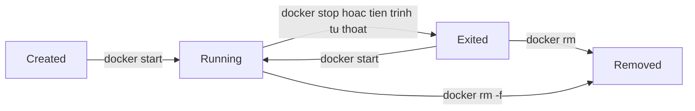
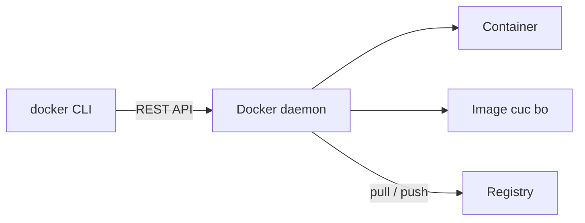

# Slide buổi 08 – Docker CLI

> **Tóm tắt:** Dùng thành thạo Docker CLI để chạy, kiểm tra, debug, dừng, xóa container và đẩy image lên registry cục bộ, rồi chẩn đoán lỗi port bận và container thoát ngay. Bài lab đầy đủ: [Buổi 08](../../labs/week-04/session-08.md).

## Slide 1: Mục tiêu buổi học

- Giải thích vòng đời container: created, running, exited, removed.
- Chạy container với `-d`, `--name`, `-p`, `-e`, `--rm`.
- Quan sát bằng `docker ps`, `logs`, `exec`, `inspect`, `stats`.
- Dừng và dọn dẹp an toàn.
- Tag và push image lên registry cục bộ.
- Chẩn đoán tình huống 01 (port bận) và 02 (container thoát ngay).

::: details Ghi chú giảng viên
Mở bài 2 phút, ôn nhanh buổi 07: image, container, registry, `-p HOST:CONTAINER`. Hỏi 1 câu ôn: "docker stop khác docker rm thế nào?" (để dành trả lời cuối buổi).
:::

---

## Slide 2: Vấn đề: chạy rồi mà không thấy gì

- `docker ps` trống dù vừa `docker run -d`.
- Mở cổng quen thuộc và thấy một trang cũ không rõ từ đâu.
- Không có CLI thì chỉ còn cách đoán và khởi động lại máy.
- CLI trả lời: container nào chạy, image nào, in gì, nghe cổng nào, thoát với mã nào.

::: details Ghi chú giảng viên
Các lệnh hôm nay là họ hàng của `kubectl logs`, `exec`, `describe` ở tuần sau. 2 phút.
:::

---

## Slide 3: Image và container

| | Image | Container |
| --- | --- | --- |
| Bản chất | Gói chỉ đọc | Tiến trình tạo từ image, có lớp ghi |
| Tạo bằng | `docker build`, `docker pull` | `docker run`, `docker create` |
| Xem bằng | `docker images` | `docker ps`, `docker ps -a` |
| Xóa bằng | `docker image rm` | `docker rm` |

- Không xóa được image nếu còn container (kể cả đã dừng) dùng nó.

::: details Ghi chú giảng viên
Nhắc lại ngắn. Nếu lớp còn mơ hồ, quay lại ví von class và object. 2 phút.
:::

---

## Slide 4: Vòng đời container



- Container sống chừng nào PID 1 còn sống.
- Tiến trình thoát thì container `Exited`, ExitCode được lưu lại.

::: details Ghi chú giảng viên
Hỏi: "Container Exited còn xem log được không?" (được, tới khi bị xóa). 3 phút.
:::

---

## Slide 5: Cú pháp docker run

```text
docker run [OPTIONS] IMAGE[:TAG] [COMMAND] [ARGS...]
```

| Cờ | Ý nghĩa |
| --- | --- |
| `-d` | Chạy nền |
| `--name web` | Đặt tên, phải duy nhất |
| `-p 8088:80` | Host 8088 vào container 80 |
| `-e KEY=value` | Biến môi trường |
| `--rm` | Tự xóa khi thoát |

- `docker run` = pull (nếu thiếu) + create + start.

::: details Ghi chú giảng viên
Cờ `-it` dành cho shell tương tác. Nhấn mạnh quên `-d` thì terminal bị chiếm, nhiều bạn tưởng container treo. 3 phút.
:::

---

## Slide 6: Bộ lệnh quan sát và điều khiển

| Mục đích | Lệnh |
| --- | --- |
| Liệt kê | `docker ps`, `docker ps -a` |
| Xem log | `docker logs -f --tail 20 web` |
| Vào trong | `docker exec -it web sh` |
| Soi chi tiết | `docker inspect web` |
| Tài nguyên | `docker stats --no-stream` |
| Dừng, xóa | `docker stop web`, `docker rm web` |

- Bộ ba chẩn đoán đầu tiên: `ps -a`, `logs`, `inspect`.

::: details Ghi chú giảng viên
Không đọc hết bảng; để học viên chụp màn hình làm cheatsheet. 2 phút.
:::

---

## Slide 7: Tên image đầy đủ

```text
localhost:5001/club/nginx:1.27-alpine
 registry      repository  tag
```

- Bỏ phần registry thì Docker hiểu là Docker Hub.
- `docker tag` chỉ thêm một cái tên, không sao chép dữ liệu.
- Tên sai (thiếu địa chỉ registry) là nguyên nhân push hỏng phổ biến nhất.

::: details Ghi chú giảng viên
Liên hệ: sau này push `ghcr.io/TEN-BAN/club-api:1.0.0` cũng cùng cơ chế. 2 phút.
:::

---

## Slide 8: Kiến trúc: CLI, daemon, registry



- `docker logs` đọc stdout và stderr của PID 1 mà daemon đã ghi lại.
- `docker exec` chạy thêm một tiến trình trong container, không khởi động lại.

::: details Ghi chú giảng viên
Câu hỏi: thoát shell của `exec` thì container có chết không? Vì sao? (không, PID 1 vẫn là nginx). 2 phút.
:::

---

## Slide 9: Demo 1 – Chạy, kiểm tra, vào trong

```bash
docker run -d --name demo-web -p 8088:80 nginx:1.27-alpine
docker ps
curl -I http://localhost:8088
docker exec demo-web wget -qO- http://localhost
```

Kết quả mong đợi:

```text
demo-web   Up ...   0.0.0.0:8088->80/tcp
HTTP/1.1 200 OK
```

- Hỏi lớp: nếu đổi thành `-p 8088:8088` thì chuyện gì xảy ra?

::: details Ghi chú giảng viên
Đáp án: nginx nghe cổng 80 nên kết nối tới 8088 trong container không ai trả lời. Đây cũng là tình huống Break của buổi. 4 phút.
:::

---

## Slide 10: Demo 2 – inspect với format

```bash
docker inspect --format '{{.State.Status}} exit={{.State.ExitCode}}' demo-web
docker logs --tail 5 demo-web
```

Kết quả mong đợi: `running exit=0` và vài dòng log nginx kèm một dòng `GET`.

- `inspect` là nguồn sự thật về cấu hình thật của container.
- Dùng `--format` để lọc, đừng dán toàn bộ output vào báo cáo.

::: details Ghi chú giảng viên
Cảnh báo: inspect hiển thị cả biến môi trường chứa mật khẩu. 3 phút.
:::

---

## Slide 11: Demo 3 – Container thoát ngay

```bash
docker run -d --name demo-pg postgres:17-alpine
docker ps
docker ps -a --filter name=demo-pg
docker logs demo-pg
```

Kết quả mong đợi: `docker ps` không thấy `demo-pg`; `docker ps -a` hiện `Exited (1)`; log có `Error: Database is uninitialized and superuser password is not specified.`

Sửa:

```bash
docker rm demo-pg
docker run -d --name demo-pg -e POSTGRES_PASSWORD=demo_only_password postgres:17-alpine
```

::: details Ghi chú giảng viên
Mật khẩu chỉ để demo, không dùng cho dự án thật (dự án thật dùng `.env` không commit). Hỏi lớp: container đã chết còn xem log không? 4 phút.
:::

---

## Slide 12: Demo 4 – Dừng và dọn

```bash
docker stop demo-web demo-pg
docker rm demo-web demo-pg
docker ps -a --filter name=demo-
```

- `stop` gửi SIGTERM, chờ 10 giây rồi SIGKILL; container còn trên đĩa.
- `rm -f` buộc dừng rồi xóa hẳn.
- Lệnh cuối chỉ còn dòng tiêu đề.

::: details Ghi chú giảng viên
Chốt phần demo, chuyển sang lab. 2 phút.
:::

---

## Slide 13: Lab – chuẩn bị và quy ước

```bash
mkdir -p ~/devops-labs/lab-08/{source,screenshots,evidence}
cd ~/devops-labs/lab-08
echo "=== Lab 08 $(date -Iseconds) ===" | tee evidence/command-output.txt
```

- Tên container bắt đầu bằng `lab08-`; cổng 8088 (web) và 5001 (registry).
- Làm trong filesystem WSL, không dùng `/mnt/c`.
- Mỗi lệnh quan trọng thêm `2>&1 | tee -a evidence/command-output.txt`.

::: details Ghi chú giảng viên
Nếu cổng 8088 đã bận ở máy học viên, đó chính là tình huống 01: cho họ sang slide Break. 5 phút.
:::

---

## Slide 14: Lab – L1 phần 1 đến 3

- Phần 1: chạy `lab08-web`, `curl` mã 200, `docker logs -f`, `exec` vào xem `ps`, `inspect`, `docker port`, `stats`.
- Phần 2: `stop`, `start`, thử `docker rm` khi đang chạy (báo lỗi), rồi `docker rm -f`; thử `--rm`.
- Phần 3: Postgres với `-e POSTGRES_PASSWORD` và `-e POSTGRES_DB=club`.

```bash
docker exec lab08-pg pg_isready -U postgres
```

Kết quả mong đợi: `/var/run/postgresql:5432 - accepting connections`.

::: details Ghi chú giảng viên
Nhắc: Postgres in `ready to accept connections` hai lần vì có server tạm khi khởi tạo; chờ lần hai rồi mới `psql`. 25 phút.
:::

---

## Slide 15: Lab – L1 phần 4: registry cục bộ

```bash
docker run -d --name lab08-registry -p 5001:5000 registry:2.8.3
docker pull nginx:1.27-alpine
docker tag nginx:1.27-alpine localhost:5001/club/nginx:1.27-alpine
docker push localhost:5001/club/nginx:1.27-alpine
curl -s http://localhost:5001/v2/club/nginx/tags/list
```

Kết quả mong đợi: `{"name":"club/nginx","tags":["1.27-alpine"]}`.

- Không cần tài khoản hay token.
- Dọn: `docker rm -fv lab08-registry`.

::: details Ghi chú giảng viên
Phần này chuẩn bị cho GHCR ở tuần CI/CD: khác ở chỗ có xác thực. 10 phút.
:::

---

## Slide 16: Lab – L2 Engineering

- Thử thách 1: tình huống 01, xung đột cổng 28081 (`examples/troubleshooting/scenario-01`).
- Thử thách 2: tình huống 02, container thoát ngay (`examples/troubleshooting/scenario-02`).
- Chạy `setup.sh` của từng tình huống từ thư mục gốc repo giáo trình (trong WSL).
- Học viên chỉ nhận triệu chứng, tự tìm nguyên nhân gốc.
- Nộp `report.md` 5 mục: triệu chứng, nguyên nhân gốc, cách xác minh, giải pháp, phòng tránh.

::: details Ghi chú giảng viên
Gợi ý cho tình huống 01: `docker ps --filter publish=28081`; nếu không có container giữ cổng thì kiểm tra tiến trình Windows bằng `netstat -ano`. Tình huống 02: `docker logs` và `docker run --rm --entrypoint ls IMAGE -la /app`. 25 phút.
:::

---

## Slide 17: Break – nhầm cổng container

```bash
docker run -d --name lab08-broken -p 8088:8088 nginx:1.27-alpine
curl -sS --max-time 3 http://localhost:8088 || echo "FAILED"
```

Triệu chứng: container `Up` nhưng `curl` báo `Connection reset by peer` hoặc `Empty reply from server`.

```bash
docker port lab08-broken
docker exec lab08-broken netstat -ltn
```

- `docker port` cho thấy 8088; `netstat` cho thấy nginx nghe `0.0.0.0:80`.

::: details Ghi chú giảng viên
Nguyên nhân gốc: ánh xạ vào cổng 8088 trong container nhưng nginx nghe 80. Sửa: `-p 8088:80`. Dọn `docker rm -f lab08-broken`. 4 phút.
:::

---

## Slide 18: Lỗi thường gặp

| Triệu chứng | Cách xử lý |
| --- | --- |
| `port is already allocated` | `docker ps --filter publish=PORT`, đổi cổng host |
| `docker ps` trống sau `run -d` | `docker ps -a`, `docker logs`, xem ExitCode |
| Terminal bị chiếm | Quên `-d`: Ctrl+C rồi chạy lại |
| `denied` khi push | Tag lại với tên có địa chỉ registry |
| Tag `latest` cho kết quả khác nhau | Pin tag cụ thể |

::: details Ghi chú giảng viên
Hỏi: "Push tới registry cục bộ thiếu gì thì đi nhầm Docker Hub?" (địa chỉ registry trong tên). 2 phút.
:::

---

## Slide 19: Challenge

- Chạy lại Postgres của tình huống 02 và tự viết checklist 3 bước chẩn đoán container thoát ngay.
- Dùng `docker inspect --format` lấy `ExitCode` và `Config.Env` (chỉ dòng `POSTGRES_DB`) mà không lộ mật khẩu.
- Đưa lệnh smoke test (chạy thử rồi xem log) vào `commands.sh` trong thư mục `source/`.

::: details Ghi chú giảng viên
Gợi ý: smoke test sẽ trở thành một bước trong CI ở tuần sau. Giao về nhà.
:::

---

## Slide 20: Recap

- PID 1 thoát thì container thoát; ExitCode cho biết thoát thế nào.
- Bộ ba chẩn đoán: `docker ps -a`, `docker logs`, `docker inspect`.
- `-p host:container`: trái là máy bạn, phải là trong container.
- `exec` thêm tiến trình; thoát shell không dừng container.
- `stop` giữ lại container, `rm` xóa; `--rm` cho lệnh một lần.
- Tên image đầy đủ gồm registry, repository, tag; pin tag.

::: details Ghi chú giảng viên
Trả lời câu hỏi ôn đầu buổi (`stop` và `rm`). Nhắc dọn container `lab08-` và nộp `lab-08/`. Buổi sau: Dockerfile. 15 phút review.
:::
