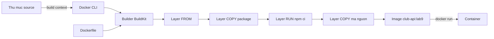

# Slide buổi 09 – Dockerfile

> **Tóm tắt:** Viết, build và chạy Dockerfile cho Node.js API của CLB; hiểu build context, ENV, CMD và ENTRYPOINT, và chẩn đoán lỗi build do sai thư mục. Bài lab đầy đủ: [Buổi 09](../../labs/week-05/session-09.md).

## Slide 1: Mục tiêu buổi học

- Giải thích các chỉ thị `FROM`, `WORKDIR`, `COPY`, `RUN`, `ENV`, `EXPOSE`, `CMD`, `ENTRYPOINT`.
- Viết Dockerfile cho `starter-project/backend`, build `club-api:lab9`, gọi được `/health`.
- Hiểu build context và vì sao build sai thư mục thì lỗi.
- Phân biệt `CMD` và `ENTRYPOINT`, exec form và shell form.
- Cache, `.dockerignore`, `USER node`, tag: để dành cho [Buổi 10](session-10.md).

---

## Slide 2: Vấn đề: ai build cũng ra image khác

- Máy Hùng dùng Node 22; máy Lan dùng Node 18 và `npm install` ra bộ thư viện khác.
- Mentor muốn deploy lên máy chung: mỗi lần cài một kiểu.
- Container chỉ chạy được khi có image.
- Dockerfile là công thức tái lập, nằm cùng mã nguồn trong Git.

---

## Slide 3: Dockerfile là công thức, image là sản phẩm

- Mỗi `COPY`, `RUN` tạo một **layer** chỉ đọc.
- Image = chồng layer + metadata (lệnh mặc định, ENV, port khai báo).
- Container = image + một lớp ghi mỏng.
- `ENV`, `EXPOSE`, `CMD` chỉ ghi metadata, không tạo dữ liệu mới.

---

## Slide 4: Các chỉ thị chính

| Chỉ thị | Làm gì | Lưu ý |
| --- | --- | --- |
| `FROM` | Chọn base image | Ghi rõ phiên bản: `node:22-alpine` |
| `WORKDIR` | Thư mục làm việc | Thay cho `RUN cd` |
| `COPY` | Chép từ context vào image | Tính theo context |
| `RUN` | Chạy lệnh lúc build | `npm ci` |
| `ENV` | Biến môi trường mặc định | Không đặt secret; `-e` ghi đè |
| `EXPOSE` | Khai báo cổng (tài liệu) | Không mở cổng ra host |

---

## Slide 5: Build context

- Dấu `.` cuối lệnh `docker build` là **build context**, thư mục gửi cho builder.
- `COPY` chỉ thấy file trong context, không tính theo vị trí Dockerfile.
- Build ở sai thư mục: không thấy Dockerfile, hoặc `COPY` báo `not found`.
- Hai cách đúng: `cd` vào thư mục có Dockerfile, hoặc ghi rõ `-f` và context.

---

## Slide 6: Từ source đến container



- Mỗi `COPY`, `RUN` tạo một layer; `ENV`, `EXPOSE`, `CMD` chỉ ghi metadata.
- Vì sao thứ tự `COPY` này quan trọng: học ở Buổi 10.

---

## Slide 7: CMD, ENTRYPOINT, exec form

| | `CMD` | `ENTRYPOINT` |
| --- | --- | --- |
| Ý nghĩa | Lệnh mặc định | Chương trình cố định |
| `docker run image abc` | Thay thế bằng `abc` | Nối `abc` vào sau |
| Ghi đè | Truyền lệnh sau tên image | Phải dùng `--entrypoint` |

- Exec form `["node", "server.js"]`: chạy trực tiếp, process là PID 1, nhận tín hiệu từ `docker stop`.
- Shell form `node server.js`: chạy qua `/bin/sh -c`.

---

## Slide 8: PID 1 và docker stop

- Node là PID 1 trong container; `server.js` không xử lý `SIGTERM`.
- Kernel không áp dụng hành vi mặc định cho PID 1, nên `docker stop` chờ khoảng 10 giây rồi `SIGKILL`.
- Cách khắc phục: bắt `SIGTERM` trong mã, hoặc `docker run --init`.

---

## Slide 9: Demo

- Build `Dockerfile.naive` của `hello-node`, chạy container và gọi `/health`.
- Sửa một dòng mã rồi build lại: bước cài dependency chạy lại từ đầu.
- Xem `docker image ls` và `docker exec ... id`: image rất nặng, container chạy bằng root.
- Ba hiện tượng này chưa cần giải thích; [Buổi 10](session-10.md) sẽ trả lời vì sao.

---

## Slide 10: Lab – bốn phần

- Phần 1: Dockerfile đầu tiên cho `club-api`, `curl /health`, `/ready` trả `503` vì chưa có database.
- Phần 2: `ENV` và `docker run -e` ghi đè lúc chạy.
- Phần 3: `CMD`, `ENTRYPOINT`, `docker stop` và `--init`.
- Phần 4: cố tình build sai thư mục, đọc lỗi và sửa.
- Lệnh chi tiết: xem [Buổi 09](../../labs/week-05/session-09.md).

---

## Slide 11: Break – build sai context (tình huống 05)

Triệu chứng:

```text
ERROR: failed to solve: failed to read dockerfile: open Dockerfile: no such file or directory
```

- Thêm `-f source/Dockerfile` nhưng context vẫn là thư mục cha: lỗi `"/package.json": not found`.
- Nguyên nhân gốc: context không chứa file mà Dockerfile tham chiếu.
- Hai cách sửa: `cd source` rồi build, hoặc `-f source/Dockerfile` kèm context `source`.

---

## Slide 12: Lỗi thường gặp

| Triệu chứng | Cách xử lý |
| --- | --- |
| `failed to read dockerfile` | Build đúng thư mục hoặc dùng `-f` kèm context |
| `COPY` báo `not found` | Kiểm tra context (đối số cuối) |
| `npm ci` lệch `package-lock.json` | Cập nhật lock file, commit cả hai |
| Container thoát ngay | `docker logs`, kiểm tra đường dẫn trong `CMD` |
| `docker stop` mất 10 giây | Bắt `SIGTERM` hoặc dùng `--init` |

---

## Slide 13: Recap và thử thách

- Dockerfile là công thức tái lập; `COPY` chỉ thấy trong build context.
- `ENV` là mặc định, `-e` ghi đè; `EXPOSE` chỉ là tài liệu, truy cập từ host cần `-p`.
- `CMD` dễ ghi đè, `ENTRYPOINT` cố định; dùng exec form.
- Thử thách ở nhà: giải thích `CMD` và `ENTRYPOINT` bằng bằng chứng của bạn; điều tra lỗi build context.
- Buổi sau: tối ưu image với layer cache, `.dockerignore`, multi-stage, `USER node`.
