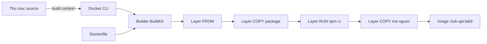

# Slide buổi 09 – Dockerfile

> **Tóm tắt:** Viết, build và chạy Dockerfile cho Node.js API của CLB; hiểu build context, layer cache, USER, CMD và ENTRYPOINT, và chẩn đoán lỗi build do sai context. Bài lab đầy đủ: [Buổi 09](../../labs/week-05/session-09.md).

## Slide 1: Mục tiêu buổi học

- Giải thích các chỉ thị `FROM`, `WORKDIR`, `COPY`, `RUN`, `ENV`, `EXPOSE`, `CMD`, `ENTRYPOINT`.
- Viết Dockerfile cho `starter-project/backend`, build `club-api:lab9`, gọi được `/health`.
- Hiểu build context và `.dockerignore`.
- Sắp xếp chỉ thị để tận dụng layer cache.
- Phân biệt `CMD` và `ENTRYPOINT`, exec form và shell form.
- Chẩn đoán lỗi build sai context (tình huống 05).

::: details Ghi chú giảng viên
Ôn 2 phút: container sống theo PID 1, `-p`, `-e`. Nói rõ hôm nay học viên tự viết Dockerfile từ đầu.
:::

---

## Slide 2: Vấn đề: ai build cũng ra image khác

- Máy Hùng dùng Node 22; máy Lan dùng Node 18 và `npm install` ra bộ thư viện khác.
- Mentor muốn deploy lên máy chung: mỗi lần cài một kiểu.
- Container chỉ chạy được khi có image.
- Dockerfile là công thức tái lập, nằm cùng mã nguồn trong Git.

::: details Ghi chú giảng viên
Nhấn: CI/CD sau này dùng lại đúng Dockerfile này (từ buổi 13). 2 phút.
:::

---

## Slide 3: Dockerfile là công thức, image là sản phẩm

- Mỗi `COPY`, `RUN` tạo một **layer** chỉ đọc.
- Image = chồng layer + metadata (lệnh mặc định, ENV, port khai báo).
- Container = image + một lớp ghi mỏng.
- `ENV`, `EXPOSE`, `USER`, `CMD` chỉ ghi metadata, không tạo dữ liệu mới.

::: details Ghi chú giảng viên
Hỏi: "Chỉ thị nào chạy lúc build, chỉ thị nào chạy lúc run?" Gọi 2 học viên. 3 phút.
:::

---

## Slide 4: Các chỉ thị chính

| Chỉ thị | Làm gì | Lưu ý |
| --- | --- | --- |
| `FROM` | Chọn base image | Ghim phiên bản: `node:22-alpine` |
| `WORKDIR` | Thư mục làm việc | Thay cho `RUN cd` |
| `COPY` | Chép từ context vào image | Tính theo context |
| `RUN` | Chạy lệnh lúc build | `npm ci` |
| `ENV` | Biến môi trường | Không đặt secret |
| `EXPOSE` | Khai báo cổng (tài liệu) | Không mở cổng ra host |
| `USER` | Đổi user chạy | Image node có user `node` |

::: details Ghi chú giảng viên
Nhấn mạnh `EXPOSE` không publish cổng; vẫn cần `-p`. 3 phút.
:::

---

## Slide 5: Build context

```bash
docker build -t club-api:lab9 .
```

- Dấu `.` cuối là **build context**, thư mục gửi cho builder.
- `COPY` chỉ thấy file trong context, không tính theo vị trí Dockerfile.
- `COPY . .` đưa mọi thứ vào image, kể cả `.env`, `.git`, `node_modules`.
- `.dockerignore` loại trừ các mục này.

::: details Ghi chú giảng viên
Hỏi: "Nếu build ở thư mục cha của Dockerfile thì lỗi gì?" (để dành cho slide Break). 3 phút.
:::

---

## Slide 6: Layer cache



- Không đổi đầu vào thì dùng lại layer và in `CACHED`.
- Một layer bị vô hiệu thì mọi layer sau build lại.
- Quy tắc: ít đổi lên trên, hay đổi xuống dưới.

::: details Ghi chú giảng viên
Chỉ vào layer `npm ci` và hỏi: nó phụ thuộc vào file nào? (chỉ hai file manifest). 4 phút.
:::

---

## Slide 7: CMD, ENTRYPOINT, exec form

| | `CMD` | `ENTRYPOINT` |
| --- | --- | --- |
| Ý nghĩa | Lệnh mặc định | Chương trình cố định |
| `docker run image abc` | Thay thế bằng `abc` | Nối `abc` vào sau |
| Ghi đè | Truyền lệnh sau tên image | Phải dùng `--entrypoint` |

- Exec form `["node", "server.js"]`: chạy trực tiếp, process là PID 1, nhận tín hiệu từ `docker stop`.
- Shell form `node server.js`: chạy qua `/bin/sh -c`.

::: details Ghi chú giảng viên
Ví dụ gợi ý: một người muốn chạy API, một người muốn vào debug bằng `sh`; `CMD` dễ cho người thứ hai. 3 phút.
:::

---

## Slide 8: Demo 1 – Dockerfile ngây thơ

```bash
mkdir -p ~/demo && cp -r ~/devops-course/examples/docker/hello-node ~/demo/ && cd ~/demo/hello-node
docker build -f Dockerfile.naive -t hello-node:naive .
docker run -d --name demo-naive -p 3100:3000 hello-node:naive
curl -s localhost:3100/health
```

Kết quả mong đợi: build mất vài chục giây lần đầu; `curl` in `{"status":"healthy"}`.

- Mentor dùng cổng 3100 để không đụng lớp.

::: details Ghi chú giảng viên
Dùng bản sao ở `~/demo` để sửa thoải mái. Cho lớp đọc `cat Dockerfile.naive` trước khi build: `COPY . .` rồi `RUN npm install`. 3 phút.
:::

---

## Slide 9: Demo 2 – Sửa một dòng, build lại

```bash
echo "// sua nhe" >> server.js
docker build -f Dockerfile.naive -t hello-node:naive .
```

Kết quả mong đợi: `RUN npm install` chạy lại từ đầu dù `package.json` không đổi.

- Nguyên nhân: `COPY . .` đứng trước, nội dung context đã đổi.
- Triệu chứng thực tế: build chậm không rõ lý do.

::: details Ghi chú giảng viên
Hỏi: "Nếu đổi thứ tự `COPY package.json` và `COPY . .` thì nhanh hay chậm?" Cho lớp dự đoán rồi mới chiếu bản tối ưu. 3 phút.
:::

---

## Slide 10: Demo 3 – Bản tối ưu và so sánh

```bash
docker build -f Dockerfile.optimized -t hello-node:opt .
echo "// sua nua" >> server.js
docker build -f Dockerfile.optimized -t hello-node:opt .
docker image ls hello-node
docker exec demo-naive id
docker rm -f demo-naive
```

- Lần build thứ hai của `opt` hiện `CACHED` ở bước cài dependency.
- Bản naive lớn hơn nhiều (base Debian đầy đủ) và chạy `uid=0(root)`.

::: details Ghi chú giảng viên
Hỏi: nếu API bị khai thác lỗ hổng khi chạy bằng root thì kẻ tấn công có gì trong tay? 4 phút.
:::

---

## Slide 11: Lab – chuẩn bị

```bash
mkdir -p ~/devops-labs/lab-09/{source,evidence,screenshots}
cd ~/devops-labs/lab-09
cp -r ~/devops-course/starter-project/backend/. source/
rm -rf source/node_modules source/Dockerfile source/.dockerignore
ls -a source
```

Kết quả mong đợi: thấy `app.js`, `db.js`, `server.js`, `package.json`, `package-lock.json`, `tests`; chưa có `Dockerfile`.

- Image `club-api:lab9`, container `club-api-lab9`, cổng host 3001.

::: details Ghi chú giảng viên
Chủ ý xóa `.dockerignore` mẫu để học viên tự thấy vì sao cần nó. Lỗi hay gặp: học viên chưa clone repo giáo trình vào WSL. 5 phút.
:::

---

## Slide 12: Lab – Dockerfile đầu tiên

```dockerfile
FROM node:22-alpine
WORKDIR /app
COPY . .
RUN npm ci --omit=dev
EXPOSE 3000
CMD ["node", "server.js"]
```

```bash
cd ~/devops-labs/lab-09/source
docker build -t club-api:lab9 .
docker run -d --name club-api-lab9 -p 3001:3000 club-api:lab9
curl -s localhost:3001/health
curl -s -i localhost:3001/ready | head -n 1
```

Kết quả mong đợi: `/health` trả `healthy`; `/ready` trả `HTTP/1.1 503 Service Unavailable`.

::: details Ghi chú giảng viên
`/ready` là 503 vì chưa có PostgreSQL; bình thường ở buổi này, buổi 11 và 12 sẽ nối DB. 12 phút.
:::

---

## Slide 13: Lab – tối ưu cache

```dockerfile
FROM node:22-alpine
WORKDIR /app
COPY package.json package-lock.json ./
RUN npm ci --omit=dev
COPY . .
EXPOSE 3000
CMD ["node", "server.js"]
```

```bash
echo "// lab9 thay doi" >> server.js
docker build --progress=plain -t club-api:lab9 . 2>&1 | grep -E "npm ci|CACHED"
```

Kết quả mong đợi: dòng `RUN npm ci --omit=dev` hiện `CACHED`, chỉ `COPY . .` build lại.

::: details Ghi chú giảng viên
Cho học viên tự đo hai lần build (trước và sau sửa Dockerfile) để thấy khác biệt. 10 phút.
:::

---

## Slide 14: Lab – ENV và USER an toàn

```dockerfile
FROM node:22-alpine
WORKDIR /app
ENV NODE_ENV=production \
    PORT=3000
COPY package.json package-lock.json ./
RUN npm ci --omit=dev
COPY --chown=node:node . .
USER node
EXPOSE 3000
CMD ["node", "server.js"]
```

```bash
docker exec club-api-lab9 id
docker run --rm -e PORT=4000 -d --name club-api-port club-api:lab9
```

Kết quả mong đợi: `uid=1000(node)`; log của container thứ hai `API listening on port 4000`.

- `ENV` là mặc định, `-e` ghi đè lúc chạy, không cần build lại.

::: details Ghi chú giảng viên
`USER node` đặt sau `npm ci` để bước cài vẫn có quyền ghi. Nhắc `sleep 1` trước `docker logs` nếu log trống, và dọn `docker rm -f club-api-port`. 10 phút.
:::

---

## Slide 15: Lab – CMD, ENTRYPOINT và dừng gọn

```bash
docker run --rm club-api:lab9 node --version
docker build -f Dockerfile.ep -t club-api:lab9-ep .
docker run --rm club-api:lab9-ep --version
docker run --rm --entrypoint id club-api:lab9-ep
time docker stop club-api-lab9
```

- `Dockerfile.ep` đổi dòng cuối thành `ENTRYPOINT ["node"]` và `CMD ["server.js"]`.
- `docker stop` mất khoảng 10 giây vì node là PID 1 và không xử lý `SIGTERM`.
- Thử `docker run --init` để dừng nhanh.

::: details Ghi chú giảng viên
Cách sửa tận gốc là bắt `SIGTERM` trong mã, như `examples/docker/hello-node/server.js`. 10 phút.
:::

---

## Slide 16: Lab – .dockerignore và file lọt vào image

```bash
echo "DB_PASSWORD=gia-lap-khong-phai-that" > .env
dd if=/dev/zero of=rac.bin bs=1M count=100 status=none
docker build --progress=plain -t club-api:lab9-leak . 2>&1 | grep -i "transferring context"
docker run --rm club-api:lab9-leak ls -a /app
```

Kết quả mong đợi: context khoảng 100 MB; `ls -a /app` liệt kê cả `.env` và `rac.bin`.

```text
node_modules
.git
.env
*.bin
tests
Dockerfile*
```

Tạo `.dockerignore` như trên, build lại: context còn vài chục KB, không còn `.env`. Nhớ `rm -f .env rac.bin`.

::: details Ghi chú giảng viên
Đây là slide gây ấn tượng nhất: ai pull image đều đọc được `.env`. Bỏ `tests` khỏi image runtime là chủ ý, test chạy ở CI. 8 phút.
:::

---

## Slide 17: Lab – L1 và L2

- L1: Dockerfile build được, cache đúng thứ tự, chạy bằng user `node`, có `.dockerignore`, chứng minh `.env` không còn trong image.
- L2 thử thách 1: viết lại từ đầu, thêm `HEALTHCHECK` gọi `/health`.
- L2 thử thách 2: viết đoạn giải thích `CMD` và `ENTRYPOINT`, vì sao dùng exec form.
- L2 thử thách 4: so sánh với `starter-project/backend/Dockerfile` (multi-stage), liệt kê 3 điểm khác.

```bash
docker inspect --format '{{.State.Health.Status}}' club-api-lab9
```

::: details Ghi chú giảng viên
Gợi ý HEALTHCHECK: Alpine có `wget` (BusyBox) nhưng không có `curl`; dùng `127.0.0.1` thay `localhost`; dùng `--start-period`. Buổi 10 sẽ đi sâu multi-stage.
:::

---

## Slide 18: Break – build sai context (tình huống 05)

```bash
cd ~/devops-labs/lab-09
docker build -t club-api:lab9 .
```

Triệu chứng:

```text
ERROR: failed to solve: failed to read dockerfile: open Dockerfile: no such file or directory
```

- Thêm `-f source/Dockerfile` nhưng context vẫn là `.`: lỗi `"/package.json": not found`.
- Nguyên nhân gốc: context không chứa file mà Dockerfile tham chiếu.
- Hai cách sửa: `cd source` rồi build, hoặc `docker build -f source/Dockerfile -t club-api:lab9 source`.

::: details Ghi chú giảng viên
Cho lớp tự điều tra bằng `pwd`, `ls` trước khi gợi ý. Học viên chỉ nhận triệu chứng như ở `examples/troubleshooting/scenario-05`. Phòng tránh: ghi lệnh build chuẩn vào README hoặc CI. 5 phút.
:::

---

## Slide 19: Lỗi thường gặp

| Triệu chứng | Cách xử lý |
| --- | --- |
| `failed to read dockerfile` | Build đúng thư mục hoặc dùng `-f` kèm context |
| `npm ci` chạy lại mỗi lần | Chép manifest trước, mã nguồn sau |
| `npm ci` lệch `package-lock.json` | Cập nhật lock file, commit cả hai |
| Container thoát ngay | `docker logs`, kiểm tra đường dẫn trong `CMD` |
| `EACCES` khi chạy `USER node` | `COPY --chown`, ghi log ra stdout |
| `docker stop` mất 10 giây | Bắt `SIGTERM` hoặc dùng `--init` |

::: details Ghi chú giảng viên
Chọn 2 dòng liên quan đến lỗi lớp vừa gặp trong lab. 2 phút.
:::

---

## Slide 20: Challenge

- Viết Dockerfile đạt đồng thời: Node 22 Alpine, user `node`, cache đúng, không chứa `.env`, có `HEALTHCHECK`.
- Đo thời gian build lần hai sau khi sửa một dòng mã nguồn và ghi vào `report.md`.
- Đồng đội báo "CI báo COPY không tìm thấy package.json": liệt kê thứ tự bạn kiểm tra.

::: details Ghi chú giảng viên
Gợi ý cho câu cuối: context và `working-directory` trong workflow, `.dockerignore`, file có được commit không, phân biệt hoa thường. Giao về nhà.
:::

---

## Slide 21: Recap

- Dockerfile là công thức tái lập; mỗi `COPY` và `RUN` tạo một layer.
- `COPY` chỉ thấy trong build context; `.dockerignore` giữ file thừa, file bí mật ra khỏi image.
- Manifest và `npm ci` trước, mã nguồn sau.
- `EXPOSE` chỉ là tài liệu; truy cập từ host cần `-p`; cấu hình lúc chạy dùng `-e`.
- Chạy bằng `USER node`, ghim `node:22-alpine`.
- `CMD` dễ ghi đè, `ENTRYPOINT` cố định; dùng exec form.

::: details Ghi chú giảng viên
Gọi học viên nhắc lại 1 ý. Nhắc nộp `lab-09/` theo `templates/lab-template.md`, không commit `.env`. Buổi sau: tối ưu image với multi-stage. 15 phút review.
:::
