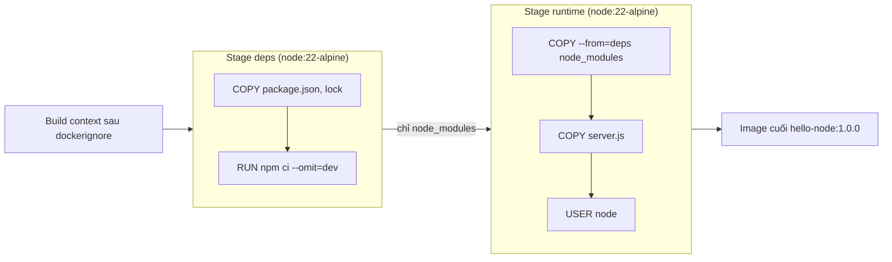

# Slide buổi 10 – Image Optimization

> **Tóm tắt:** Hiểu layer và build cache, dùng .dockerignore, multi-stage build, non-root user và tagging để làm image nhỏ hơn, build nhanh hơn, an toàn hơn, rồi chứng minh bằng số liệu.

## Slide 1: Mục tiêu buổi học

- Giải thích layer chỉ đọc và vì sao thứ tự lệnh quyết định cache.
- Đọc `docker history` và `docker image ls` để so sánh hai image.
- Viết `.dockerignore` để giảm context và không đưa `.env` vào image.
- Chuyển Dockerfile sang multi-stage, chạy bằng non-root, chứng minh bằng `id`.
- Gắn tag có ý nghĩa, phân biệt tag với digest.

::: details Ghi chú giảng viên
Thời lượng: 2 phút. Nhấn mạnh buổi này lab có số liệu trước/sau: ai cũng phải có bảng so sánh. Hỏi lớp: ai đã từng build image trên 1 GB?
:::

---

## Slide 2: Vấn đề thực tế

- Dockerfile đầu tiên: `FROM node:22`, `COPY . .`, `RUN npm install`.
- Image nặng hơn 1 GB.
- Sửa một dòng code, CI cài lại toàn bộ dependency mất vài phút.
- `COPY . .` chép luôn file `.env` chứa mật khẩu vào image.
- Ba vấn đề (nặng, chậm, không an toàn) chung một gốc: không hiểu image được tạo thế nào.

::: details Ghi chú giảng viên
Kể câu chuyện như tình huống có thật trong CLB. Hỏi: "Nếu image này push lên registry công khai thì ai đọc được mật khẩu?" Thời lượng: 2 phút.
:::

---

## Slide 3: Layer là bất biến

- Image là chồng layer chỉ đọc; `RUN`, `COPY`, `ADD` tạo layer mới.
- Container thêm một writable layer mỏng, mất khi container bị xóa.
- `RUN npm install` tạo 200 MB, `RUN rm -rf cache` ở lớp sau vẫn không làm image nhỏ lại.
- Muốn bỏ thứ gì khỏi image: đừng đưa nó vào (`.dockerignore`, multi-stage).

::: details Ghi chú giảng viên
Vẽ chồng layer lên bảng. Câu hỏi: "rm ở layer 5 có xóa được dữ liệu ở layer 4 không?" Đáp: chỉ che đi, dữ liệu vẫn nằm trong layer 4. Thời lượng: 3 phút.
:::

---

## Slide 4: Build cache

- Mỗi lệnh được so khớp với cache; `COPY` so sánh checksum nội dung file.
- Một layer mất cache thì mọi layer phía sau đều build lại.
- Nguyên tắc: ít đổi (base, dependency) đặt trước, hay đổi (source code) đặt sau.

| Cách viết | Sửa 1 dòng server.js | Đánh giá |
| --- | --- | --- |
| `COPY . .` rồi `RUN npm install` | Cài lại toàn bộ | Chậm |
| `COPY package*.json`, `RUN npm ci`, rồi `COPY . .` | Chỉ chép lại code | Nhanh |

::: details Ghi chú giảng viên
Cho lớp tự sắp xếp 3 lệnh `COPY . .`, `RUN npm ci`, `COPY package*.json ./` trước khi lộ đáp án. Thời lượng: 3 phút.
:::

---

## Slide 5: Build context và .dockerignore

- `docker build .` gửi cả thư mục `.` (build context) cho builder trước khi đọc Dockerfile.
- `.dockerignore` loại file khỏi context nên `COPY . .` không chép nhầm.
- Nên ignore: `node_modules`, `.git`, `.env`, `*.pem`, `tests`, `*.md`, `Dockerfile*`.
- Không ignore file mà Dockerfile cần `COPY` (ví dụ `package-lock.json`).

::: details Ghi chú giảng viên
Nhắc lại: `.dockerignore` đặt cạnh Dockerfile. Báo trước rằng cuối buổi sẽ cố tình ignore nhầm `package-lock.json` để phá lỗi. Thời lượng: 2 phút.
:::

---

## Slide 6: Kiến trúc multi-stage



::: details Ghi chú giảng viên
Đi theo mũi tên từ trái sang phải. Nhấn mạnh: chỉ stage cuối thành image, các stage trước chỉ còn trong build cache. Thời lượng: 3 phút.
:::

---

## Slide 7: Cách hoạt động của multi-stage và cache

- Stage `deps` chép riêng manifest, chạy `npm ci --omit=dev`; chỉ build lại khi lockfile đổi.
- Stage `runtime` bắt đầu từ base sạch, lấy `node_modules` bằng `COPY --from=deps`.
- Code ứng dụng chép sau cùng; `USER node` đặt cuối.
- Sửa `server.js`: chỉ `COPY server.js` và layer sau bị tạo lại.

::: details Ghi chú giảng viên
Hỏi: "Nếu tôi sửa package-lock.json thì layer nào chạy lại?" Đáp: từ `npm ci` trở đi. Thời lượng: 2 phút.
:::

---

## Slide 8: Base image, non-root, tag

- `node:22` trên 1 GB; `node:22-slim` khoảng 200-250 MB; `node:22-alpine` khoảng 150-200 MB (số đo thật có thể khác).
- Mặc định tiến trình chạy bằng root (uid 0); image `node` có sẵn user `node` (uid 1000).
- Dùng `USER node` và `COPY --chown=node:node`.
- Tag là nhãn có thể bị gán lại; `latest` chỉ là một tag bình thường; digest là định danh theo nội dung.
- Deploy luôn dùng tag version cụ thể: `club-api:1.0.0`.

::: details Ghi chú giảng viên
Nhắc: tin số bạn đo bằng `docker image ls`, không tin con số trong slide. Alpine dùng musl nên vài thư viện native có thể lỗi, khi đó dùng slim. Thời lượng: 3 phút.
:::

---

## Slide 9: Demo 1 - Baseline naive

```bash
mkdir -p ~/demo-10 && cp -r ~/devops-course/examples/docker/hello-node/. ~/demo-10/ && cd ~/demo-10
rm -f .dockerignore
docker build -f Dockerfile.naive -t hello-node:demo-naive .
docker image ls hello-node
```

```text
REPOSITORY   TAG          IMAGE ID       CREATED          SIZE
hello-node   demo-naive   3f1c0a9b7d2e   10 seconds ago   1.6GB
```

- Ứng dụng chỉ có 1 file và 1 thư viện nhưng image nặng hơn 1 GB: vì sao?

::: details Ghi chú giảng viên
Gợi ý đáp án: base image Debian đầy đủ. Số thật của máy bạn sẽ khác, miễn là trên 1 GB. Thời lượng: 3 phút.
:::

---

## Slide 10: Demo 2 - Rò rỉ .env và context phình to

```bash
head -c 30M /dev/zero > big.bin
echo "DB_PASSWORD=do-not-leak" > .env
docker build -f Dockerfile.naive -t hello-node:demo-naive .
docker run --rm hello-node:demo-naive cat /app/.env
```

```text
=> => transferring context: 31.46MB
DB_PASSWORD=do-not-leak
```

- Tìm dòng `transferring context` trong log build.
- Bí mật nằm trong image, ai pull cũng đọc được.

::: details Ghi chú giảng viên
Dừng lại ở kết quả `cat`. Hỏi lớp: "Nếu push công khai thì sao?" Giá trị mật khẩu ở đây là giả. Thời lượng: 3 phút.
:::

---

## Slide 11: Demo 3 - Mất cache rồi sửa

```bash
echo "// edit" >> server.js
docker build -f Dockerfile.naive -t hello-node:demo-naive . 2>&1 | grep -E "RUN|COPY|CACHED"
```

- Mong đợi: `COPY . .` và `RUN npm install` đều chạy lại, không có chữ `CACHED`.

Sửa bằng `.dockerignore` và Dockerfile tối ưu:

```bash
printf 'node_modules\n.git\n.env\n*.bin\nDockerfile*\n.dockerignore\n' > .dockerignore
docker build -f Dockerfile.optimized -t hello-node:demo-opt .
docker run --rm hello-node:demo-opt cat /app/.env
```

```text
cat: can't open '/app/.env': No such file or directory
```

::: details Ghi chú giảng viên
Thông báo lỗi của `cat` có thể hơi khác tùy phiên bản busybox, ý chính là file không tồn tại. Size mong đợi khoảng 200-250 MB. Câu chốt: "Vì sao lần này nhanh hơn, layer nào lấy từ cache?" Dọn: `docker rmi hello-node:demo-naive hello-node:demo-opt`. Thời lượng: 5 phút.
:::

---

## Slide 12: Hands-on L1 - Baseline, .dockerignore, so sánh

- Chuẩn bị `lab-10/source/hello-node`, xóa `.dockerignore` mẫu, tạo `big.bin` và `.env` giả.
- Build `hello-node:1.0.0-naive`, ghi size và dòng `transferring context`.
- Chứng minh `.env` bị lộ và chạy bằng root: `docker run --rm hello-node:1.0.0-naive id`.
- Đọc layer bằng `docker history hello-node:1.0.0-naive`.
- Tạo `.dockerignore`, build lại, `ls -a /app` không còn `.env`, `big.bin`.

```text
uid=0(root) gid=0(root) groups=0(root)
```

::: details Ghi chú giảng viên
Lưu ý quan trọng: sau khi thêm `.dockerignore`, size gần như không đổi vì vấn đề chính là base image. Yêu cầu học viên ghi nhận điều này vào report. Thời lượng: 20 phút.
:::

---

## Slide 13: Hands-on L1 - Optimized và starter-project

```bash
docker build -f Dockerfile.optimized -t hello-node:1.0.0 .
echo "// edit 2" >> server.js
docker build -f Dockerfile.optimized -t hello-node:1.0.0 . 2>&1 | grep -E "RUN npm|COPY|CACHED"
docker run --rm --entrypoint id hello-node:1.0.0
```

```text
=> CACHED [deps 4/4] RUN npm ci --omit=dev
uid=1000(node) gid=1000(node) groups=1000(node)
```

- Áp dụng vào dự án: `docker build -t club-api:1.0.0 ~/devops-course/starter-project/backend`.
- Health check của bản optimized có `--interval=30s`: đợi khoảng 35 giây mới thấy `(healthy)`.

::: details Ghi chú giảng viên
Số thứ tự bước (`4/4`) có thể khác tùy phiên bản Docker. Nhắc học viên đừng hoảng khi thấy `(health: starting)` trong 30 giây đầu. Thời lượng: 20 phút.
:::

---

## Slide 14: Hands-on L2 - Thử thách tự làm

- Viết `Dockerfile.mine` multi-stage, `node:22-alpine`, pin major version.
- Sửa `server.js` không được làm `npm ci` chạy lại (chứng minh bằng `CACHED`).
- Non-root, không có `.env`, size không quá 10% so với bản optimized.
- Giải thích từng layer của `docker history`: layer nào của base, của bạn, 0B vì sao.
- Chiến lược tag cho `club-api` với 1.0.0, 1.0.1, 1.1.0. Nâng cao: stage `test`.

::: details Ghi chú giảng viên
Gợi ý nếu bí: bắt đầu từ hai stage, stage `deps` chỉ chép manifest. Nếu `npm ci` báo thiếu lockfile, kiểm tra `.dockerignore`. L2 có thể hoàn thành sau giờ. Thời lượng: phần còn lại của giờ lab.
:::

---

## Slide 15: Lỗi thường gặp

| Triệu chứng | Nguyên nhân | Cách xử lý |
| --- | --- | --- |
| `"/xxx": not found` | File bị `.dockerignore` loại hoặc sai context | Kiểm tra `.dockerignore` và tham số cuối của `docker build` |
| Sửa code là cài lại dependency | `COPY . .` đặt trước `npm ci` | Chép manifest trước, cài, rồi chép code |
| `EACCES` khi chạy `USER node` | File thuộc root | `COPY --chown=node:node` |
| Image vẫn lớn dù `RUN rm` | Layer trước còn nguyên | Multi-stage hoặc `.dockerignore` |

::: details Ghi chú giảng viên
Hỏi nhanh: "Triệu chứng nào bạn dễ gặp nhất ở CI?" Thời lượng: 2 phút.
:::

---

## Slide 16: Debug - "not found" dù file có thật

```bash
echo "package-lock.json" >> .dockerignore
docker build -f Dockerfile.optimized -t hello-node:broken .
```

```text
ERROR: failed to solve: ... "/package-lock.json": not found
```

- Đọc lỗi: file không có trong context, không phải lỗi npm.
- `ls package-lock.json` thấy có: file có trên đĩa nhưng builder không thấy.
- `cat .dockerignore` thấy dòng loại file: đó là nguyên nhân gốc.
- Sửa: xóa dòng đó, hoặc thêm `!package-lock.json`.

::: details Ghi chú giảng viên
Cho học viên tự điều tra theo thứ tự trên trước khi lộ nguyên nhân. Đây là họ lỗi của tình huống 05 (`examples/troubleshooting/scenario-05/`). Thời lượng: 5 phút.
:::

---

## Slide 17: Thử thách cuối buổi

- Tag `latest` có đảm bảo là bản mới nhất không? Nên tag thế nào để deploy tái lập được?
- CI build mất 6 phút dù chỉ sửa README: kiểm tra những gì?
- Làm sao chứng minh container chạy non-root?
- Vì sao `.dockerignore` không thu nhỏ base image?

::: details Ghi chú giảng viên
Đáp án gợi ý: không, dùng tag `1.0.1` hoặc digest; xem layer nào mất cache và `.dockerignore` thiếu `.git`, `*.md`; `docker run --rm --entrypoint id image`; nó chỉ lọc context. Thời lượng: 5 phút.
:::

---

## Slide 18: Recap

- Layer bất biến: xóa ở layer sau không làm image nhỏ lại.
- Ít đổi đặt trước, hay đổi đặt sau để tận dụng cache.
- `.dockerignore` giảm context và ngăn bí mật lọt vào image.
- Multi-stage + base nhỏ cho image gọn; đo bằng `docker image ls`, `docker history`.
- Non-root (`USER node`, `COPY --chown`); tag version cụ thể, `latest` không phải "mới nhất".
- Buổi sau: container networking với `club-api` và Postgres.

::: details Ghi chú giảng viên
Nhắc nộp bài vào `lab-10/` với bảng so sánh trước/sau, không commit `.env` và `big.bin`. Thời lượng: 2 phút.
:::
