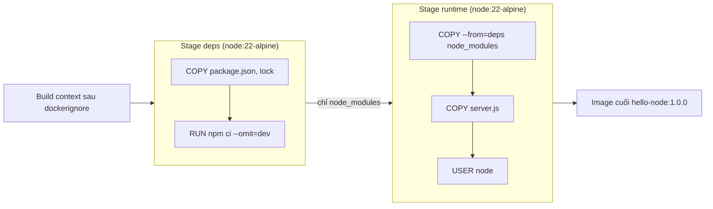

# Slide buổi 10 – Image Optimization

> **Tóm tắt:** Làm image nhỏ hơn, build nhanh hơn, an toàn hơn bằng layer cache, .dockerignore, multi-stage, non-root user và tagging, rồi chứng minh bằng số liệu. Bài lab đầy đủ: [Buổi 10](../../labs/week-05/session-10.md).

## Slide 1: Mục tiêu buổi học

- Giải thích layer chỉ đọc và vì sao thứ tự lệnh quyết định cache.
- Đọc `docker history` và `docker image ls` để so sánh hai image.
- Viết `.dockerignore` để giảm context và không đưa `.env` vào image.
- Chuyển Dockerfile sang multi-stage, chạy bằng non-root, chứng minh bằng `id`.
- Gắn tag có ý nghĩa, phân biệt tag với digest.

---

## Slide 2: Vấn đề thực tế

- Dockerfile đầu tiên: `FROM node:22`, `COPY . .`, `RUN npm install`.
- Image nặng hơn 1 GB.
- Sửa một dòng code, CI cài lại toàn bộ dependency mất vài phút.
- `COPY . .` chép luôn file `.env` chứa mật khẩu vào image.
- Ba vấn đề (nặng, chậm, không an toàn) chung một gốc: không hiểu image được tạo thế nào.

---

## Slide 3: Layer là bất biến

- Image là chồng layer chỉ đọc; `RUN`, `COPY`, `ADD` tạo layer mới.
- Container thêm một writable layer mỏng, mất khi container bị xóa.
- `RUN npm install` tạo 200 MB, `RUN rm -rf cache` ở lớp sau vẫn không làm image nhỏ lại.
- Muốn bỏ thứ gì khỏi image: đừng đưa nó vào (`.dockerignore`, multi-stage).

---

## Slide 4: Build cache

- Mỗi lệnh được so khớp với cache; `COPY` so sánh checksum nội dung file.
- Một layer mất cache thì mọi layer phía sau đều build lại.
- Nguyên tắc: ít đổi (base, dependency) đặt trước, hay đổi (source code) đặt sau.

| Cách viết | Sửa 1 dòng server.js | Đánh giá |
| --- | --- | --- |
| `COPY . .` rồi `RUN npm install` | Cài lại toàn bộ | Chậm |
| `COPY package*.json`, `RUN npm ci`, rồi `COPY . .` | Chỉ chép lại code | Nhanh |

---

## Slide 5: Build context và .dockerignore

- `docker build .` gửi cả thư mục `.` (build context) cho builder trước khi đọc Dockerfile.
- `.dockerignore` loại file khỏi context nên `COPY . .` không chép nhầm.
- Nên ignore: `node_modules`, `.git`, `.env`, `*.pem`, `tests`, `*.md`, `Dockerfile*`.
- Không ignore file mà Dockerfile cần `COPY` (ví dụ `package-lock.json`).

---

## Slide 6: Kiến trúc multi-stage



---

## Slide 7: Cách hoạt động của multi-stage và cache

- Stage `deps` chép riêng manifest, chạy `npm ci --omit=dev`; chỉ build lại khi lockfile đổi.
- Stage `runtime` bắt đầu từ base sạch, lấy `node_modules` bằng `COPY --from=deps`.
- Code ứng dụng chép sau cùng; `USER node` đặt cuối.
- Sửa `server.js`: chỉ `COPY server.js` và layer sau bị tạo lại.

---

## Slide 8: Base image, non-root, tag

- `node:22` trên 1 GB; `node:22-slim` khoảng 200-250 MB; `node:22-alpine` khoảng 150-200 MB (số đo thật có thể khác).
- Mặc định tiến trình chạy bằng root (uid 0); image `node` có sẵn user `node` (uid 1000).
- Dùng `USER node` và `COPY --chown=node:node`.
- Tag là nhãn có thể bị gán lại; `latest` chỉ là một tag bình thường; digest là định danh theo nội dung.
- Deploy luôn dùng tag version cụ thể: `club-api:1.0.0`.

---

## Slide 9: Demo

- Baseline: build `Dockerfile.naive` của `hello-node`, image trên 1 GB (ví dụ `1.6GB`).
- Thêm `big.bin` và `.env` giả: `transferring context` khoảng 31 MB, `cat /app/.env` trong image in ra mật khẩu giả.
- Sửa code, build lại naive: `COPY . .` và `RUN npm install` chạy lại, không có `CACHED`.
- Thêm `.dockerignore` và build `Dockerfile.optimized`: khoảng 200-250 MB, không còn `.env`, chạy `uid=1000`.

---

## Slide 10: Lab – L1 trong 60 phút

- Phần 1: baseline naive, đo size, chứng minh `.env` bị lộ và chạy root, đọc `docker history`.
- Phần 2: thêm `.dockerignore`; lưu ý size gần như không đổi vì vấn đề chính là base image.
- Phần 3: cache, multi-stage, non-root; `CACHED` ở bước `npm ci`; health đợi khoảng 35 giây.
- Phần 4 và 5: tag và digest; build `club-api:1.0.0` từ starter-project.
- Lệnh chi tiết: [Buổi 10](../../labs/week-05/session-10.md).

---

## Slide 11: Lab – L2 thử thách tự làm

- Viết `Dockerfile.mine` multi-stage, `node:22-alpine`, pin major version.
- Sửa `server.js` không được làm `npm ci` chạy lại (chứng minh bằng `CACHED`).
- Non-root, không có `.env`, size không quá 10% so với bản optimized.
- Giải thích từng layer của `docker history`: layer nào của base, của bạn, 0B vì sao.
- Chiến lược tag cho `club-api` với 1.0.0, 1.0.1, 1.1.0. Nâng cao: stage `test`.

---

## Slide 12: Lỗi thường gặp

| Triệu chứng | Nguyên nhân | Cách xử lý |
| --- | --- | --- |
| `"/xxx": not found` | File bị `.dockerignore` loại hoặc sai context | Kiểm tra `.dockerignore` và tham số cuối của `docker build` |
| Sửa code là cài lại dependency | `COPY . .` đặt trước `npm ci` | Chép manifest trước, cài, rồi chép code |
| `EACCES` khi chạy `USER node` | File thuộc root | `COPY --chown=node:node` |
| Image vẫn lớn dù `RUN rm` | Layer trước còn nguyên | Multi-stage hoặc `.dockerignore` |

---

## Slide 13: Debug – "not found" dù file có thật

Triệu chứng sau khi ignore nhầm `package-lock.json`:

```text
ERROR: failed to solve: ... "/package-lock.json": not found
```

- Đọc lỗi: file không có trong context, không phải lỗi npm.
- `ls package-lock.json` thấy có: file có trên đĩa nhưng builder không thấy.
- `cat .dockerignore` thấy dòng loại file: đó là nguyên nhân gốc.
- Sửa: xóa dòng đó, hoặc thêm `!package-lock.json`.

---

## Slide 14: Thử thách cuối buổi và recap

- Tag `latest` có đảm bảo là bản mới nhất không? Nên tag thế nào để deploy tái lập được?
- CI build mất 6 phút dù chỉ sửa README: kiểm tra những gì?
- Làm sao chứng minh container chạy non-root? Vì sao `.dockerignore` không thu nhỏ base image?
- Recap: layer bất biến; ít đổi đặt trước, hay đổi đặt sau; `.dockerignore` ngăn bí mật lọt vào image; multi-stage và base nhỏ cho image gọn; non-root; tag version cụ thể.
- Buổi sau: container networking với `club-api` và Postgres.
