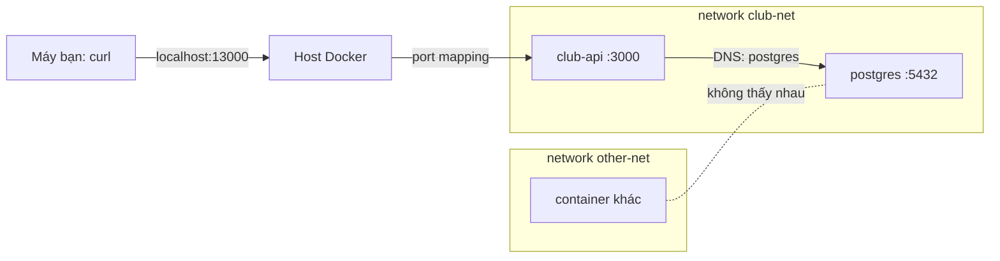

# Slide buổi 11 – Container Networking

> **Tóm tắt:** Cho API và database ở hai container nói chuyện bằng tên qua network riêng, chỉ mở đúng cổng ra máy bạn, và tự tìm ra lỗi "API chạy nhưng không nối được DB".

Bài học: [Buổi 11 – Container Networking](../../labs/week-06/session-11.md) · Bài tập: [Bài tập tuần 6](../../assignments/weekly/week-06.md)

## Slide 1: Mục tiêu buổi học

- Phân biệt default bridge và user-defined bridge (DNS theo tên container).
- Phân biệt `-p` (publish ra máy bạn) với kết nối giữa container cùng network.
- Chứng minh isolation và dùng `docker network connect`.
- Dựng `club-api` kết nối Postgres, đặt đúng `DB_HOST`, chẩn đoán lỗi kết nối DB.

---

## Slide 2: Vấn đề thực tế

- Trên máy: API gọi `localhost:5432` và chạy tốt.
- Vào container: API báo không nối được DB dù container Postgres vẫn `Up`.
- `localhost` trong container API là chính container API.
- Ba câu hỏi hằng ngày: gọi bằng địa chỉ nào, cổng nào cần mở ra ngoài, làm sao database không bị truy cập từ mọi nơi.

---

## Slide 3: Default bridge và user-defined bridge

- Default bridge: container chỉ gọi nhau bằng IP, không có DNS theo tên.
- IP đổi mỗi lần container được tạo lại nên không thể dựa vào.
- User-defined bridge (`docker network create`): có DNS nhúng, gọi nhau bằng tên.
- Compose cũng làm vậy: tên service là tên DNS.
- Khóa học chỉ dùng `bridge`. Kết luận: mọi dự án tự tạo network.

---

## Slide 4: Container DNS và port mapping

- Bên trong container ở network tự tạo, DNS nhúng nằm tại `127.0.0.11`.
- `DB_HOST=postgres` hoạt động dù IP đổi.
- `-p MÁY:CONTAINER` chỉ cần cho truy cập từ ngoài network.
- Container cùng network gọi thẳng cổng của container, không cần `-p`.
- `-p 127.0.0.1:...` chỉ mở trên localhost; `EXPOSE` chỉ là tài liệu.

---

## Slide 5: Kiến trúc

---

## Slide 6: Cách hoạt động từng bước

- Tạo `club-net`: Docker cấp subnet riêng và một bridge ảo.
- Mỗi container gắn vào network nhận một IP trong subnet.
- API gọi `postgres:5432`: truy vấn DNS tới `127.0.0.11`, Docker trả IP hiện tại.
- Gói tin đi qua bridge, không cần publish cổng 5432.
- Container ở network khác không có đường tới `club-net`.

---

## Slide 7: Demo 1 - Default bridge không có DNS

- Chạy một web server trên default bridge, rồi gọi nó bằng tên từ một container khác.
- Kết quả: `wget: bad address`, dù web server đang chạy tốt.
- Câu hỏi cho lớp: vì sao gọi bằng tên thất bại?

---

## Slide 8: Demo 2 - User-defined network có DNS

- Cùng thao tác nhưng trên network tạo bằng `docker network create`.
- Gọi bằng tên thành công, `nslookup` cho thấy `Server: 127.0.0.11`.
- IP của bạn sẽ khác; `127.0.0.11` là DNS nhúng của Docker, nằm trong mỗi container.

---

## Slide 9: Demo 3 - Port mapping

- Publish một cổng với `-p 127.0.0.1:18081:80`, rồi `curl -sI` từ máy bạn: `200 OK`.
- `docker port` cho thấy cổng đã map; container thứ hai trong network không cần `-p`.
- Dọn dẹp: xóa container trước, rồi mới xóa network.

---

## Slide 10: Hands-on L1 (60 phút)

Các lệnh nằm trong bài lab, làm theo thứ tự:

- Phần 1: hai container gọi nhau bằng tên, so sánh với default bridge.
- Phần 2: port mapping, `docker port` rỗng với container không publish.
- Phần 3: `club-api` và Postgres trên `club-net`, `/ready` trả ready, Postgres không publish cổng.
- Phần 4: isolation, `docker network connect`.
- Phần 5: tự phá một lỗi (`DB_HOST=localhost`) và debug.

Xem [Buổi 11 – Container Networking](../../labs/week-06/session-11.md).

---

## Slide 11: Debug - API chạy nhưng `/ready` trả 503

- Triệu chứng: container `Up`, `/health` 200, `/ready` 503, `/api/members` 500.
- Điều tra theo thứ tự: log (`ECONNREFUSED 127.0.0.1:5432`), địa chỉ, biến `DB_HOST`, `nslookup` tên Postgres từ trong container.
- `nslookup` thành công: network ổn, lỗi ở cấu hình. Nguyên nhân gốc: loopback là của chính container API.
- Sửa: tạo lại container với `DB_HOST` là tên Postgres. Biến thể sai network: `docker network connect`.

---

## Slide 12: Lỗi thường gặp

| Triệu chứng | Nguyên nhân | Cách xử lý |
| --- | --- | --- |
| `ECONNREFUSED 127.0.0.1:5432` | `DB_HOST=localhost` | Đặt `DB_HOST` là tên Postgres |
| `bad address` hoặc `ENOTFOUND` | Default bridge hoặc khác network | Chung user-defined network |
| `port is already allocated` | Cổng host đã bị dùng | Đổi cổng host |
| `network rm` báo `active endpoints` | Còn container gắn vào | `docker rm -f` trước |

---

## Slide 13: Thử thách cuối buổi

- Container ở network khác muốn nói chuyện mà không tạo lại: dùng lệnh gì?
- Có cần `-p 5432:5432` để API nối DB không? Vì sao?
- Thấy `ENOTFOUND postgres` dù `DB_HOST=postgres` đúng: hai nguyên nhân khả dĩ?
- `127.0.0.11` là gì?

---

## Slide 14: Recap

- Default bridge không có DNS; user-defined bridge có.
- Gọi nhau bằng tên và cổng của container, không cần `-p`.
- `-p` chỉ để truy cập từ máy bạn; bind `127.0.0.1` khi không muốn mở ra LAN.
- `localhost` trong container là chính nó; `DB_HOST` bằng tên service.
- Database ở network nội bộ, không publish cổng.
- Buổi sau: [Buổi 12 – Persistent Storage](../../labs/week-06/session-12.md).
