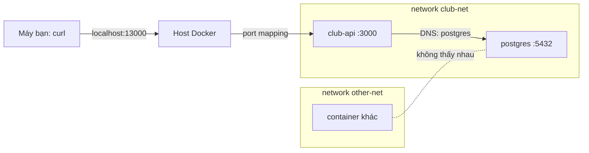

# Slide buổi 11 – Container Networking

> **Tóm tắt:** Dùng user-defined bridge network, container DNS và port mapping để cho API nói chuyện với database, và chẩn đoán lỗi API không kết nối được DB.

## Slide 1: Mục tiêu buổi học

- Phân biệt default bridge và user-defined bridge (DNS theo tên container).
- Phân biệt `-p` (publish ra host) với kết nối giữa container cùng network.
- Kiểm chứng bằng `nslookup`, `wget`, `docker network inspect`.
- Chứng minh isolation và dùng `docker network connect`.
- Dựng `club-api` kết nối Postgres, đặt đúng `DB_HOST`, chẩn đoán lỗi kết nối DB.

::: details Ghi chú giảng viên
Thời lượng: 2 phút. Tên tài nguyên lab dùng tiền tố `lab-`, demo dùng `demo-` để không đụng nhau.
:::

---

## Slide 2: Vấn đề thực tế

- Trên máy: API gọi `localhost:5432` và chạy tốt.
- Vào container: API báo không nối được DB dù container Postgres vẫn `Up`.
- `localhost` trong container API là chính container API.
- Ba câu hỏi hằng ngày: gọi bằng địa chỉ nào, cổng nào cần mở ra host, làm sao database không bị truy cập từ mọi nơi.

::: details Ghi chú giảng viên
Hỏi lớp: "Ai từng gặp ECONNREFUSED 127.0.0.1:5432?" Thời lượng: 2 phút.
:::

---

## Slide 3: Network driver

| Driver | Phạm vi | Dùng khi |
| --- | --- | --- |
| `bridge` | Một host | Mặc định, dùng nhiều nhất |
| `host` | Một host | Dùng thẳng network của host, hạn chế dùng |
| `none` | Một host | Cô lập hoàn toàn |
| `overlay` | Nhiều host | Swarm, ngoài phạm vi khóa này |

- Khóa học chỉ dùng `bridge`.

::: details Ghi chú giảng viên
Không đi sâu `host` và `overlay`. Kubernetes sẽ lo phần nhiều host. Thời lượng: 1 phút.
:::

---

## Slide 4: Default bridge và user-defined bridge

- Default bridge: container chỉ gọi nhau bằng IP, không có DNS theo tên.
- IP đổi mỗi lần container được tạo lại nên không thể dựa vào.
- User-defined bridge (`docker network create`): có DNS nhúng, gọi nhau bằng tên.
- Compose cũng làm vậy: service name là tên DNS.
- Kết luận: mọi dự án tự tạo network.

::: details Ghi chú giảng viên
Hỏi: "Vì sao IP không đáng tin?" Đáp: container tạo lại sẽ nhận IP khác. Thời lượng: 3 phút.
:::

---

## Slide 5: Container DNS và port mapping

- Bên trong container ở user-defined network, DNS nhúng nằm tại `127.0.0.11`.
- `DB_HOST=postgres` hoạt động dù IP đổi.
- `-p HOST:CONTAINER` chỉ cần cho truy cập từ ngoài network.
- Container cùng network gọi thẳng cổng của container, không cần `-p`.
- `-p 127.0.0.1:18081:80` chỉ mở trên localhost; `EXPOSE` chỉ là tài liệu.

::: details Ghi chú giảng viên
Câu hỏi: "`-p 13000:3000` khác `-p 127.0.0.1:13000:3000` thế nào?" Đáp: bản đầu mở trên mọi interface, máy trong LAN truy cập được. Thời lượng: 3 phút.
:::

---

## Slide 6: Kiến trúc



::: details Ghi chú giảng viên
Chỉ ra: chỉ API có port mapping; Postgres không có đường từ ngoài vào. Thời lượng: 2 phút.
:::

---

## Slide 7: Cách hoạt động từng bước

- Tạo `club-net`: Docker cấp subnet riêng và một bridge ảo.
- Mỗi container gắn vào network nhận một IP trong subnet.
- API gọi `postgres:5432`: truy vấn DNS tới `127.0.0.11`, Docker trả IP hiện tại.
- Gói tin đi qua bridge, không cần publish cổng 5432.
- Container ở network khác không có đường tới `club-net`.

::: details Ghi chú giảng viên
Không cần giải thích veth. Chỉ cần học viên nhớ: cùng network thì có tên và có đường. Thời lượng: 2 phút.
:::

---

## Slide 8: Demo 1 - Default bridge không có DNS

```bash
docker run -d --name demo-web-default nginx:1.27-alpine
docker run --rm alpine:3.20 wget -qO- -T 3 http://demo-web-default
```

```text
wget: bad address 'demo-web-default'
```

- Container web đang chạy tốt nhưng gọi bằng tên thất bại: vì sao?

::: details Ghi chú giảng viên
Đáp: default bridge không có DNS theo tên. Để lớp tự trả lời trước. Thời lượng: 2 phút.
:::

---

## Slide 9: Demo 2 - User-defined network có DNS

```bash
docker network create demo-net
docker run -d --name demo-web --network demo-net nginx:1.27-alpine
docker run --rm --network demo-net alpine:3.20 nslookup demo-web
```

```text
Server:		127.0.0.11
Address:	127.0.0.11:53

Name:	demo-web
Address: 172.19.0.2
```

- IP của bạn sẽ khác; `127.0.0.11` là DNS nhúng của Docker.

::: details Ghi chú giảng viên
Cũng cho chạy `wget -qO- http://demo-web` để thấy trang chào của Nginx. Câu hỏi: "127.0.0.11 nằm ở đâu?" Đáp: trong mỗi container. Thời lượng: 3 phút.
:::

---

## Slide 10: Demo 3 - Port mapping và dọn dẹp

```bash
docker run -d --name demo-web-pub --network demo-net -p 127.0.0.1:18081:80 nginx:1.27-alpine
curl -sI http://localhost:18081 | head -n 1
docker port demo-web-pub
```

```text
HTTP/1.1 200 OK
80/tcp -> 127.0.0.1:18081
```

```bash
docker rm -f demo-web-default demo-web demo-web-pub
docker network rm demo-net
```

::: details Ghi chú giảng viên
Nếu báo `port is already allocated`, đổi cổng host. Nhắc xóa container trước rồi mới xóa network. Thời lượng: 3 phút.
:::

---

## Slide 11: Hands-on L1 - Hai container giao tiếp bằng tên

```bash
docker network create lab-net
docker run -d --name lab-web --network lab-net nginx:1.27-alpine
docker run -d --name lab-client --network lab-net alpine:3.20 sleep 3600
docker exec lab-client wget -qO- http://lab-web | head -n 4
docker exec lab-client nslookup lab-web
```

- `sleep 3600` giữ Alpine sống để còn `docker exec`.
- So sánh: `docker run --rm alpine:3.20 wget -qO- -T 3 http://lab-web` phải báo `bad address`.
- Publish một cổng: `-p 127.0.0.1:18082:80`, rồi `curl -sI`.

::: details Ghi chú giảng viên
Mong đợi: HTML Nginx và IP phân giải qua 127.0.0.11. `docker port lab-web` không in gì vì không publish. Thời lượng: 15 phút.
:::

---

## Slide 12: Hands-on L1 - API và Postgres trên club-net

```bash
docker network create club-net
export DB_PASSWORD="$(openssl rand -hex 12)"
docker run -d --name lab-postgres --network club-net \
  -e POSTGRES_DB=clubdb -e POSTGRES_USER=club -e POSTGRES_PASSWORD="$DB_PASSWORD" \
  -v "$SP/database/init.sql:/docker-entrypoint-initdb.d/init.sql:ro" \
  postgres:17-alpine
until docker exec lab-postgres pg_isready -h 127.0.0.1 -U club -d clubdb; do sleep 1; done
```

- Postgres không có `-p`: không lộ ra host.
- `-h 127.0.0.1` để chờ đến khi server thật khởi động, không phải server tạm.

::: details Ghi chú giảng viên
Biến `SP` trỏ tới starter-project, đặt ở bước chuẩn bị. Cảnh báo: mở terminal mới thì `DB_PASSWORD` bị sinh lại, dẫn tới `password authentication failed`. Thời lượng: 10 phút.
:::

---

## Slide 13: Hands-on L1 - Chạy API và kiểm tra

```bash
docker build -t club-api:1.0.0 "$SP/backend"
docker run -d --name lab-api --network club-net -p 127.0.0.1:13000:3000 \
  -e DB_HOST=lab-postgres -e DB_PORT=5432 -e DB_NAME=clubdb \
  -e DB_USER=club -e DB_PASSWORD="$DB_PASSWORD" \
  club-api:1.0.0
curl -s http://localhost:13000/ready
docker port lab-postgres
```

```text
{"status":"ready"}
```

- `/api/members` trả danh sách thành viên từ `init.sql`.
- `docker port lab-postgres` rỗng: đúng thiết kế.
- Nếu `curl` lỗi ngay sau `run`, chờ 2-3 giây rồi chạy lại.

::: details Ghi chú giảng viên
`DB_HOST` bằng tên container Postgres vì DNS nhúng phân giải trong club-net. Thời lượng: 10 phút.
:::

---

## Slide 14: Hands-on L1 - Isolation

```bash
docker network create net-a && docker network create net-b
docker run -d --name iso-a --network net-a nginx:1.27-alpine
docker run -d --name iso-b --network net-b alpine:3.20 sleep 3600
docker exec iso-b wget -qO- -T 3 http://iso-a
docker network connect net-a iso-b
docker exec iso-b wget -qO- http://iso-a | head -n 4
```

- Lần đầu: `bad address 'iso-a'`. Gọi bằng IP cũng hết thời gian chờ.
- Sau `docker network connect`: nhận được HTML Nginx.

::: details Ghi chú giảng viên
Một container có thể thuộc nhiều network: đó là cầu nối có kiểm soát. Thời lượng: 8 phút.
:::

---

## Slide 15: Hands-on L2 - Thử thách

- Thử thách A: viết `isolation-test.sh` in PASS/FAIL, tự dọn bằng `trap cleanup EXIT`.
- Giải thích vì sao gọi bằng IP cũng thất bại giữa hai network.
- Thử thách B: `compose.yaml` với `backend-net` và `frontend-net`.
- `web` không phân giải được `postgres`, `api` thì được (`docker compose exec`).
- Chỉ `api` publish cổng; mật khẩu lấy từ `.env`, kèm `.env.example` giá trị giả.

::: details Ghi chú giảng viên
Gợi ý A: kiểm tra mong đợi thất bại viết `if ! docker exec ...; then echo PASS; fi`. Gợi ý B: `docker compose exec web nslookup postgres`. Thời lượng: phần còn lại của giờ lab.
:::

---

## Slide 16: Lỗi thường gặp

| Triệu chứng | Nguyên nhân | Cách xử lý |
| --- | --- | --- |
| `ECONNREFUSED 127.0.0.1:5432` | `DB_HOST=localhost` | Đặt `DB_HOST` là tên Postgres |
| `bad address` hoặc `ENOTFOUND` | Default bridge hoặc khác network | Chung user-defined network |
| `port is already allocated` | Cổng host đã bị dùng | Đổi cổng host |
| `network rm` báo `active endpoints` | Còn container gắn vào | `docker rm -f` trước |

::: details Ghi chú giảng viên
Thời lượng: 2 phút. Nhắc thêm: app phải lắng nghe `0.0.0.0` trong container (API starter đã làm).
:::

---

## Slide 17: Debug - API chạy nhưng `/ready` trả 503

```bash
docker run -d --name lab-api-bad --network club-net -p 127.0.0.1:13002:3000 \
  -e DB_HOST=localhost -e DB_PORT=5432 -e DB_NAME=clubdb \
  -e DB_USER=club -e DB_PASSWORD="$DB_PASSWORD" club-api:1.0.0
curl -s -o /dev/null -w "%{http_code}\n" http://localhost:13002/api/members
docker logs lab-api-bad --tail 20
docker exec lab-api-bad env | grep DB_
docker exec lab-api-bad nslookup lab-postgres
```

- Triệu chứng: container `Up`, `/health` 200, `/ready` 503, `/api/members` 500.
- Log có `ECONNREFUSED` kèm `127.0.0.1:5432` (hoặc `::1:5432`).
- `nslookup lab-postgres` thành công: network ổn, lỗi ở cấu hình.

::: details Ghi chú giảng viên
Cho học viên tự điều tra theo thứ tự: log, địa chỉ, env, nslookup. Lưu ý `/ready` không ghi log lỗi, hãy gọi `/api/members` trước khi xem log. Nguyên nhân gốc: loopback là của chính container API. Thời lượng: 6 phút.
:::

---

## Slide 18: Sửa lỗi và biến thể sai network

- Sửa: tạo lại container với `DB_HOST=lab-postgres` (không đổi được env của container đang chạy).
- Biến thể: API ở `lab-net-x` khác network, log có `ENOTFOUND lab-postgres`.
- Sửa biến thể: `docker network connect club-net lab-api-iso`.
- Tình huống 03 (`examples/troubleshooting/scenario-03/`): vì sao `/health` vẫn 200 và `docker compose ps` không cảnh báo?

::: details Ghi chú giảng viên
Phòng tránh: đặt DB_HOST bằng tên service, đừng viết cứng trong code, giữ `/ready` kiểm tra DB. Thời lượng: 3 phút.
:::

---

## Slide 19: Thử thách cuối buổi

- Container ở network khác muốn nói chuyện mà không tạo lại: dùng lệnh gì?
- Có cần `-p 5432:5432` để API nối DB không? Vì sao?
- Thấy `ENOTFOUND postgres` dù `DB_HOST=postgres` đúng: hai nguyên nhân khả dĩ?
- `127.0.0.11` là gì?

::: details Ghi chú giảng viên
Đáp án: `docker network connect`; không, vì cùng network; khác network hoặc sai tên; DNS nhúng của Docker. Thời lượng: 4 phút.
:::

---

## Slide 20: Recap

- Default bridge không có DNS; user-defined bridge có.
- Gọi nhau bằng tên và cổng của container, không cần `-p`.
- `-p` chỉ để truy cập từ host; bind `127.0.0.1` khi không muốn mở ra LAN.
- `localhost` trong container là chính nó; `DB_HOST` bằng tên service.
- Database ở network nội bộ, không publish cổng.
- Lỗi kết nối: log, env, `nslookup` từ trong container, `docker network inspect`.

::: details Ghi chú giảng viên
Nhắc dọn dẹp lab và nộp `lab-11/`. Buổi sau: persistent storage cho Postgres. Thời lượng: 2 phút.
:::
