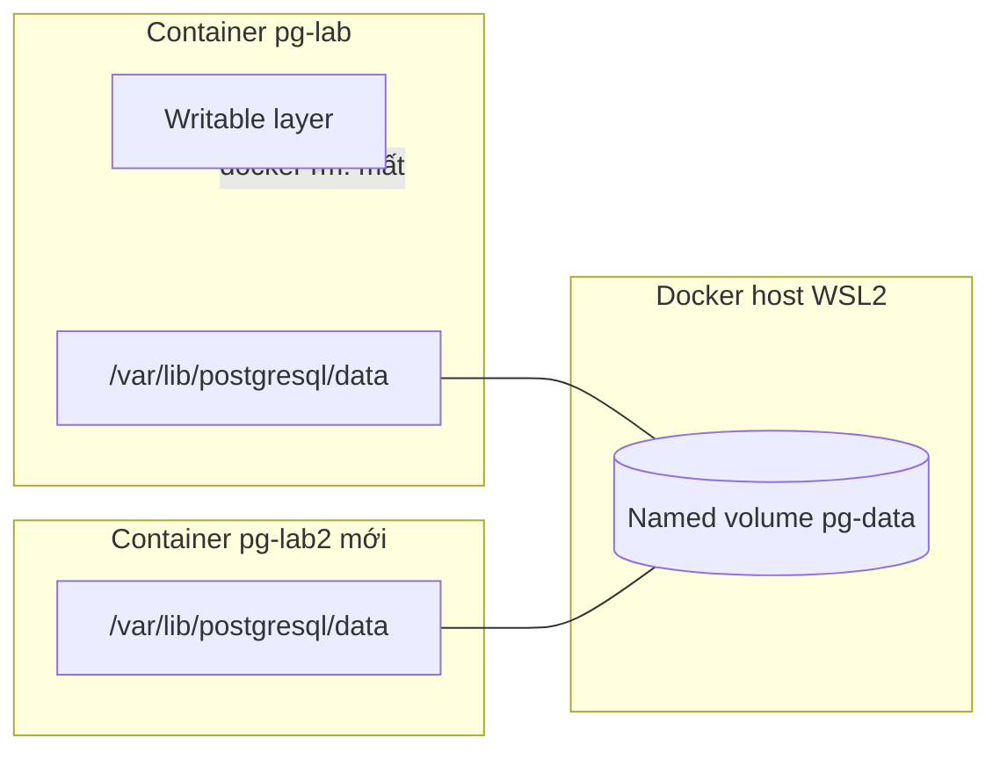
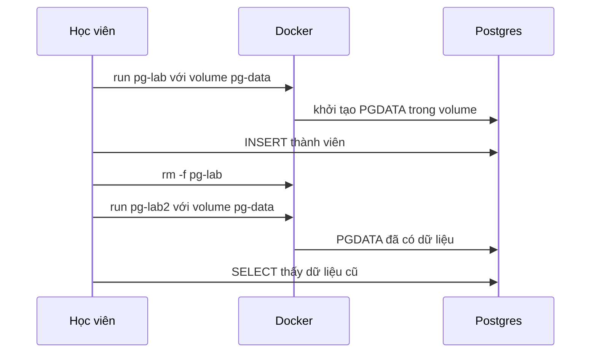

# Slide buổi 12 – Persistent Storage

> **Tóm tắt:** Chạy PostgreSQL với named volume để dữ liệu sống sót khi xóa container, rồi backup và restore bằng pg_dump. Biết phân biệt volume, bind mount và tmpfs.

Bài học: [Buổi 12 – Persistent Storage](../../labs/week-06/session-12.md) · Bài tập: [Bài tập tuần 6](../../assignments/weekly/week-06.md)

## Slide 1: Mục tiêu buổi học

- Giải thích vì sao dữ liệu trong writable layer mất khi xóa container.
- Phân biệt named volume, bind mount, tmpfs và chọn đúng loại.
- Chạy PostgreSQL với named volume, chứng minh dữ liệu còn sau recreate.
- Backup và restore bằng `pg_dump`; chẩn đoán "có volume nhưng vẫn mất dữ liệu".

---

## Slide 2: Vấn đề thực tế

- Một thành viên nhập 30 người đăng ký vào Postgres.
- Hôm sau cập nhật image: xóa container cũ, chạy container mới.
- Bảng `members` trống trơn, không có lỗi nào được báo.
- Container dùng một lần là điểm mạnh; dữ liệu database thì không được dùng một lần.

---

## Slide 3: Writable layer

- Image là các layer chỉ đọc; container thêm một writable layer ở trên cùng.
- Mọi file tiến trình ghi ra đều nằm ở đó và gắn với vòng đời container.
- `docker rm` là mất toàn bộ.
- Quy tắc: thứ gì cần sống lâu hơn container phải nằm ngoài writable layer.

---

## Slide 4: Ba loại mount

| Tiêu chí | Named volume | Bind mount | tmpfs |
| --- | --- | --- | --- |
| Dữ liệu nằm ở | Vùng Docker quản lý | Đường dẫn trên máy | RAM |
| Sống sau khi xóa container | Có | Có | Không |
| Dùng điển hình | Database | Mã nguồn dev, config | Dữ liệu tạm |

- Database dùng named volume; code khi dev dùng bind mount; dữ liệu tạm dùng tmpfs.
- Giáo trình dùng `--mount` vì tường minh; `-v host:container` âm thầm tạo thư mục rỗng nếu gõ nhầm đường dẫn.

---

## Slide 5: Postgres lưu dữ liệu ở đâu

- Dữ liệu nằm ở `/var/lib/postgresql/data` (biến `PGDATA`), image khai báo đó là `VOLUME`.
- Không gắn gì: Docker tạo anonymous volume tên hex, container mới tạo cái mới nên trông như mất dữ liệu.
- Gắn sai đường dẫn hoặc đổi `PGDATA`: Postgres ghi vào writable layer, volume của bạn nằm trống.
- `init.sql` và `POSTGRES_*` chỉ có tác dụng khi thư mục dữ liệu trống.
- Bài này ghim `postgres:17-alpine`; từ Postgres 18 cách bố trí đổi, đọc lại Docker Hub trước khi dùng lại volume cũ.

---

## Slide 6: Kiến trúc

---

## Slide 7: Vòng đời dữ liệu từng bước

- Trên Docker Desktop, volume nằm trong máy ảo của Docker, không phải thư mục WSL.

---

## Slide 8: Demo - Không volume, có volume, tmpfs

- Không volume: ghi file vào `/note.txt`, xóa container, chạy lại cùng tên: file không còn. Câu hỏi: file đã nằm ở đâu? Writable layer của container cũ.
- Có volume: gắn volume vào `/data`, ghi file, xóa container, chạy container mới cùng volume: file vẫn còn. Ai đang giữ file? Volume.
- tmpfs: gắn tại `/scratch`, `df` hiện filesystem `tmpfs`; container dừng thì dữ liệu mất.
- Câu hỏi: nếu chạy nhầm `docker compose down -v` trên môi trường thật, cứu dữ liệu bằng cách nào? Dẫn vào backup.

---

## Slide 9: Hands-on L1 (60 phút)

Các lệnh nằm trong bài lab, làm theo thứ tự:

- Phần 1 và 2: Postgres với named volume `pg-data`, tạo bảng `members` 3 dòng.
- Phần 3: `docker rm -f` rồi tạo container mới cùng volume: dữ liệu còn, log có `Skipping initialization`.
- Phần 4: `docker inspect` và `SHOW data_directory;` phải trùng đường dẫn.
- Phần 5: `pg_dump`, xóa volume, restore bằng `docker exec -i`, `SELECT` thấy lại dữ liệu.

Xem [Buổi 12 – Persistent Storage](../../labs/week-06/session-12.md).

---

## Slide 10: Compose, down và down -v

- `docker compose down`: xóa container và network, giữ named volume; `up -d --wait` thì dữ liệu còn.
- `docker compose down -v`: xóa thêm named volume khai báo trong file; dữ liệu mất.
- Mật khẩu đặt trong `.env`, không commit. Thử thách L2 nằm ở [Thử thách thêm buổi 12](../../labs/week-06/session-12-challenge.md).

---

## Slide 11: Lỗi thường gặp

| Triệu chứng | Nguyên nhân | Cách xử lý |
| --- | --- | --- |
| Mất dữ liệu sau `down` dù có volume | Mount không khớp nơi Postgres ghi | Đối chiếu `docker inspect` và `SHOW data_directory;` |
| Mất hết sau `down -v` | `-v` xóa named volume | Dùng `down`, backup trước |
| Đổi `POSTGRES_PASSWORD` không có tác dụng | Chỉ áp dụng lần đầu | `ALTER USER` hoặc tạo volume mới sau khi backup |
| Restore xong bảng vẫn trống | Thiếu `-i` | Thêm `-i`, kiểm tra `SELECT` |
| Lỗi quyền với bind mount dưới `/mnt/c` | Filesystem Windows | Dùng named volume, làm trong WSL |

---

## Slide 12: Debug - Có volume nhưng vẫn mất dữ liệu

- `PGDATA` đặt khác điểm mount của volume: nhìn qua đều "đúng", volume có thật.
- Triệu chứng: sau `down` rồi `up`, `SELECT` báo `relation "members" does not exist`; `docker volume ls` vẫn thấy volume.
- Điều tra: `data_directory` so với đích mount trong `docker inspect`; `docker diff` cho thấy dữ liệu nằm trong writable layer.
- Nguyên nhân gốc: `PGDATA` và điểm mount không trùng. Sửa: bỏ `PGDATA` hoặc cho hai bên cùng đường dẫn.
- Phòng tránh: làm bài kiểm tra recreate ngay ngày đầu, có backup và thử restore.

---

## Slide 13: Thử thách cuối buổi

- `down` và `down -v` khác nhau thế nào?
- `docker volume ls` có volume nhưng dữ liệu mất: kiểm tra gì đầu tiên?
- Vì sao ưu tiên `pg_dump` hơn sao chép thô thư mục dữ liệu?
- Đồng đội muốn bind mount dữ liệu Postgres dưới `/mnt/c`: bạn nhận xét gì?

---

## Slide 14: Recap

- Dữ liệu trong writable layer mất cùng container; dữ liệu bền phải nằm trong volume.
- Database dùng named volume; bind mount cho code và config; tmpfs cho dữ liệu tạm.
- Đích mount phải khớp `PGDATA`; volume tồn tại không có nghĩa là đang được dùng.
- `down` giữ volume, `down -v` xóa volume; backup trước thao tác phá hủy.
- Buổi sau: [Buổi 13 – Docker Compose](../../labs/week-07/session-13.md) gom mọi thứ vào một file.
