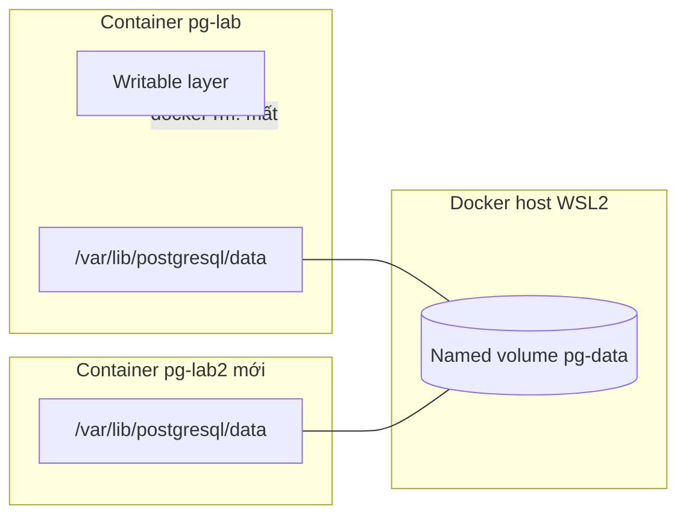
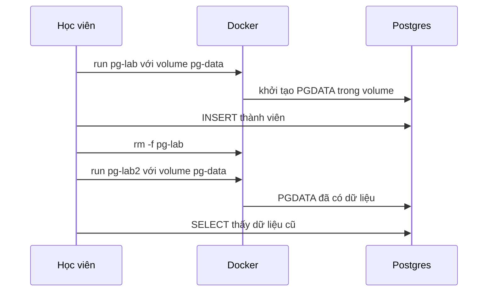

# Slide buổi 12 – Persistent Storage

> **Tóm tắt:** Phân biệt volume, bind mount và tmpfs, chạy PostgreSQL với named volume để dữ liệu sống sót qua recreate container, backup và restore bằng pg_dump.

## Slide 1: Mục tiêu buổi học

- Giải thích vì sao dữ liệu trong writable layer mất khi xóa container.
- Phân biệt named volume, bind mount, tmpfs và chọn đúng loại.
- Chạy PostgreSQL với named volume, chứng minh dữ liệu còn sau recreate.
- Backup và restore bằng `pg_dump` và `psql`.
- Chẩn đoán "có volume nhưng vẫn mất dữ liệu"; phân biệt `down` với `down -v`.

::: details Ghi chú giảng viên
Thời lượng: 2 phút. Phần 1 đến 4 là L1, phần 5 và 6 là L2.
:::

---

## Slide 2: Vấn đề thực tế

- Một thành viên nhập 30 người đăng ký vào Postgres.
- Hôm sau cập nhật image: xóa container cũ, chạy container mới.
- Bảng `members` trống trơn, không có lỗi nào được báo.
- Container dùng một lần là điểm mạnh; dữ liệu database thì không được dùng một lần.

::: details Ghi chú giảng viên
Câu hỏi: "Dữ liệu 30 người đó đã đi đâu?" Dẫn vào writable layer. Thời lượng: 2 phút.
:::

---

## Slide 3: Writable layer

- Image là các layer chỉ đọc; container thêm một writable layer ở trên cùng.
- Mọi file tiến trình ghi ra đều nằm ở đó và gắn với vòng đời container.
- `docker rm` là mất toàn bộ.
- Quy tắc: thứ gì cần sống lâu hơn container phải nằm ngoài writable layer.

::: details Ghi chú giảng viên
Liên hệ buổi 10: layer bất biến, writable layer là lớp mỏng trên cùng. Thời lượng: 2 phút.
:::

---

## Slide 4: Ba loại mount

| Tiêu chí | Named volume | Bind mount | tmpfs |
| --- | --- | --- | --- |
| Dữ liệu nằm ở | Vùng Docker quản lý | Đường dẫn trên host | RAM |
| Sống sau khi xóa container | Có | Có | Không |
| Dùng điển hình | Database | Mã nguồn dev, config | Dữ liệu tạm |

- Database dùng named volume; code khi dev dùng bind mount; dữ liệu tạm dùng tmpfs.

::: details Ghi chú giảng viên
Hỏi lớp chọn loại mount cho: database, thư mục code khi dev, token tạm. Thời lượng: 3 phút.
:::

---

## Slide 5: Cú pháp --mount

```bash
docker run -d --mount type=volume,source=pg-data,target=/var/lib/postgresql/data postgres:17-alpine
docker run -d --mount type=bind,source="$PWD/html",target=/usr/share/nginx/html,readonly nginx:1.27-alpine
docker run -d --mount type=tmpfs,target=/scratch alpine:3.20 sleep 300
```

- Giáo trình dùng `--mount` vì tường minh.
- `--mount type=bind` báo lỗi nếu thư mục nguồn không có; `-v host:container` âm thầm tạo thư mục rỗng.

::: details Ghi chú giảng viên
Nhấn mạnh rủi ro gõ nhầm đường dẫn với `-v`. Thời lượng: 2 phút.
:::

---

## Slide 6: Postgres lưu dữ liệu ở đâu

- Dữ liệu nằm ở `/var/lib/postgresql/data` (biến `PGDATA`), image khai báo đó là `VOLUME`.
- Không gắn gì: Docker tạo anonymous volume tên hex, container mới tạo cái mới nên trông như mất dữ liệu.
- Gắn sai đường dẫn hoặc đổi `PGDATA`: Postgres ghi vào writable layer, volume của bạn nằm trống.
- Bài này ghim `postgres:17-alpine`; từ Postgres 18 cách bố trí đổi, đọc lại Docker Hub trước khi dùng lại volume cũ.
- `init.sql` và `POSTGRES_*` chỉ có tác dụng khi data directory trống.

::: details Ghi chú giảng viên
Đây là kiến thức nền cho tình huống 04. Hỏi: "Đổi POSTGRES_PASSWORD trên volume đã có dữ liệu thì sao?" Đáp: không có tác dụng. Thời lượng: 3 phút.
:::

---

## Slide 7: Kiến trúc



::: details Ghi chú giảng viên
Chỉ vào writable layer bị xóa, còn volume vẫn đó và được gắn lại vào container mới. Thời lượng: 2 phút.
:::

---

## Slide 8: Vòng đời dữ liệu từng bước



- Trên Docker Desktop, volume nằm trong máy ảo của Docker, không phải thư mục WSL.

::: details Ghi chú giảng viên
Đừng tìm file volume trong `/var/lib/docker` của Ubuntu; dùng `docker volume inspect` và `docker run` để xem. Thời lượng: 2 phút.
:::

---

## Slide 9: Demo 1 - Mất dữ liệu khi không có volume

```bash
docker run -d --name demo-tmp alpine:3.20 sleep 600
docker exec demo-tmp sh -c 'echo "du lieu quan trong" > /note.txt && cat /note.txt'
docker rm -f demo-tmp
docker run -d --name demo-tmp alpine:3.20 sleep 600
docker exec demo-tmp cat /note.txt
```

```text
cat: can't open '/note.txt': No such file or directory
```

- File đã nằm ở đâu và vì sao biến mất?

::: details Ghi chú giảng viên
Đáp: writable layer của container cũ. Thời lượng: 3 phút.
:::

---

## Slide 10: Demo 2 - Cùng thao tác với volume

```bash
docker rm -f demo-tmp
docker volume create demo-vol
docker run -d --name demo-tmp --mount type=volume,source=demo-vol,target=/data alpine:3.20 sleep 600
docker exec demo-tmp sh -c 'echo "du lieu quan trong" > /data/note.txt'
docker rm -f demo-tmp
docker run --rm --mount type=volume,source=demo-vol,target=/data alpine:3.20 cat /data/note.txt
```

```text
du lieu quan trong
```

- Container đã bị xóa, ai đang giữ file? Volume `demo-vol`.

::: details Ghi chú giảng viên
Dọn: `docker volume rm demo-vol`. Có thể cho xem `docker volume inspect demo-vol`; Mountpoint nằm trong máy ảo Docker Desktop. Thời lượng: 3 phút.
:::

---

## Slide 11: Demo 3 - tmpfs

```bash
docker run --rm --mount type=tmpfs,target=/scratch alpine:3.20 sh -c 'df -h /scratch | tail -1; echo hi > /scratch/a; cat /scratch/a'
```

- Dòng `df` hiện filesystem `tmpfs` gắn tại `/scratch`, sau đó in `hi`.
- Container dừng thì dữ liệu mất.
- Câu hỏi: nếu chạy nhầm `docker compose down -v` trên môi trường thật, cứu dữ liệu bằng cách nào?

::: details Ghi chú giảng viên
Dẫn vào backup bằng pg_dump. Thời lượng: 2 phút.
:::

---

## Slide 12: Hands-on L1 - Postgres với named volume

```bash
export PGPASS=lab-only-password
docker volume create pg-data
docker run -d --name pg-lab \
  -e POSTGRES_DB=clubdb -e POSTGRES_USER=club -e POSTGRES_PASSWORD="$PGPASS" \
  --mount type=volume,source=pg-data,target=/var/lib/postgresql/data \
  postgres:17-alpine
until docker exec pg-lab pg_isready -h 127.0.0.1 -U club -d clubdb; do sleep 1; done
```

```text
127.0.0.1:5432 - accepting connections
```

- Đích mount phải khớp đường dẫn Postgres dùng, nếu không volume vô dụng.
- Không bind cổng ra host: truy cập bằng `docker exec`.

::: details Ghi chú giảng viên
Mật khẩu lab là giá trị giả, không dùng mật khẩu thật. Vài giây đầu có thể thấy `no response`, bình thường. Thời lượng: 8 phút.
:::

---

## Slide 13: Hands-on L1 - Tạo dữ liệu, xóa và tạo lại

```bash
docker exec pg-lab psql -U club -d clubdb -c "CREATE TABLE members (id SERIAL PRIMARY KEY, name VARCHAR(100) NOT NULL); INSERT INTO members (name) VALUES ('Alice'), ('Bob'), ('Carol');"
docker rm -f pg-lab
docker run -d --name pg-lab2 \
  -e POSTGRES_DB=clubdb -e POSTGRES_USER=club -e POSTGRES_PASSWORD="$PGPASS" \
  --mount type=volume,source=pg-data,target=/var/lib/postgresql/data \
  postgres:17-alpine
until docker exec pg-lab2 pg_isready -h 127.0.0.1 -U club -d clubdb; do sleep 1; done
docker exec pg-lab2 psql -U club -d clubdb -c "SELECT id, name FROM members ORDER BY id;"
```

- Mong đợi: vẫn thấy 3 dòng Alice, Bob, Carol.
- `docker logs pg-lab2 | head` có dòng `Skipping initialization`.

::: details Ghi chú giảng viên
Bản lab đầy đủ tạo bảng giống `init.sql` (có email, created_at); slide rút gọn để dễ chiếu. Khoảnh khắc "wow": container đã bị xóa mà dữ liệu còn. Thời lượng: 10 phút.
:::

---

## Slide 14: Hands-on L1 - Kiểm chứng bằng inspect

```bash
docker inspect pg-lab2 --format '{{range .Mounts}}{{.Type}} {{.Name}} -> {{.Destination}}{{"\n"}}{{end}}'
docker exec pg-lab2 psql -U club -d clubdb -tA -c "SHOW data_directory;"
```

```text
volume pg-data -> /var/lib/postgresql/data
/var/lib/postgresql/data
```

- Hai đường dẫn phải trùng nhau: đây là phép kiểm tra cốt lõi.
- Dọn container, giữ volume cho phần L2: `docker rm -f pg-lab2`.

::: details Ghi chú giảng viên
Nhấn mạnh: học viên sẽ dùng lại đúng phép kiểm tra này để debug tình huống 04. Thời lượng: 4 phút.
:::

---

## Slide 15: Hands-on L2 - Backup và restore bằng pg_dump

```bash
docker exec pg-lab pg_dump -U club -d clubdb > source/backup.sql
docker rm -f pg-lab
docker volume rm pg-data
# tạo lại pg-lab với volume pg-data mới, chờ pg_isready, rồi restore
docker exec -i pg-lab psql -U club -d clubdb -v ON_ERROR_STOP=1 < source/backup.sql
docker exec pg-lab psql -U club -d clubdb -c "SELECT count(*) FROM members;"
```

- Mong đợi: `CREATE TABLE`, `COPY 3`, `count` bằng 3.
- `docker exec -i` (có `-i`, không `-t`) là bắt buộc khi nhận dữ liệu qua redirect.
- Backup chưa thử restore thì chưa phải backup.

::: details Ghi chú giảng viên
Nhắc: trước bước xóa phải có container `pg-lab` đang chạy với dữ liệu (theo lab, tạo container ở bước 5.1). Thiếu `-i` thì restore trống mà không báo lỗi. Thời lượng: 12 phút.
:::

---

## Slide 16: Hands-on L2 - Compose, down và down -v

```yaml
name: lab12

services:
  postgres:
    image: postgres:17-alpine
    environment:
      POSTGRES_DB: clubdb
      POSTGRES_USER: club
      POSTGRES_PASSWORD: ${DB_PASSWORD:?Set DB_PASSWORD in .env}
    volumes:
      - pgdata:/var/lib/postgresql/data
    healthcheck:
      test: ["CMD-SHELL", "pg_isready -h 127.0.0.1 -U club -d clubdb"]
      interval: 5s
      timeout: 3s
      retries: 5

volumes:
  pgdata:
```

- `down` rồi `up -d --wait`: dữ liệu còn. `down -v` rồi `up -d --wait`: dữ liệu mất.
- Thử thách B: backup mức volume bằng `tar` từ container tạm khi database đã dừng.

::: details Ghi chú giảng viên
Mật khẩu đặt trong `.env`, không commit. `down` xóa container và network, giữ volume; `down -v` xóa thêm named volume khai báo trong file. Thời lượng: 10 phút.
:::

---

## Slide 17: Lỗi thường gặp

| Triệu chứng | Nguyên nhân | Cách xử lý |
| --- | --- | --- |
| Mất dữ liệu sau `down` dù có volume | Mount không khớp nơi Postgres ghi | Đối chiếu `docker inspect` và `SHOW data_directory;` |
| Mất hết sau `down -v` | `-v` xóa named volume | Dùng `down`, backup trước |
| Đổi `POSTGRES_PASSWORD` không có tác dụng | Chỉ áp dụng lần đầu | `ALTER USER` hoặc tạo volume mới sau khi backup |
| Restore xong bảng vẫn trống | Thiếu `-i` | Thêm `-i`, kiểm tra `SELECT count(*)` |
| Lỗi quyền với bind mount dưới `/mnt/c` | Filesystem Windows | Dùng named volume, làm trong WSL |

::: details Ghi chú giảng viên
Nhắc thêm: `init.sql` chỉ chạy khi data directory trống nên sửa file không chạy lại. Thời lượng: 2 phút.
:::

---

## Slide 18: Debug - Có volume nhưng vẫn mất dữ liệu

```yaml
    environment:
      PGDATA: /var/lib/postgresql/pgdata
    volumes:
      - ts04-pgdata:/var/lib/postgresql/data
```

- Nhìn qua đều "đúng": đích mount chuẩn, volume có thật.
- Triệu chứng: sau `down` rồi `up`, `SELECT` báo `relation "members" does not exist`; `docker volume ls` vẫn thấy volume.
- Học viên chỉ nhận triệu chứng (`examples/troubleshooting/scenario-04/`), phải tìm nguyên nhân gốc.

::: details Ghi chú giảng viên
Mentor chạy `bash setup.sh` trong thư mục tình huống. Cho học viên 5 phút tự điều tra trước khi sang slide sau. Dọn: `bash cleanup.sh`. Thời lượng: 6 phút.
:::

---

## Slide 19: Điều tra và nguyên nhân gốc

```bash
docker compose exec postgres psql -U club -d clubdb -tA -c "SHOW data_directory;"
docker inspect ts04-postgres-1 --format '{{range .Mounts}}{{.Type}} {{.Name}} -> {{.Destination}}{{"\n"}}{{end}}'
docker diff ts04-postgres-1 | head
```

- `data_directory` là `/var/lib/postgresql/pgdata`, mount trỏ `/var/lib/postgresql/data`: hai đường dẫn khác nhau.
- `docker diff` cho thấy dữ liệu nằm trong writable layer của container.
- Nguyên nhân gốc: `PGDATA` và điểm mount không trùng.
- Sửa: bỏ `PGDATA` hoặc cho hai bên cùng đường dẫn, rồi kiểm tra bằng `down` và `up`.
- Phòng tránh: làm bài kiểm tra recreate ngày đầu, có backup và thử restore.

::: details Ghi chú giảng viên
Nếu chưa chạy `down`, `pg_dump` ngay từ container đang chạy để cứu dữ liệu; sau `down` dữ liệu đã mất cùng container. Cùng họ lỗi: gõ sai đích mount như `/var/lib/postgres/data`. Thời lượng: 5 phút.
:::

---

## Slide 20: Thử thách cuối buổi

- `down` và `down -v` khác nhau thế nào?
- `docker volume ls` có volume nhưng dữ liệu mất: kiểm tra gì đầu tiên?
- Vì sao ưu tiên `pg_dump` hơn sao chép thô thư mục dữ liệu?
- Đồng đội muốn bind mount dữ liệu Postgres dưới `/mnt/c`: bạn nhận xét gì?

::: details Ghi chú giảng viên
Đáp án: down giữ volume, down -v xóa; so đích mount với `SHOW data_directory;`; dump nhất quán, restore được sang phiên bản khác; chậm và dễ lỗi quyền, dùng named volume. Thời lượng: 4 phút.
:::

---

## Slide 21: Recap

- Dữ liệu trong writable layer mất cùng container; dữ liệu bền phải nằm trong volume.
- Database dùng named volume; bind mount cho code và config; tmpfs cho dữ liệu tạm.
- Đích mount phải khớp `PGDATA`; volume tồn tại không có nghĩa là đang được dùng.
- Script khởi tạo và `POSTGRES_*` chỉ có tác dụng ở lần đầu.
- `down` giữ volume, `down -v` xóa volume; backup trước thao tác phá hủy.
- Buổi sau: Docker Compose gom mọi thứ vào một file.

::: details Ghi chú giảng viên
Nhắc dọn lab và nộp `lab-12/`, không commit `.env` hay mật khẩu. Thời lượng: 2 phút.
:::
