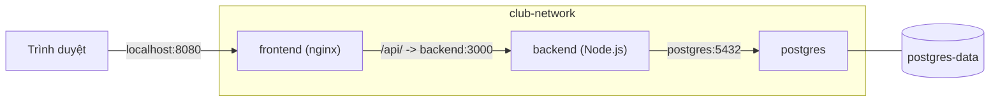

# Slide buổi 13 – Docker Compose

> **Tóm tắt:** Dùng Docker Compose để mô tả và chạy cả Frontend, API và PostgreSQL của starter-project bằng một file `compose.yaml` và một lệnh duy nhất.

## Slide 1: Mục tiêu buổi học

- Đọc và giải thích được các khóa chính của `compose.yaml`.
- Chạy cả starter-project bằng `docker compose up -d --build`.
- Phân biệt `depends_on` mặc định với `condition: service_healthy`.
- Đặt secret trong `.env`, không commit.
- Giải thích vì sao dữ liệu còn sau `down` nhưng mất sau `down -v`.

::: details Ghi chú giảng viên
Mở đầu 2 phút. Nhắc lại buổi 9-12: Dockerfile, network, volume. Hỏi lớp: bạn nào còn nhớ đủ các cờ `docker run` của cả ba container? Thời lượng phần kiến thức khoảng 30 phút gồm demo.
:::

---

## Slide 2: Vấn đề với chuỗi lệnh docker run

- Cả hệ thống = tạo network, tạo volume, chạy postgres, chạy backend, chạy frontend.
- Quên một cờ `-e` hoặc sai thứ tự là hệ thống không lên.
- Lệnh nằm trong history của một người, không ai review được.
- Thành viên mới phải chép lại cả chục dòng lệnh.

::: details Ghi chú giảng viên
Kể lại cảnh thành viên mới vào dự án. Câu hỏi: lệnh `docker run` của bạn nằm ở đâu, có trong Git không? Dẫn vào ý: cần một file mô tả hệ thống, commit cùng mã nguồn.
:::

---

## Slide 3: Compose là gì

- Công cụ khai báo (declarative): mô tả trạng thái mong muốn trong `compose.yaml`.
- Compose tạo hoặc cập nhật container, network, volume cho khớp.
- Một project mặc định lấy tên theo thư mục chứa `compose.yaml`.
- File này là tài liệu sống của hệ thống.
- Dùng `docker compose` (có dấu cách), không dùng `docker-compose` bản v1.

::: details Ghi chú giảng viên
Nhấn mạnh Compose v2 và không có khóa `version` trong file. Chạy `docker compose version` để lớp kiểm tra máy mình.
:::

---

## Slide 4: Các khóa chính trong compose.yaml

| Khóa | Ý nghĩa |
| --- | --- |
| `services` | Các thành phần của ứng dụng |
| `build` / `image` | Build từ Dockerfile / dùng image có sẵn |
| `ports` | Publish `HOST:CONTAINER` |
| `environment` | Biến môi trường cho container |
| `depends_on` | Thứ tự khởi động |
| `networks`, `volumes` | Mạng và nơi lưu dữ liệu |
| `healthcheck`, `restart` | Kiểm tra sức khỏe, tự khởi động lại |

::: details Ghi chú giảng viên
Không đọc hết bảng. Chỉ chọn ba khóa: `services`, `ports`, `volumes`, các khóa còn lại sẽ gặp khi đọc file thật ở demo. 3 phút.
:::

---

## Slide 5: Kiến trúc starter-project trong Compose



- Ba service, một network `club-network`, một volume `postgres-data`.
- Postgres không publish cổng ra máy.

::: details Ghi chú giảng viên
Cho lớp tự chỉ ra: cổng nào mở ra máy chủ? (8080 cho frontend, 3000 cho backend.) Vì sao 5432 không mở mà backend vẫn nối được?
:::

---

## Slide 6: Network và DNS theo tên service

- Trong network của project, gọi nhau bằng tên service.
- Backend gọi `postgres:5432`, nginx gọi `backend:3000`.
- Vì vậy `DB_HOST: postgres`, không phải `localhost`.
- `localhost` trong container backend là chính container backend.

```yaml
backend:
  environment:
    DB_HOST: postgres
```

::: details Ghi chú giảng viên
Đây là lỗi số 1 của người mới. Hỏi: nếu đặt `DB_HOST: localhost` thì backend sẽ báo lỗi gì? (`ECONNREFUSED`.)
:::

---

## Slide 7: depends_on không bằng sẵn sàng

| Dạng | Hành vi |
| --- | --- |
| `depends_on: [backend]` | Chỉ đảm bảo container được start trước |
| `condition: service_started` | Giống dạng trên (mặc định) |
| `condition: service_healthy` | Chờ healthcheck báo healthy |

- Postgres "đang chạy" chưa có nghĩa đã nhận kết nối: còn khởi tạo cluster và chạy `init.sql`.
- Backend dùng `condition: service_healthy` trên postgres.

::: details Ghi chú giảng viên
Câu hỏi cho lớp: nếu bỏ `condition`, backend có luôn lỗi không? Đáp án: không chắc, lỗi lúc được lúc không, tùy postgres lên nhanh hay chậm. Đây là kiểu lỗi khó debug nhất.
:::

---

## Slide 8: Biến môi trường và file .env

- Compose tự đọc `.env` cạnh `compose.yaml` để thay các biến `${...}`.
- `${WEB_PORT:-8080}`: dùng `WEB_PORT`, trống thì dùng 8080.
- `${DB_PASSWORD:?Set DB_PASSWORD in .env}`: bắt buộc có, thiếu thì dừng.
- `.env` chứa mật khẩu, không commit; chỉ commit `.env.example`.

```text
DB_PASSWORD=change-me-locally
WEB_PORT=8080
```

::: details Ghi chú giảng viên
Phân biệt: thay thế biến lúc Compose đọc file khác với truyền biến vào container. Nhắc học viên đổi `DB_PASSWORD` thành chuỗi riêng, không dùng mật khẩu thật của dịch vụ khác.
:::

---

## Slide 9: Volume và init.sql

- `postgres-data` là named volume, gắn vào `/var/lib/postgresql/data`.
- Xóa container, dữ liệu vẫn nằm trong volume.
- `./database/init.sql` được mount vào `/docker-entrypoint-initdb.d/`.
- Init script chỉ chạy khi data directory còn trống, tức lần khởi tạo đầu.

::: details Ghi chú giảng viên
Chuẩn bị câu hỏi để đến slide 14: sửa `init.sql` rồi `up -d` lại, dữ liệu có đổi không? Để lớp tự dự đoán.
:::

---

## Slide 10: Vòng đời với Compose

| Lệnh | Tác dụng |
| --- | --- |
| `docker compose up -d --build` | Build, tạo, chạy ở nền |
| `docker compose ps` | Trạng thái service |
| `docker compose logs -f backend` | Theo dõi log |
| `docker compose exec backend sh` | Vào container |
| `docker compose config` | In cấu hình sau khi thay biến |
| `docker compose down` / `down -v` | Xóa container, network / xóa luôn volume |

::: details Ghi chú giảng viên
Nhấn mạnh `config` là bước đầu khi nghi ngờ Compose không nhận biến hoặc YAML sai thụt lề. Dùng tên service trong lệnh, không dùng tên container.
:::

---

## Slide 11: Demo 1 – thiếu .env

```bash
cd ~/devops-labs/starter-project
docker compose up -d --build
```

Kết quả mong đợi: Compose dừng và báo thiếu biến.

```text
error while interpolating services.backend.environment.DB_PASSWORD: required variable DB_PASSWORD is missing a value: Set DB_PASSWORD in .env
```

- Thông báo lỗi do chính file YAML định nghĩa sau dấu `?`.

::: details Ghi chú giảng viên
Trước demo đọc cùng lớp `compose.yaml`: chỉ ra ba service, một network, một volume. Chạy khi chưa có `.env` để lớp thấy lỗi có chủ đích. 3 phút.
:::

---

## Slide 12: Demo 2 – tạo .env và chạy

```bash
cp .env.example .env
docker compose up -d --build
docker compose ps
```

```text
NAME                        SERVICE    STATUS                    PORTS
starter-project-backend-1   backend    Up 10 seconds             0.0.0.0:3000->3000/tcp
starter-project-frontend-1  frontend   Up 9 seconds              0.0.0.0:8080->80/tcp
starter-project-postgres-1  postgres   Up 20 seconds (healthy)   5432/tcp
```

- Tên container phụ thuộc tên thư mục chứa `compose.yaml`.

::: details Ghi chú giảng viên
Chỉ vào `(healthy)` của postgres và cột PORTS: postgres chỉ có `5432/tcp`, không có mũi tên ra máy chủ. 3 phút.
:::

---

## Slide 13: Demo 3 – gọi API

```bash
curl -s http://localhost:8080/api/members
curl -s http://localhost:3000/ready
```

```text
[{"id":1,"name":"Alice","email":"alice@example.com"},{"id":2,"name":"Bob","email":"bob@example.com"}]
{"status":"ready"}
```

- Đường thứ nhất đi qua nginx rồi tới backend.
- Đường thứ hai gọi thẳng backend.

::: details Ghi chú giảng viên
Vẽ lại luồng trên bảng cho hai lệnh curl. Dùng `docker compose config` để cho lớp thấy cấu hình sau khi thay biến.
:::

---

## Slide 14: Lab – chuẩn bị và Phần 1

```bash
mkdir -p ~/devops-labs/lab-13/source ~/devops-labs/lab-13/evidence ~/devops-labs/lab-13/screenshots
cp -r ~/devops-course/starter-project/. ~/devops-labs/lab-13/source/
cd ~/devops-labs/lab-13/source
cp .env.example .env
docker compose config | head -40
```

- Làm việc trong filesystem của WSL, không dùng `/mnt/c`.
- Kiểm tra `.env` bị bỏ qua: `git check-ignore -v lab-13/source/.env`.
- Cổng 8080 bận thì đặt `WEB_PORT=8081`.

::: details Ghi chú giảng viên
Lab 60 phút: chuẩn bị 10', phần 1-4 khoảng 35', L2 khoảng 15'. Học viên L1 có thể dừng sau phần 4. Cảnh báo: backend publish cổng 3000, chỉ dùng trên máy cá nhân.
:::

---

## Slide 15: Lab – chạy và kiểm thử (Phần 2-3)

```bash
docker compose up -d --build 2>&1 | tee -a ../evidence/command-output.txt
docker compose ps
docker compose logs --tail=20 backend
docker compose exec frontend wget -qO- http://backend:3000/health
docker compose exec postgres psql -U club -d clubdb -c "SELECT id, name FROM members;"
```

```text
{"status":"healthy","service":"club-api"}
```

- Lệnh `wget` từ frontend chứng minh DNS của `club-network` hoạt động.
- Image alpine dùng `wget` của busybox, không cần `curl`.

::: details Ghi chú giảng viên
Đi vòng quanh lớp xem ai chưa healthy. Nếu postgres chưa healthy, bảo học viên đợi 10-15 giây rồi chạy lại `ps`.
:::

---

## Slide 16: Lab – down và down -v (Phần 4)

```bash
docker compose exec postgres psql -U club -d clubdb \
  -c "INSERT INTO members (name, email) VALUES ('Carol', 'carol@example.com');"
docker compose down && docker compose up -d
docker compose down -v && docker compose up -d
```

- Sau `down` rồi `up`: vẫn có Carol (volume còn).
- Sau `down -v` rồi `up`: chỉ còn Alice và Bob, `init.sql` chạy lại.
- Ghi cả ba lần gọi `curl` vào `evidence/command-output.txt`.

::: details Ghi chú giảng viên
Cho học viên dự đoán trước khi chạy. Lưu ý sau `down -v` cần chờ khoảng 15 giây vì postgres khởi tạo lại. L1 hoàn thành khi chứng minh được khác biệt này bằng dữ liệu Carol.
:::

---

## Slide 17: Lab L2 – thử thách tự làm

- A: viết `compose.mine.yaml` từ đầu, không nhìn file gốc; backend chờ postgres healthy; postgres không publish cổng.
- B: chạy với `WEB_PORT=8081` mà không sửa `compose.yaml`.
- C: `docker compose kill backend` rồi quan sát restart policy.
- Chạy bản mới bằng `docker compose -f compose.mine.yaml -p lab13mine up -d --build`, dừng bản gốc trước.

```bash
docker compose -f compose.mine.yaml config
```

::: details Ghi chú giảng viên
Gợi ý nếu học viên kẹt: bắt đầu từ postgres vì các service khác phụ thuộc vào nó; chạy `config` sau mỗi service thêm vào để bắt lỗi thụt lề sớm.
:::

---

## Slide 18: Lỗi thường gặp

| Triệu chứng | Cách xử lý |
| --- | --- |
| `required variable DB_PASSWORD is missing` | `cp .env.example .env`, rồi `docker compose config` |
| `port is already allocated` | Đổi `WEB_PORT` trong `.env` |
| `mapping values are not allowed` | Thụt lề 2 dấu cách, không dùng Tab |
| `ECONNREFUSED` tới DB | Đặt `DB_HOST: postgres` |
| Bảng `members` không tồn tại | Mount `init.sql`; môi trường học dùng `down -v` |
| Sửa code nhưng chạy bản cũ | `docker compose up -d --build` |

::: details Ghi chú giảng viên
Chọn 2-3 dòng liên quan nhất đến lớp. Nhắc riêng: vô tình commit `.env` thì phải đổi mật khẩu đã lộ.
:::

---

## Slide 19: Break và Debug – đổi mật khẩu trong .env

```bash
sed -i 's/^DB_PASSWORD=.*/DB_PASSWORD=another-password-123/' .env
docker compose up -d
curl -s -o /dev/null -w "%{http_code}\n" http://localhost:8080/api/members
```

- Triệu chứng: mọi container `Up`, postgres `healthy`, nhưng API trả `500`.
- Điều tra: `docker compose logs --tail=30 backend` tìm `password authentication failed`.
- Nguyên nhân gốc: `POSTGRES_PASSWORD` chỉ dùng khi khởi tạo data directory; volume giữ mật khẩu cũ.

::: details Ghi chú giảng viên
Đây là phần Break thật sự: cho học viên tự điều tra theo thứ tự `ps`, `logs backend`, `logs postgres`, so sánh hai phía. Cách sửa: trả lại mật khẩu cũ, hoặc `ALTER USER club PASSWORD '...'`. Nhắc khôi phục `.env` sau bài. Gợi ý thêm: scenario-03 và scenario-01 trong `examples/troubleshooting/`.
:::

---

## Slide 20: Thử thách

- Sửa `init.sql` thêm một thành viên, chạy `docker compose up -d`, dữ liệu không đổi. Vì sao và xử lý thế nào?
- Đổi `DB_PASSWORD` nhưng không muốn mất dữ liệu: làm cách nào?
- Vì sao postgres không cần `ports` mà backend vẫn kết nối được?

<details><summary>Gợi ý</summary>

Init script chỉ chạy khi data directory trống. Với môi trường học dùng `down -v`; trong thực tế dùng câu lệnh SQL hoặc migration. Đổi mật khẩu trong database bằng `ALTER USER`.

</details>

::: details Ghi chú giảng viên
Dành 3-4 phút cho lớp thảo luận theo cặp trước khi mở gợi ý.
:::

---

## Slide 21: Recap

- Một file `compose.yaml`, quản lý bằng `up`, `ps`, `logs`, `exec`, `down`.
- Service gọi nhau bằng tên service; `localhost` trong container là chính nó.
- `depends_on` chỉ lo thứ tự start; muốn chờ sẵn sàng cần `healthcheck` và `service_healthy`.
- Secret trong `.env` (không commit); dùng `${VAR:?msg}` để bắt buộc biến.
- `down` giữ volume, `down -v` xóa dữ liệu; `init.sql` chỉ chạy khi volume trống.

::: details Ghi chú giảng viên
Nhắc nộp bài: README theo template, `source/`, `evidence/command-output.txt`, `report.md` về tình huống đổi mật khẩu. Buổi sau: healthcheck, restart, limits, backup.
:::
