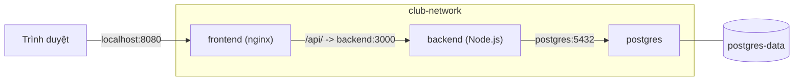

# Slide buổi 13 – Docker Compose

> **Tóm tắt:** Dùng Docker Compose để mô tả và chạy cả Frontend, API và PostgreSQL của starter-project bằng một file `compose.yaml` và một lệnh duy nhất.

Bài học đầy đủ: [Buổi 13 – Docker Compose](../../labs/week-07/session-13.md). Kịch bản demo và ghi chú giảng viên nằm ở trang dành cho mentor.

## Slide 1: Mục tiêu buổi học

- Đọc và giải thích được các khóa chính của `compose.yaml`.
- Chạy cả starter-project bằng một lệnh `docker compose up -d --build`.
- Phân biệt `depends_on` mặc định với `condition: service_healthy`.
- Đặt secret trong `.env`, không commit.
- Giải thích vì sao dữ liệu còn sau `down` nhưng mất sau `down -v`.

---

## Slide 2: Vấn đề với chuỗi lệnh docker run

- Cả hệ thống = tạo network, tạo volume, chạy postgres, chạy backend, chạy frontend.
- Quên một cờ `-e` hoặc sai thứ tự là hệ thống không lên.
- Lệnh nằm trong history của một người, không ai review được.
- Thành viên mới phải chép lại cả chục dòng lệnh.

---

## Slide 3: Compose là gì

- Công cụ khai báo (declarative): mô tả trạng thái mong muốn trong `compose.yaml`.
- Compose tạo hoặc cập nhật container, network, volume cho khớp.
- Một project mặc định lấy tên theo thư mục chứa `compose.yaml`.
- File này là tài liệu sống của hệ thống, commit cùng mã nguồn.
- Dùng `docker compose` (có dấu cách), không dùng `docker-compose` bản v1.

---

## Slide 4: Các khóa chính trong compose.yaml

| Khóa | Ý nghĩa |
| --- | --- |
| `services` | Các thành phần của ứng dụng |
| `build` / `image` | Build từ Dockerfile / dùng image có sẵn |
| `ports` | Publish `HOST:CONTAINER` |
| `environment` | Biến môi trường cho container |
| `depends_on` | Thứ tự khởi động |
| `networks`, `volumes` | Mạng và nơi lưu dữ liệu |
| `healthcheck`, `restart` | Kiểm tra sức khỏe, tự khởi động lại |

---

## Slide 5: Kiến trúc starter-project trong Compose

- Ba service, một network `club-network`, một volume `postgres-data`.
- Postgres không publish cổng ra máy.

---

## Slide 6: Network và DNS theo tên service

- Trong network của project, gọi nhau bằng tên service.
- Backend gọi `postgres:5432`, nginx gọi `backend:3000`.
- Vì vậy `DB_HOST: postgres`, không phải `localhost`.
- `localhost` trong container backend là chính container backend.

---

## Slide 7: depends_on không bằng sẵn sàng

| Dạng | Hành vi |
| --- | --- |
| `depends_on: [backend]` | Chỉ đảm bảo container được start trước |
| `condition: service_started` | Giống dạng trên (mặc định) |
| `condition: service_healthy` | Chờ healthcheck báo healthy |

- Postgres "đang chạy" chưa có nghĩa đã nhận kết nối: còn khởi tạo cluster và chạy `init.sql`.
- Backend dùng `condition: service_healthy` trên postgres.

---

## Slide 8: Biến môi trường và file .env

- Compose tự đọc `.env` cạnh `compose.yaml` để thay các biến `${...}`.
- `${WEB_PORT:-8080}`: dùng `WEB_PORT`, trống thì dùng 8080.
- `${DB_PASSWORD:?Set DB_PASSWORD in .env}`: bắt buộc có, thiếu thì dừng.
- `.env` chứa mật khẩu, không commit; chỉ commit `.env.example`.

---

## Slide 9: Volume và init.sql

- `postgres-data` là named volume, gắn vào `/var/lib/postgresql/data`.
- Xóa container, dữ liệu vẫn nằm trong volume.
- `./database/init.sql` được mount vào `/docker-entrypoint-initdb.d/`.
- Init script chỉ chạy khi data directory còn trống, tức lần khởi tạo đầu.

---

## Slide 10: Vòng đời với Compose

| Lệnh (đi sau `docker compose`) | Tác dụng |
| --- | --- |
| `up -d --build` | Build, tạo, chạy ở nền |
| `ps` | Trạng thái service |
| `logs -f backend` | Theo dõi log |
| `exec backend sh` | Vào container |
| `config` | In cấu hình sau khi thay biến |
| `down` / `down -v` | Xóa container, network / xóa luôn volume |

---

## Slide 11: Demo – từ thiếu .env tới hệ thống chạy

- Chạy khi chưa có `.env`: Compose dừng và báo thiếu `DB_PASSWORD`, thông báo do chính file YAML định nghĩa sau dấu `?`.
- Tạo `.env` từ `.env.example` rồi chạy lại: postgres `(healthy)`, backend và frontend `Up`.
- Postgres chỉ có `5432/tcp`, không có mũi tên ra máy chủ.
- Gọi API qua nginx (cổng 8080) và gọi thẳng backend (cổng 3000).
- Dùng `docker compose config` để xem cấu hình sau khi thay biến.

---

## Slide 12: Lab và thử thách

- Lab bắt buộc: chuẩn bị, Phần 1 (`.env`, `config`), Phần 2 (khởi chạy), Phần 3 (kiểm thử qua mạng), Phần 4 (`down` so với `down -v` bằng dữ liệu Carol). Lệnh và kết quả mong đợi nằm trong [Buổi 13 – Docker Compose](../../labs/week-07/session-13.md).
- Gặp lỗi: bảng "Gặp lỗi?" trong bài lab.
- Thử thách L2 ở nhà: viết `compose.mine.yaml` từ đầu; đổi `WEB_PORT` không sửa `compose.yaml`; quan sát restart policy ([thử thách buổi 13](../../labs/week-07/session-13-challenge.md)).

---

## Slide 13: Break và Debug – đổi mật khẩu trong .env

- Triệu chứng: mọi container `Up`, postgres `healthy`, nhưng API trả `500`.
- Điều tra theo thứ tự: `ps`, log backend, log postgres, so sánh hai phía.
- Nguyên nhân gốc: `POSTGRES_PASSWORD` chỉ dùng khi khởi tạo data directory; volume giữ mật khẩu cũ.
- Cách sửa: trả lại mật khẩu cũ, hoặc `ALTER USER` trong database.

---

## Slide 14: Recap

- Một file `compose.yaml`, quản lý bằng `up`, `ps`, `logs`, `exec`, `down`.
- Service gọi nhau bằng tên service; `localhost` trong container là chính nó.
- `depends_on` chỉ lo thứ tự start; muốn chờ sẵn sàng cần `healthcheck` và `service_healthy`.
- Secret trong `.env` (không commit); dùng `${VAR:?msg}` để bắt buộc biến.
- `down` giữ volume, `down -v` xóa dữ liệu; `init.sql` chỉ chạy khi volume trống.
