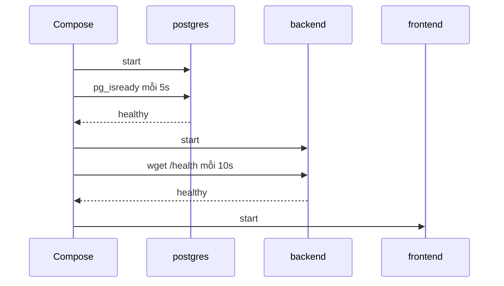

# Slide buổi 14 – Production-minded Compose

> **Tóm tắt:** Nâng `compose.yaml` từ mức chạy được lên mức đáng tin cậy: healthcheck, thứ tự khởi động, restart, giới hạn tài nguyên, secrets, logging, backup và restore.

Bài học đầy đủ: [Buổi 14 – Production-minded Compose](../../labs/week-07/session-14.md).

## Slide 1: Mục tiêu buổi học

- Giải thích vì sao `depends_on` thường chưa đủ.
- Viết healthcheck cho backend và frontend với `interval`, `timeout`, `retries`, `start_period`.
- Chọn restart policy và kiểm chứng bằng một lần thoát bất thường thật.
- Phân biệt `/health` (sống) với `/ready` (sẵn sàng).
- Điều tra được healthcheck bị đặt sai (Break -> Debug).

---

## Slide 2: Một buổi demo hỏng

- Chạy `up -d`, mở trình duyệt ngay: lỗi 500 vì Postgres chưa sẵn sàng.
- Chạy lại lần hai thì được.
- Máy khởi động lại, container API chết và không tự dậy.
- Vài tuần sau, log của Docker chiếm hàng GB.
- Không lỗi nào nằm ở code: chúng nằm ở cách vận hành.

---

## Slide 3: Started khác ready

- Docker chỉ biết tiến trình chính (PID 1) có đang chạy không.
- Healthcheck là lệnh Docker chạy định kỳ trong container: exit 0 là healthy, 1 là unhealthy.
- Ba trạng thái: `starting`, `healthy`, `unhealthy`.
- Đây là nền tảng của liveness và readiness probe ở Kubernetes.

---

## Slide 4: Các tham số của healthcheck

| Khóa | Ý nghĩa | Gợi ý |
| --- | --- | --- |
| `test` | Lệnh kiểm tra | `CMD` hoặc `CMD-SHELL` |
| `interval` | Khoảng cách giữa hai lần | 5s đến 10s |
| `timeout` | Quá thời gian là thất bại | 3s |
| `retries` | Số lần lỗi liên tiếp trước `unhealthy` | 3 đến 5 |
| `start_period` | Lỗi trong khoảng này chưa tính vào retries | 10s đến 30s |

---

## Slide 5: depends_on với condition

| Cú pháp | Compose chờ điều gì |
| --- | --- |
| `depends_on: [postgres]` | Container được tạo, không chờ ready |
| `condition: service_healthy` | Healthcheck đã `healthy` |
| `condition: service_completed_successfully` | Job một lần thoát với exit 0 |

- `depends_on` chỉ tác động lúc `docker compose up`.
- Postgres restart giữa chừng thì Compose không restart API.
- Ứng dụng vẫn phải chịu được mất kết nối tạm thời.

---

## Slide 6: Kiến trúc chuỗi khởi động

- Postgres, rồi backend, rồi frontend; mỗi bước chờ bước trước healthy.

---

## Slide 7: Restart policy

| Policy | Hành vi |
| --- | --- |
| `no` | Không tự khởi động lại (mặc định) |
| `on-failure` | Chỉ khi exit code khác 0 |
| `always` | Luôn chạy lại, kể cả sau khi daemon khởi động lại |
| `unless-stopped` | Như `always`, trừ khi bạn chủ động dừng |

- Restart chỉ xảy ra khi tiến trình thoát.
- Container `unhealthy` vẫn chạy: Docker Engine không tự restart nó.
- Docker 29.x coi `kill` do người dùng gõ là dừng thủ công; dùng thoát bất thường thật để kiểm chứng.

---

## Slide 8: Demo – sống khác sẵn sàng

- Dừng postgres khi hệ thống đang chạy.
- `/health` trả `200`, `/ready` trả `503` với `{"status":"not-ready"}`.
- Chạy lại postgres, chờ healthy: `/ready` trả `200` lại.
- Liveness (còn sống) khác readiness (sẵn sàng phục vụ).
- Thêm: quan sát khoảng chờ khi `up -d` bằng một terminal thứ hai chạy `watch docker compose ps`.

---

## Slide 9: Viết healthcheck cho backend và frontend

- Image `node:22-alpine` và `nginx:alpine` đều có `wget` của BusyBox.
- Dùng `127.0.0.1` thay `localhost` để tránh phân giải sang IPv6.
- `start_period` bao trùm thời gian khởi động thật.
- Frontend dùng `depends_on` với `condition: service_healthy` tới backend.
- Chạy `docker compose config --quiet` trước `up` để bắt lỗi thụt lề. Cấu hình cụ thể: Phần 2 của bài lab.

---

## Slide 10: Resource limits và log rotation (L2)

- Không đặt giới hạn thì một container rò bộ nhớ có thể kéo sập cả WSL2.
- Vượt CPU: bị làm chậm. Vượt memory: bị OOM kill, exit code 137.
- Log mặc định không giới hạn; `max-size` và `max-file` giới hạn mỗi container ở khoảng 30 MB.
- Tin vào `docker inspect`, không tin vào file YAML.

---

## Slide 11: Secrets và backup (L2)

- Mật khẩu ghi cứng trong YAML là không chấp nhận được; `.env` đủ cho lab; secret dạng file an toàn hơn.
- Image postgres hỗ trợ `POSTGRES_PASSWORD_FILE`; ứng dụng phải biết đọc file.
- Volume không phải là backup: `pg_dump` ra file SQL, dùng `exec -T` khi chuyển hướng.
- Backup chưa từng restore thử thì chưa phải backup; restore thử vào database mới.

---

## Slide 12: Break và Debug – healthcheck quá ngặt

- Cấu hình sai: đường dẫn kiểm tra sai, `retries: 1`, không có `start_period`.
- Triệu chứng: backend `(unhealthy)`, frontend không được tạo, `up` báo `dependency failed to start`.
- Điều tra: đọc `.State.Health.Log` bằng `docker inspect`, chạy tay lệnh check trong container.
- Nguyên nhân gốc: đường dẫn sai, cộng với thông số quá ngặt.
- Phòng tránh: chạy tay lệnh check trước khi đưa vào YAML; `timeout` lớn hơn thời gian phản hồi vài lần.

---

## Slide 13: Lab và thử thách

- Lab bắt buộc: Phần 1 (healthcheck postgres), Phần 2 (healthcheck backend, frontend), Phần 3 (restart, `/health`, `/ready`), Phần 4 (Break -> Debug). Lệnh và kết quả mong đợi nằm trong [Buổi 14 – Production-minded Compose](../../labs/week-07/session-14.md).
- Thử thách L2 ở nhà: giới hạn tài nguyên, secrets, backup và restore, bốn thử thách ([thử thách buổi 14](../../labs/week-07/session-14-challenge.md)).
- Câu hỏi thảo luận: Postgres restart giữa chừng thì frontend và backend có bị khởi động lại không? Vì sao `unhealthy` không tự được restart?

---

## Slide 14: Recap

- Chạy chưa có nghĩa là sẵn sàng: dùng healthcheck và `condition: service_healthy`.
- `/health` (còn sống) khác `/ready` (sẵn sàng); nền tảng của probe trong Kubernetes.
- `restart: unless-stopped` hồi phục khi tiến trình thoát, không xử lý `unhealthy`.
- Luôn đặt giới hạn tài nguyên và log rotation; không đưa mật khẩu vào Git.
- Volume không phải backup: tập `pg_dump` và thử restore thật.
