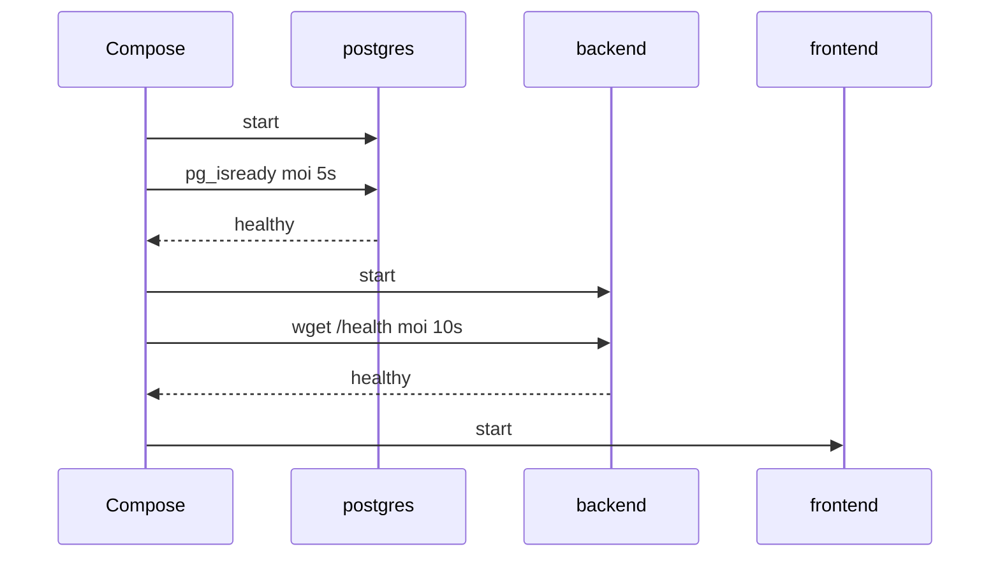

# Slide buổi 14 – Production-minded Compose

> **Tóm tắt:** Nâng `compose.yaml` từ mức chạy được lên mức đáng tin cậy: healthcheck, thứ tự khởi động, restart, giới hạn tài nguyên, secrets, logging, backup và restore.

## Slide 1: Mục tiêu buổi học

- Giải thích vì sao `depends_on` thường chưa đủ.
- Viết healthcheck cho backend và frontend với `interval`, `timeout`, `retries`, `start_period`.
- Chọn restart policy và kiểm chứng bằng cách kill container.
- Cấu hình resource limits, log rotation và secret cho Postgres.
- Backup bằng `pg_dump` và restore thật.

::: details Ghi chú giảng viên
Mở đầu 2 phút. Yêu cầu học viên đã chạy được starter-project từ buổi 13. Nhắc chạy `docker compose down` trong `lab-13/source` trước, vì hai lab cùng tên project `source`.
:::

---

## Slide 2: Một buổi demo hỏng

- Chạy `up -d`, mở trình duyệt ngay: lỗi 500 vì Postgres chưa sẵn sàng.
- Chạy lại lần hai thì được.
- Máy khởi động lại, container API chết và không tự dậy.
- Vài tuần sau, log của Docker chiếm hàng GB.
- Không lỗi nào nằm ở code: chúng nằm ở cách vận hành.

::: details Ghi chú giảng viên
Kể như một câu chuyện thật. Hỏi lớp: bạn đã gặp lỗi kiểu lúc được lúc không chưa? Production-minded không có nghĩa là đưa Compose lên production lớn, mà là tập thói quen vận hành.
:::

---

## Slide 3: Started khác ready

- Docker chỉ biết tiến trình chính (PID 1) có đang chạy không.
- Healthcheck là lệnh Docker chạy định kỳ trong container: exit 0 là healthy, 1 là unhealthy.
- Ba trạng thái: `starting`, `healthy`, `unhealthy`.
- Đây là nền tảng của liveness và readiness probe ở Kubernetes.

::: details Ghi chú giảng viên
Câu hỏi: Postgres chạy rồi, vì sao backend vẫn không kết nối được? Vì còn khởi tạo cluster và chạy `init.sql`.
:::

---

## Slide 4: Các tham số của healthcheck

| Khóa | Ý nghĩa | Gợi ý |
| --- | --- | --- |
| `test` | Lệnh kiểm tra | `CMD` hoặc `CMD-SHELL` |
| `interval` | Khoảng cách giữa hai lần | 5s đến 10s |
| `timeout` | Quá thời gian là thất bại | 3s |
| `retries` | Số lần lỗi liên tiếp trước `unhealthy` | 3 đến 5 |
| `start_period` | Lỗi trong khoảng này chưa tính vào retries | 10s đến 30s |

::: details Ghi chú giảng viên
Nhấn mạnh `start_period` bao trùm thời gian khởi động thật. Slide 18 sẽ cho thấy điều gì xảy ra khi đặt các giá trị quá ngặt.
:::

---

## Slide 5: depends_on với condition

| Cú pháp | Compose chờ điều gì |
| --- | --- |
| `depends_on: [postgres]` | Container được tạo, không chờ ready |
| `condition: service_healthy` | Healthcheck đã `healthy` |
| `condition: service_completed_successfully` | Job một lần thoát với exit 0 |

- `depends_on` chỉ tác động lúc `docker compose up`.
- Postgres restart giữa chừng thì Compose không restart API.
- Ứng dụng vẫn phải chịu được mất kết nối tạm thời.

::: details Ghi chú giảng viên
Đây là ý dễ hiểu sai nhất: `depends_on` không phải cơ chế giám sát liên tục. Nối sang `/ready` ở slide 8.
:::

---

## Slide 6: Kiến trúc chuỗi khởi động



- Postgres, rồi backend, rồi frontend; mỗi bước chờ bước trước healthy.

::: details Ghi chú giảng viên
Đọc sơ đồ theo thứ tự. Lưu ý `pg_isready` có thể báo sẵn sàng sớm trong bước khởi tạo, nên sau `down -v` chờ vài giây trước khi truy vấn.
:::

---

## Slide 7: Restart policy

| Policy | Hành vi |
| --- | --- |
| `no` | Không tự khởi động lại (mặc định) |
| `on-failure` | Chỉ khi exit code khác 0 |
| `always` | Luôn chạy lại, kể cả sau khi daemon khởi động lại |
| `unless-stopped` | Như `always`, trừ khi bạn chủ động dừng |

- Restart chỉ xảy ra khi tiến trình thoát.
- Container `unhealthy` vẫn chạy: Docker Engine không tự restart nó.

::: details Ghi chú giảng viên
Câu hỏi: `docker compose kill` và `docker compose stop` khác nhau thế nào với restart policy? `kill` là thoát bất thường nên được restart, `stop` là dừng chủ động nên nằm yên.
:::

---

## Slide 8: Demo – sống khác sẵn sàng

```bash
docker compose stop postgres
curl -s -o /dev/null -w "%{http_code}\n" http://localhost:3000/health
curl -s -w "\n%{http_code}\n" http://localhost:3000/ready
docker compose start postgres
```

- Kết quả mong đợi: `/health` trả `200`, `/ready` trả `503` với `{"status":"not-ready"}`.
- Sau khi postgres healthy, `/ready` trả `200` lại.
- Liveness (còn sống) khác readiness (sẵn sàng phục vụ).

::: details Ghi chú giảng viên
Cho lớp dự đoán trước khi chạy. Lưu ý: `db.js` chưa lắng nghe sự kiện `error` của `pg.Pool`; nếu pool đang giữ kết nối nhàn rỗi khi postgres dừng, Node có thể crash rồi được `unless-stopped` dựng lại, và `/health` có thể tạm lỗi. Đây là gợi ý cải tiến cho capstone (`pool.on("error", ...)`).
:::

---

## Slide 9: Demo – quan sát khoảng chờ

```bash
# Terminal B
watch -n 1 docker compose ps
```

```bash
# Terminal A
docker compose down -v
docker compose up -d --build
```

- Terminal B: postgres `(health: starting)`, backend chưa xuất hiện.
- Không có `sleep` nào trong file, vậy ai bắt backend chờ?
- Cần terminal thứ hai vì `up -d` chỉ trả về sau khi postgres healthy.

::: details Ghi chú giảng viên
Đặt câu hỏi: vì sao backend chưa chạy dù ta không viết sleep? Đáp: `condition: service_healthy`. Xem lịch sử check bằng `docker inspect --format '{{json .State.Health}}' $(docker compose ps -q postgres)`.
:::

---

## Slide 10: Thêm healthcheck cho backend

```yaml
    healthcheck:
      test: ["CMD-SHELL", "wget -q -O /dev/null http://127.0.0.1:3000/health || exit 1"]
      interval: 10s
      timeout: 3s
      retries: 3
      start_period: 10s
```

- Image `node:22-alpine` có sẵn `wget` của BusyBox.
- Dùng `127.0.0.1` thay `localhost` để tránh phân giải sang IPv6.

::: details Ghi chú giảng viên
Câu hỏi mở: healthcheck nên gọi `/health` hay `/ready`? Nếu gọi `/ready` thì khi DB chết backend thành `unhealthy`. Để dành cho thử thách L2 số 1.
:::

---

## Slide 11: Healthcheck cho frontend và depends_on

```yaml
    depends_on:
      backend:
        condition: service_healthy
    healthcheck:
      test: ["CMD-SHELL", "wget -q -O /dev/null http://127.0.0.1:80/ || exit 1"]
      interval: 10s
      timeout: 3s
      retries: 3
      start_period: 5s
```

```bash
docker compose config --quiet && echo "YAML OK"
docker compose up -d
docker compose ps
```

- Kết quả mong đợi: `YAML OK`, sau khoảng 15-25 giây cả ba service `(healthy)`.

::: details Ghi chú giảng viên
Luôn chạy `config --quiet` trước `up` để bắt lỗi thụt lề. Thêm vào đúng service, chú ý thụt lề 4 dấu cách trong khối `services`.
:::

---

## Slide 12: Kiểm chứng restart policy

```bash
docker compose kill backend
sleep 3
docker compose ps backend
docker inspect --format '{{.RestartCount}} {{.HostConfig.RestartPolicy.Name}}' $(docker compose ps -q backend)
```

- Kết quả mong đợi: backend `Up`, đầu ra `1 unless-stopped`.
- Thử `docker compose stop backend`: container nằm yên ở `Exited`.
- Sau đó `docker compose start backend`.

::: details Ghi chú giảng viên
Cho học viên tự so sánh `kill` và `stop`. Nhắc: restart policy không sửa lỗi cấu hình, container lỗi liên tục sẽ lặp vòng khởi động lại.
:::

---

## Slide 13: Resource limits và log rotation

```yaml
    deploy:
      resources:
        limits:
          cpus: "0.50"
          memory: 256M
    logging:
      driver: json-file
      options:
        max-size: "10m"
        max-file: "3"
```

- Vượt CPU: bị làm chậm. Vượt memory: bị OOM kill, exit code 137.
- Mỗi container tối đa khoảng 30 MB log.

::: details Ghi chú giảng viên
Giải thích: không đặt giới hạn thì một container rò bộ nhớ có thể kéo sập cả WSL2. Gợi ý giá trị: 256M cho backend và frontend, 512M cho postgres.
:::

---

## Slide 14: Kiểm tra limit có hiệu lực thật

```bash
docker compose up -d
docker stats --no-stream
docker inspect --format '{{.HostConfig.Memory}} {{.HostConfig.NanoCpus}} {{.HostConfig.LogConfig.Config}}' $(docker compose ps -q backend)
```

```text
268435456 500000000 map[max-file:3 max-size:10m]
```

- Cột `MEM USAGE / LIMIT` của backend hiện `256MiB`.
- Đổi `deploy.resources` mà không thấy hiệu lực: chưa recreate container, hãy chạy lại `up -d`.

::: details Ghi chú giảng viên
Nhấn mạnh tinh thần Break -> Debug: tin vào `inspect`, không tin vào file YAML. Số hiển thị có thể khác nhẹ tùy phiên bản.
:::

---

## Slide 15: Secrets cho Postgres

```bash
mkdir -p secrets
printf '%s' "$(grep '^DB_PASSWORD=' .env | cut -d= -f2- | tr -d '\r')" > secrets/db_password.txt
echo "secrets/" >> .gitignore
```

```yaml
  postgres:
    environment:
      POSTGRES_DB: clubdb
      POSTGRES_USER: club
      POSTGRES_PASSWORD_FILE: /run/secrets/db_password
    secrets:
      - db_password
```

- Xóa hẳn `POSTGRES_PASSWORD`: image từ chối khởi động nếu đặt cả hai.
- Thêm khối cấp cao nhất `secrets:` với `file: ./secrets/db_password.txt`.

::: details Ghi chú giảng viên
Nói rõ giới hạn: mật khẩu chỉ áp dụng khi volume trống; ứng dụng phải biết đọc file; file trên host vẫn phải được bảo vệ. Kiểm chứng: `POSTGRES_PASSWORD=[]` trong env của postgres, API vẫn trả dữ liệu.
:::

---

## Slide 16: Backup bằng pg_dump

```bash
docker compose exec -T postgres psql -U club -d clubdb -c "INSERT INTO members (name, email) VALUES ('Carol', 'carol@example.com');"
mkdir -p ../backups
docker compose exec -T postgres pg_dump -U club -d clubdb > ../backups/clubdb-$(date +%Y%m%d).sql
head -n 5 ../backups/clubdb-*.sql
```

- Kết quả mong đợi: file lớn hơn 0 byte, dòng đầu có `-- PostgreSQL database dump`.
- Bắt buộc `-T` khi chuyển hướng, nếu không file dump bị hỏng.
- Volume không phải là backup.

::: details Ghi chú giảng viên
Hỏi: vì sao xóa nhầm volume là mất hết dù đã có volume? Vì volume là bản duy nhất. Nhắc không commit file backup chứa dữ liệu nhạy cảm.
:::

---

## Slide 17: Restore và kiểm chứng

```bash
docker compose down -v && docker compose up -d && sleep 10
BACKUP=$(ls -1t ../backups/clubdb-*.sql | head -n 1)
docker compose exec -T postgres psql -U club -d postgres -c "CREATE DATABASE clubdb_restore;"
docker compose exec -T postgres psql -U club -d clubdb_restore < "$BACKUP"
docker compose exec -T postgres psql -U club -d clubdb_restore -c "SELECT id, name FROM members ORDER BY id;"
```

- Kết quả mong đợi: `clubdb_restore` có 3 dòng, gồm Carol.
- Restore thử vào database mới là cách an toàn, không đụng database đang chạy.
- Dùng biến `BACKUP` để tránh lỗi `ambiguous redirect`.

::: details Ghi chú giảng viên
Backup chưa từng restore thử thì chưa phải backup. Phần restore vào `clubdb` đang phục vụ API (có `DROP TABLE members` trước) để học viên tự làm trong lab. Lỗi `relation already exists` là do nạp dump vào database đã có bảng.
:::

---

## Slide 18: Lab L1 và L2

- L1: ba service đều `(healthy)`; kill backend thấy tự dậy, `stop` thì không; `/health` 200 và `/ready` 503 khi dừng postgres.
- L2 (làm tối thiểu 3 trong 4):
  - Đổi healthcheck sang `/ready`, giải thích nên chọn `/health` hay `/ready`.
  - Đặt `memory: 16M`, quan sát `OOMKilled` hoặc exit 137, rồi trả về giá trị hợp lý.
  - Viết `backup.sh`, giữ 5 bản gần nhất.
  - Cho backend đọc mật khẩu từ file (`DB_PASSWORD_FILE`).
- Ghi lệnh chính vào `evidence/command-output.txt`.

::: details Ghi chú giảng viên
Lab 60 phút: L1 khoảng 30 phút, L2 khoảng 30 phút. Gợi ý: `docker inspect --format '{{.State.OOMKilled}} {{.State.ExitCode}}' ID`; trong `backup.sh` dùng `ls -1t clubdb-*.sql | tail -n +6 | xargs -r rm --` để giữ 5 bản.
:::

---

## Slide 19: Lỗi thường gặp

| Triệu chứng | Cách xử lý |
| --- | --- |
| Backend 500 ngay sau `up` | Thêm healthcheck và `service_healthy` |
| Healthcheck luôn `unhealthy` | Chạy tay lệnh check bằng `exec`; dùng `127.0.0.1` |
| `dependency failed to start` | Đọc `.State.Health.Log`, sửa lệnh hoặc tăng `start_period` |
| Exit code 137 | `docker inspect` xem `OOMKilled`; tăng limit |
| File backup rỗng | Dùng `exec -T`, kiểm tra `test -s` |
| Cổng database lộ ra mạng | Bỏ `ports` của postgres |

::: details Ghi chú giảng viên
Chọn các dòng phù hợp lớp. Nhấn mạnh: không bao giờ publish `5432:5432` nếu không cần.
:::

---

## Slide 20: Break và Debug – healthcheck quá ngặt

```yaml
    healthcheck:
      test: ["CMD-SHELL", "wget -q -O /dev/null http://127.0.0.1:3000/healthz || exit 1"]
      interval: 2s
      timeout: 1s
      retries: 1
```

- Triệu chứng: backend `(unhealthy)`, frontend không được tạo, `up` báo `dependency failed to start`.
- Điều tra: `docker inspect --format '{{range .State.Health.Log}}{{.ExitCode}} {{.Output}}{{end}}' $(docker compose ps -q backend)`.
- Tái hiện tay: `docker compose exec backend wget -S -O /dev/null http://127.0.0.1:3000/health`.
- Nguyên nhân gốc: đường dẫn sai, cộng với `retries: 1` và không có `start_period`.

::: details Ghi chú giảng viên
Cho học viên tự điều tra trước khi mở đáp án. Phòng tránh: chạy tay lệnh check trước khi đưa vào YAML; `start_period` bao trùm thời gian khởi động; `timeout` lớn hơn thời gian phản hồi bình thường vài lần. Bài nộp `report.md` mô tả tình huống này. Gợi ý thêm: scenario-03 và scenario-04 trong `examples/troubleshooting/`.
:::

---

## Slide 21: Thử thách

- Postgres bị restart khi hệ thống đang chạy tốt: frontend và backend có bị Compose khởi động lại không?
- API trả 503 ở `/ready` trong 20 giây đầu rồi tự ổn: có cần sửa không?
- Vì sao container `unhealthy` không tự được Docker restart, và bạn xử lý thế nào?

<details><summary>Gợi ý</summary>

`depends_on` chỉ tác động lúc `up`. Pool kết nối của backend lỗi lúc DB tắt rồi tạo kết nối mới khi DB lên. Restart chỉ kích hoạt khi tiến trình thoát; `unhealthy` chỉ là trạng thái.

</details>

::: details Ghi chú giảng viên
Cho thảo luận theo cặp 3-4 phút. Liên hệ: ở Kubernetes liveness probe sẽ restart container unhealthy.
:::

---

## Slide 22: Recap

- Chạy chưa có nghĩa là sẵn sàng: dùng healthcheck và `condition: service_healthy`.
- `/health` (còn sống) khác `/ready` (sẵn sàng); nền tảng của probe trong Kubernetes.
- `restart: unless-stopped` hồi phục khi tiến trình thoát, không xử lý `unhealthy`.
- Luôn đặt giới hạn tài nguyên và log rotation.
- Không đưa mật khẩu vào Git; ưu tiên secret dạng file khi image hỗ trợ.
- Volume không phải backup: tập `pg_dump` và thử restore thật.

::: details Ghi chú giảng viên
Nhắc nộp bài vào `lab-14/`: `compose.yaml` đã sửa, evidence gồm `ps`, Health Log, `stats`, backup và restore, và `report.md`. Không commit `.env`, `secrets/`, file backup.
:::
