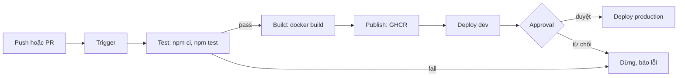
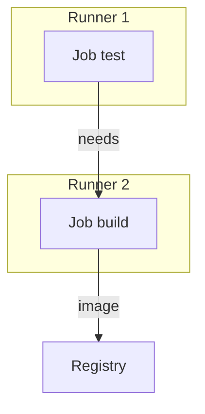

# Slide buổi 15 – CI/CD Fundamentals

> **Tóm tắt:** Phân biệt CI, Continuous Delivery và Continuous Deployment, nắm các thành phần của pipeline, rồi thiết kế và chạy thử pipeline Test, Build, Publish, Deploy cho Club API bằng một shell script.

## Slide 1: Mục tiêu buổi học

- Phân biệt CI, Continuous Delivery, Continuous Deployment bằng ví dụ Club API.
- Giải thích trigger, runner, job, step, artifact, gate.
- Vẽ pipeline Test, Build, Publish, Deploy: input, output, điều kiện dừng.
- Chạy pipeline giả lập bằng script, quan sát stage làm hỏng pipeline.
- Chẩn đoán pipeline "xanh nhưng vẫn deploy lỗi".

::: details Ghi chú giảng viên
Mở buổi (2 phút). Nhấn mạnh hôm nay chưa viết workflow thật, chỉ thiết kế và giả lập. Buổi 16 mới chuyển thành YAML. Hỏi lớp: ai từng "push xong mới nhớ chưa chạy test"?
:::

---

## Slide 2: Vấn đề: "máy tôi chạy được"

- Bạn A sửa `/api/members`, chạy thử trên máy rồi push.
- Bạn B build image trên laptop, gắn tag `latest`, gửi mentor deploy.
- Sáng hôm sau API trả lỗi 500: bản build của B không chứa thay đổi của A.
- Không ai biết image đang chạy được build từ commit nào.

::: details Ghi chú giảng viên
Kể như một câu chuyện thật của CLB (3 phút). Câu hỏi cho lớp: có bao nhiêu điểm "phụ thuộc vào con người" trong câu chuyện? Gợi ý: chạy test, build, đặt tag, gửi image, deploy.
:::

---

## Slide 3: Nguyên nhân chung

- Kiểm tra, build, deploy phụ thuộc con người và máy cá nhân.
- CI/CD thay bằng quy trình tự động, lặp lại được.
- Chạy trên môi trường sạch, mỗi lần chạy để lại log và artifact.
- Hôm nay: nghĩ và thiết kế pipeline trước khi viết code cho nó.

::: details Ghi chú giảng viên
Chuyển ý (1 phút). Từ khóa: tự động, lặp lại được, có bằng chứng.
:::

---

## Slide 4: Ba thuật ngữ dễ nhầm

| Thuật ngữ | Làm gì | Ai bấm nút cuối |
| --- | --- | --- |
| Continuous Integration | Mỗi push hoặc PR tự build và test | Không cần |
| Continuous Delivery | Luôn sẵn sàng deploy, production cần duyệt | Con người |
| Continuous Deployment | Qua test là tự deploy production | Không cần |

- Khác nhau ở đúng một chỗ: có cổng duyệt bằng tay trước production hay không.

::: details Ghi chú giảng viên
3 phút. Hỏi: nhóm 4 người như CLB nên chọn loại nào? Đáp án gợi ý: Continuous Delivery, vì test còn mỏng.
:::

---

## Slide 5: Các thành phần của pipeline

| Thành phần | Ý nghĩa | Ví dụ Club API |
| --- | --- | --- |
| Trigger | Sự kiện khởi động | push, PR, tag `v1.0.0` |
| Runner | Máy chạy pipeline, sạch mỗi lần | `ubuntu-latest` |
| Job / Step | Nhóm lệnh / một lệnh | `npm ci`, `npm test` |
| Artifact | Kết quả được giữ lại | image `club-api` |
| Gate | Điều kiện để đi tiếp | test pass, approval |

::: details Ghi chú giảng viên
3 phút. Chỉ vào từng dòng và hỏi lớp tìm ví dụ ngoài bảng. Lưu ý artifact khác cache: cache chỉ để tăng tốc, mất thì pipeline vẫn đúng.
:::

---

## Slide 6: Năm nguyên tắc thiết kế

1. Fail fast: stage rẻ đứng trước stage đắt.
2. Build once, deploy many: một image đi qua mọi môi trường.
3. Artifact truy vết về commit: tag bằng SHA hoặc phiên bản.
4. Secret không nằm trong code.
5. Pipeline là code: nằm trong repo, được review.

::: details Ghi chú giảng viên
3 phút. Hỏi: nếu build lại image cho từng môi trường thì điều gì mất? Đáp: thứ chạy production không còn là thứ đã test.
:::

---

## Slide 7: Kiến trúc pipeline mục tiêu



::: details Ghi chú giảng viên
3 phút. Đi theo mũi tên, hỏi tại mỗi stage: input là gì, output là gì, khi nào dừng?
:::

---

## Slide 8: Job chạy trên runner riêng



- Runner không chia sẻ file hệ thống.
- Dữ liệu giữa các job đi qua artifact, cache hoặc registry.

::: details Ghi chú giảng viên
2 phút. Câu hỏi: job build cần mã đã biên dịch từ job test, làm sao truyền? Đáp: artifact hoặc registry.
:::

---

## Slide 9: Demo 1: xem pipeline thật

- Mở tab Actions của repo giáo trình, chọn một run của workflow `CI`.
- Hỏi lớp: sự kiện nào làm workflow chạy? (push lên `main` hoặc `master`, mọi PR)
- Hai job `test` và `validate-compose` chạy song song vì độc lập.
- Mở workflow `Publish images`: artifact là image `club-api`, `club-web` trên GHCR.

::: details Ghi chú giảng viên
5 phút. Mở log step `Run tests` để lớp thấy output giống lệnh họ chạy trên máy, chỉ khác là trên runner sạch.
:::

---

## Slide 10: Demo 2: test pass trên máy đã đủ chưa?

```bash
cd ~/devops-labs/lab-15/source/starter-project/backend
npm ci
npm test
```

Kết quả mong đợi (rút gọn):

```text
added NN packages
# tests 1
# pass 1
# fail 0
```

- Thiếu gì? Cùng phiên bản Node chưa chắc, chưa build image, chưa ai review, chưa có bản ghi ai chạy gì lúc nào.

::: details Ghi chú giảng viên
5 phút. Để lớp tự liệt kê trước khi đưa gợi ý. Nếu `npm ci` lỗi vì thiếu thư mục, nhắc chép `starter-project/` vào `source/` ở bước chuẩn bị.
:::

---

## Slide 11: Lab bước 1: chuẩn bị và vẽ pipeline

```bash
mkdir -p ~/devops-labs/lab-15/{source,screenshots,evidence}
cd ~/devops-labs/lab-15
ls source/starter-project/backend
```

- Mong đợi thấy `Dockerfile`, `app.js`, `server.js`, `package.json`, `tests`.
- Vẽ 4 stage Test, Build, Publish, Deploy bằng draw.io hoặc `source/pipeline.mmd`.
- Mỗi stage ghi: lệnh chính, output, điều kiện qua. Thêm trigger và nhánh dừng khi fail.
- Xuất `screenshots/pipeline.png`.

::: details Ghi chú giảng viên
Lab bắt đầu (5 phút chuẩn bị, 15 phút vẽ). Đi quanh lớp kiểm tra: mũi tên nào chưa ghi artifact chảy qua nó?
:::

---

## Slide 12: Lab bước 2: đặc tả stage

```markdown
| Stage | Lệnh chính | Input | Output | Điều kiện qua |
| --- | --- | --- | --- | --- |
| Test | npm ci; npm test | mã nguồn | log test | exit code 0 |
| Build | docker build | mã nguồn + Dockerfile | image club-api | build thành công |
```

- Điền đủ 4 stage trong `source/pipeline-spec.md`.
- Bổ sung: tag image (gợi ý commit SHA), secret cần dùng (không ghi giá trị thật), stage nào chạy song song được.
- Đây là bản thiết kế mà buổi 16 chuyển thành YAML.

::: details Ghi chú giảng viên
15 phút. Nhắc: không bao giờ ghi giá trị token thật vào file, chỉ ghi tên secret.
:::

---

## Slide 13: Lab bước 3: chạy pipeline giả lập

```bash
#!/usr/bin/env bash
set -euo pipefail
ROOT="$(cd "$(dirname "$0")" && pwd)/starter-project"
SHA="$(date +%Y%m%d%H%M%S)"
IMAGE="club-api"
stage() { echo; echo "=== STAGE: $1 ==="; }
stage "test";  cd "$ROOT/backend"; npm ci; npm test
stage "build"; docker build -t "$IMAGE:$SHA" -t "$IMAGE:1.0.0" .
echo "PIPELINE OK: $IMAGE:$SHA"
```

- Bản đầy đủ có thêm stage `verify-artifact` và `publish (mô phỏng)` trong bài lab.

::: details Ghi chú giảng viên
Đây là rút gọn để vừa slide; học viên chép bản đầy đủ từ bài lab. Giải thích `set -euo pipefail`: lệnh nào trả mã khác 0 là dừng, giống runner CI.
:::

---

## Slide 14: Chạy và lưu bằng chứng

```bash
cd ~/devops-labs/lab-15
chmod +x source/run-pipeline.sh
./source/run-pipeline.sh 2>&1 | tee evidence/command-output.txt
```

Kết quả mong đợi (rút gọn):

```text
=== STAGE: test ===
# pass 1
# fail 0
=== STAGE: build ===
...
PIPELINE OK: club-api:2026...
```

- Lỗi hay gặp: `docker build` báo không kết nối được daemon, hãy mở Docker Desktop và bật WSL integration.

::: details Ghi chú giảng viên
12 phút. Nếu máy chậm, cho học viên chạy song song với phần vẽ sơ đồ. Cảnh báo không làm việc trong `/mnt/c` vì rất chậm.
:::

---

## Slide 15: Lab bước 4: kiểm chứng gate dừng khi fail

```bash
cd ~/devops-labs/lab-15/source/starter-project/backend
cp tests/health.test.js /tmp/health.test.js.bak
# sửa "healthy" thành "unhealthy" trong assert.deepEqual, rồi:
cd ~/devops-labs/lab-15
./source/run-pipeline.sh 2>&1 | tee -a evidence/command-output.txt
echo "exit code: ${PIPESTATUS[0]}"
```

- Mong đợi: stage test fail, không có dòng `=== STAGE: build ===`, exit code khác 0.
- Hoàn tác: `cp /tmp/health.test.js.bak tests/health.test.js` rồi `npm test`.

::: details Ghi chú giảng viên
12 phút. Nhấn mạnh việc sao lưu file trước khi phá. Hỏi: nếu không có gate này thì stage build đóng gói cái gì?
:::

---

## Slide 16: Hai cấp độ lab

- L1: có sơ đồ, `pipeline-spec.md`, log chạy thành công và log dừng khi fail, `report.md` giải thích Delivery và Deployment.
- L2: thêm `environments.md` cho dev, staging, production, mỗi môi trường có trigger, gate, rollback.
- L2: chọn Delivery hay Deployment cho production, nêu ít nhất 3 lý do.
- L2: sửa script để chỉ có đúng một lệnh `docker build`.
- L2: đề xuất 2 gate bổ sung, nói gate chặn loại lỗi nào.

::: details Ghi chú giảng viên
Nếu hết giờ, ưu tiên L1. Gợi ý cho L2: rollback đơn giản nhất là deploy lại tag cũ, chỉ làm được khi mọi image có tag bất biến.
:::

---

## Slide 17: Debug: pipeline xanh nhưng bản deploy lỗi

```bash
# Cách phá: trong script, đặt build trước test và nuốt mã thoát
npm test || true
```

- Triệu chứng: script in `PIPELINE OK` dù log có `# fail` lớn hơn 0.
- Điều tra: đọc log từ trên xuống, tìm `|| true` hoặc `set +e`, chạy riêng `npm test; echo $?`, kiểm tra thứ tự stage.
- Nguyên nhân gốc: mã thoát bị nuốt nên gate không phân biệt pass và fail.

::: details Ghi chú giảng viên
5 phút, nên cho học viên tự phá rồi tự điều tra. Câu hỏi: gate bị vô hiệu hóa nguy hiểm hơn không có gate vì sao? Đáp: tạo cảm giác an toàn giả.
:::

---

## Slide 18: Lỗi thường gặp

| Triệu chứng | Cách xử lý |
| --- | --- |
| Một job gộp mọi thứ, khó biết lỗi ở đâu | Tách test, build, publish, deploy |
| Không biết image từ commit nào | Tag theo SHA hoặc phiên bản, không chỉ `latest` |
| Stage sau không thấy file stage trước | Truyền qua artifact hoặc registry |
| `npm ci` báo lock file lệch | `npm install` cục bộ, commit lại `package-lock.json` |
| Pipeline xanh dù test fail | Bỏ đoạn nuốt mã thoát, dùng `set -euo pipefail` |

::: details Ghi chú giảng viên
2 phút. Hỏi lớp: lỗi nào trong bảng đã gặp trong lab hôm nay?
:::

---

## Slide 19: Thử thách

- Thiết kế pipeline cho 3 môi trường: dev, staging, production.
- Production chỉ nhận image đã chạy ổn ở staging: cần cơ chế gì?
- Pipeline xanh nhưng `/api/members` trả 500 sau deploy: kiểm tra theo thứ tự nào?
- Gợi ý: tag bất biến, smoke test sau deploy, gate approval.

::: details Ghi chú giảng viên
Giao về nhà hoặc thảo luận 5 phút cuối. Đáp án thứ tự kiểm tra: test có phủ endpoint không, tag image có đúng commit không, biến môi trường và kết nối DB, log Pod hoặc container.
:::

---

## Slide 20: Recap

- CI tự build và test; Delivery giữ cổng duyệt; Deployment bỏ cổng đó.
- Pipeline = trigger, runner, job, step, artifact, gate.
- Fail fast và build once, deploy many.
- Gate bị vô hiệu hóa còn nguy hiểm hơn không có gate.
- Buổi 16: viết workflow GitHub Actions thật.

::: details Ghi chú giảng viên
Review 15 phút cuối: mời 2 học viên trình bày pipeline của mình. Nhắc nộp `lab-15/` theo `templates/lab-template.md`, không commit secret hoặc `.env`.
:::
