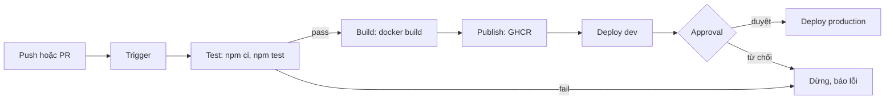
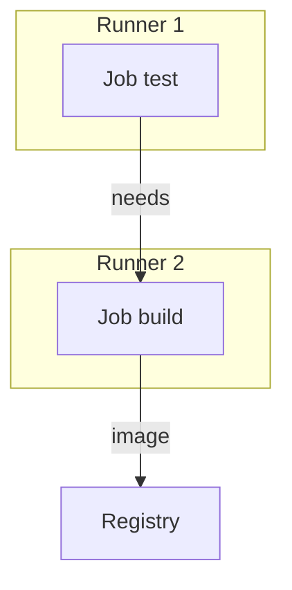

# Slide buổi 15 – CI/CD Fundamentals

> **Tóm tắt:** Phân biệt CI, Continuous Delivery và Continuous Deployment, nắm các thành phần của pipeline, rồi thiết kế và chạy thử pipeline Test, Build, Publish, Deploy cho Club API bằng một shell script.

## Slide 1: Mục tiêu buổi học

- Phân biệt CI, Continuous Delivery, Continuous Deployment bằng ví dụ Club API.
- Giải thích trigger, runner, job, step, artifact, gate.
- Vẽ pipeline Test, Build, Publish, Deploy: input, output, điều kiện dừng.
- Chạy pipeline giả lập bằng script, quan sát stage làm hỏng pipeline.
- Chẩn đoán pipeline "xanh nhưng vẫn deploy lỗi".

---

## Slide 2: Vấn đề: "máy tôi chạy được"

- Bạn A sửa `/api/members`, chạy thử trên máy rồi push.
- Bạn B build image trên laptop, gắn tag `latest`, gửi mentor deploy.
- Sáng hôm sau API trả lỗi 500: bản build của B không chứa thay đổi của A.
- Không ai biết image đang chạy được build từ commit nào.

---

## Slide 3: Nguyên nhân chung

- Kiểm tra, build, deploy phụ thuộc con người và máy cá nhân.
- CI/CD thay bằng quy trình tự động, lặp lại được.
- Chạy trên môi trường sạch, mỗi lần chạy để lại log và artifact.
- Hôm nay: nghĩ và thiết kế pipeline trước khi viết code cho nó.

---

## Slide 4: Ba thuật ngữ dễ nhầm

| Thuật ngữ | Làm gì | Ai bấm nút cuối |
| --- | --- | --- |
| Continuous Integration | Mỗi push hoặc PR tự build và test | Không cần |
| Continuous Delivery | Luôn sẵn sàng deploy, production cần duyệt | Con người |
| Continuous Deployment | Qua test là tự deploy production | Không cần |

- Khác nhau ở đúng một chỗ: có cổng duyệt bằng tay trước production hay không.

---

## Slide 5: Các thành phần của pipeline

| Thành phần | Ý nghĩa | Ví dụ Club API |
| --- | --- | --- |
| Trigger | Sự kiện khởi động | push, PR, tag `v1.0.0` |
| Runner | Máy chạy pipeline, sạch mỗi lần | `ubuntu-latest` |
| Job / Step | Nhóm lệnh / một lệnh | `npm ci`, `npm test` |
| Artifact | Kết quả được giữ lại | image `club-api` |
| Gate | Điều kiện để đi tiếp | test pass, approval |

---

## Slide 6: Năm nguyên tắc thiết kế

1. Fail fast: stage rẻ đứng trước stage đắt.
2. Build once, deploy many: một image đi qua mọi môi trường.
3. Artifact truy vết về commit: tag bằng SHA hoặc phiên bản.
4. Secret không nằm trong code.
5. Pipeline là code: nằm trong repo, được review.

---

## Slide 7: Kiến trúc pipeline mục tiêu

---

## Slide 8: Job chạy trên runner riêng

- Runner không chia sẻ file hệ thống.
- Dữ liệu giữa các job đi qua artifact, cache hoặc registry.

---

## Slide 9: Demo 1: xem pipeline thật

- Mở tab Actions của repo giáo trình, chọn một run của workflow `CI`.
- Hỏi lớp: sự kiện nào làm workflow chạy? (push lên `main` hoặc `master`, mọi PR)
- Hai job `test` và `validate-compose` chạy song song vì độc lập.
- Mở workflow `Publish images`: artifact là image `club-api`, `club-web` trên GHCR.

---

## Slide 10: Demo 2: test pass trên máy đã đủ chưa?

- Chạy `npm ci` rồi `npm test` cho backend ngay trên máy: pass.
- Câu hỏi cho lớp: vậy đã đủ để deploy chưa?
- Thiếu gì? Cùng phiên bản Node chưa chắc, chưa build image, chưa ai review, chưa có bản ghi ai chạy gì lúc nào.

---

## Slide 11: Lab: bốn phần trong 60 phút

- Phần 1: vẽ pipeline (trigger, 4 stage, nhánh dừng, nhãn trên mũi tên).
- Phần 2: đặc tả stage trong `pipeline-spec.md`: lệnh, input, output, điều kiện qua, tag, secret.
- Phần 3: chạy `run-pipeline.sh` giả lập pipeline và lưu log.
- Phần 4: làm test đỏ, chứng minh pipeline dừng trước stage build.
- Lệnh chi tiết: [Buổi 15 – CI/CD Fundamentals](../../labs/week-08/session-15.md).

---

## Slide 12: Debug: pipeline xanh nhưng bản deploy lỗi

- Triệu chứng: script in `PIPELINE OK` dù log có `# fail` lớn hơn 0.
- Điều tra: đọc log từ trên xuống, tìm `|| true` hoặc `set +e`, chạy riêng `npm test` rồi xem mã thoát, kiểm tra thứ tự stage.
- Nguyên nhân gốc: mã thoát bị nuốt nên gate không phân biệt pass và fail.
- Gate bị vô hiệu hóa còn nguy hiểm hơn không có gate: tạo cảm giác an toàn giả.

---

## Slide 13: Lỗi thường gặp và thử thách

| Triệu chứng | Cách xử lý |
| --- | --- |
| Một job gộp mọi thứ, khó biết lỗi ở đâu | Tách test, build, publish, deploy |
| Không biết image từ commit nào | Tag theo SHA hoặc phiên bản, không chỉ `latest` |
| Stage sau không thấy file stage trước | Truyền qua artifact hoặc registry |

- Thử thách L2: 3 môi trường dev, staging, production; production chỉ nhận image đã chạy ổn ở staging.
- Gợi ý: tag bất biến, smoke test sau deploy, gate approval.

---

## Slide 14: Recap

- CI tự build và test; Delivery giữ cổng duyệt; Deployment bỏ cổng đó.
- Pipeline = trigger, runner, job, step, artifact, gate.
- Fail fast và build once, deploy many.
- Gate bị vô hiệu hóa còn nguy hiểm hơn không có gate.
- Buổi 16: viết workflow GitHub Actions thật.
