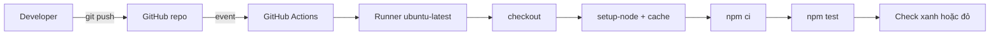

# Slide buổi 16 – GitHub Actions Basics

> **Tóm tắt:** Viết workflow GitHub Actions chạy npm ci và npm test mỗi lần push hoặc mở pull request, rồi bật cache, dùng matrix, tách job và chẩn đoán workflow bị đỏ (Tình huống 06).

## Slide 1: Mục tiêu buổi học

- Giải thích workflow, event, job, step, runner, action lồng nhau thế nào.
- Viết `.github/workflows/ci.yml` chạy `npm ci` và `npm test`.
- Đọc log từng step, tìm step làm job thất bại.
- Bật cache dependency và matrix nhiều phiên bản Node.js.
- Chẩn đoán workflow fail do sai `working-directory` hoặc thiếu `package-lock.json`.

::: details Ghi chú giảng viên
2 phút. Nhắc buổi 15 đã thiết kế pipeline, hôm nay biến nó thành YAML chạy thật. Kiểm tra ai đã có repo `devops-labs` và `git push` được.
:::

---

## Slide 2: Vấn đề: quên chạy test

- Thứ sáu, một bạn push code sửa `/health` nhưng quên chạy test.
- Tối đó cả nhóm kéo code về, `npm test` đỏ, mất cả buổi tối tìm thủ phạm.
- "Nhớ chạy test trước khi push" phụ thuộc trí nhớ từng người.
- GitHub tự chạy test trên máy sạch mỗi khi có push hoặc PR.

::: details Ghi chú giảng viên
2 phút. Nhấn mạnh máy sạch còn lộ ra lỗi "chạy được trên máy tôi": thiếu file chưa commit, khác phiên bản Node.
:::

---

## Slide 3: Năm khái niệm nền tảng

| Khái niệm | Là gì | Ví dụ |
| --- | --- | --- |
| Workflow | File YAML trong `.github/workflows/` | `ci.yml` |
| Event | Sự kiện kích hoạt, khóa `on` | `push`, `pull_request` |
| Job | Nhóm step trên một runner | `test` |
| Step | Lệnh `run` hoặc action `uses` | `npm ci` |
| Runner | Máy ảo mới cho mỗi job | `ubuntu-latest` |

::: details Ghi chú giảng viên
3 phút. Hỏi: job chạy song song hay tuần tự theo mặc định? (Song song; step trong job thì tuần tự.)
:::

---

## Slide 4: YAML cần nhớ

```yaml
name: CI
on: push
jobs:
  test:
    runs-on: ubuntu-latest
    steps:
      - run: echo "xin chào"
```

- Map: `khóa: giá trị`. List: mỗi phần tử bắt đầu bằng `- `.
- `run: |` cho nhiều lệnh shell.
- Thụt lề bằng dấu cách, không dùng tab. Sai một cấp là workflow lỗi hoặc chạy sai.

::: details Ghi chú giảng viên
2 phút. Khuyến nghị dùng editor có kiểm tra YAML, thụt lề 2 dấu cách.
:::

---

## Slide 5: Events thường dùng

| Event | Khi nào chạy | Dùng cho |
| --- | --- | --- |
| `push` | Có commit đẩy lên | CI trên nhánh chính |
| `pull_request` | Mở hoặc cập nhật PR | Kiểm tra trước merge |
| `workflow_dispatch` | Bấm chạy thủ công | Chạy lại, thử nghiệm |
| `schedule` | Theo lịch cron | Kiểm tra định kỳ |

::: details Ghi chú giảng viên
2 phút. Lưu ý nút Run workflow chỉ xuất hiện khi file đã nằm trên nhánh mặc định.
:::

---

## Slide 6: Runner, action và quyền tối thiểu

- Runner phổ biến: `ubuntu-latest`, `ubuntu-24.04`, `windows-latest`. Muốn không đổi khi GitHub nâng `latest`, dùng nhãn cụ thể.
- Action là đơn vị tái sử dụng, ví dụ `actions/checkout@v4`.
- Pin ít nhất theo major version; chỉ dùng action của nhà phát hành đáng tin.
- CI chỉ đọc code: `permissions: contents: read` là đủ.

::: details Ghi chú giảng viên
3 phút. Hỏi: vì sao đặt quyền tối thiểu? Đáp: nếu một action bên thứ ba bị lợi dụng thì token không ghi được vào repo.
:::

---

## Slide 7: Kiến trúc: từ push đến check xanh



::: details Ghi chú giảng viên
2 phút. Đi qua từng khối. Hỏi: nếu không có checkout thì runner có mã nguồn không? (Không.)
:::

---

## Slide 8: Cách hoạt động

- GitHub đối chiếu event với khóa `on` của mọi file trong `.github/workflows/`.
- Mỗi job được cấp một runner mới, sạch.
- Step đầu thường là `actions/checkout@v4` vì runner không có source.
- Step trả exit code khác 0 thì job fail, các step sau bị bỏ qua.
- `npm ci` cài đúng theo lock file, báo lỗi nếu thiếu hoặc lệch; dùng trong CI thay `npm install`.

::: details Ghi chú giảng viên
3 phút. Câu hỏi: khác biệt npm install và npm ci? Đáp: ci xóa node_modules, không sửa lock file, tái lập được.
:::

---

## Slide 9: Demo 1: workflow tối thiểu

```yaml
name: CI
on: push
jobs:
  hello:
    runs-on: ubuntu-latest
    steps:
      - run: echo "Hello from $GITHUB_REPOSITORY on $RUNNER_OS"
```

- Kết quả mong đợi: log in tên repo và `Linux`.
- Thêm `ls` sau echo: thư mục trống, vì chưa có checkout.
- Thêm `actions/checkout@v4`: `ls` thấy file. Đó là khác biệt giữa `uses` và `run`.

::: details Ghi chú giảng viên
5 phút. Hỏi trước khi chạy: source code của chúng ta có trên runner chưa? Để lớp dự đoán rồi mới thêm `ls`.
:::

---

## Slide 10: Demo 2: cache và lỗi đường dẫn

- Chạy CI thật lần hai, chỉ dòng báo khôi phục cache.
- Cố ý sửa `working-directory` sai, push, cho lớp đọc log.
- Hỏi: dòng nào trong log cho biết nguyên nhân?
- Sau đó sửa lại cho xanh.

::: details Ghi chú giảng viên
5 phút. Chuẩn bị trước repo demo có workflow chạy sẵn để không mất thời gian chờ runner. Dạy thói quen đọc dòng lỗi đầu tiên, không đọc từ cuối.
:::

---

## Slide 11: Lab bước 1: chuẩn bị source

```bash
cd ~/devops-labs
mkdir -p lab-16/source lab-16/evidence lab-16/screenshots .github/workflows
cp -r ~/devops-course/starter-project/backend/. lab-16/source/
rm -rf lab-16/source/node_modules
printf 'node_modules/\n.env\n' > .gitignore
```

Kết quả mong đợi khi `ls -A lab-16/source` (thứ tự có thể khác):

```text
.dockerignore  Dockerfile  app.js  db.js  package-lock.json  package.json  server.js  tests
```

- Tuyệt đối không ignore `package-lock.json`.

::: details Ghi chú giảng viên
5 phút. Đường dẫn `~/devops-course` là ví dụ, học viên thay bằng nơi họ clone giáo trình. Nhắc làm trong WSL, không dùng `/mnt/c`.
:::

---

## Slide 12: Lab bước 2: chạy test ở local trước

```bash
cd lab-16/source
npm ci
npm test
cd ../..
```

- Mong đợi: `# pass 1` và `# fail 0`.
- Local đỏ thì CI chắc chắn đỏ, sửa local trước.
- Lý do: khi CI đỏ, bạn biết lỗi nằm ở cấu hình workflow hay ở code.

::: details Ghi chú giảng viên
3 phút. Nếu `npm ci` lỗi, kiểm tra học viên đã copy cả `package-lock.json` chưa.
:::

---

## Slide 13: Lab bước 3: workflow hello và CI (L1)

```yaml
name: CI
on:
  push:
    branches: [main, master]
  pull_request:
permissions:
  contents: read
jobs:
  test:
    runs-on: ubuntu-latest
    steps:
      - uses: actions/checkout@v4
      - uses: actions/setup-node@v4
        with:
          node-version: 22
      - run: npm ci
        working-directory: lab-16/source
      - run: npm test
        working-directory: lab-16/source
```

::: details Ghi chú giảng viên
Đoạn này là bản rút gọn của `ci.yml` trong bài lab (đã bỏ `name` của từng step). Bước trước đó học viên tạo `hello.yml` với `workflow_dispatch` để thấy runner là máy trống. Dành 25 phút cho phần này.
:::

---

## Slide 14: Đẩy lên và quan sát

```bash
git add .github/workflows/ci.yml
git commit -m "ci: run backend tests on push and pull request"
git push
```

- Mở tab Actions, chọn run mới nhất, bung từng step.
- Mong đợi: các step có dấu tích xanh, log `Run tests` có `# fail 0`.
- Lỗi: workflow không xuất hiện trong tab Actions, kiểm tra file nằm đúng `.github/workflows/` và đuôi `.yml`.
- Lỗi: không chạy khi push, kiểm tra `branches` có khớp tên nhánh của bạn không.

::: details Ghi chú giảng viên
Cho lớp 5 phút chờ run và đọc log. Hỏi: vì sao cần `working-directory`? Đáp: `package.json` nằm ở `lab-16/source`, không phải gốc repo.
:::

---

## Slide 15: Cache và matrix

```yaml
      - uses: actions/setup-node@v4
        with:
          node-version: ${{ matrix.node-version }}
          cache: npm
          cache-dependency-path: lab-16/source/package-lock.json
```

```yaml
    strategy:
      fail-fast: false
      matrix:
        node-version: [22, 24]
```

- Cache key tính từ hash của lock file; đổi dependency thì cache làm mới.
- Matrix tạo `test (22)` và `test (24)` chạy song song.
- `fail-fast: false` để một biến thể fail không hủy biến thể khác.

::: details Ghi chú giảng viên
8 phút. Bấm Re-run all jobs để thấy log khôi phục cache. Với dự án nhỏ, chênh lệch thời gian chỉ vài giây, điều quan trọng là thấy cache hoạt động. Node 22 là mục tiêu của backend, 24 chỉ để học matrix.
:::

---

## Slide 16: Hai cấp độ lab

- L1: `ci.yml` chạy khi push và PR, có checkout, setup-node 22, `npm ci`, `npm test`, một run xanh có screenshot, giải thích được `working-directory`.
- L2: cache và matrix, ít nhất hai job độc lập.
- L2: nhánh `feature/break-test` làm test đỏ, mở PR, chụp check đỏ rồi sửa cho xanh.
- L2: xử lý Tình huống 06, ghi nguyên nhân gốc vào `report.md`.
- Gợi ý: `needs: test` để job sau chỉ chạy khi `test` xanh.

::: details Ghi chú giảng viên
Nếu hết giờ, ưu tiên hoàn thành L1. Đi quanh lớp, hỏi học viên L2 mở log nào để chứng minh nguyên nhân.
:::

---

## Slide 17: Debug Tình huống 06: workflow fail

Cách phá (chọn một):

```text
1. Đổi working-directory thành lab-16/src ở step npm ci
2. Ignore package-lock.json rồi git rm --cached và push
```

- Cách 1: step đỏ ngay, log báo `No such file or directory` trước khi chạy `npm`.
- Cách 2: đỏ ở Setup Node.js (nếu bật cache) hoặc ở `npm ci` vì thiếu lock file.
- Điều tra: tìm step X đỏ đầu tiên, đọc dòng lỗi đầu tiên, `git ls-files lab-16/source | head`, tái hiện trên bản clone sạch.
- Nguyên nhân gốc: runner chỉ có thứ đã commit và thứ workflow khai báo.

::: details Ghi chú giảng viên
8 phút. Học viên chỉ nhận triệu chứng trước, tự tìm. Kết luận: luôn commit `package-lock.json`, dùng `defaults.run.working-directory` để khỏi lặp đường dẫn, kiểm tra bằng clone sạch trước khi đổ lỗi cho CI.
:::

---

## Slide 18: Lỗi thường gặp

| Triệu chứng | Cách xử lý |
| --- | --- |
| Lỗi cú pháp YAML ngay khi mở run | Kiểm tra thụt lề, không dùng tab |
| Không tìm thấy `package.json` | Thêm `working-directory` hoặc `defaults.run` |
| Cache không bao giờ khôi phục | Chỉ đúng `cache-dependency-path` |
| Test pass local, fail trên CI | Clone sạch, cố định `node-version` |
| Check đỏ do quyền 403 | Nâng đúng quyền cần, không dùng `write-all` |

::: details Ghi chú giảng viên
2 phút. Hỏi lớp: lỗi nào đã gặp trong buổi hôm nay?
:::

---

## Slide 19: Thử thách

- Thêm job `build-image` chạy `docker build -t club-api:ci .` với `needs: [test, validate]`.
- Chứng minh khi `test` đỏ thì job này bị bỏ qua.
- Thêm `workflow_dispatch` vào `ci.yml` để chạy tay được.
- Gợi ý: Docker có sẵn trên `ubuntu-latest`.

::: details Ghi chú giảng viên
Bài thêm cho nhóm xong sớm. Thảo luận: so sánh với pipeline đã thiết kế ở buổi 15, còn thiếu stage nào?
:::

---

## Slide 20: Recap

- Workflow là YAML trong `.github/workflows/`; event kích hoạt, job chạy trên runner, step là lệnh hoặc action.
- Runner mới cho mỗi job, nên phải checkout và cài mọi thứ.
- Dùng `npm ci`, commit `package-lock.json`, cố định phiên bản Node.
- Khi workflow đỏ: đọc dòng lỗi đầu tiên, xác định step, tái hiện trên bản clone sạch.
- Pin action và đặt `permissions` tối thiểu.

::: details Ghi chú giảng viên
Review 15 phút cuối: cho 2 học viên chia sẻ màn hình run xanh và run đỏ. Nhắc nộp `lab-16/` kèm link run, không commit secret.
:::
