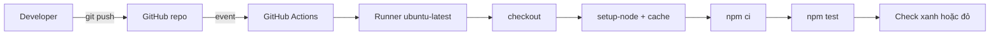

# Slide buổi 16 – GitHub Actions Basics

> **Tóm tắt:** Viết workflow GitHub Actions chạy npm ci và npm test mỗi lần push hoặc mở pull request, rồi bật cache, tách job và chẩn đoán workflow bị đỏ.

## Slide 1: Mục tiêu buổi học

- Giải thích workflow, event, job, step, runner, action lồng nhau thế nào.
- Viết `.github/workflows/ci.yml` chạy `npm ci` và `npm test`.
- Đọc log từng step, tìm step làm job thất bại.
- Bật cache dependency và tách job chạy song song.
- Chẩn đoán workflow fail do sai `working-directory` hoặc thiếu `package-lock.json`.

---

## Slide 2: Vấn đề: quên chạy test

- Thứ sáu, một bạn push code sửa `/health` nhưng quên chạy test.
- Tối đó cả nhóm kéo code về, `npm test` đỏ, mất cả buổi tối tìm thủ phạm.
- "Nhớ chạy test trước khi push" phụ thuộc trí nhớ từng người.
- GitHub tự chạy test trên máy sạch mỗi khi có push hoặc PR.

---

## Slide 3: Năm khái niệm nền tảng

| Khái niệm | Là gì | Ví dụ |
| --- | --- | --- |
| Workflow | File YAML trong `.github/workflows/` | `ci.yml` |
| Event | Sự kiện kích hoạt, khóa `on` | `push`, `pull_request` |
| Job | Nhóm step trên một runner | `test` |
| Step | Lệnh `run` hoặc action `uses` | `npm ci` |
| Runner | Máy ảo mới cho mỗi job | `ubuntu-latest` |

---

## Slide 4: YAML cần nhớ

```yaml
name: CI
on: push
jobs:
  test:
    runs-on: ubuntu-latest
    steps:
      - run: echo "xin chào"
```

- Map: `khóa: giá trị`. List: mỗi phần tử bắt đầu bằng `- `.
- `run: |` cho nhiều lệnh shell.
- Thụt lề bằng dấu cách, không dùng tab. Sai một cấp là workflow lỗi hoặc chạy sai.

---

## Slide 5: Events thường dùng

| Event | Khi nào chạy | Dùng cho |
| --- | --- | --- |
| `push` | Có commit đẩy lên | CI trên nhánh chính |
| `pull_request` | Mở hoặc cập nhật PR | Kiểm tra trước merge |
| `workflow_dispatch` | Bấm chạy thủ công | Chạy lại, thử nghiệm |
| `schedule` | Theo lịch cron | Kiểm tra định kỳ |

---

## Slide 6: Runner, action và quyền tối thiểu

- Runner phổ biến: `ubuntu-latest`, `ubuntu-24.04`, `windows-latest`. Muốn không đổi khi GitHub nâng `latest`, dùng nhãn cụ thể.
- Action là đơn vị tái sử dụng, ví dụ `actions/checkout@v4`.
- Pin ít nhất theo major version; chỉ dùng action của nhà phát hành đáng tin.
- CI chỉ đọc code: `permissions: contents: read` là đủ.

---

## Slide 7: Kiến trúc: từ push đến check xanh



---

## Slide 8: Cách hoạt động

- GitHub đối chiếu event với khóa `on` của mọi file trong `.github/workflows/`.
- Mỗi job được cấp một runner mới, sạch.
- Step đầu thường là `actions/checkout@v4` vì runner không có source.
- Step trả exit code khác 0 thì job fail, các step sau bị bỏ qua.
- `npm ci` cài đúng theo lock file, báo lỗi nếu thiếu hoặc lệch; dùng trong CI thay `npm install`.

---

## Slide 9: Demo 1: workflow tối thiểu

```yaml
name: CI
on: push
jobs:
  hello:
    runs-on: ubuntu-latest
    steps:
      - run: echo "Hello from $GITHUB_REPOSITORY on $RUNNER_OS"
```

- Kết quả mong đợi: log in tên repo và `Linux`.
- Thêm `ls` sau echo: thư mục trống, vì chưa có checkout.
- Thêm `actions/checkout@v4`: `ls` thấy file. Đó là khác biệt giữa `uses` và `run`.

---

## Slide 10: Demo 2: cache và lỗi đường dẫn

- Chạy CI thật lần hai, chỉ dòng báo khôi phục cache.
- Cố ý sửa `working-directory` sai, push, cho lớp đọc log.
- Hỏi: dòng nào trong log cho biết nguyên nhân?
- Sau đó sửa lại cho xanh.

---

## Slide 11: Lab: bốn phần trong 60 phút

- Chuẩn bị: copy backend vào `lab-16/source`, chạy test local trước.
- Phần 1: workflow `hello` với `workflow_dispatch` để thấy runner là máy trống.
- Phần 2 (L1): `ci.yml` với checkout, setup-node 22, `npm ci`, `npm test`, đúng `working-directory`.
- Phần 3: bật cache với `cache-dependency-path`; Phần 4: tách job `validate` chạy song song.
- Lệnh chi tiết: [Buổi 16 – GitHub Actions Basics](../../labs/week-08/session-16.md).

---

## Slide 12: Cache và matrix

- Cache key tính từ hash của lock file; đổi dependency thì cache làm mới.
- Matrix tạo `test (22)` và `test (24)` chạy song song.
- `fail-fast: false` để một biến thể fail không hủy biến thể khác.
- Cache chỉ tăng tốc; mất cache thì kết quả vẫn đúng.

---

## Slide 13: Debug Tình huống 06 và lỗi thường gặp

- Cách phá: sai `working-directory`, hoặc ignore `package-lock.json`.
- Điều tra: tìm step đỏ đầu tiên, đọc dòng lỗi đầu tiên, `git ls-files`, tái hiện trên bản clone sạch.
- Nguyên nhân gốc: runner chỉ có thứ đã commit và thứ workflow khai báo.

| Triệu chứng | Cách xử lý |
| --- | --- |
| Lỗi cú pháp YAML ngay khi mở run | Kiểm tra thụt lề, không dùng tab |
| Cache không bao giờ khôi phục | Chỉ đúng `cache-dependency-path` |
| Test pass local, fail trên CI | Clone sạch, cố định `node-version` |

---

## Slide 14: Recap

- Workflow là YAML trong `.github/workflows/`; event kích hoạt, job chạy trên runner, step là lệnh hoặc action.
- Runner mới cho mỗi job, nên phải checkout và cài mọi thứ.
- Dùng `npm ci`, commit `package-lock.json`, cố định phiên bản Node.
- Khi workflow đỏ: đọc dòng lỗi đầu tiên, xác định step, tái hiện trên bản clone sạch.
- Pin action và đặt `permissions` tối thiểu.
