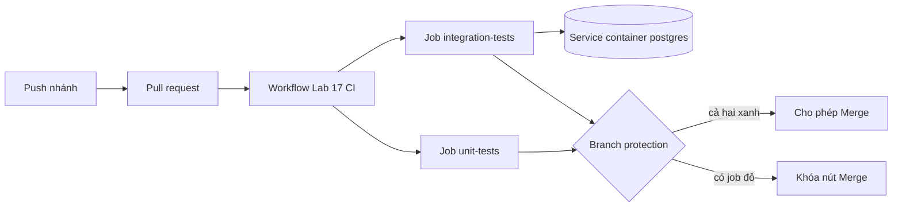

# Slide buổi 17 – Automated Testing

> **Tóm tắt:** Viết unit test (mock pool) bằng node:test, chạy trong GitHub Actions và dùng branch protection để chặn merge khi CI đỏ. Integration test với Postgres là phần tùy chọn.

## Slide 1: Mục tiêu buổi học

- Phân biệt unit test và integration test, biết khi nào dùng loại nào.
- Viết test cho `/ready` và `/api/members` bằng `node:test` với `mock.method`.
- Upload test report JUnit XML làm artifact.
- Bật branch protection để PR chỉ merge khi check xanh.
- Tùy chọn: integration test với PostgreSQL thật, cục bộ và trong Actions.

---

## Slide 2: Vấn đề: merge xong mới biết lỗi

- Một bạn đổi câu SQL trong `/api/members`, chạy thử thấy ổn rồi merge.
- Tối đó cả nhóm `docker compose up` thì API trả 500.
- Không ai biết thay đổi nào gây lỗi vì không có gì kiểm tra trước khi vào nhánh chính.
- Mục tiêu: biến "có ai làm hỏng gì không?" thành tín hiệu xanh hoặc đỏ.

---

## Slide 3: Unit test và integration test

| Tiêu chí | Unit test | Integration test |
| --- | --- | --- |
| Kiểm tra | Một đơn vị logic | API + PostgreSQL thật |
| Phụ thuộc ngoài | Mock hoặc stub | Dịch vụ thật |
| Tốc độ | Mili giây | Giây |
| Bắt được | Logic sai, nhánh lỗi | SQL sai, schema lệch, kết nối sai |

- Nhiều unit test nhanh làm nền, vài integration test cho đường đi quan trọng.

---

## Slide 4: node:test có sẵn trong Node 22

| Thành phần | Công dụng |
| --- | --- |
| `test(name, fn)` | Khai báo test case |
| `describe`, `before`, `after`, `beforeEach` | Gom nhóm, chuẩn bị, dọn dữ liệu |
| `t.mock.method(obj, "name", impl)` | Thay method bằng bản giả, tự khôi phục |
| `node --test` | Tự tìm và chạy `*.test.js` |

- Không cần cài Jest hay Mocha.
- Test pass khi hàm kết thúc mà không ném lỗi.

---

## Slide 5: Test report và branch protection

- Log trên màn hình chỉ đọc được khi bạn đang nhìn.
- JUnit XML là file có cấu trúc: số test pass và fail, thời gian từng test.
- Upload làm artifact, kể cả khi test fail.
- CI mà không chặn thì chỉ là thông báo. Branch protection biến nó thành cổng kiểm soát.

---

## Slide 6: Kiến trúc: hai job và cổng merge

---

## Slide 7: Service container: cách kết nối

- Khai báo `services.postgres` với image `postgres:17-alpine`.
- `--health-cmd` làm runner chờ Postgres sẵn sàng trước khi chạy step đầu tiên.
- Job chạy trực tiếp trên runner nên host là `localhost`, cổng là cổng đã map trong `ports`.
- Tên `postgres` chỉ phân giải được khi job chạy trong `container:`.

---

## Slide 8: Demo 1: đỏ rồi xanh

- Chạy `npm test` trên bài có sẵn, đọc `pass 1`, `fail 0`.
- Cố ý sửa một `assert`, chạy lại, đọc `AssertionError` (actual và expected).
- Hỏi: dòng nào cho biết test hỏng ở đâu? Sửa lại cho xanh.
- Câu hỏi: test `/health` có cần PostgreSQL không? Vì sao?

---

## Slide 9: Demo 2: nút Merge bị khóa

- Mở Settings, Branches của repo demo, cho xem rule đang bật.
- Mở một PR có check đỏ: thông báo "Required statuses must pass", nút Merge bị khóa.
- Mở một PR xanh để so sánh.

---

## Slide 10: Lab L1: bốn phần trong 60 phút

- Phần 1: chạy test có sẵn để có mốc xanh.
- Phần 2: viết 4 unit test với mock pool.
- Phần 3: workflow chạy test, xuất report, upload artifact với `if: always()`.
- Phần 4: bật branch protection và kiểm chứng bằng PR cố ý đỏ.
- Lệnh và code đầy đủ: [Buổi 17 – Automated Testing](../../labs/week-09/session-17.md).

---

## Slide 11: Debug A: test pass riêng, fail chung

- Cách phá: bỏ `TRUNCATE` khỏi `beforeEach`, thêm một test chèn dữ liệu.
- Triệu chứng: test danh sách fail vì thấy thêm bản ghi lạ; chạy riêng thì pass.
- Điều tra: so sánh chạy riêng và chạy chung, xem dữ liệu thật trong DB.
- Nguyên nhân gốc: các test dùng chung DB và không đưa DB về trạng thái đã biết.

---

## Slide 12: Debug B: không kết nối được service container

- Cách phá: đổi `DB_HOST: localhost` thành `DB_HOST: postgres`.
- Triệu chứng: job đỏ, log có `getaddrinfo ENOTFOUND postgres`, trong khi container Postgres vẫn khởi động bình thường.
- `ENOTFOUND` là lỗi phân giải tên, không phải lỗi mật khẩu hay timeout.
- Nguyên nhân gốc: job chạy trực tiếp trên runner thì truy cập service qua `localhost` và cổng đã map.

---

## Slide 13: Recap

- Unit test nhanh nhưng dùng mock; integration test chậm hơn nhưng bắt được lỗi SQL, schema, kết nối.
- Mỗi test tự dựng dữ liệu, không dựa vào thứ tự chạy.
- Service container cần health check; host là `localhost` khi job chạy trên runner.
- Upload report với `if: always()`.
- CI chỉ có giá trị khi branch protection chặn merge, luôn kiểm chứng bằng một PR cố ý đỏ.
