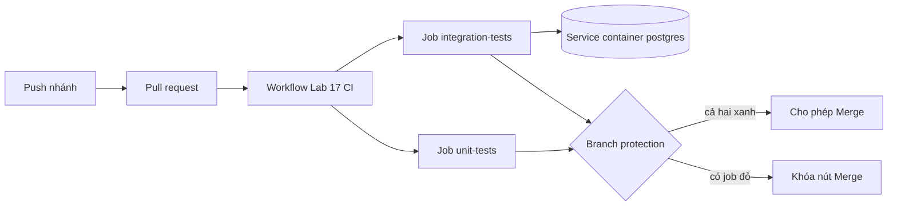

# Slide buổi 17 – Automated Testing

> **Tóm tắt:** Viết unit test (mock pool) và integration test (Postgres service container) bằng node:test, xuất report JUnit, chạy trong GitHub Actions và dùng branch protection để chặn merge khi CI đỏ.

## Slide 1: Mục tiêu buổi học

- Phân biệt unit test và integration test, biết khi nào dùng loại nào.
- Viết test cho `/ready` và `/api/members` bằng `node:test` với `mock.method`.
- Chạy integration test với PostgreSQL thật, cục bộ và trong Actions.
- Upload test report JUnit XML làm artifact.
- Bật branch protection để PR chỉ merge khi check xanh.

::: details Ghi chú giảng viên
2 phút. Nhắc buổi 16 đã có workflow chạy `npm test`. Hôm nay làm cho test có giá trị thật và chặn được merge. Repo nên để public nếu muốn dùng branch protection.
:::

---

## Slide 2: Vấn đề: merge xong mới biết lỗi

- Một bạn đổi câu SQL trong `/api/members`, chạy thử thấy ổn rồi merge.
- Tối đó cả nhóm `docker compose up` thì API trả 500.
- Không ai biết thay đổi nào gây lỗi vì không có gì kiểm tra trước khi vào nhánh chính.
- Mục tiêu: biến "có ai làm hỏng gì không?" thành tín hiệu xanh hoặc đỏ.

::: details Ghi chú giảng viên
2 phút. Test không chứng minh code đúng tuyệt đối, nhưng cho cả nhóm một tín hiệu đáng tin.
:::

---

## Slide 3: Unit test và integration test

| Tiêu chí | Unit test | Integration test |
| --- | --- | --- |
| Kiểm tra | Một đơn vị logic | API + PostgreSQL thật |
| Phụ thuộc ngoài | Mock hoặc stub | Dịch vụ thật |
| Tốc độ | Mili giây | Giây |
| Bắt được | Logic sai, nhánh lỗi | SQL sai, schema lệch, kết nối sai |

- Nhiều unit test nhanh làm nền, vài integration test cho đường đi quan trọng.

::: details Ghi chú giảng viên
3 phút. Hỏi: nếu mock luôn trả dữ liệu đúng thì có phát hiện được SQL sai không? Đáp: không, đó là lý do cần integration test.
:::

---

## Slide 4: node:test có sẵn trong Node 22

| Thành phần | Công dụng |
| --- | --- |
| `test(name, fn)` | Khai báo test case |
| `describe`, `before`, `after`, `beforeEach` | Gom nhóm, chuẩn bị, dọn dữ liệu |
| `t.mock.method(obj, "name", impl)` | Thay method bằng bản giả, tự khôi phục |
| `node --test` | Tự tìm và chạy `*.test.js` |

- Không cần cài Jest hay Mocha.
- Test pass khi hàm kết thúc mà không ném lỗi.

::: details Ghi chú giảng viên
2 phút. Nhấn mạnh `t.mock.method` tự khôi phục khi test kết thúc nên không làm bẩn test khác.
:::

---

## Slide 5: Test report và branch protection

- Log trên màn hình chỉ đọc được khi bạn đang nhìn.
- JUnit XML là file có cấu trúc: số test pass và fail, thời gian từng test.
- Upload làm artifact, kể cả khi test fail.
- CI mà không chặn thì chỉ là thông báo. Branch protection biến nó thành cổng kiểm soát.

::: details Ghi chú giảng viên
2 phút. Check bắt buộc được chọn theo tên job (trường `name`).
:::

---

## Slide 6: Kiến trúc: hai job và cổng merge



::: details Ghi chú giảng viên
3 phút. Hai job chạy trên hai runner độc lập, song song. Chỉ ra Postgres là container phụ chạy cạnh job integration.
:::

---

## Slide 7: Service container: cách kết nối

- Khai báo `services.postgres` với image `postgres:17-alpine`.
- `--health-cmd` làm runner chờ Postgres sẵn sàng trước khi chạy step đầu tiên.
- Job chạy trực tiếp trên runner nên host là `localhost`, cổng là cổng đã map trong `ports`.
- Tên `postgres` chỉ phân giải được khi job chạy trong `container:`.

::: details Ghi chú giảng viên
3 phút. Câu hỏi: vì sao `DB_HOST` là `localhost` mà không phải `postgres`? Đây cũng là lỗi của Tình huống B ở cuối buổi.
:::

---

## Slide 8: Demo 1: đỏ rồi xanh

```bash
cd ~/devops-labs/lab-17/source/backend
npm test
```

Kết quả mong đợi (rút gọn):

```text
✔ GET /health returns healthy (15.2ms)
ℹ tests 1
ℹ pass 1
ℹ fail 0
```

- Sửa `assert.equal(res.status, 200)` thành `201`, chạy lại, đọc `AssertionError`.
- Hỏi: dòng nào cho biết test hỏng ở đâu? Sửa lại cho xanh.

::: details Ghi chú giảng viên
5 phút. Hỏi trước: test này có cần PostgreSQL không? Đáp: không, vì `/health` không chạm DB và `Pool` chỉ kết nối khi có query.
:::

---

## Slide 9: Demo 2: nút Merge bị khóa

- Mở Settings, Branches của repo demo, cho xem rule đang bật.
- Mở một PR có check đỏ.
- Chỉ thông báo "Required statuses must pass" và nút Merge bị khóa.
- Mở một PR xanh để so sánh.

::: details Ghi chú giảng viên
5 phút. Chuẩn bị sẵn hai PR (một đỏ, một xanh) trước buổi. Lưu ý giao diện GitHub thay đổi tên nút, có thể dùng Rulesets thay classic rule.
:::

---

## Slide 10: Lab bước 1: chuẩn bị

```bash
cd ~/devops-labs
mkdir -p lab-17/source lab-17/evidence lab-17/screenshots
cp -r ~/devops-course/starter-project/backend lab-17/source/backend
cp -r ~/devops-course/starter-project/database lab-17/source/database
rm -rf lab-17/source/backend/node_modules
printf "node_modules/\ntest-results.xml\n.env\n" >> .gitignore
git switch -c add-api-tests
cd lab-17/source/backend && npm ci
```

- Mong đợi `ls lab-17/source` thấy `backend` và `database`.
- `node_modules` sinh ra bởi `npm ci`, không bao giờ commit.

::: details Ghi chú giảng viên
5 phút. Đường dẫn `~/devops-course` là ví dụ. Chạy `npm test` một lần để có mốc xanh (`pass 1`, `fail 0`) trước khi thêm test.
:::

---

## Slide 11: Lab bước 2: unit test với mock pool

```js
test("GET /ready returns 503 when database fails", async (t) => {
  t.mock.method(pool, "query", async () => {
    throw new Error("connection refused");
  });
  const res = await fetch(`${baseUrl}/ready`);
  assert.equal(res.status, 503);
  assert.deepEqual(await res.json(), { status: "not-ready" });
});
```

- Đặt trong `tests/api.test.js` cùng 3 test khác: `/ready` 200, `/api/members` trả rows, `/api/members` 500.
- `before` mở server cổng ngẫu nhiên; `after` đóng server và `pool.end()`.

::: details Ghi chú giảng viên
Đoạn này chỉ là một trong bốn test; bản đầy đủ có trong bài lab. 10 phút. Giải thích vì sao mock `console.error` ở test 500: để log không nhiễu báo cáo.
:::

---

## Slide 12: Chạy unit test

```bash
npm test -- --test-reporter=spec
```

Kết quả mong đợi (rút gọn):

```text
✔ GET /ready returns 200 when database answers (6ms)
✔ GET /ready returns 503 when database fails (3ms)
ℹ tests 5
ℹ pass 5
ℹ fail 0
```

- Lỗi: test treo, process không thoát, kiểm tra `after` đã `server.close` và `pool.end()` chưa.
- Lỗi: `Cannot find package 'express'`, quên `npm ci` hoặc sai thư mục.

::: details Ghi chú giảng viên
3 phút. Cho học viên lưu output vào `evidence/command-output.txt` bằng `tee`.
:::

---

## Slide 13: Lab bước 3: workflow và report

```yaml
jobs:
  unit-tests:
    name: unit-tests
    runs-on: ubuntu-latest
    defaults:
      run:
        working-directory: lab-17/source/backend
    steps:
      - uses: actions/checkout@v4
      - uses: actions/setup-node@v4
        with:
          node-version: 22
      - run: npm ci
      - run: >
          npm test --
          --test-reporter=spec --test-reporter-destination=stdout
          --test-reporter=junit --test-reporter-destination=test-results.xml
      - if: always()
        uses: actions/upload-artifact@v4
        with:
          name: test-results-unit
          path: lab-17/source/backend/test-results.xml
```

::: details Ghi chú giảng viên
Đây là rút gọn (bỏ cache và permissions); workflow đầy đủ trong bài lab, lưu ở `.github/workflows/lab17-ci.yml` ở gốc repo. Hỏi: vì sao `if: always()`? Đáp: step sau step fail mặc định bị bỏ qua, mà report quan trọng nhất khi test đỏ. 12 phút.
:::

---

## Slide 14: Lab bước 4: chặn merge khi CI đỏ

- Chạy workflow ít nhất một lần trên nhánh chính, check mới hiện trong ô tìm kiếm.
- Settings, Branches, thêm rule cho `main`: bật Require a pull request và Require status checks.
- Chọn check `unit-tests`.
- Kiểm chứng bằng nhánh `break-test` cố ý làm test đỏ, mở PR, chụp nút Merge bị khóa.
- Sửa cho xanh, xác nhận nút Merge mở.

::: details Ghi chú giảng viên
10 phút. Lưu ý repo private gói Free không hỗ trợ branch protection. Nếu check bắt buộc đứng ở "Expected - Waiting for status" mãi, kiểm tra path filter của workflow. Nhánh mặc định tên `master` thì sửa pattern và `branches` trong workflow.
:::

---

## Slide 15: L2: integration test với PostgreSQL thật

```bash
docker run -d --name lab17-pg \
  -e POSTGRES_USER=club -e POSTGRES_PASSWORD=ci-only-password -e POSTGRES_DB=clubdb \
  -p 5433:5432 postgres:17-alpine
RUN_INTEGRATION=1 DB_PORT=5433 DB_PASSWORD=ci-only-password npm test -- --test-reporter=spec
```

- Cổng 5433 để không đụng cổng 5432 của compose.
- Mong đợi: `tests 7`, `pass 7`, `fail 0`; bỏ `RUN_INTEGRATION=1` thì nhóm test DB hiển thị `skipped`.
- `beforeEach` chạy `TRUNCATE members RESTART IDENTITY` để mỗi test tự dựng dữ liệu.
- Dọn xong: `docker rm -f lab17-pg`.

::: details Ghi chú giảng viên
10 phút. Chờ `docker exec lab17-pg pg_isready -U club -d clubdb` báo accepting connections trước khi chạy test. Lỗi hay gặp: `ECONNREFUSED 127.0.0.1:5432` do quên `DB_PORT=5433`; `password authentication failed` do lệch mật khẩu.
:::

---

## Slide 16: L2: job integration trong Actions

```yaml
  integration-tests:
    name: integration-tests
    runs-on: ubuntu-latest
    services:
      postgres:
        image: postgres:17-alpine
        env:
          POSTGRES_USER: club
          POSTGRES_PASSWORD: ci-only-password
          POSTGRES_DB: clubdb
        ports:
          - 5432:5432
        options: >-
          --health-cmd "pg_isready -U club -d clubdb"
          --health-interval 5s --health-retries 10
    env:
      RUN_INTEGRATION: "1"
      DB_HOST: localhost
      DB_PORT: "5432"
```

- Mật khẩu `ci-only-password` chỉ tồn tại trong container tạm của CI. Môi trường thật dùng GitHub Secrets.

::: details Ghi chú giảng viên
Bản rút gọn: bản đầy đủ còn có `working-directory`, `DB_NAME`, `DB_USER`, `DB_PASSWORD`, các step checkout, setup-node, `npm ci`, chạy test và upload `test-results-integration`. Sau khi job xanh, thêm `integration-tests` vào required checks. 10 phút.
:::

---

## Slide 17: Debug A: test pass riêng, fail chung

- Cách phá: bỏ `TRUNCATE` khỏi `beforeEach`, thêm test chèn Carol.
- Triệu chứng: `returns seeded members in id order` fail, thấy thêm `Carol`.
- Chạy riêng trên DB mới thì pass, nhưng chạy lại sau lần chạy cả file thì fail.
- Điều tra: so sánh chạy riêng và chạy chung, xem dữ liệu thật bằng `docker exec lab17-pg psql -U club -d clubdb -c "SELECT id, name FROM members ORDER BY id"`.
- Nguyên nhân gốc: các test dùng chung DB và không đưa DB về trạng thái đã biết.

::: details Ghi chú giảng viên
5 phút. Phòng tránh: mỗi test tự dựng dữ liệu, không giả định test khác đã chạy, nhiều file cùng dùng DB thì chạy với `--test-concurrency=1`.
:::

---

## Slide 18: Debug B: không kết nối được service container

- Cách phá: đổi `DB_HOST: localhost` thành `DB_HOST: postgres`.
- Triệu chứng: job đỏ, log có `getaddrinfo ENOTFOUND postgres`, trong khi container Postgres vẫn khởi động bình thường.
- `ENOTFOUND` là lỗi phân giải tên, không phải lỗi mật khẩu hay timeout.
- Nguyên nhân gốc: job chạy trực tiếp trên runner thì truy cập service qua `localhost` và cổng đã map.

::: details Ghi chú giảng viên
5 phút. Hướng điều tra: mở bước khởi tạo container xem Postgres có healthy không; hỏi job chạy trên runner hay trong `container:`. Liên hệ Tình huống 06 về cách đọc log từ step lỗi đầu tiên.
:::

---

## Slide 19: Thử thách

- Viết integration test chứng minh API trả 500 khi bảng `members` không tồn tại.
- Thêm step ghi tóm tắt kết quả vào `GITHUB_STEP_SUMMARY`, kể cả khi test fail.
- Đề xuất một test nên thêm khi capstone có `POST /api/members`.
- Gợi ý: chạy lại `init.sql` ở đầu `beforeEach` trước khi `TRUNCATE`.

::: details Ghi chú giảng viên
Giao về nhà hoặc cho nhóm làm nhanh. Gợi ý test cho capstone: thêm thành viên trùng email phải trả lỗi và không tạo bản ghi mới.
:::

---

## Slide 20: Recap

- Unit test nhanh nhưng dùng mock; integration test chậm hơn nhưng bắt được lỗi SQL, schema, kết nối.
- Mỗi test tự dựng dữ liệu, không dựa vào thứ tự chạy.
- Service container cần health check; host là `localhost` khi job chạy trên runner.
- Upload report với `if: always()`.
- CI chỉ có giá trị khi branch protection chặn merge, luôn kiểm chứng bằng một PR cố ý đỏ.

::: details Ghi chú giảng viên
Review 15 phút cuối: mời học viên cho cả lớp xem ảnh nút Merge bị khóa. Nhắc nộp `lab-17/`, chỉ dùng mật khẩu giả `ci-only-password`, không commit `.env` thật.
:::
