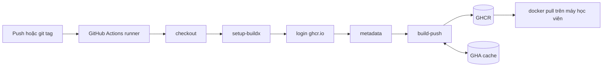

# Slide buổi 18 – Docker CI Pipeline

> **Tóm tắt:** Dùng GitHub Actions với Buildx để tự động build image club-api, gắn tag theo SHA và git tag, bật cache và publish lên GHCR bằng GITHUB_TOKEN.

## Slide 1: Mục tiêu buổi học

- Phân biệt image tag, digest và registry; vì sao không tag `latest` cho bản phát hành.
- Viết workflow build và push lên GHCR với `login-action`, `metadata-action`, `build-push-action`.
- Hiểu `GITHUB_TOKEN` và quyền `packages: write` theo least privilege.
- Bật cache `type=gha` và đo lợi ích qua thời gian build (tùy chọn).
- Pull image vừa publish về máy và kiểm tra `/health`.

---

## Slide 2: Vấn đề: "mình đã đẩy bản mới"

- Build tay trên laptop: không biết bản đang chạy từ commit nào, ai build, test chạy chưa.
- Mỗi laptop có Node, cache, biến môi trường khác nhau: cùng commit có thể ra hai image khác nhau.
- Deploy chỉ nên nói "chạy image có tag này", không phải "chạy bản mới nhất trên máy bạn Nam".
- Giải pháp: runner sạch trên GitHub build từ đúng commit, gắn tag truy vết được, đẩy lên registry.

---

## Slide 3: Image, tag, digest, registry

| Khái niệm | Ý nghĩa | Ví dụ |
| --- | --- | --- |
| Registry | Nơi lưu image | `ghcr.io` |
| Repository | Các phiên bản của một image | `ghcr.io/ten-ban/club-api` |
| Tag | Nhãn, có thể trỏ sang image khác | `sha-3f2a1bc` |
| Digest | Mã băm nội dung, bất biến | `sha256:` kèm chuỗi hex |

- Tag là con trỏ; digest mới là định danh tuyệt đối.

---

## Slide 4: Chiến lược tag

| Tag | Khi nào tạo | Mục đích |
| --- | --- | --- |
| `sha-xxxxxxx` | Mọi push vào nhánh chính | Truy vết về commit |
| `v1.2.0` | Khi đẩy git tag `v1.2.0` | Bản phát hành cho con người |
| `latest` hoặc tên nhánh | Tùy chọn | Thử nghiệm, không dùng để deploy |

- Luôn có tag SHA, kể cả khi đã có tag phiên bản.

---

## Slide 5: GHCR và GITHUB_TOKEN

- GHCR (`ghcr.io`): registry tích hợp GitHub, miễn phí cho package public.
- Tên image phải viết thường (lowercase). Package mới tạo thường mặc định private.
- `GITHUB_TOKEN`: token tạm, cấp cho mỗi lần chạy, hết hạn khi job kết thúc.
- Quyền điều khiển bằng khóa `permissions`: `contents: read` để checkout, `packages: write` để push.
- Least privilege: `contents: read` ở cấp workflow, nâng quyền chỉ ở job cần.

---

## Slide 6: Buildx và cache

- Buildx là CLI của BuildKit; `docker/setup-buildx-action` cài builder trên runner.
- Runner là máy mới mỗi lần chạy, cache layer cục bộ mất.
- Lưu cache ở dịch vụ của Actions: `cache-from: type=gha`, `cache-to: type=gha,mode=max`.
- `mode=max` lưu cả layer trung gian, như stage `dependencies` (chạy `npm ci`) của club-api.

---

## Slide 7: Ba action Docker chính thức

| Action | Việc làm |
| --- | --- |
| `docker/login-action@v3` | Đăng nhập registry |
| `docker/metadata-action@v5` | Sinh tags và labels từ ngữ cảnh Git |
| `docker/build-push-action@v6` | Build và push bằng Buildx |

- `metadata-action` nhận quy tắc (`type=sha`, `type=ref,event=tag`) rồi tự tính tag.
- Nó cũng sinh label OCI để GHCR liên kết package với repo.

---

## Slide 8: Kiến trúc pipeline

---

## Slide 9: Cách hoạt động từng bước

- Sự kiện `push` lên nhánh chính hoặc tag `v*` kích hoạt workflow.
- Runner `ubuntu-latest` checkout đúng commit.
- Login bằng `github.actor` và `GITHUB_TOKEN`; quyền ghi package đến từ khối `permissions`.
- Build đọc cache, push các tag, ghi cache mới.
- Học viên pull về, chạy thử, so sánh digest.

---

## Slide 10: Demo: từ push đến image chạy được

- Đọc to workflow publish: khối `permissions`, `login-action`, `metadata-action`. Hỏi: xóa `packages: write` thì bước nào fail?
- Push một commit nhỏ, mở tab Actions: run xanh, log `pushing manifest for ghcr.io/owner/club-api:sha-xxxxxxx`.
- Mở trang Packages: tag `sha-xxxxxxx` khớp 7 ký tự đầu của commit.
- Pull image, chạy trên cổng 3100, `curl` `/health` thấy `healthy`.
- Push lần hai: nhanh hơn vì layer `npm ci` lấy từ cache.

---

## Slide 11: Lab L1: bốn phần

- Chuẩn bị: chép source, build tay hai image để chắc Dockerfile đúng.
- Phần 1: viết workflow publish club-api (`packages: write` ở cấp job).
- Phần 2 và 3: chạy pipeline, đọc log, so tag `sha-` với commit, đổi package sang Public.
- Phần 4: pull, chạy, kiểm tra `/health`, ghi digest vào evidence.
- Lệnh và YAML đầy đủ: [Buổi 18 – Docker CI Pipeline](../../labs/week-09/session-18.md).

---

## Slide 12: Lỗi 1: thiếu packages: write

- Triệu chứng: run đỏ ở `Build and push`, log có `denied`, `permission_denied: write_package` hoặc `403`.
- Bước login vẫn xanh: login chỉ xác thực danh tính, chưa kiểm tra quyền ghi.
- Điều tra: bước đỏ đầu tiên, rồi mục `GITHUB_TOKEN Permissions` trong Set up job, rồi `permissions` ở cả cấp workflow và job.
- Gốc: token không có quyền ghi package; khai báo cấp job ghi đè cấp workflow.

---

## Slide 13: Lỗi 2: pull bị từ chối (package private)

- Triệu chứng: `denied` hoặc `unauthorized` (giống lỗi gõ sai tên image).
- Điều tra: tên chữ thường và đúng tag không; visibility của package.
- Cách xử lý: đổi Public, hoặc đăng nhập bằng PAT classic có `read:packages` qua stdin (không dán PAT vào lệnh).

---

## Slide 14: Recap

- Build trong CI từ commit sạch thì truy vết và tái lập được.
- Tag là con trỏ, digest bất biến; luôn có tag SHA.
- Pipeline chuẩn: checkout, setup-buildx, login, metadata, build-push.
- `contents: read` toàn cục, `packages: write` chỉ ở job publish.
- Cache `type=gha` với `mode=max` rút ngắn build multi-stage.
- `denied` khi push: kiểm tra quyền token; `unauthorized` khi pull: kiểm tra visibility và tên image.
- Buổi sau: [Buổi 19 – CD & Deployment Strategies](../../labs/week-10/session-19.md).
