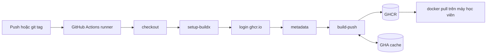

# Slide buổi 18 – Docker CI Pipeline

> **Tóm tắt:** Dùng GitHub Actions với Buildx để tự động build image club-api và club-web, gắn tag theo SHA và git tag, bật cache và publish lên GHCR bằng GITHUB_TOKEN.

## Slide 1: Mục tiêu buổi học

- Phân biệt image tag, digest và registry; vì sao không tag `latest` cho bản phát hành.
- Viết workflow build và push lên GHCR với `login-action`, `metadata-action`, `build-push-action`.
- Hiểu `GITHUB_TOKEN` và quyền `packages: write` theo least privilege.
- Bật cache `type=gha` và đo lợi ích qua thời gian build.
- Pull image vừa publish về máy và kiểm tra `/health`.

::: details Ghi chú giảng viên
Mở buổi 2 phút. Nhấn mạnh kết quả cuối: một lần push tạo ra image truy vết được về commit. Hỏi lớp: ai đã từng `docker push` từ laptop?
:::

---

## Slide 2: Vấn đề - "mình đã đẩy bản mới"

- Build tay trên laptop: không biết bản đang chạy từ commit nào, ai build, test chạy chưa.
- Mỗi laptop có Node, cache, biến môi trường khác nhau: cùng commit có thể ra hai image khác nhau.
- Deploy chỉ nên nói "chạy image có tag này", không phải "chạy bản mới nhất trên máy bạn Nam".
- Giải pháp: runner sạch trên GitHub build từ đúng commit, gắn tag truy vết được, đẩy lên registry.

::: details Ghi chú giảng viên
Kể câu chuyện ban chủ nhiệm hỏi "bản nào đang chạy" mà không ai trả lời được. 3 phút. Câu hỏi: build tay để lại dấu vết gì?
:::

---

## Slide 3: Image, tag, digest, registry

| Khái niệm | Ý nghĩa | Ví dụ |
| --- | --- | --- |
| Registry | Nơi lưu image | `ghcr.io` |
| Repository | Các phiên bản của một image | `ghcr.io/ten-ban/club-api` |
| Tag | Nhãn, có thể trỏ sang image khác | `sha-3f2a1bc` |
| Digest | Mã băm nội dung, bất biến | `sha256:` kèm chuỗi hex |

- Tag là con trỏ; digest mới là định danh tuyệt đối.

::: details Ghi chú giảng viên
Hỏi: `latest` hôm nay và `latest` tuần sau có chắc là một image không? Chốt: tag mutable, digest immutable. 3 phút.
:::

---

## Slide 4: Chiến lược tag

| Tag | Khi nào tạo | Mục đích |
| --- | --- | --- |
| `sha-xxxxxxx` | Mọi push vào nhánh chính | Truy vết về commit |
| `v1.2.0` | Khi đẩy git tag `v1.2.0` | Bản phát hành cho con người |
| `latest` hoặc tên nhánh | Tùy chọn | Thử nghiệm, không dùng để deploy |

- Luôn có tag SHA, kể cả khi đã có tag phiên bản.

::: details Ghi chú giảng viên
Cho lớp đoán vì sao cần cả hai loại tag. Đáp án: SHA cho mọi build, phiên bản chỉ khi chủ động phát hành. 2 phút.
:::

---

## Slide 5: GHCR và GITHUB_TOKEN

- GHCR (`ghcr.io`): registry tích hợp GitHub, miễn phí cho package public.
- Tên image phải viết thường (lowercase).
- `GITHUB_TOKEN`: token tạm, cấp cho mỗi lần chạy, hết hạn khi job kết thúc.
- Quyền điều khiển bằng khóa `permissions`: `contents: read` để checkout, `packages: write` để push.
- Least privilege: `contents: read` ở cấp workflow, nâng quyền chỉ ở job cần.

::: details Ghi chú giảng viên
Hỏi: vì sao runner không cần mật khẩu của bạn mà vẫn push được? Nhấn mạnh package mới tạo thường mặc định private. 3 phút.
:::

---

## Slide 6: Buildx và cache

- Buildx là CLI của BuildKit; `docker/setup-buildx-action` cài builder trên runner.
- Runner là máy mới mỗi lần chạy, cache layer cục bộ mất.
- Lưu cache ở dịch vụ của Actions: `cache-from: type=gha`, `cache-to: type=gha,mode=max`.
- `mode=max` lưu cả layer trung gian, như stage `dependencies` (chạy `npm ci`) của club-api.

::: details Ghi chú giảng viên
Liên hệ Dockerfile multi-stage đã học ở tuần 3-4. Hỏi: layer nào tốn thời gian nhất? Đáp án: `npm ci`. 3 phút.
:::

---

## Slide 7: Ba action Docker chính thức

| Action | Việc làm |
| --- | --- |
| `docker/login-action@v3` | Đăng nhập registry |
| `docker/metadata-action@v5` | Sinh tags và labels từ ngữ cảnh Git |
| `docker/build-push-action@v6` | Build và push bằng Buildx |

- `metadata-action` nhận quy tắc (`type=sha`, `type=ref,event=tag`) rồi tự tính tag.
- Nó cũng sinh label OCI để GHCR liên kết package với repo.

::: details Ghi chú giảng viên
Không đọc từng dòng YAML ở đây, chỉ giới thiệu vai trò. Phần YAML đầy đủ ở slide demo. 2 phút.
:::

---

## Slide 8: Kiến trúc pipeline



::: details Ghi chú giảng viên
Đi theo mũi tên từ trái sang phải, dừng ở bước login để nhắc `permissions`. 3 phút.
:::

---

## Slide 9: Cách hoạt động từng bước

- Sự kiện `push` lên nhánh chính hoặc tag `v*` kích hoạt workflow.
- Runner `ubuntu-latest` checkout đúng commit.
- Login bằng `github.actor` và `GITHUB_TOKEN`; quyền ghi package đến từ khối `permissions`.
- Build đọc cache, push các tag, ghi cache mới.
- Học viên pull về, chạy thử, so sánh digest.

::: details Ghi chú giảng viên
Chỉ vào `.github/workflows/publish.yml` của repo giáo trình (matrix 2 image) để đối chiếu. 2 phút.
:::

---

## Slide 10: Demo - workflow publish club-api

```yaml
name: Publish club-api
on:
  push:
    branches: [main]
permissions:
  contents: read
jobs:
  publish:
    runs-on: ubuntu-latest
    permissions:
      contents: read
      packages: write
    steps:
      - uses: actions/checkout@v4
      - uses: docker/setup-buildx-action@v3
      - uses: docker/login-action@v3
        with:
          registry: ghcr.io
          username: ${{ github.actor }}
          password: ${{ secrets.GITHUB_TOKEN }}
      - id: meta
        uses: docker/metadata-action@v5
        with:
          images: ghcr.io/${{ github.repository_owner }}/club-api
          tags: |
            type=sha
      - uses: docker/build-push-action@v6
        with:
          context: lab-18/source/backend
          push: true
          tags: ${{ steps.meta.outputs.tags }}
          labels: ${{ steps.meta.outputs.labels }}
```

::: details Ghi chú giảng viên
Hỏi lớp: nếu xóa dòng `packages: write`, bước nào fail? Nhánh chính tên `master` thì đổi `main`. 4 phút.
:::

---

## Slide 11: Demo - push, đọc log, kiểm tra package

```bash
git commit -am "demo: doi tieu de trang chu"
git push origin main
```

- Tab Actions: run xanh, mọi bước có dấu tích.
- Log bước `Build and push`: dòng `pushing manifest for ghcr.io/owner/club-api:sha-xxxxxxx`.
- Trang Packages: tag `sha-xxxxxxx` khớp 7 ký tự đầu của commit.
- Lần đầu là cache miss; push lần hai (đổi một dòng trong `app.js`) nhanh hơn vì layer `npm ci` lấy từ cache.

::: details Ghi chú giảng viên
Mở hai job matrix chạy song song nếu dùng bản `publish.yml` của giáo trình. Câu hỏi: hai tag khác nhau, tag nào mới nhất, dựa vào đâu? 4 phút.
:::

---

## Slide 12: Demo - pull và chạy image đã publish

```bash
docker pull ghcr.io/OWNER/club-api:sha-3f2a1bc
docker run --rm -d --name demo-api -p 3100:3000 ghcr.io/OWNER/club-api:sha-3f2a1bc
sleep 2
curl -s http://localhost:3100/health
docker rm -f demo-api
```

Kết quả mong đợi:

```json
{"status":"healthy","service":"club-api"}
```

- Thay `OWNER` bằng tên tài khoản viết thường và tag thật.
- Dùng cổng 3100 để không đụng stack khác trên cổng 3000.

::: details Ghi chú giảng viên
`/health` không chạm database nên chạy được mà không có Postgres. Lỗi `denied` ở đây dẫn sang slide lỗi thường gặp. 3 phút.
:::

---

## Slide 13: Lab L1 - chuẩn bị và build tay

```bash
cd ~/devops-labs
mkdir -p lab-18/source lab-18/evidence lab-18/screenshots
cp -r ~/devops-course/starter-project/backend  lab-18/source/backend
cp -r ~/devops-course/starter-project/frontend lab-18/source/frontend
rm -rf lab-18/source/backend/node_modules
docker build -t club-api:1.0.0 lab-18/source/backend
docker build -t club-web:1.0.0 lab-18/source/frontend
docker images | grep club-
```

- Kết quả mong đợi: hai dòng `club-api` và `club-web` tag `1.0.0`.
- Build tay lỗi thì CI chắc chắn lỗi: sửa ở đây trước.
- Làm việc trong filesystem WSL, không dùng `/mnt/c`.

::: details Ghi chú giảng viên
Lệnh giả định repo giáo trình ở `~/devops-course`. Dành 10 phút cho bước này. Đi quanh lớp xem ai build lỗi.
:::

---

## Slide 14: Lab L1 - viết workflow, chạy, kiểm tra

- Tạo `.github/workflows/publish.yml` ở gốc repo `devops-labs` (không nằm trong `lab-18/`).
- Dùng YAML ở slide 10, commit và push:

```bash
git add .github lab-18
git commit -m "lab-18: workflow publish club-api len GHCR"
git push origin main
```

- Tab Actions: run xanh; đọc bước đỏ đầu tiên nếu lỗi.
- So tag `sha-` với `git rev-parse --short=7 HEAD`.
- Pull, `curl /health`, ghi digest vào `evidence/command-output.txt`.

::: details Ghi chú giảng viên
Nhắc lấy digest bằng `docker inspect --format '{{index .RepoDigests 0}}' ten-image`. Package private thì đổi Public trong Package settings. Lab L1 khoảng 40 phút.
:::

---

## Slide 15: Lab L2 - thử thách tự làm

- Publish thêm `club-web` bằng matrix (một job, hai image) và tự giải thích từng dòng.
- Thêm tag theo git tag `v*`: đẩy `v1.0.0` phải có `club-api:v1.0.0` và `club-web:v1.0.0`.
- Bật cache `type=gha` (mỗi image một `scope`); đo thời gian lần 1 và lần 2.
- Pull request: build để kiểm tra nhưng không push.
- `report.md`: vì sao `GITHUB_TOKEN` an toàn hơn PAT lưu secret? Vì sao `packages: write` ở cấp job?

<details><summary>Gợi ý</summary>

- Matrix: `strategy.matrix.include` với `name` và `context`.
- Git tag: thêm `tags: ["v*"]` vào `on.push` và `type=ref,event=tag` vào `metadata-action`.
- PR: thêm `pull_request` vào `on`, đặt `push` theo điều kiện, bỏ qua login bằng `if`.
- Đẩy git tag: `git tag v1.0.0` rồi `git push origin v1.0.0`.

</details>

::: details Ghi chú giảng viên
Cho học viên L2 tự làm; không đưa lời giải ngay. Đi qua từng bàn hỏi "dòng này làm gì". Tiêu chí: GHCR có đủ 2 image, log lần 2 có CACHED, PR không tạo package.
:::

---

## Slide 16: Lỗi 1 - thiếu packages: write

- Cách phá: xóa dòng `packages: write` trong job `publish`, commit, push.
- Triệu chứng: run đỏ ở `Build and push`, log có `denied`, `permission_denied: write_package` hoặc `403`.
- Bước login vẫn xanh: login chỉ xác thực danh tính, chưa kiểm tra quyền ghi.
- Điều tra: bước đỏ đầu tiên, rồi mục `GITHUB_TOKEN Permissions` trong Set up job, rồi `permissions` ở cả cấp workflow và job.
- Gốc: token không có quyền ghi package; khai báo cấp job ghi đè cấp workflow.

::: details Ghi chú giảng viên
Liên hệ scenario-06 (GitHub Actions fail) trong `examples/troubleshooting`. Để học viên tự đoán nguyên nhân trước khi mở log. 4 phút.
:::

---

## Slide 17: Lỗi 2 - pull bị từ chối (package private)

```bash
docker logout ghcr.io
docker pull ghcr.io/OWNER/club-api:sha-3f2a1bc
```

- Triệu chứng: `denied` hoặc `unauthorized` (giống lỗi gõ sai tên image).
- Điều tra: tên chữ thường và đúng tag không; visibility của package; private thì cần đăng nhập.
- Cách xử lý: đổi Public, hoặc đăng nhập bằng PAT classic có `read:packages` qua stdin:

```bash
read -rs GHCR_TOKEN && export GHCR_TOKEN
echo "$GHCR_TOKEN" | docker login ghcr.io -u OWNER --password-stdin
```

::: details Ghi chú giảng viên
Nhấn mạnh: không dán PAT vào lệnh hay commit. Liên hệ scenario-07 (ImagePullBackOff) vì cùng họ lỗi pull. 3 phút.
:::

---

## Slide 18: Lỗi thường gặp (bảng tra nhanh)

| Triệu chứng | Cách xử lý |
| --- | --- |
| `invalid reference format` | Tên image có chữ hoa; dùng `metadata-action` |
| Không thấy tag `v1.0.0` | Thiếu `tags: ["v*"]` hoặc `type=ref,event=tag` |
| Build nào cũng chậm | Thiếu `setup-buildx-action` hoặc dòng cache |
| `failed to read dockerfile` | `context` trỏ sai thư mục |
| Workflow không chạy | File không ở `.github/workflows/` ở gốc repo, hoặc sai tên nhánh |
| Cache hai image ghi đè nhau | Thêm `scope` riêng cho mỗi image |

::: details Ghi chú giảng viên
Dùng làm checklist khi đi quanh lớp. Hỏi: dòng nào bạn đã gặp? 2 phút.
:::

---

## Slide 19: Thử thách và bài nộp

- Thử thách: giải thích tại sao tag SHA không bao giờ nên bị ghi đè, còn `v1.0.0` bị force-push thì máy đã pull có bị ảnh hưởng không.
- Nộp vào `lab-18/` theo `templates/lab-template.md`: `README.md`, `source/`, `evidence/`, `screenshots/`, `report.md`.
- `evidence/command-output.txt`: log bước push, tag trên GHCR, `docker pull`, `curl /health`, digest.
- Không commit token, PAT, mật khẩu hay `.env`; kiểm tra bằng `git diff --cached`.

::: details Ghi chú giảng viên
Gợi ý đáp án thử thách: máy đã pull vẫn giữ image cũ (theo digest), máy pull sau nhận image mới. Đó là lý do deploy nên dùng tag bất biến. 3 phút.
:::

---

## Slide 20: Recap

- Build trong CI từ commit sạch thì truy vết và tái lập được.
- Tag là con trỏ, digest bất biến; luôn có tag SHA.
- Pipeline chuẩn: checkout, setup-buildx, login, metadata, build-push.
- `contents: read` toàn cục, `packages: write` chỉ ở job publish.
- Cache `type=gha` với `mode=max` rút ngắn build multi-stage.
- `denied` khi push: kiểm tra quyền token; `unauthorized` khi pull: kiểm tra visibility và tên image.
- Buổi sau: deploy image này theo tag bất biến và rollback.

::: details Ghi chú giảng viên
Cho học viên nhắc lại một ý bằng lời của mình (exit ticket). 15 phút review cuối buổi dùng để xem evidence và giải đáp.
:::
