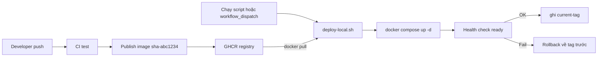
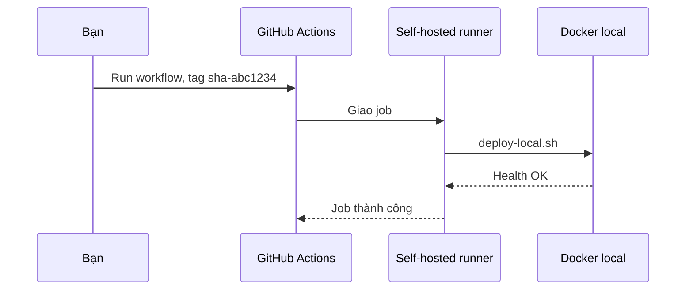

# Slide buổi 19 – CD và Deployment Strategies

> **Tóm tắt:** Viết script deploy image từ GHCR lên môi trường local có kiểm tra sức khỏe và rollback, rồi nối vào workflow_dispatch, không expose máy ra Internet.

## Slide 1: Mục tiêu buổi học

- Phân biệt Continuous Delivery và Continuous Deployment; khóa này dừng ở "có người bấm nút".
- Giải thích Recreate, Rolling, Blue/Green, Canary và đánh đổi của từng loại.
- Viết và chạy `deploy-local.sh`: pull theo tag bất biến, chạy Compose, chờ health check.
- Rollback về tag trước bằng một lệnh, chứng minh bằng log.
- Nối vào `workflow_dispatch` có input `tag`, environment và approval.

::: details Ghi chú giảng viên
2 phút. Nhắc học viên phải có image `sha-...` trên GHCR từ buổi 18, nếu chưa có thì dùng tag của mentor.
:::

---

## Slide 2: Vấn đề - "chạy được trên máy tôi"

- SSH vào máy demo, `git pull`, `docker compose up --build`, rồi cầu nguyện.
- Bản build trên máy bạn Nam dùng Node khác phiên bản, API chết đúng lúc ban chủ nhiệm xem.
- Image build lại tại chỗ, không có tên cố định, không biết quay về commit nào.
- Cần: build một lần ở CI, deploy đúng image đó, biết bản trước để rollback trong vài giây.

::: details Ghi chú giảng viên
Kể lại câu chuyện 2 phút. Hỏi lớp: nếu API chết lúc demo, bạn quay về bản trước bằng cách nào?
:::

---

## Slide 3: Delivery và Deployment

| Thuật ngữ | Ý nghĩa | Ai quyết định |
| --- | --- | --- |
| Continuous Integration | Mỗi thay đổi được build và test | Không liên quan |
| Continuous Delivery | Mọi bản qua CI sẵn sàng deploy | Con người bấm nút |
| Continuous Deployment | Bản qua CI tự lên môi trường | Pipeline |

- Khóa này dùng Continuous Delivery.
- Máy học viên không expose ra Internet nên GitHub không thể "đẩy" vào máy bạn.

::: details Ghi chú giảng viên
Hỏi: chữ "D" trong CD là gì, hai nghĩa khác nhau ở đâu? 2 phút.
:::

---

## Slide 4: Artifact bất biến và tag

| Cách đặt tag | Ví dụ | Dùng để deploy? |
| --- | --- | --- |
| Theo commit | `sha-abc1234` | Nên dùng |
| Theo phiên bản | `v1.2.0` | Nên dùng |
| Trôi nổi | `latest`, `main` | Không |

- Cùng một artifact từ staging đến production: với container, artifact là image.
- `latest` đổi nội dung theo thời gian nên không rollback chính xác được.
- Digest chắc chắn hơn tag, nhưng tag theo commit đủ cho khóa này.

::: details Ghi chú giảng viên
Câu hỏi: nếu dùng `latest`, bước rollback đưa chúng ta về đâu? 2 phút.
:::

---

## Slide 5: Environment, secrets, approval

- Environment: tên nơi deploy (ví dụ `local`); job khai báo `environment: local`.
- Secrets: lưu ở GitHub Secrets hoặc `.env` trên máy đích, không bao giờ nằm trong repo, script hay log.
- Approval: environment có thể yêu cầu reviewer duyệt trước khi job chạy.
- Required reviewers có sẵn cho repo public; repo private có thể cần gói trả phí, hãy kiểm tra tài liệu GitHub về environments.
- Không có approval: `workflow_dispatch` đã là thao tác chủ động, thêm quy ước review của nhóm.

::: details Ghi chú giảng viên
Không hứa với học viên rằng approval luôn dùng được. 3 phút.
:::

---

## Slide 6: Bốn chiến lược deploy

| Chiến lược | Cách làm | Downtime | Chi phí |
| --- | --- | --- | --- |
| Recreate | Dừng cũ, chạy mới | Có, ngắn | Thấp nhất |
| Rolling | Thay dần từng instance | Gần như không | Cần nhiều replica |
| Blue/Green | Dựng song song, chuyển traffic | Không | Gấp đôi tài nguyên |
| Canary | Một phần nhỏ traffic dùng bản mới | Không | Cần metrics và router |

- Compose trên một máy là Recreate.
- Kubernetes Deployment mặc định là Rolling.

::: details Ghi chú giảng viên
Chỉ cần hiểu khái niệm với Blue/Green và Canary. Hỏi: Compose trên một máy tương ứng chiến lược nào? 3 phút.
:::

---

## Slide 7: Rollback tốt là hành động nhàm chán

- Biết tag đang chạy và tag trước đó (ghi vào file trạng thái).
- Image bản cũ còn trên registry: không xóa tag cũ.
- Dữ liệu tương thích: rollback code không rollback database.
- Migration làm kiểu thêm trước, xóa sau.
- Rollback = deploy lại tag cũ bằng cùng một cơ chế.

::: details Ghi chú giảng viên
Tình huống cho lớp: bản mới xóa một cột rồi hỏng, rollback code đủ chưa? Đáp án: không. 3 phút.
:::

---

## Slide 8: Kiến trúc deploy local



::: details Ghi chú giảng viên
Nhấn mạnh chiều "kéo" (pull): máy local chủ động lấy image, không cần mở cổng. 3 phút.
:::

---

## Slide 9: Self-hosted runner kết nối ra



- Runner chủ động gọi ra GitHub qua HTTPS; không có kết nối đi vào.
- Máy bạn không cần mở cổng trên router hay firewall.

::: details Ghi chú giảng viên
Câu hỏi: máy này không có IP public, làm sao GitHub vẫn "ra lệnh" được? 2 phút.
:::

---

## Slide 10: Compose override chạy image từ registry

```yaml
services:
  backend:
    image: ghcr.io/${OWNER:?Set OWNER}/club-api:${TAG:?Set TAG}
  frontend:
    image: ghcr.io/${OWNER:?Set OWNER}/club-web:${TAG:?Set TAG}
```

```bash
OWNER=your-github-user TAG=sha-abc1234 docker compose -f compose.yaml -f compose.deploy.yaml config | grep "image:"
```

Kết quả mong đợi:

```text
    image: ghcr.io/your-github-user/club-api:sha-abc1234
    image: ghcr.io/your-github-user/club-web:sha-abc1234
    image: postgres:17-alpine
```

::: details Ghi chú giảng viên
Lưu tên file là `compose.deploy.yaml`. Compose gộp hai file, `--no-build` khi chạy để dùng image. 3 phút.
:::

---

## Slide 11: Demo - deploy-local.sh (phần đầu)

```bash
#!/usr/bin/env bash
set -euo pipefail

STATE_DIR=${STATE_DIR:-.deploy}
HEALTH_URL=${HEALTH_URL:-http://localhost:3000/ready}
mkdir -p "$STATE_DIR"
log() { echo "[deploy] $*"; }

current=$(cat "$STATE_DIR/current-tag" 2>/dev/null || true)
previous=$(cat "$STATE_DIR/previous-tag" 2>/dev/null || true)

if [ "${ROLLBACK:-0}" = "1" ]; then
  : "${previous:?khong co previous-tag de rollback}"
  TAG=$previous
fi
: "${OWNER:?Set OWNER}" "${TAG:?Set TAG}"
OWNER=$(echo "$OWNER" | tr '[:upper:]' '[:lower:]')

case "$TAG" in
  latest|"") log "tu choi tag 'latest'"; exit 2 ;;
esac
```

- `set -euo pipefail`: dừng khi lệnh lỗi hoặc biến chưa đặt.
- Từ chối `latest` để ép dùng artifact bất biến.

::: details Ghi chú giảng viên
Đọc từng khối ngắn. Rollback chỉ là gán `TAG=$previous` rồi chạy tiếp luồng deploy. 4 phút.
:::

---

## Slide 12: Demo - deploy-local.sh (pull, up, health)

```bash
export OWNER TAG
export COMPOSE_PROJECT_NAME=${COMPOSE_PROJECT_NAME:-club-lab19}
COMPOSE="docker compose -f compose.yaml -f compose.deploy.yaml"

log "pull image tag $TAG"
$COMPOSE pull backend frontend
log "compose up"
$COMPOSE up -d --no-build

healthy=0
for i in $(seq 1 20); do
  if curl -fsS "$HEALTH_URL" > /dev/null 2>&1; then healthy=1; break; fi
  sleep 3
done

if [ "$healthy" -eq 1 ]; then
  log "health OK"
  if [ "$TAG" != "$current" ]; then
    [ -n "$current" ] && echo "$current" > "$STATE_DIR/previous-tag"
    echo "$TAG" > "$STATE_DIR/current-tag"
  fi
  log "ghi trang thai: current=$TAG previous=${previous:-none}"
  exit 0
fi

log "health FAIL, in log backend"
$COMPOSE logs --tail 30 backend || true
if [ -n "$current" ] && [ "$TAG" != "$current" ]; then
  log "rollback ve $current"
  TAG=$current $COMPOSE up -d --no-build
fi
exit 1
```

::: details Ghi chú giảng viên
Hỏi: vì sao ghi `current-tag` chỉ sau khi health OK? Vì file phải chỉ chứa bản đã xác nhận chạy được. 4 phút.
:::

---

## Slide 13: Demo - deploy tốt rồi deploy hỏng

```bash
OWNER=your-github-user TAG=TAG_GOOD ./deploy-local.sh
OWNER=your-github-user TAG=TAG_BAD ./deploy-local.sh
cat .deploy/current-tag
```

Kết quả mong đợi (rút gọn):

```text
[deploy] pull image tag TAG_GOOD
[deploy] compose up
[deploy] health OK
[deploy] ghi trang thai: current=TAG_GOOD previous=none
...
[deploy] health FAIL, in log backend
[deploy] rollback ve TAG_GOOD
```

- Sau tối đa khoảng 60 giây chờ; `current-tag` vẫn là `TAG_GOOD`.
- `TAG_BAD`: bản build được nhưng cố ý hỏng (container thoát ngay).
- Xác nhận: `curl -s http://localhost:3000/ready`.

::: details Ghi chú giảng viên
Mentor chuẩn bị sẵn hai tag trước buổi học. Trong lúc chờ health, hỏi: rollback code có đưa dữ liệu database về như cũ không? 5 phút.
:::

---

## Slide 14: Lab L1 - chuẩn bị

```bash
cd ~/devops-labs
mkdir -p lab-19/source lab-19/evidence lab-19/screenshots
cp -r starter-project/compose.yaml starter-project/backend starter-project/frontend starter-project/database lab-19/source/
cd lab-19/source
cat > .env <<'EOF'
DB_PASSWORD=change-me-local-only
WEB_PORT=8080
COMPOSE_PROJECT_NAME=club-lab19
EOF
printf '.env\n.deploy/\n' >> .gitignore
```

- Kết quả mong đợi của `ls`: `backend  compose.yaml  database  frontend`.
- `.env` và `.deploy/` phải nằm trong `.gitignore`.
- Cho phép pull: đổi package sang Public, hoặc `docker login ghcr.io -u your-github-user` bằng PAT `read:packages`, nhập token khi được hỏi.

::: details Ghi chú giảng viên
Mật khẩu trong `.env` chỉ là giá trị local. Nhắc: không viết token vào file. 10 phút chuẩn bị.
:::

---

## Slide 15: Lab L1 - deploy, deploy lần hai, rollback

```bash
chmod +x deploy-local.sh
OWNER=your-github-user TAG=sha-abc1234 ./deploy-local.sh | tee ../evidence/command-output.txt
docker compose ps
curl -s http://localhost:3000/health
# publish bản mới, lấy tag sha-def5678, rồi:
OWNER=your-github-user TAG=sha-def5678 ./deploy-local.sh | tee -a ../evidence/command-output.txt
cat .deploy/current-tag .deploy/previous-tag
ROLLBACK=1 OWNER=your-github-user ./deploy-local.sh | tee -a ../evidence/command-output.txt
docker compose ps --format '{{.Service}} {{.Image}}'
```

- Mong đợi: ba service `Up` (postgres `healthy`), `/health` trả `{"status":"healthy","service":"club-api"}`.
- Sau lần hai: `sha-def5678` rồi `sha-abc1234`.
- Sau rollback: image quay về `sha-abc1234`; chạy rollback lần nữa sẽ "tiến" lại vì hai tag đổi chỗ.

::: details Ghi chú giảng viên
Phần 1-3 khoảng 30 phút. Giải thích hành vi hoán đổi tag sau rollback và yêu cầu học viên ghi vào report. Dùng `/ready` vì nó chạy `SELECT 1`, còn `/health` thì không chạm database.
:::

---

## Slide 16: Lab L2 - workflow_dispatch

```yaml
name: Deploy local
on:
  workflow_dispatch:
    inputs:
      tag:
        description: "Image tag, ví dụ sha-abc1234"
        required: true
        type: string
permissions:
  contents: read
concurrency:
  group: deploy-local
  cancel-in-progress: false
jobs:
  deploy:
    runs-on: [self-hosted, linux, club-local]
    environment: local
    steps:
      - uses: actions/checkout@v4
      - name: Deploy
        working-directory: lab-19/source
        env:
          OWNER: ${{ github.repository_owner }}
          TAG: ${{ inputs.tag }}
          DB_PASSWORD: ${{ secrets.DB_PASSWORD }}
          COMPOSE_PROJECT_NAME: club-lab19
        run: |
          export STATE_DIR="$HOME/.club-deploy"
          bash ./deploy-local.sh
```

::: details Ghi chú giảng viên
Giải thích: checkout dọn sạch workspace nên `.env` và `.deploy/` mất, vì vậy dùng secret `DB_PASSWORD` và đặt state ngoài workspace. Input `tag` đi qua `env`, không nhúng vào `run`. 4 phút.
:::

---

## Slide 17: Quy tắc an toàn cho self-hosted runner

- Chỉ đăng ký cho repo cá nhân hoặc nhóm private; không bao giờ cho repo public.
- Chạy bằng user thường trong WSL, không root, không sudo không mật khẩu.
- Không đặt secret cá nhân (SSH key, token) trên máy runner ngoài những gì deploy cần.
- Chỉ bật runner khi cần deploy, tắt khi xong.
- Không mở cổng nào trên router hay Windows Firewall.
- Không muốn cài runner: giữ workflow trên hosted runner chỉ để validate và dùng `docker manifest inspect`, chạy script thủ công, nêu rủi ro trong report.

::: details Ghi chú giảng viên
Tình huống: một bạn mở pull request từ fork vào repo public có runner của bạn. Rủi ro: code lạ chạy trên máy bạn. 3 phút.
:::

---

## Slide 18: Lab L2 - chặn tag không tồn tại

```bash
for img in club-api club-web; do
  if ! docker manifest inspect "ghcr.io/${OWNER}/${img}:${TAG}" > /dev/null 2>&1; then
    log "KHONG tim thay ghcr.io/${OWNER}/${img}:${TAG}, huy deploy"
    exit 3
  fi
done
```

- Đặt ngay sau `export OWNER TAG`, trước `compose pull`.
- Kiểm thử: `OWNER=your-github-user TAG=sha-khongtontai ./deploy-local.sh; echo "exit=$?"`.
- Mong đợi: `exit=3` và các service cũ vẫn `Up`.
- Tiêu chí: một lần deploy thành công, một lần tag sai bị chặn, log đính kèm.

::: details Ghi chú giảng viên
Đây là phần học viên L2 tự viết; chiếu khối này chỉ sau khi họ thử. `docker manifest inspect` trả mã khác 0 nếu tag không tồn tại hoặc không có quyền.
:::

---

## Slide 19: Lỗi - deploy xong nhưng stack không lên

```bash
sed -i 's/DB_PASSWORD=.*/DB_PASSWORD=mat-khau-moi/' .env
OWNER=your-github-user TAG=sha-abc1234 ./deploy-local.sh
```

- Triệu chứng: `health FAIL` vì `/ready` trả 503, trong khi `/health` vẫn `healthy`.
- Điều tra: `docker compose ps`, rồi `docker compose logs --tail 50 postgres` tìm `password authentication failed for user "club"`.
- Gốc: mật khẩu cố định lúc tạo volume; đổi `.env` sau đó làm backend gửi sai mật khẩu.
- Khôi phục: trả lại mật khẩu cũ rồi deploy lại cùng tag; `ROLLBACK=1` không giúp vì lỗi ở cấu hình.
- Không xóa volume để "sửa cho nhanh": sẽ mất dữ liệu.

::: details Ghi chú giảng viên
Cùng họ lỗi với scenario-03 và scenario-04. Để học viên đọc triệu chứng và tự tìm nguyên nhân trước. 5 phút.
:::

---

## Slide 20: Lỗi thường gặp và thử thách

| Triệu chứng | Cách xử lý |
| --- | --- |
| `unauthorized` hoặc `denied` khi pull | Package Public hoặc `docker login ghcr.io` đúng scope |
| `manifest unknown` | Kiểm tra tag, owner viết thường, chờ publish xong |
| Thiếu `DB_PASSWORD` | Tạo `.env` cạnh `compose.yaml` |
| Workflow Queued mãi | Không có runner online khớp label; chạy `./run.sh` |
| Mở cổng máy ra Internet | Hiểu nhầm mô hình; dùng runner kết nối ra |

- Thử thách: viết `report.md` mô tả rollback từng bước, giới hạn với database, rủi ro runner.

::: details Ghi chú giảng viên
Nộp bài vào `lab-19/`: `compose.deploy.yaml`, `deploy-local.sh`, `.gitignore`, workflow nếu L2, log evidence. Kiểm tra bằng `git grep -i password` không lộ secret. 3 phút.
:::

---

## Slide 21: Recap

- Build một lần, deploy artifact bất biến theo tag commit; không dùng `latest`.
- Mô hình pull và runner kết nối ra: không cần expose máy.
- Health check là cổng chặn trước khi ghi `current-tag`.
- Rollback là deploy lại tag trước, bằng cùng một cơ chế.
- Rollback code không hoàn tác database.
- Self-hosted runner chỉ cho repo private, user thường, bật khi cần.

::: details Ghi chú giảng viên
Exit ticket: mỗi bạn nói một lý do script ghi trạng thái sau health check. Dành 15 phút review xem log deploy và rollback.
:::
