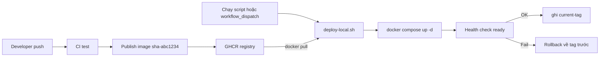
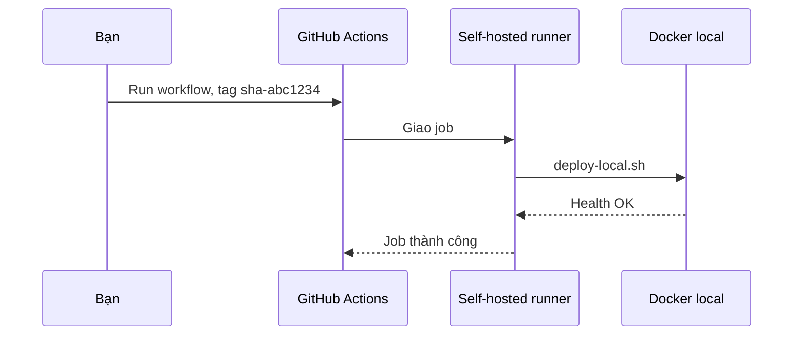

# Slide buổi 19 – CD và Deployment Strategies

> **Tóm tắt:** Viết script deploy image từ GHCR lên máy local, có kiểm tra sức khỏe và tự rollback. Chỉ chạy trên máy bạn, không expose máy ra Internet.

Bài học viên: [Buổi 19 – CD & Deployment Strategies](../../labs/week-10/session-19.md). Lệnh lab nằm trong bài học, không chép lại ở slide.

## Slide 1: Mục tiêu buổi học

- Phân biệt Continuous Delivery và Continuous Deployment; khóa này dừng ở "có người bấm nút".
- Giải thích Recreate, Rolling, Blue/Green, Canary và đánh đổi của từng loại.
- Viết và chạy `deploy-local.sh`: pull theo tag bất biến, chạy Compose, chờ health check.
- Rollback về tag trước bằng một lệnh, chứng minh bằng log.

---

## Slide 2: Vấn đề - "chạy được trên máy tôi"

- SSH vào máy demo, `git pull`, `docker compose up --build`, rồi cầu nguyện.
- Bản build trên máy bạn Nam dùng Node khác phiên bản, API chết đúng lúc ban chủ nhiệm xem.
- Image build lại tại chỗ, không có tên cố định, không biết quay về commit nào.
- Cần: build một lần ở CI, deploy đúng image đó, biết bản trước để rollback trong vài giây.

---

## Slide 3: Delivery và Deployment

| Thuật ngữ | Ý nghĩa | Ai quyết định |
| --- | --- | --- |
| Continuous Integration | Mỗi thay đổi được build và test | Không liên quan |
| Continuous Delivery | Mọi bản qua CI sẵn sàng deploy | Con người bấm nút |
| Continuous Deployment | Bản qua CI tự lên môi trường | Pipeline |

- Khóa này dùng Continuous Delivery.
- Máy học viên không expose ra Internet nên GitHub không thể "đẩy" vào máy bạn.

---

## Slide 4: Artifact bất biến và tag

| Cách đặt tag | Ví dụ | Dùng để deploy? |
| --- | --- | --- |
| Theo commit | `sha-abc1234` | Nên dùng |
| Theo phiên bản | `v1.2.0` | Nên dùng |
| Trôi nổi | `latest`, `main` | Không |

- Cùng một artifact từ staging đến production: với container, artifact là image.
- `latest` đổi nội dung theo thời gian nên không rollback chính xác được.
- Digest chắc chắn hơn tag, nhưng tag theo commit đủ cho khóa này.

---

## Slide 5: Environment, secrets, approval

- Environment: tên nơi deploy (ví dụ `local`); job khai báo `environment: local`.
- Secrets: lưu ở GitHub Secrets hoặc `.env` trên máy đích, không bao giờ nằm trong repo, script hay log.
- Approval: environment có thể yêu cầu reviewer duyệt trước khi job chạy.
- Required reviewers có sẵn cho repo public; repo private có thể cần gói trả phí, hãy kiểm tra tài liệu GitHub về environments.
- Không có approval: `workflow_dispatch` đã là thao tác chủ động, thêm quy ước review của nhóm.

---

## Slide 6: Bốn chiến lược deploy

| Chiến lược | Cách làm | Downtime | Chi phí |
| --- | --- | --- | --- |
| Recreate | Dừng cũ, chạy mới | Có, ngắn | Thấp nhất |
| Rolling | Thay dần từng instance | Gần như không | Cần nhiều replica |
| Blue/Green | Dựng song song, chuyển traffic | Không | Gấp đôi tài nguyên |
| Canary | Một phần nhỏ traffic dùng bản mới | Không | Cần metrics và router |

- Compose trên một máy là Recreate.
- Kubernetes Deployment mặc định là Rolling.

---

## Slide 7: Rollback tốt là hành động nhàm chán

- Biết tag đang chạy và tag trước đó (ghi vào file trạng thái).
- Image bản cũ còn trên registry: không xóa tag cũ.
- Dữ liệu tương thích: rollback code không rollback database.
- Migration làm kiểu thêm trước, xóa sau.
- Rollback = deploy lại tag cũ bằng cùng một cơ chế.

---

## Slide 8: Kiến trúc deploy local

- Chiều "kéo" (pull): máy local chủ động lấy image, không cần mở cổng.

---

## Slide 9: Self-hosted runner kết nối ra

- Runner chủ động gọi ra GitHub qua HTTPS; không có kết nối đi vào, không mở cổng nào.
- Chỉ cho repo private, chạy bằng user thường (không root), bật khi cần deploy, tắt khi xong.
- Không đặt secret cá nhân (SSH key, token) trên máy runner. Repo public thì tuyệt đối không dùng: người lạ mở pull request là chạy được code trên máy bạn.

---

## Slide 10: Health check và file trạng thái

- Sau `compose up`, script hỏi `/ready` (chạy `SELECT 1`), không dùng `/health` (chỉ trả JSON tĩnh).
- Chỉ ghi `current-tag` sau khi health check đạt: file luôn chứa bản đã xác nhận chạy được.
- Health fail: in log backend, rollback về `current` nếu có, thoát mã khác 0.
- Rollback chỉ là gán lại `TAG` bằng `previous` rồi đi qua cùng luồng deploy.
- Rollback hai lần liên tiếp hoán đổi hai bản, không lùi thêm một bước.

---

## Slide 11: Demo - deploy tốt rồi deploy hỏng

- Hai tag chuẩn bị sẵn: bản khỏe và bản build được nhưng cố ý hỏng (container thoát ngay).
- Deploy bản khỏe: log `health OK`, `current-tag` ghi tag mới.
- Deploy bản hỏng: sau khoảng 60 giây báo `health FAIL`, tự rollback; `current-tag` vẫn là bản khỏe.
- Xác nhận bản khỏe đã quay lại bằng `/ready`.

---

## Slide 12: Lab - ba chặng

- Chặng 1: file override `compose.deploy.yaml` chạy image từ GHCR thay vì `build`.
- Chặng 2: viết `deploy-local.sh`, deploy một tag, kiểm tra `/health` và `/api/members`.
- Chặng 3: deploy bản thứ hai, rồi `ROLLBACK=1`, chứng minh bằng log và `docker compose ps`.
- Tùy chọn: chặn tag không tồn tại, nối vào `workflow_dispatch` (input `tag` đi qua `env`).

Lệnh chi tiết: mục Hands-on lab của [Buổi 19](../../labs/week-10/session-19.md) và [Thử thách L2](../../labs/week-10/session-19-challenge.md).

---

## Slide 13: Lỗi thường gặp

| Triệu chứng | Cách xử lý |
| --- | --- |
| `unauthorized` hoặc `denied` khi pull | Package Public hoặc `docker login ghcr.io` đúng scope |
| `manifest unknown` | Kiểm tra tag, owner viết thường, chờ publish xong |
| Thiếu `DB_PASSWORD` | Tạo `.env` cạnh `compose.yaml` |
| `health FAIL` sau khi đổi mật khẩu | Mật khẩu cố định lúc tạo volume; trả lại mật khẩu cũ, không xóa volume |
| Workflow Queued mãi | Không có runner online khớp label |
| Mở cổng máy ra Internet | Hiểu nhầm mô hình; dùng runner kết nối ra |

---

## Slide 14: Recap

- Build một lần, deploy artifact bất biến theo tag commit; không dùng `latest`.
- Mô hình pull và runner kết nối ra: không cần expose máy.
- Health check là cổng chặn trước khi ghi `current-tag`.
- Rollback là deploy lại tag trước, bằng cùng một cơ chế.
- Rollback code không hoàn tác database.
- Self-hosted runner chỉ cho repo private, user thường, bật khi cần.
