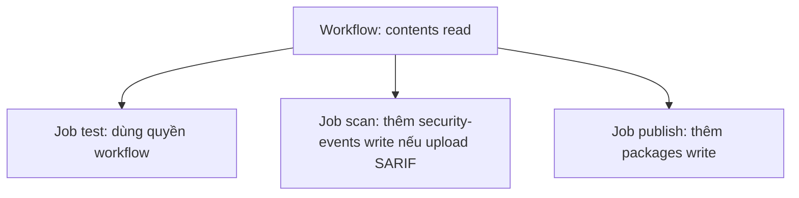
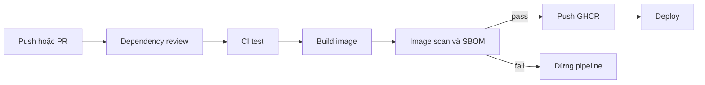

# Slide buổi 20 – Pipeline Security

> **Tóm tắt:** Rà soát quyền GITHUB_TOKEN theo least privilege, quản lý secret an toàn và quét image club-api bằng Trivy một lần. SBOM và pin SHA là phần nâng cao.

Bài học viên: [Buổi 20 – Pipeline Security](../../labs/week-10/session-20.md). Lệnh lab nằm trong bài học, không chép lại ở slide.

## Slide 1: Mục tiêu buổi học

- Giải thích least privilege và tác động của `permissions:` lên `GITHUB_TOKEN`.
- Rà soát workflow, đưa quyền về mức tối thiểu cho từng job.
- Quét `club-api:1.0.0` bằng Trivy một lần, đọc và phân loại theo severity.
- Nâng cao: SBOM CycloneDX, pin action theo commit SHA, chẩn đoán security gate.

---

## Slide 2: Vấn đề - action lạ và write-all

- Thành viên mới copy một action từ blog, đặt `permissions: write-all` cho nhanh.
- Tác giả mất tài khoản, tag `v1` bị trỏ sang mã độc.
- Lần chạy kế tiếp, mã đó đọc được `GITHUB_TOKEN` có quyền ghi vào repo và package.
- Pipeline đọc source, giữ secret, ghi registry, triển khai: mỗi dòng quyền và mỗi dependency mở rộng bề mặt tấn công.

---

## Slide 3: Least privilege và permissions

- Mỗi thành phần chỉ có quyền đủ để làm việc, trong thời gian đủ để làm việc.
- Quyền mặc định của token phụ thuộc cài đặt repo; hãy khai báo `permissions:` tường minh.
- Khi khai báo `permissions`, mọi quyền không liệt kê đều là `none`.

| Quyền | Khi nào cần |
| --- | --- |
| `contents: read` | checkout code |
| `packages: write` | đẩy image lên GHCR |
| `security-events: write` | upload SARIF vào tab Security |

---

## Slide 4: Quyền theo tầng



- Quyền cấp workflow là mức sàn cho mọi job.
- Job chỉ nâng quyền khi thật sự cần.

---

## Slide 5: Secret - làm và không làm

| Làm | Không làm |
| --- | --- |
| Lưu ở Settings, Secrets and variables, Actions | Ghi secret vào YAML, Dockerfile, `compose.yaml` |
| Truyền qua biến môi trường của đúng bước | Truyền qua tham số dòng lệnh |
| Xoay ngay khi nghi ngờ lộ | Tin rằng "xóa commit là xong" |

- Với repo local: dùng `.env` và để `.env` trong `.gitignore`.
- Không `echo` secret, không in `env`.

---

## Slide 6: Che secret trong log có giới hạn

- GitHub che secret theo kiểu khớp chuỗi.
- Giá trị bị biến đổi (base64, cắt, đảo) sẽ không bị che.
- Che log không thay thế được việc không in secret.
- Demo: in secret thô thì hiện `***`, in dạng base64 thì lộ chuỗi thật (dùng secret giả, xoay sau buổi).

---

## Slide 7: Script injection

- `${{ ... }}` được thay bằng chuỗi trước khi shell chạy.
- Dữ liệu người dùng kiểm soát (tiêu đề PR, tên nhánh, nội dung issue) nhúng vào `run:` có thể chèn lệnh.
- Cách an toàn: gán vào biến môi trường rồi dùng `"$BIEN"`.

```yaml
# Nguy hiểm
- run: echo "PR title is ${{ github.event.pull_request.title }}"

# An toàn
- env:
    PR_TITLE: ${{ github.event.pull_request.title }}
  run: echo "PR title is $PR_TITLE"
```

---

## Slide 8: Pin action theo SHA (nâng cao)

| Cách tham chiếu | Bất biến | Khuyến nghị |
| --- | --- | --- |
| `@main` | Không | Không dùng |
| `@v4` | Không, tag di chuyển được | Chấp nhận với action chính thức của GitHub, Docker |
| `@` kèm SHA 40 ký tự | Có | Dùng cho action bên thứ ba |

- Ghi chú phiên bản trong comment; Dependabot có thể tự cập nhật SHA đã pin.
- Nhược điểm: khó đọc, khó cập nhật thủ công.

---

## Slide 9: Dependency review và SBOM (nâng cao)

- Dependency review (`actions/dependency-review-action`) so sánh dependency trước và sau PR.
- Repo public bật sẵn; repo private có thể cần bật dependency graph hoặc tính năng trả phí, hãy kiểm tra tài liệu GitHub. Tại local dùng `npm audit`.
- SBOM: danh sách thành phần, phiên bản, nguồn gốc của sản phẩm (CycloneDX hoặc SPDX).
- Khi có CVE mới, SBOM trả lời trong vài phút: có dùng gói đó không, ở image nào.

---

## Slide 10: Image scanning - Trivy và Docker Scout

| Tiêu chí | Trivy | Docker Scout |
| --- | --- | --- |
| Cài đặt | Chạy bằng container | Có trong Docker Desktop |
| Đăng nhập | Không cần | Cần đăng nhập Docker Hub |
| SBOM | `--format cyclonedx` | `docker scout sbom` |
| CI | Rất phổ biến | Cần cấu hình đăng nhập |

- Không mount `docker.sock` vào container quét: xuất image ra file tar rồi quét file.
- Severity (LOW đến CRITICAL) chỉ là điểm khởi đầu.
- Mục tiêu không phải "0 lỗ hổng" mà là hiểu, ưu tiên, xử lý có chủ đích.

---

## Slide 11: Kiến trúc pipeline an toàn



- Image chỉ lên registry khi scan đạt ngưỡng đã thỏa thuận.
- Chỉ job publish có `packages: write`.

---

## Slide 12: Demo - đọc kết quả quét

- Quét `club-api:1.0.0`: mỗi loại thành phần một khối `Total: N (HIGH: x, CRITICAL: y)`.
- Hôm nay ra 0, ngày mai có thể khác 0: cơ sở dữ liệu CVE đổi liên tục dù image không đổi.
- Quét một image cũ (`node:18-alpine`) để thấy danh sách CVE; hỏi lớp: bỏ qua, nâng base image, hay vá từng gói?
- Đọc cột Library: gói của npm đi kèm base image khác với `express` hay `pg` của ứng dụng.

---

## Slide 13: Lỗi - security gate chặn pipeline

- Triệu chứng: job `image-scan` đỏ, log kết thúc bằng bảng CVE và exit code 1; test vẫn xanh.
- Điều tra: đọc dòng `Total:`; gói hệ điều hành hay `node-pkg`; cột Fixed Version; chạy lại cục bộ với `--ignore-unfixed`.
- Gốc: base image cũ, hết hỗ trợ. Pipeline đã làm đúng việc của nó.
- Xử lý có kiểm soát: nâng base image; nếu phải chấp nhận thì `.trivyignore` kèm lý do và ngày xem xét lại, không tắt gate.

| Triệu chứng | Cách xử lý |
| --- | --- |
| `denied: permission_denied` khi push | Thêm `packages: write` vào đúng job publish |
| `Resource not accessible by integration` | Thêm đúng một quyền thiếu ở cấp job |
| Trivy lỗi tải DB hoặc timeout | Chạy lại, giữ volume `trivy-cache` |

---

## Slide 14: Recap

- Khai báo `permissions` tường minh, sàn là `contents: read`, nâng quyền ở cấp job khi cần.
- Không in secret; che log chỉ là lớp bảo vệ phụ.
- Dữ liệu người dùng đi qua biến môi trường, không nhúng vào `run:`.
- Quét image mỗi lần build và định kỳ; SBOM giúp tra cứu nhanh; pin action bên thứ ba theo SHA.
- Security gate chặn pipeline là tính năng; xử lý nguyên nhân, đừng tắt gate.
