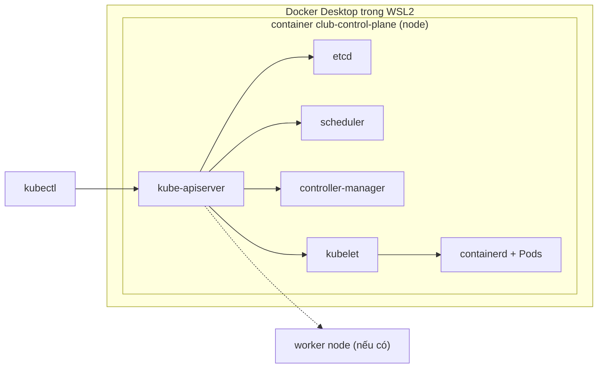

# Slide buổi 21 – Kubernetes Introduction

> **Tóm tắt:** Vì sao cần orchestration, các thành phần của Kubernetes, và dựng cluster kind club bằng kubectl. Lệnh lab nằm ở bài học, slide chỉ giữ khung.

Bài học: [Buổi 21 – Kubernetes Introduction](../../labs/week-11/session-21.md)

## Slide 1: Mục tiêu buổi học

- Giải thích vì sao Compose không đủ khi chạy nhiều bản sao trên nhiều máy.
- Phân biệt control plane và worker node, nêu vai trò từng thành phần.
- Mô tả đường đi của một yêu cầu từ `kubectl` tới container.
- Dựng cluster kind `club` và đọc được bên trong nó.
- Chẩn đoán lỗi kubectl không kết nối được cluster.

---

## Slide 2: Vấn đề thực tế

- Club Management chạy bằng `compose.yaml` trên một máy.
- Muốn 3 bản sao backend, tự khởi động lại bản chết, cập nhật không gián đoạn.
- Compose mô tả một stack trên một host, không tự dàn container sang máy khác.
- Máy hỏng là cả stack ngừng.

---

## Slide 3: Orchestration và Compose

- Orchestration: tự động hóa vòng đời container ở quy mô nhiều bản sao, nhiều máy (lên lịch, tự phục hồi, scale, cập nhật, cấu hình, mạng).
- Kubernetes (K8s) là hệ thống orchestration phổ biến nhất; stack nhỏ trên một máy vẫn nên dùng Compose.

| Nhu cầu | Compose (1 host) | Kubernetes |
| --- | --- | --- |
| Nhiều bản sao | Thủ công | Khai báo `replicas` |
| Container chết | Restart trên cùng máy | Tạo lại, có thể sang node khác |
| Cập nhật | Tự làm | Rolling update, rollback |
| Nhiều máy | Không | Mục đích thiết kế |

---

## Slide 4: Declarative và reconciliation loop

- Declarative: bạn mô tả "cái gì" (YAML), không mô tả "làm thế nào".
- Ví dụ trạng thái mong muốn: "luôn có 2 bản `club-api`".
- Reconciliation loop: controller đọc mong muốn, đọc thực tế, sửa chênh lệch, rồi lặp lại.
- Đây là ý tưởng xuyên suốt toàn bộ khóa Kubernetes.

---

## Slide 5: Thành phần control plane

| Thành phần | Vai trò |
| --- | --- |
| kube-apiserver | Cổng duy nhất của cluster |
| etcd | Kho key-value lưu trạng thái cluster |
| kube-scheduler | Chọn node cho Pod chưa có node |
| kube-controller-manager | Chạy các controller đưa thực tế về mong muốn |

- Chỉ API Server được nói chuyện với etcd.

---

## Slide 6: Thành phần trên mỗi node

| Thành phần | Vai trò |
| --- | --- |
| kubelet | Agent trên node: chạy Pod được giao, báo trạng thái |
| kube-proxy | Cài luật mạng để traffic tới Service đến đúng Pod |
| Container runtime | Thực sự chạy container (kind dùng containerd) |

- Phân biệt: kubelet lo Pod, kube-proxy lo đường mạng.

---

## Slide 7: Kiến trúc cluster

- Các thành phần không gọi trực tiếp nhau, tất cả đi qua API Server.

---

## Slide 8: Luồng một yêu cầu

1. `kubectl apply` gửi manifest tới API Server; trạng thái mong muốn được ghi vào etcd.
2. Controller thấy Deployment mới, tạo ReplicaSet rồi các Pod (chưa có node).
3. Scheduler chọn node cho Pod.
4. kubelet trên node đó bảo containerd kéo image và chạy container.
5. kubelet báo `Running`, `Ready` ngược về API Server.

---

## Slide 9: kubectl, kubeconfig và context

- `kubectl` chỉ là client gọi API Server.
- Thông tin cluster nằm ở kubeconfig, mặc định `~/.kube/config`.
- Context = cluster + user + namespace; kubectl chỉ làm việc với context hiện tại.
- Thói quen: kiểm tra `kubectl config current-context` trước khi apply.

---

## Slide 10: kind là gì

- kind = Kubernetes IN Docker: mỗi node là một container Docker.
- Tên node: `<tên-cluster>-control-plane`, `<tên-cluster>-worker`; context là `kind-<tên-cluster>`.
- Chạy hoàn toàn trên máy bạn, không expose ra Internet.
- Phù hợp học tập và CI, không phải production.
- Môi trường cả khóa: cluster `club`, context `kind-club`; máy 8 GB tắt Compose trước khi dựng kind.

---

## Slide 11: Demo

- Tạo cluster bằng `kind create cluster`.
- Cho thấy node trong `kubectl get nodes` và container trong `docker ps` là cùng một thứ.
- Liệt kê Pod trong `kube-system`: etcd, apiserver, scheduler, controller-manager, kube-proxy.
- Gọi thẳng API: `kubectl get --raw /readyz`.

---

## Slide 12: Lab

- Chuẩn bị: kiểm tra Docker, kubectl, kind.
- Phần 1: tạo cluster `club` từ `starter-project/k8s/kind-config.yaml`.
- Phần 2: xem bên trong cluster, lập bảng thành phần.
- Phần 3: tự dừng control plane rồi khôi phục.
- Lệnh chi tiết, kết quả mong đợi và bảng lỗi: xem bài học.

---

## Slide 13: Phá lỗi - dừng control plane

- Triệu chứng: `connection refused` hoặc timeout khi chạy `kubectl get nodes`.
- Điều tra theo thứ tự: Docker, rồi container node, rồi context.
- Nguyên nhân gốc: node kind là container, dừng container tương đương tắt máy chủ control plane.
- Khôi phục: `docker start` container node, đợi 30-60 giây; nếu cổng đổi thì `kind export kubeconfig --name club`.

---

## Slide 14: Recap và nộp bài

- Kubernetes là orchestration khai báo, controller liên tục đưa thực tế về mong muốn.
- Control plane: apiserver, etcd, scheduler, controller-manager; node: kubelet, kube-proxy, runtime.
- Mọi thứ đi qua API Server; chỉ API Server nói chuyện với etcd.
- kind chạy node như container; luôn kiểm tra context; giữ cluster `club` cho buổi 22.
- Nộp `lab-21/` gồm `README.md`, `evidence/command-output.txt`, `report.md`; không commit kubeconfig.
