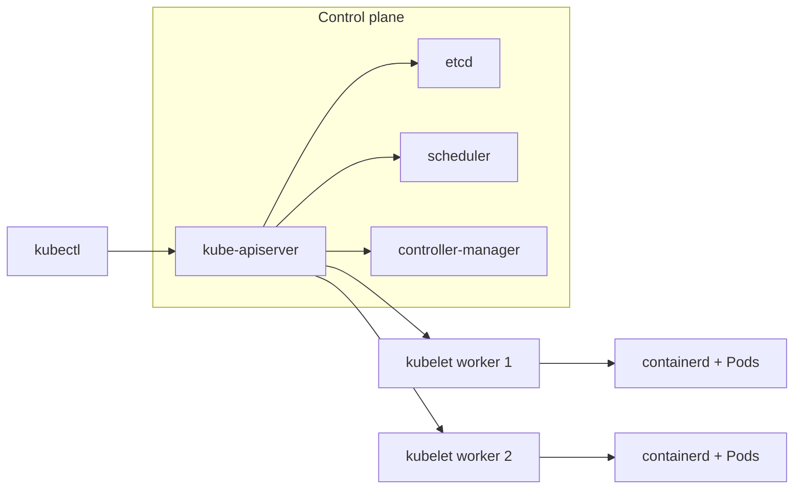

# Slide buổi 21 – Kubernetes Introduction

> **Tóm tắt:** Vì sao cần orchestration, các thành phần của Kubernetes, và dựng cluster kind 1 node và 3 node bằng kubectl.

## Slide 1: Mục tiêu buổi học

- Giải thích vì sao Compose không đủ khi chạy nhiều bản sao trên nhiều máy.
- Phân biệt control plane và worker node, nêu vai trò từng thành phần.
- Mô tả đường đi của một yêu cầu từ `kubectl` tới container.
- Cài kubectl và kind, tạo cluster 1 node và 3 node.
- Chẩn đoán lỗi kubectl không kết nối được cluster.

::: details Ghi chú giảng viên
Nêu mục tiêu trong 2 phút. Nhấn mạnh hôm nay chưa deploy ứng dụng, chỉ dựng nền để dùng cho cả tuần 11-14. Hỏi lớp: ai đã từng nghe tới Kubernetes, nghe ở đâu.
:::

---

## Slide 2: Vấn đề thực tế

- Club Management chạy bằng `compose.yaml` trên một máy.
- Muốn 3 bản sao backend, tự khởi động lại bản chết, cập nhật không gián đoạn.
- Compose mô tả một stack trên một host, không tự dàn container sang máy khác.
- Máy hỏng là cả stack ngừng.

::: details Ghi chú giảng viên
Gợi chuyện: laptop của một bạn đang chạy API, bạn đó tắt máy thì CLB mất dịch vụ. Hỏi lớp: nếu có 3 máy, ai quyết định container nào chạy ở máy nào. Khoảng 3 phút.
:::

---

## Slide 3: Orchestration là gì

- Tự động hóa vòng đời container ở quy mô nhiều bản sao, nhiều máy.
- Gồm: lên lịch, tự phục hồi, scale, cập nhật, cấu hình, mạng.
- Kubernetes (K8s) là hệ thống orchestration phổ biến nhất.
- Không thay thế Compose trong mọi trường hợp: stack nhỏ trên một máy vẫn nên dùng Compose.

::: details Ghi chú giảng viên
Chiếu bảng so sánh ở slide sau. Tránh sa đà vào lịch sử Kubernetes. 2 phút.
:::

---

## Slide 4: Compose và Kubernetes

| Nhu cầu | Compose (1 host) | Kubernetes |
| --- | --- | --- |
| Nhiều bản sao | Thủ công | Khai báo `replicas` |
| Container chết | Restart trên cùng máy | Tạo lại, có thể sang node khác |
| Cập nhật | Tự làm | Rolling update, rollback |
| Nhiều máy | Không | Mục đích thiết kế |

::: details Ghi chú giảng viên
Hỏi lớp: dòng nào là lý do quan trọng nhất với CLB của mình. Nhắc lại Kubernetes có đường cong học tập cao hơn, đó là lý do ta học từng bước. 2 phút.
:::

---

## Slide 5: Declarative và reconciliation loop

- Declarative: bạn mô tả "cái gì" (YAML), không mô tả "làm thế nào".
- Ví dụ trạng thái mong muốn: "luôn có 2 bản `club-api`".
- Reconciliation loop: controller đọc mong muốn, đọc thực tế, sửa chênh lệch, rồi lặp lại.
- Đây là ý tưởng xuyên suốt toàn bộ khóa Kubernetes.

::: details Ghi chú giảng viên
Ví dụ đời thường: điều hòa giữ 25 độ, đo nhiệt độ liên tục và bật tắt máy nén. Hỏi lớp: nếu một bản chết thì controller làm gì. 3 phút.
:::

---

## Slide 6: Các thành phần control plane

| Thành phần | Vai trò |
| --- | --- |
| kube-apiserver | Cổng duy nhất của cluster |
| etcd | Kho key-value lưu trạng thái cluster |
| kube-scheduler | Chọn node cho Pod chưa có node |
| kube-controller-manager | Chạy các controller đưa thực tế về mong muốn |

::: details Ghi chú giảng viên
Dùng ví dụ công ty: API Server là lễ tân, etcd là sổ sách, scheduler là người xếp chỗ ngồi, controller là quản lý theo dõi chỉ tiêu. Chỉ API Server được nói chuyện với etcd. 4 phút.
:::

---

## Slide 7: Các thành phần trên mỗi node

| Thành phần | Vai trò |
| --- | --- |
| kubelet | Agent trên node: chạy Pod được giao, báo trạng thái |
| kube-proxy | Cài luật mạng để traffic tới Service đến đúng Pod |
| Container runtime | Thực sự chạy container (kind dùng containerd) |

- Phân biệt: kubelet lo Pod, kube-proxy lo đường mạng.

::: details Ghi chú giảng viên
Hỏi lớp: kubelet và kube-proxy khác nhau thế nào (đây cũng là câu tự kiểm tra số 7). 2 phút.
:::

---

## Slide 8: Kiến trúc cluster



- Các thành phần không gọi trực tiếp nhau, tất cả đi qua API Server.

::: details Ghi chú giảng viên
Chỉ theo mũi tên, để lớp nhìn mô hình hình sao quanh API Server. Hỏi: vì sao thiết kế như vậy (xác thực, phân quyền, kiểm tra hợp lệ tập trung một chỗ). 3 phút.
:::

---

## Slide 9: Luồng một yêu cầu

1. `kubectl apply` gửi manifest tới API Server; trạng thái mong muốn được ghi vào etcd.
2. Controller thấy Deployment mới, tạo ReplicaSet rồi các Pod (chưa có node).
3. Scheduler chọn node cho Pod.
4. kubelet trên node đó bảo containerd kéo image và chạy container.
5. kubelet báo `Running`, `Ready` ngược về API Server.

::: details Ghi chú giảng viên
Đây là slide quan trọng nhất của buổi. Yêu cầu học viên nhắc lại luồng bằng lời của mình. Buổi 22 sẽ quay lại luồng này với Deployment thật. 4 phút.
:::

---

## Slide 10: kubectl, kubeconfig và context

- `kubectl` chỉ là client gọi API Server.
- Thông tin cluster nằm ở kubeconfig, mặc định `~/.kube/config`.
- Context = cluster + user + namespace; kubectl chỉ làm việc với context hiện tại.
- Kiểm tra bằng `kubectl config current-context`.

```bash
kubectl config current-context
kubectl config get-contexts
```

Kết quả mong đợi: tên context như `kind-club-lab`, dấu `*` đánh dấu context đang dùng. Lỗi hay gặp: chưa có context nào, hoặc đang trỏ nhầm cluster khác.

::: details Ghi chú giảng viên
Cảnh báo: làm việc trên nhầm cluster là lỗi tốn kém nhất ngoài đời thật. Tập thói quen kiểm tra context trước khi apply. 2 phút.
:::

---

## Slide 11: kind là gì

- kind = Kubernetes IN Docker: mỗi node là một container Docker.
- Tên node: `ten-cluster-control-plane`, `ten-cluster-worker`.
- Context tạo ra có tên `kind-ten-cluster`.
- Chạy hoàn toàn trên máy bạn, không expose ra Internet.
- Phù hợp học tập và CI, không phải production.

::: details Ghi chú giảng viên
Nhắc nhu cầu RAM: 4 GB cho 1 node, nên 6 GB trở lên cho 3 node. Ai máy yếu thì chỉ làm L1. 2 phút.
:::

---

## Slide 12: Demo - tạo cluster và xem node

```bash
kind create cluster --name club-demo
docker ps --format 'table {{.Names}}\t{{.Image}}'
kubectl get nodes -o wide
```

Kết quả mong đợi (rút gọn):

```text
 ✓ Starting control-plane
Set kubectl context to "kind-club-demo"
club-demo-control-plane   kindest/node:v1.30.x
club-demo-control-plane   Ready   control-plane
```

Lỗi hay gặp: `Cannot connect to the Docker daemon` nghĩa là Docker Desktop chưa chạy.

::: details Ghi chú giảng viên
Chạy trực tiếp trên máy chiếu. Điểm cần chỉ: node trong `kubectl get nodes` và container trong `docker ps` là cùng một thứ. Khoảng 5 phút kể cả thời gian chờ tạo cluster.
:::

---

## Slide 13: Demo - control plane là các Pod

```bash
kubectl get pods -n kube-system
kubectl get --raw /readyz
```

Kết quả mong đợi: các Pod `etcd-...`, `kube-apiserver-...`, `kube-scheduler-...`, `kube-controller-manager-...`, `coredns-...`, `kube-proxy-...` đều `Running`; `/readyz` trả `ok`.

- Dọn dẹp demo: `kind delete cluster --name club-demo`.

::: details Ghi chú giảng viên
Câu hỏi cho lớp: nếu scheduler ngừng, Pod đang chạy và Pod mới bị ảnh hưởng thế nào (Pod cũ vẫn chạy, Pod mới Pending). Vì sao chỉ API Server nói chuyện với etcd. 4 phút.
:::

---

## Slide 14: Lab phần 1 - cài kubectl và kind

```bash
curl -LO "https://dl.k8s.io/release/$(curl -L -s https://dl.k8s.io/release/stable.txt)/bin/linux/amd64/kubectl"
sudo install -o root -g root -m 0755 kubectl /usr/local/bin/kubectl
rm kubectl
curl -Lo ./kind https://kind.sigs.k8s.io/dl/v0.23.0/kind-linux-amd64
chmod +x ./kind && sudo mv ./kind /usr/local/bin/kind
kubectl version --client && kind version
```

Kết quả mong đợi: `Client Version: v1.3x.x` và `kind v0.23.0 ...`. Lỗi hay gặp: `command not found` do chưa nằm trong `PATH`; máy ARM đổi `amd64` thành `arm64`.

::: details Ghi chú giảng viên
Làm trong terminal WSL, thư mục `~/devops-labs/lab-21`, không dùng `/mnt/c`. Nhắc pin kind v0.23.0 để cả lớp cùng phiên bản. Đi vòng kiểm tra output. 10 phút.
:::

---

## Slide 15: Lab L1 - cluster 1 node

```bash
kind create cluster --name club-lab
kubectl config current-context
kubectl get nodes
docker ps --filter name=club-lab --format 'table {{.Names}}\t{{.Status}}'
kind delete cluster --name club-lab
```

Kết quả mong đợi: context `kind-club-lab`, node `club-lab-control-plane` trạng thái `Ready`, một container `Up`.

- Checklist L1: có `Ready`, thấy node là container, liệt kê Pod `kube-system`, xóa được cluster.
- Lỗi hay gặp: `node(s) already exist for a cluster with the name` nghĩa là chạy `kind get clusters` rồi xóa cluster cũ.

::: details Ghi chú giảng viên
Lần đầu tải image node mất 1-3 phút, tranh thủ giải thích lại luồng ở slide 9. Nhắc ghi output vào `evidence/command-output.txt` bằng `tee -a`. 15 phút.
:::

---

## Slide 16: Lab L2 - cluster 3 node bằng file cấu hình

```yaml
kind: Cluster
apiVersion: kind.x-k8s.io/v1alpha4
nodes:
  - role: control-plane
  - role: worker
  - role: worker
```

```bash
kind create cluster --name club-lab-3 --config source/kind-3-nodes.yaml
kubectl get nodes -o wide
kubectl get pods -n kube-system -o wide
kubectl describe node club-lab-3-control-plane | grep -i taints
```

Kết quả mong đợi: 3 node `Ready`; etcd, apiserver, scheduler, controller-manager chỉ ở control-plane; `kube-proxy` và `kindnet` có một Pod mỗi node; control-plane có taint `NoSchedule`.

::: details Ghi chú giảng viên
Yêu cầu học viên tự viết file YAML, không chép. Câu hỏi: vì sao control plane không nhận Pod ứng dụng. L2 làm thêm thử thách `kubectl version` và `get --raw '/readyz?verbose'` để chứng minh cluster khỏe. 20 phút.
:::

---

## Slide 17: Phá lỗi - dừng control plane

```bash
docker stop club-lab-3-control-plane
kubectl get nodes
```

Triệu chứng: `The connection to the server 127.0.0.1:xxxxx was refused` hoặc timeout.

Điều tra theo thứ tự:

1. `kubectl config current-context`: đúng context, không phải lỗi context.
2. `docker ps -a --filter name=club-lab-3`: container control-plane `Exited`.
3. Khôi phục: `docker start club-lab-3-control-plane`, đợi 30-60 giây.
4. Nếu cổng API đổi: `kind export kubeconfig --name club-lab-3`.

::: details Ghi chú giảng viên
Mentor chạy trước, lớp đoán nguyên nhân, rồi lớp tự làm lại. Kết luận: node kind là container, dừng container tương đương tắt máy chủ control plane. Kiểm tra Docker trước khi nghi ngờ Kubernetes. 8 phút.
:::

---

## Slide 18: Lỗi thường gặp

| Triệu chứng | Cách xử lý |
| --- | --- |
| `Cannot connect to the Docker daemon` | Mở Docker Desktop, bật WSL integration |
| Cluster treo, node không `Ready` | Tăng RAM cho WSL2, xóa cluster dư |
| `already exist for a cluster` | `kind get clusters`, xóa hoặc đổi tên |
| Kết quả của cluster lạ | `kubectl config use-context kind-club-lab-3` |
| `bind: address already in use` | Tìm tiến trình giữ cổng 80/443, tắt hoặc đổi `hostPort` |

::: details Ghi chú giảng viên
Lỗi `address already in use` sẽ gặp thật ở buổi 22 vì `starter-project/k8s/kind-config.yaml` map cổng 80 và 443. Liên hệ với scenario-01 (port đã được sử dụng). 2 phút.
:::

---

## Slide 19: Thử thách

- Đối chiếu `starter-project/k8s/kind-config.yaml` với file 3 node của bạn.
- Giải thích `extraPortMappings` và nhãn `ingress-ready=true`.
- Viết 3-5 câu vào `report.md`.
- Mở rộng: tạo hai cluster rồi `kubectl config use-context` sang cluster đã xóa và đọc lỗi.

::: details Ghi chú giảng viên
Gợi ý đáp án: file của starter có 1 control-plane, gắn nhãn để Ingress controller chọn đúng node, map cổng 80 và 443 ra host để truy cập `club.localhost`. Giao làm ở nhà nếu hết giờ.
:::

---

## Slide 20: Recap và nộp bài

- Kubernetes là orchestration khai báo, controller liên tục đưa thực tế về mong muốn.
- Control plane: apiserver, etcd, scheduler, controller-manager; node: kubelet, kube-proxy, runtime.
- Mọi thứ đi qua API Server; chỉ API Server nói chuyện với etcd.
- kind chạy node như container; luôn kiểm tra context.
- Kubectl không kết nối được: Docker, rồi container node, rồi context.
- Nộp `lab-21/` gồm `README.md`, `source/kind-3-nodes.yaml`, `evidence/command-output.txt`, `report.md`; không commit kubeconfig.
- Xóa cluster `club-lab-3` trước buổi 22 để giải phóng RAM.

::: details Ghi chú giảng viên
Hỏi nhanh 2-3 câu tự kiểm tra: kubectl nói chuyện trực tiếp với kubelet được không, reconciliation loop là gì. Báo trước buổi sau: Pods và Deployments trên cluster `club`. 5 phút.
:::
