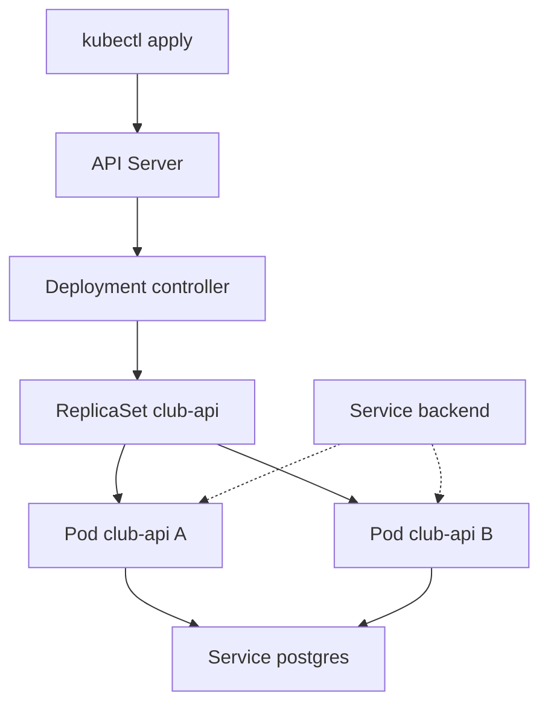
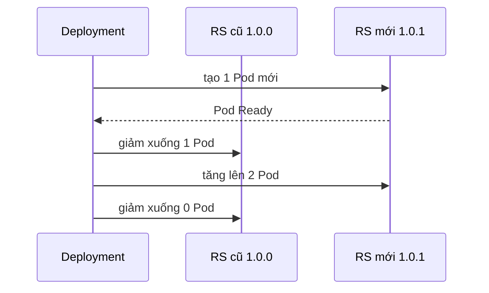

# Slide buổi 22 – Pods & Deployments

> **Tóm tắt:** Vòng đời Pod, ReplicaSet, Deployment; deploy Club API lên kind, rolling update, rollback và chẩn đoán ImagePullBackOff. Lệnh lab nằm ở bài học, slide chỉ giữ khung.

Bài học: [Buổi 22 – Pods & Deployments](../../labs/week-11/session-22.md)

## Slide 1: Mục tiêu buổi học

- Giải thích quan hệ Deployment, ReplicaSet, Pod.
- Viết manifest Deployment với labels, selector, resources, probes.
- Build image, `kind load docker-image`, apply, kiểm tra qua `kubectl port-forward`.
- Rolling update và rollback bằng `kubectl rollout`.
- Chẩn đoán ImagePullBackOff bằng `describe` và `events`.

---

## Slide 2: Vấn đề thực tế

- Club API chạy bằng Compose trên laptop một bạn.
- Container chết vì thiếu bộ nhớ, không ai biết tới khi có người mở web.
- Muốn 2 bản API phải tự sửa file, tự mở cổng.
- Cập nhật phiên bản là API sập vài giây.

---

## Slide 3: Pod

- Pod là đơn vị nhỏ nhất bạn triển khai.
- Một hoặc nhiều container chung IP, gọi nhau qua `localhost`.
- Thường mỗi Pod một container chính.
- Pod là tạm thời: bị xóa thì không tự quay lại, Pod mới có IP khác.

---

## Slide 4: Vòng đời Pod

| Phase | Ý nghĩa |
| --- | --- |
| Pending | Đã nhận, chưa có container chạy (chờ node hoặc pull image) |
| Running | Đã gán node, ít nhất một container đang chạy |
| Succeeded | Mọi container kết thúc exit code 0 (thường là Job) |
| Failed | Mọi container kết thúc, có container thất bại |
| Unknown | Mất liên lạc với node |

- `ImagePullBackOff`, `CrashLoopBackOff` là trạng thái container, không phải phase.

---

## Slide 5: ReplicaSet và Deployment

- ReplicaSet giữ đúng N Pod khớp một selector; thiếu thì tạo, thừa thì xóa.
- Deployment quản lý ReplicaSet và thêm rolling update, rollback.
- Đổi Pod template (image, env) thì Deployment tạo ReplicaSet mới; ReplicaSet cũ giữ lại với 0 Pod để rollback.

| | Pod trần | ReplicaSet | Deployment |
| --- | --- | --- | --- |
| Tự tạo lại | Không | Có | Có |
| Rolling update | Không | Không | Có |
| Rollback | Không | Không | Có |

---

## Slide 6: Labels và selectors

- Label là cặp key=value gắn lên object; selector chọn object theo label.
- Đây là cách duy nhất Kubernetes nối các object với nhau.
- `spec.selector.matchLabels` phải khớp `spec.template.metadata.labels`, nếu không API Server từ chối.
- Selector của Deployment không sửa được sau khi tạo.
- Service `backend` chọn Pod bằng `app: club-api`.

---

## Slide 7: Kiến trúc Deployment

- Đường nét đứt: Service chọn Pod theo label, chỉ khi Pod đã qua readiness probe `/ready`.

---

## Slide 8: Rolling update

- Mặc định `maxSurge: 25%`, `maxUnavailable: 25%`.
- Với 2 replicas: surge làm tròn lên thành 1, unavailable làm tròn xuống thành 0.
- Tạo thêm 1 Pod mới, chờ Ready, rồi mới xóa 1 Pod cũ, lặp lại; luôn có ít nhất 2 Pod sẵn sàng.
- Không có readiness probe thì Pod bị coi là Ready ngay khi container khởi động.

---

## Slide 9: Image trong kind

- Node kind là container có runtime riêng, không thấy image của Docker Desktop.
- Phải nạp bằng `kind load docker-image ... --name club`.
- Tag cố định `1.0.0` kèm `imagePullPolicy: IfNotPresent` thì dùng image đã nạp.
- Tránh `latest`: chính sách mặc định là `Always`, kubelet luôn cố pull.
- Thiếu bước nạp là nguyên nhân hàng đầu của ImagePullBackOff.

---

## Slide 10: Demo - Pod trần và Deployment

- Tạo Pod trần, xóa nó: không quay lại vì không có controller sở hữu.
- Tạo Deployment 3 replicas, xóa một Pod: ReplicaSet tạo Pod thay thế.
- Cho thấy chuỗi sở hữu Deployment, ReplicaSet, Pod.
- Câu hỏi: đổi label một Pod đang chạy thì ReplicaSet làm gì.

---

## Slide 11: Lab

- Phần 1: build `club-api:1.0.0` và nạp vào cluster `club`.
- Phần 2: dựng nền (namespace, ConfigMap, Secret, Postgres, `init.sql`).
- Phần 3: deploy Club API, kiểm tra qua port-forward.
- Phần 4: rolling update lên 1.0.1, xem hai ReplicaSet, rollback.
- Lệnh chi tiết và bảng lỗi: xem bài học.

---

## Slide 12: Phá lỗi - ImagePullBackOff

- Triệu chứng: `rollout status` timeout, một Pod mới `ImagePullBackOff`, hai Pod cũ vẫn `Running`.
- Dịch vụ không sập vì `maxUnavailable` bằng 0 và readiness probe giữ Pod cũ phục vụ.
- Điều tra: `get pods`, `describe pod` (Events), kiểm tra image trong node.
- Nguyên nhân gốc: tag chưa được build và nạp vào node.
- Sửa: `rollout undo`, hoặc nạp image rồi `rollout restart`.

---

## Slide 13: Lỗi thường gặp

| Triệu chứng | Cách xử lý |
| --- | --- |
| `selector does not match template labels` | Sửa cho khớp; Deployment đã tồn tại thì xóa và tạo lại |
| Pod `0/1 Running` không Ready | `kubectl logs`, kiểm tra Postgres và Secret `club-secrets` |
| `CreateContainerConfigError` | Tạo Secret hoặc apply ConfigMap còn thiếu |
| `/api/members` trả 500 | Chạy `init.sql` bằng `kubectl exec` vào `postgres-0` |
| `connection refused` tới kubectl | Sai context hoặc container node đã dừng |

---

## Slide 14: Recap và nộp bài

- Pod nhỏ nhất nhưng tạm thời; ứng dụng stateless dùng Deployment.
- Deployment quản lý ReplicaSet; labels và selectors nối các object.
- Rolling update thay Pod dần, readiness probe quyết định Pod nhận traffic.
- Bộ công cụ vận hành: `rollout status`, `history`, `undo`; timeout là lời cảnh báo.
- Với kind: `docker build`, `kind load docker-image`, tag cố định.
- Nộp `lab-22/`: `README.md`, manifest trong `source/`, evidence, ảnh hai ReplicaSet, `report.md`; không commit mật khẩu.
