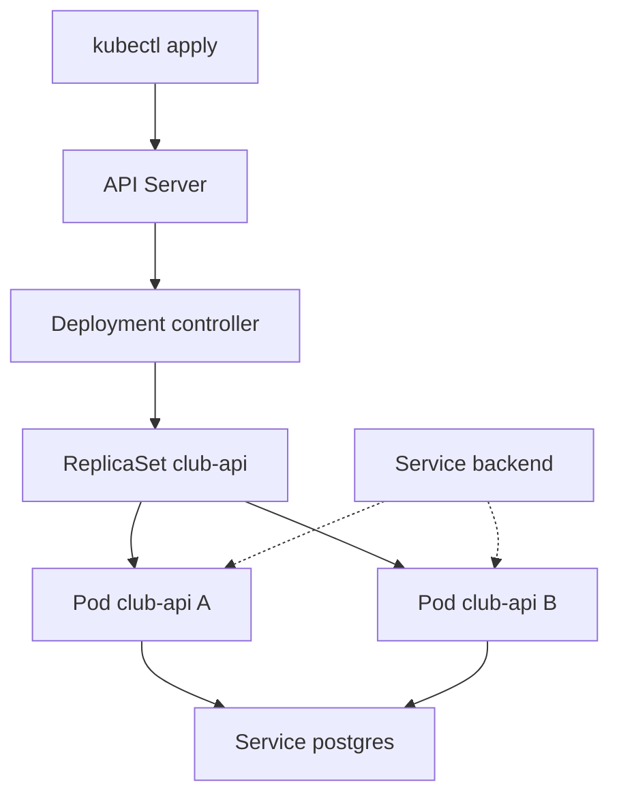
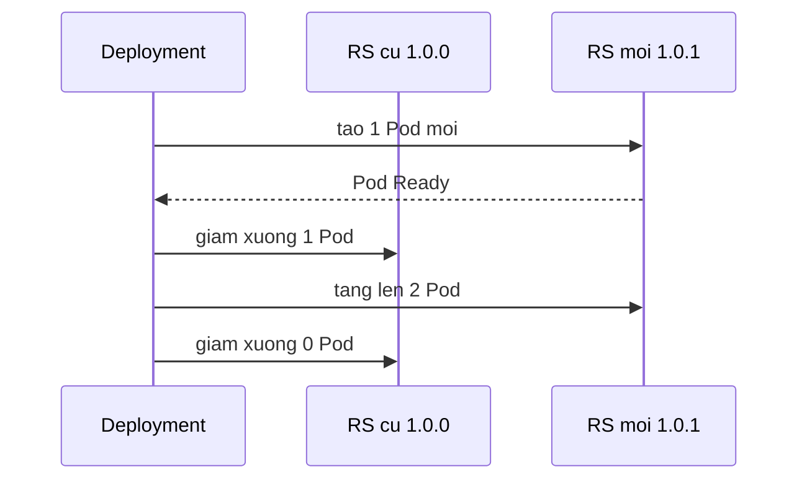

# Slide buổi 22 – Pods & Deployments

> **Tóm tắt:** Vòng đời Pod, ReplicaSet, Deployment; deploy Club API lên kind, rolling update, rollback và chẩn đoán ImagePullBackOff.

## Slide 1: Mục tiêu buổi học

- Giải thích quan hệ Deployment, ReplicaSet, Pod.
- Viết manifest Deployment với labels, selector, resources, probes.
- Build image, `kind load docker-image`, apply, kiểm tra qua `kubectl port-forward`.
- Rolling update và rollback bằng `kubectl rollout`.
- Chẩn đoán ImagePullBackOff bằng `describe` và `events`.

::: details Ghi chú giảng viên
Nhắc lại buổi 21 trong 15 phút ôn tập: control plane gồm những gì, luồng `kubectl apply`. Hôm nay là buổi đầu tiên chạy ứng dụng thật trên cluster.
:::

---

## Slide 2: Vấn đề thực tế

- Club API chạy bằng Compose trên laptop một bạn.
- Container chết vì thiếu bộ nhớ, không ai biết tới khi có người mở web.
- Muốn 2 bản API phải tự sửa file, tự mở cổng.
- Cập nhật phiên bản là API sập vài giây.

::: details Ghi chú giảng viên
Hỏi lớp: việc nào trong số này nên để máy làm. Dẫn vào ý tưởng khai báo: "luôn có 2 bản `club-api:1.0.0` chạy, qua readiness probe mới nhận traffic". 3 phút.
:::

---

## Slide 3: Pod

- Pod là đơn vị nhỏ nhất bạn triển khai.
- Một hoặc nhiều container chung IP, gọi nhau qua `localhost`.
- Thường mỗi Pod một container chính.
- Pod là tạm thời: bị xóa thì không tự quay lại, Pod mới có IP khác.

::: details Ghi chú giảng viên
Nhấn mạnh "tạm thời". Đừng hard-code IP của Pod. 2 phút.
:::

---

## Slide 4: Vòng đời Pod

| Phase | Ý nghĩa |
| --- | --- |
| Pending | Đã nhận, chưa có container chạy (chờ node hoặc pull image) |
| Running | Đã gán node, ít nhất một container đang chạy |
| Succeeded | Mọi container kết thúc exit code 0 (thường là Job) |
| Failed | Mọi container kết thúc, có container thất bại |
| Unknown | Mất liên lạc với node |

- `ImagePullBackOff`, `CrashLoopBackOff` là trạng thái container, không phải phase.

::: details Ghi chú giảng viên
Phân biệt phase (5 giá trị) với cột STATUS của `kubectl get pods` (nhiều giá trị chi tiết hơn). Sẽ gặp lại ở các scenario 08, 09. 3 phút.
:::

---

## Slide 5: ReplicaSet và Deployment

- ReplicaSet giữ đúng N Pod khớp một selector; thiếu thì tạo, thừa thì xóa.
- Deployment quản lý ReplicaSet và thêm rolling update, rollback.
- Đổi Pod template (image, env) thì Deployment tạo ReplicaSet mới.
- ReplicaSet cũ giữ lại với 0 Pod để rollback.

| | Pod trần | ReplicaSet | Deployment |
| --- | --- | --- | --- |
| Tự tạo lại | Không | Có | Có |
| Rolling update | Không | Không | Có |
| Rollback | Không | Không | Có |

::: details Ghi chú giảng viên
Quy tắc: ứng dụng stateless như Club API luôn dùng Deployment; Pod trần chỉ để thử nghiệm. 3 phút.
:::

---

## Slide 6: Labels và selectors

- Label là cặp key=value gắn lên object; selector chọn object theo label.
- Đây là cách duy nhất Kubernetes nối các object với nhau.
- `spec.selector.matchLabels` phải khớp `spec.template.metadata.labels`, nếu không API server từ chối.
- Selector của Deployment không sửa được sau khi tạo.
- Service `backend` chọn Pod bằng `app: club-api`.

::: details Ghi chú giảng viên
Câu hỏi: nếu tôi đổi label một Pod đang chạy thành `app=other` thì sao (Pod rời ReplicaSet và Service, ReplicaSet tạo Pod mới). 3 phút.
:::

---

## Slide 7: Kiến trúc Deployment



- Đường nét đứt: Service chọn Pod theo label.

::: details Ghi chú giảng viên
Đi từ trên xuống, liên hệ luồng 5 bước của buổi 21. Chỉ rõ Pod chỉ vào endpoint của Service sau khi readiness probe `/ready` trả 200. 3 phút.
:::

---

## Slide 8: Rolling update

- Mặc định `maxSurge: 25%`, `maxUnavailable: 25%`.
- Với 2 replicas: surge làm tròn lên thành 1, unavailable làm tròn xuống thành 0.
- Tạo thêm 1 Pod mới, chờ Ready, rồi mới xóa 1 Pod cũ, lặp lại.
- Luôn có ít nhất 2 Pod sẵn sàng.
- Không có readiness probe thì Pod bị coi là Ready ngay khi container khởi động.



::: details Ghi chú giảng viên
Viết số lên bảng: 2 replicas, tối đa 3 Pod, tối thiểu 2 Ready. Hỏi: nếu bỏ readiness probe thì rủi ro là gì. 4 phút.
:::

---

## Slide 9: Image trong kind

- Node kind là container có runtime riêng, không thấy image của Docker Desktop.
- Phải nạp bằng `kind load docker-image`.
- Tag cố định `1.0.0` kèm `imagePullPolicy: IfNotPresent` thì dùng image đã nạp.
- Tránh `latest`: chính sách mặc định là `Always`, kubelet luôn cố pull.
- Thiếu bước nạp là nguyên nhân hàng đầu của ImagePullBackOff.

::: details Ghi chú giảng viên
Ngoài đời thật image nằm ở registry (GHCR); `kind load` chỉ là cách học local. 2 phút.
:::

---

## Slide 10: Demo - Pod trần và Deployment

```bash
kubectl apply -f k8s/namespace.yaml
kubectl run demo-nginx --image=nginx:1.27-alpine -n club
kubectl delete pod demo-nginx -n club
kubectl get pods -n club
```

Kết quả mong đợi: `No resources found in club namespace.` Pod trần không quay lại vì không có controller sở hữu.

- Ghi chú: bản YAML tương đương nằm ở `examples/kubernetes/01-pod.yaml`.
- Lỗi hay gặp: `namespaces "club" not found` nghĩa là chưa apply `namespace.yaml`; mạng yếu thì `docker pull` và `kind load` image nginx trước.

::: details Ghi chú giảng viên
Trước khi xóa, hỏi lớp: ai nghĩ Pod sẽ tự quay lại. Cluster `club` của mentor tạo từ `starter-project/k8s/kind-config.yaml`. 4 phút.
:::

---

## Slide 11: Demo - Deployment tự chữa lành

```bash
kubectl create deployment demo-nginx --image=nginx:1.27-alpine --replicas=3 -n club
POD=$(kubectl get pods -n club -l app=demo-nginx -o name | head -1)
kubectl delete "$POD" -n club
kubectl get deployment,replicaset,pod -n club -l app=demo-nginx
kubectl delete deployment demo-nginx -n club
```

Kết quả mong đợi: vẫn đủ 3 Pod, một Pod có AGE vài giây; một Deployment, một ReplicaSet có hậu tố hash, ba Pod.

::: details Ghi chú giảng viên
Cho lớp thấy chuỗi sở hữu: Deployment, ReplicaSet, Pod (có thể in `ownerReferences[0].kind` ra `ReplicaSet`). Nhớ dọn dẹp cuối demo. 5 phút.
:::

---

## Slide 12: Lab phần 1 - build và nạp image

```bash
cd ~/devops-labs/lab-22/source/starter-project
docker build -t club-api:1.0.0 ./backend
kind load docker-image club-api:1.0.0 --name club
docker exec club-control-plane crictl images | grep club-api
```

Kết quả mong đợi: một dòng `docker.io/library/club-api   1.0.0   ...` trong node.

- Lỗi hay gặp: quên `--name club` thì nạp vào cluster sai hoặc báo không tìm thấy cluster.
- Cổng 80 và 443 của máy phải rảnh khi tạo cluster `club`.

::: details Ghi chú giảng viên
Kiểm tra mọi người có `kubectl config current-context` là `kind-club`. Ai còn cluster buổi 21 thì xóa trước để giải phóng RAM. 8 phút.
:::

---

## Slide 13: Lab phần 2 - nền: config, secret, Postgres

```bash
kubectl apply -f k8s/namespace.yaml
kubectl apply -f k8s/configmap.yaml
read -rsp "DB password (local): " DB_PASS; echo
kubectl create secret generic club-secrets -n club --from-literal=db-password="$DB_PASS"
unset DB_PASS
kubectl apply -f k8s/postgres.yaml
kubectl rollout status statefulset/postgres -n club --timeout=120s
kubectl exec -i -n club postgres-0 -- psql -U club -d clubdb < database/init.sql
```

Kết quả mong đợi: `secret/club-secrets created`, StatefulSet rolled out, `CREATE TABLE` và `INSERT 0 2`.

- Không ghi mật khẩu vào file được commit.
- Thiếu bảng `members` thì `/api/members` trả 500.

::: details Ghi chú giảng viên
Giải thích ngắn: Secret học kỹ ở buổi 25, init.sql dạng ConfigMap volume cũng để buổi 25. Phần này chỉ dựng tối thiểu. 8 phút.
:::

---

## Slide 14: Lab phần 3 - deploy Club API

```bash
kubectl apply -f k8s/backend.yaml
kubectl rollout status deployment/club-api -n club --timeout=120s
kubectl get deployment,replicaset,pod -n club -l app=club-api
kubectl port-forward -n club svc/backend 3000:3000
```

Terminal thứ hai:

```bash
curl -s localhost:3000/health
curl -s localhost:3000/api/members
```

Kết quả mong đợi: `deployment "club-api" successfully rolled out`, 2 Pod `1/1 Running`, `{"status":"healthy","service":"club-api"}` và danh sách Alice, Bob.

::: details Ghi chú giảng viên
Trước khi apply, cho học viên đọc `k8s/backend.yaml` và trả lời: label nào nối Deployment với Pod, probe nào chặn traffic, `DB_HOST` đến từ đâu. Lưu ý port-forward chỉ mở 127.0.0.1. Nếu cổng 3000 bận thì đổi `3001:3000`. 10 phút.
:::

---

## Slide 15: Lab phần 4 - rolling update và rollback

```bash
docker build -t club-api:1.0.1 ./backend
kind load docker-image club-api:1.0.1 --name club
kubectl set image deployment/club-api api=club-api:1.0.1 -n club
kubectl rollout status deployment/club-api -n club
kubectl rollout history deployment/club-api -n club
kubectl rollout undo deployment/club-api -n club
kubectl get deployment club-api -n club -o jsonpath='{.spec.template.spec.containers[0].image}'
```

Kết quả mong đợi: hai ReplicaSet (2 Pod bản mới, 0 Pod bản cũ), history có REVISION 1 và 2, dòng cuối in `club-api:1.0.0` sau rollback.

- Mở terminal thứ hai chạy `kubectl get pods -n club -l app=club-api -w` để xem Pod thay dần.

::: details Ghi chú giảng viên
Chưa muốn sửa code thì dùng `docker tag club-api:1.0.0 club-api:1.0.1`. Câu hỏi: sau `undo`, ReplicaSet mới hay cũ được dùng lại (cũ). 12 phút.
:::

---

## Slide 16: Phá lỗi - ImagePullBackOff

```bash
kubectl set image deployment/club-api api=club-api:1.0.9 -n club
kubectl rollout status deployment/club-api -n club --timeout=30s
kubectl get pods -n club -l app=club-api
```

Triệu chứng: `error: timed out waiting for the condition`, một Pod mới `ImagePullBackOff`, hai Pod cũ vẫn `Running`.

- Dịch vụ không sập: `maxUnavailable` bằng 0 và readiness probe giữ Pod cũ phục vụ.
- Có thể thấy `ErrImagePull` trước khi sang `ImagePullBackOff`.

::: details Ghi chú giảng viên
Học viên chỉ nhận triệu chứng (scenario-07), chưa cho biết nguyên nhân. Cho 3 phút để đoán. Nhấn: coi `timed out` là tín hiệu phải điều tra, không phải đợi thêm. 5 phút.
:::

---

## Slide 17: Điều tra và sửa ImagePullBackOff

```bash
kubectl describe pod -n club -l app=club-api | sed -n '/Events:/,$p'
kubectl get events -n club --sort-by=.lastTimestamp | tail -8
docker exec club-control-plane crictl images | grep club-api
```

1. Events có `Failed to pull image "club-api:1.0.9"` và `Back-off pulling image`.
2. `crictl` chỉ thấy `1.0.0` và `1.0.1`, không có `1.0.9`.
3. Nguyên nhân gốc: tag chưa tồn tại trong node và không có trên registry công khai.
4. Sửa: gõ sai tag thì `kubectl rollout undo deployment/club-api -n club`; quên nạp thì `kind load docker-image` rồi `kubectl rollout restart`.

::: details Ghi chú giảng viên
Quy trình debug cố định: get pods, describe (Events), logs. Phòng tránh: luôn `kind load` ngay sau `docker build`, dùng tag cố định, luôn `rollout status`. 5 phút.
:::

---

## Slide 18: Lỗi thường gặp

| Triệu chứng | Cách xử lý |
| --- | --- |
| `selector does not match template labels` | Sửa cho khớp; Deployment đã tồn tại thì xóa và tạo lại |
| Pod `0/1 Running` không Ready | `kubectl logs`, kiểm tra Postgres và Secret `club-secrets` |
| `CreateContainerConfigError` | Tạo Secret hoặc apply ConfigMap còn thiếu |
| `/api/members` trả 500 | Chạy `init.sql` bằng `kubectl exec` vào `postgres-0` |
| `connection refused` tới kubectl | Sai context hoặc cluster đã bị xóa |

::: details Ghi chú giảng viên
Chọn 2 dòng gắn với lỗi học viên đang gặp trong lớp để giải thích sâu. Liên hệ scenario-10 (readiness probe fail) cho dòng thứ hai. 3 phút.
:::

---

## Slide 19: Thử thách L2

- Thử thách 1: tự viết Deployment `club-api-canary` (1 replica, image `club-api:1.0.1`, labels `app: club-api` và `track: canary`, Secret cho `DB_PASSWORD`, ConfigMap cho biến còn lại, readinessProbe, resources).
- Tiêu chí: `kubectl get endpointslices -n club -l kubernetes.io/service-name=backend` có 3 địa chỉ; giải thích vì sao Service tự nhận Pod canary.
- Thử thách 2: `strategy` với `maxSurge: 1`, `maxUnavailable: 0`, `replicas: 4`; giải thích vì sao tối đa 5 Pod, tối thiểu 4 Ready.
- Sửa manifest rồi `kubectl apply`, không dùng `kubectl edit`.

::: details Ghi chú giảng viên
Gợi ý: selector là tập con của label trong template; Service chỉ chọn `app: club-api`. Đáp án thử thách 2: replicas cộng surge bằng 5, replicas trừ unavailable bằng 4. Học viên L1 chỉ cần xem mẫu. Dọn dẹp bằng `kubectl delete deployment club-api-canary -n club`.
:::

---

## Slide 20: Recap và nộp bài

- Pod nhỏ nhất nhưng tạm thời; ứng dụng stateless dùng Deployment.
- Deployment quản lý ReplicaSet, ReplicaSet giữ đúng số Pod theo selector.
- Labels và selectors nối các object; selector phải khớp template và không sửa được.
- Rolling update thay Pod dần, readiness probe quyết định Pod nhận traffic.
- Bộ công cụ vận hành: `rollout status`, `history`, `undo`; timeout là lời cảnh báo.
- Với kind: `docker build`, `kind load docker-image`, tag cố định.
- Nộp `lab-22/`: `README.md`, manifest trong `source/`, `evidence/command-output.txt`, ảnh hai ReplicaSet, `report.md` về ImagePullBackOff; không commit mật khẩu.

::: details Ghi chú giảng viên
Hỏi nhanh: sau `kubectl set image` lên tag mới mà rollout treo, ba lệnh đầu tiên là gì. Báo trước buổi sau: Service, mạng và Ingress với cluster `club` đang chạy. 5 phút.
:::
