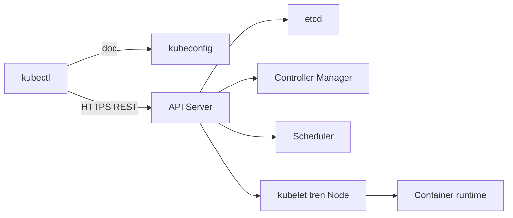
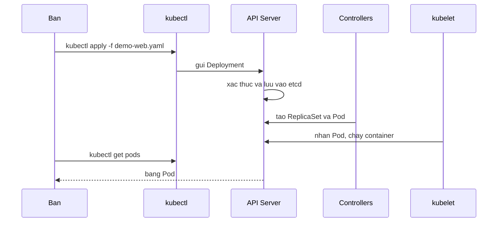

# Slide buổi 23 – kubectl Fundamentals

> **Tóm tắt:** Dùng kubectl thành thạo để chọn đúng cluster và namespace, apply manifest, đọc trạng thái, log, exec, port-forward và trích dữ liệu bằng -o yaml, jsonpath. Bài lab đầy đủ: [Buổi 23](../../labs/week-12/session-23.md).

## Slide 1: Mục tiêu buổi học

- Hiểu kubectl nói chuyện với cluster qua kubeconfig, context và API Server.
- Luôn biết lệnh của mình đang tác động vào cluster nào, namespace nào.
- Chạy vòng đời `apply`, `get`, `describe`, `logs`, `exec`, `port-forward`, `delete`.
- Trích dữ liệu bằng `-o wide`, `-o yaml`, `-o jsonpath`, `-o custom-columns`.
- Chẩn đoán Deployment lỗi bằng `describe` và events thay vì đoán mò.

::: details Ghi chú giảng viên
Đọc nhanh 5 mục tiêu, không giải thích sâu (2 phút). Hỏi lớp: ai đã từng gõ `kubectl get pods` và thấy "No resources found"? Cuối buổi quay lại danh sách này để tự đánh giá.
:::

---

## Slide 2: Vấn đề thực tế – "Pod biến mất"

- Tối trước buổi sinh hoạt CLB, có tin nhắn "web điểm danh bị lỗi".
- Gõ `kubectl get pods` và nhận `No resources found`.
- Workload không mất: bạn đang nhìn namespace `default`, ứng dụng nằm ở `club`.
- Tệ hơn: `kubectl delete` nhầm vì context cũ vẫn đang được chọn.

::: details Ghi chú giảng viên
Kể như một câu chuyện (2 phút). Nhấn mạnh: kubectl là công cụ duy nhất dùng hằng ngày, dùng sai ngữ cảnh gây sự cố thật. Câu hỏi: "Có cách nào biết ngay mình đang đứng ở đâu?"
:::

---

## Slide 3: kubeconfig, cluster, user, context

- kubectl không "biết" cluster nào, nó đọc file kubeconfig (mặc định `~/.kube/config`, đổi bằng biến `KUBECONFIG`).
- cluster: địa chỉ API Server và CA.
- user: thông tin xác thực (chứng chỉ, token).
- context: bộ ba cluster + user + namespace mặc định.
- current-context: context đang dùng cho mọi lệnh.

::: details Ghi chú giảng viên
Vẽ ba hộp rồi một mũi tên "context" nối chúng. Với kind, tên context có dạng `kind-` cộng tên cluster (mặc định `kind-kind`). Lưu ý không bao giờ commit `~/.kube/config` vào Git.
:::

---

## Slide 4: Namespace – ranh giới logic

- Namespace nhóm và tách tài nguyên trong cùng một cluster.
- Tên chỉ cần duy nhất trong một namespace.
- Không chỉ định thì dùng namespace của context (mặc định `default`).
- Node, Namespace, PersistentVolume là cluster-scoped, không thuộc namespace nào.

```bash
kubectl get pods
kubectl get pods -n club
```

```text
No resources found in default namespace.
NAME                        READY   STATUS    RESTARTS   AGE
demo-web-6d9c8f7b5d-4xk2p   1/1     Running   0          20s
```

::: details Ghi chú giảng viên
Chạy hai lệnh trực tiếp. Kết quả thứ hai chỉ có nếu đã có workload ở `club`. Hỏi lớp: "Workload có mất không?" rồi chỉ ra cờ `-n`.
:::

---

## Slide 5: Kiến trúc – kubectl chỉ là client HTTP



- kubectl không tạo Pod, nó gửi yêu cầu tới API Server.
- Các thành phần khác phản ứng với dữ liệu trong etcd.

::: details Ghi chú giảng viên
Đây là sơ đồ quan trọng nhất buổi (3 phút). Câu hỏi: "Nếu API Server chết thì Pod đang chạy có chết không?" (Không, kubelet vẫn giữ container, nhưng không thể thay đổi gì.)
:::

---

## Slide 6: Chuyện gì xảy ra khi `kubectl apply`



- Desired state được lưu trước, thực tế đuổi theo sau vài giây.

::: details Ghi chú giảng viên
Giải thích vì sao `get` ngay sau `apply` có thể thấy Pod `ContainerCreating`. Nhắc: `logs` và `exec` đi qua API Server tới kubelet; `port-forward` cũng qua API Server nên không cần Service.
:::

---

## Slide 7: Declarative và imperative

- Declarative (`apply -f`): nguồn sự thật là file manifest trong Git, tái lập và review được.
- Imperative (`create`, `scale`, `edit`): nguồn sự thật là trạng thái live, không để lại dấu vết.
- Quy tắc khóa học: khai báo bằng file; dùng imperative để thử hoặc khắc phục khẩn.
- Sau khi sửa khẩn, phải đưa thay đổi về manifest.

::: details Ghi chú giảng viên
Cho một ví dụ: đồng đội `kubectl scale` lên 5 để chịu tải, sáng hôm sau số Pod về 2 vì pipeline apply lại manifest. Hỏi lớp ai chịu trách nhiệm.
:::

---

## Slide 8: Demo 1 – context, namespace, dry-run

```bash
kubectl config get-contexts
kubectl get pods -n club
kubectl create deployment demo --image=nginx:1.27-alpine --replicas=2 --dry-run=client -o yaml
```

```text
CURRENT   NAME        CLUSTER     AUTHINFO    NAMESPACE
*         kind-kind   kind-kind   kind-kind
```

- Lệnh cuối chỉ in YAML, không tạo gì trong cluster.
- `--dry-run=client` dựng object ở máy bạn; `--dry-run=server` gửi lên API Server kiểm tra nhưng không lưu.

::: details Ghi chú giảng viên
Demo khoảng 3 phút. Dùng cách này để sinh YAML mẫu mà không cần nhớ cú pháp. Nếu cluster chưa chạy, lệnh đầu báo lỗi kết nối: dùng `kind get clusters` và kiểm tra Docker Desktop.
:::

---

## Slide 9: Demo 2 – nhìn kubectl gọi REST

```bash
kubectl get pods -n club -v=6 2>&1 | head -5
```

```text
GET https://127.0.0.1:xxxxx/api/v1/namespaces/club/pods?limit=500 200 OK
```

- Địa chỉ là API Server của kind, chỉ lắng nghe trên máy bạn.
- Cờ `-v=6` in các request HTTP kubectl gửi đi.
- Xoá một Pod do Deployment quản lý và quan sát Pod mới xuất hiện: ReplicaSet giữ đủ `replicas`.

::: details Ghi chú giảng viên
Hỏi lớp: "Ai tạo lại Pod? Nếu xoá Deployment thì sao?" Dùng `kubectl explain deployment.spec.strategy` để cho thấy tài liệu có sẵn trong terminal (1 phút).
:::

---

## Slide 10: Lab bước 0 – chuẩn bị và ngữ cảnh

```bash
mkdir -p ~/devops-labs/lab-23/{source,screenshots,evidence}
cd ~/devops-labs/lab-23
kubectl config current-context
kubectl create namespace club-dev
kubectl config set-context --current --namespace=club
kubectl config view --minify | grep namespace
```

```text
kind-kind
namespace/club-dev created
    namespace: club
```

- Làm trong filesystem của WSL, không dùng `/mnt/c`.
- Quy ước: vẫn gõ `-n` tường minh trong lệnh ghi vào bằng chứng và script.

::: details Ghi chú giảng viên
Phát file `namespace.yaml` và `demo-web.yaml` ở bài lab. Nếu `club` đã tồn tại, `apply` báo `unchanged` hoặc `configured`, đều bình thường.
:::

---

## Slide 11: Lab – diff, apply, rollout

```bash
kubectl diff -f source/demo-web.yaml
kubectl apply -f source/demo-web.yaml
kubectl rollout status deployment/demo-web -n club
kubectl get pods -n club -l app=demo-web -o wide
```

```text
deployment.apps/demo-web created
deployment "demo-web" successfully rolled out
NAME                        READY   STATUS    RESTARTS   AGE
demo-web-6d9c8f7b5d-4xk2p   1/1     Running   0          20s
```

- Thói quen tốt: `diff` trước, `apply` sau, `rollout status` để chờ.
- Tên Pod trên máy bạn sẽ khác, hậu tố là ngẫu nhiên.

::: details Ghi chú giảng viên
`kubectl diff` lần đầu in toàn bộ object và có thể kèm cảnh báo không đáng lo. Nhắc `get all` không thật sự lấy tất cả (không có ConfigMap, Secret, Ingress).
:::

---

## Slide 12: Lab – describe và events

```bash
POD=$(kubectl get pods -n club -l app=demo-web -o jsonpath='{.items[0].metadata.name}')
kubectl describe pod "$POD" -n club
kubectl get events -n club --sort-by=.lastTimestamp
```

- Đọc `describe` từ trên xuống: Node, IP, Image, State, Conditions, rồi Events.
- Events cho biết Scheduled, Pulled, Created, Started.
- Events chỉ lưu khoảng một giờ, hãy xem ngay khi có sự cố.
- Tra cấu trúc nhanh: `kubectl explain deployment.spec.replicas`.

::: details Ghi chú giảng viên
Dạy thói quen: Pod không chạy thì `describe` trước, nguyên nhân thường nằm ở Events. Cho học viên 3 phút tự đọc rồi gọi vài bạn nêu 3 sự kiện đầu.
:::

---

## Slide 13: Lab – logs, exec, port-forward

```bash
kubectl port-forward deployment/demo-web 8081:80 -n club
curl -sI http://localhost:8081 | head -3
kubectl logs -n club -l app=demo-web --tail=3 --prefix
kubectl exec -it -n club "$POD" -- sh
```

```text
Forwarding from 127.0.0.1:8081 -> 80
HTTP/1.1 200 OK
[pod/demo-web-6d9c8f7b5d-q8m7t/web] 127.0.0.1 - - "HEAD / HTTP/1.1" 200 0
```

- Lệnh `port-forward` giữ terminal: chạy ở cửa sổ thứ hai, dừng bằng Ctrl+C.
- Dấu `--` tách cờ của kubectl khỏi lệnh trong container. Image alpine chỉ có `sh`.
- Lọc nhiễu của readiness probe bằng `grep -v kube-probe`.

::: details Ghi chú giảng viên
Dùng cổng 8081 vì 8080 thường bị Compose chiếm. Nhấn: thay đổi trong container sẽ mất khi Pod bị tạo lại; `port-forward` chỉ là công cụ gỡ lỗi, không thay Service.
:::

---

## Slide 14: Lab – định dạng đầu ra

```bash
kubectl get deployment demo-web -n club -o jsonpath='{.spec.template.spec.containers[0].image}'; echo
kubectl get pods -n club -l app=demo-web -o jsonpath='{range .items[*]}{.metadata.name}{"\t"}{.status.podIP}{"\n"}{end}'
kubectl get pods -n club -o custom-columns=NAME:.metadata.name,NODE:.spec.nodeName
```

```text
nginx:1.27-alpine
demo-web-6d9c8f7b5d-q8m7t	10.244.0.12
```

- Một object có tên thì không có `.items`; nhiều object thì có.
- Đặt jsonpath trong dấu nháy đơn để shell không xử lý `{`, `*`, `$`.
- Jsonpath rỗng: chạy `-o yaml` để xem cấu trúc rồi viết lại đường dẫn.

::: details Ghi chú giảng viên
So sánh `spec` (bạn khai báo) với `status` (Kubernetes ghi lại). Nhắc `-o name` để truyền cho lệnh khác và `--sort-by` để sắp xếp.
:::

---

## Slide 15: Lab – scale, drift và dọn dẹp

```bash
kubectl scale deployment demo-web -n club --replicas=3
kubectl diff -f source/demo-web.yaml
kubectl apply -f source/demo-web.yaml
kubectl delete -f source/demo-web.yaml
kubectl delete namespace club-dev
```

```text
-  replicas: 3
+  replicas: 2
deployment.apps/demo-web configured
```

- `scale` đổi trạng thái live, manifest vẫn ghi 2, nên `apply` đưa cluster về 2.
- Muốn giữ 3: sửa file rồi `apply`.
- Không xoá namespace `club`, chỉ xoá `club-dev`.

::: details Ghi chú giảng viên
Đây là phần dạy về drift. Nhắc `kubectl diff` trả exit code 1 khi có khác biệt nên dùng được trong CI. Nhóm L1 dừng ở đây.
:::

---

## Slide 16: Phân tầng L1 và L2

- L1 (Foundation): làm theo hướng dẫn, hoàn thành checklist 8 mục.
- L2 (Engineering): tự viết `inspect.sh`, phát hiện drift, chẩn đoán Deployment bí ẩn.
- Mỗi thử thách có tiêu chí hoàn thành rõ ràng.
- Ghi lệnh và kết quả vào `evidence/command-output.txt`.
- Nộp bài theo `templates/lab-template.md`.

::: details Ghi chú giảng viên
Giới thiệu 30 giây trước khi học viên bắt đầu. Học viên xong sớm chuyển sang L2 và phần Phá lỗi. Nhắc không commit nội dung `~/.kube/config`.
:::

---

## Slide 17: Phá lỗi – ImagePullBackOff

```bash
sed 's#nginx:1.27-alpine#nginx:1.99-nope#' source/demo-web.yaml > source/broken.yaml
kubectl apply -f source/broken.yaml
kubectl get pods -n club
kubectl describe pod "$POD" -n club
kubectl rollout undo deployment/demo-web -n club
```

```text
demo-web-7c5b9d6f4-abcde   0/1   ImagePullBackOff   0   90s
Failed to pull image "nginx:1.99-nope": not found
```

- Hai Pod cũ vẫn `Running` vì rolling update giữ Pod cũ tới khi Pod mới Ready.
- Nguyên nhân gốc: tag không tồn tại trên registry.
- Học viên tự điều tra trước, chỉ xem `scenario-07` sau khi xong.

::: details Ghi chú giảng viên
Để lớp tự đi bước `get`, `describe`, đọc Events (5 phút). Lỗi thường gặp khác: quên `-n club` rồi tưởng workload mất. Sau `rollout undo` nhớ sửa manifest để Git khớp cluster.
:::

---

## Slide 18: Lỗi thường gặp

| Triệu chứng | Cách xử lý |
| --- | --- |
| `No resources found in default namespace` | Thêm `-n club` hoặc đặt namespace cho context |
| `connection to the server localhost:8080 was refused` | Kiểm tra kubeconfig, `kind get clusters`, Docker Desktop |
| `Unable to listen on port 8081` | Đổi cổng local, tắt `port-forward` cũ |
| `exec: "bash": executable file not found` | Dùng `sh` |
| Sửa bằng `edit` rồi `apply` thì mất | Sửa manifest rồi `apply` |

::: details Ghi chú giảng viên
Đi qua từng dòng trong 2 phút, hỏi lớp đã gặp lỗi nào trong lab hôm nay. Mỗi lỗi đều có một lệnh kiểm tra đầu tiên.
:::

---

## Slide 19: Thử thách nâng cao

- Viết `source/inspect.sh NAMESPACE`: bảng Pod, image duy nhất kèm số Pod, Pod chưa `Running`.
- Gợi ý: `custom-columns`, jsonpath với `range`, `--field-selector=status.phase!=Running`.
- Gây drift bằng `scale` và `set image`, chứng minh bằng `kubectl diff`, rồi khôi phục.
- Chẩn đoán `kubectl create deployment mystery --image=busybox:1.36 -n club-dev`: vì sao Pod không giữ được `Running`?

::: details Ghi chú giảng viên
Với thử thách 3, gợi ý nhìn `Last State` và Exit Code trong `describe`. Đáp án: `sh` thoát ngay vì không có stdin, dẫn tới CrashLoopBackOff; sửa bằng thêm `-- sleep 3600`.
:::

---

## Slide 20: Recap

- kubectl là client của API Server; context chọn cluster, namespace chọn nơi nhìn.
- Manifest trong Git là nguồn sự thật: `diff`, `apply`, `rollout status`.
- `describe` và events là nơi đầu tiên tìm nguyên nhân; `logs`, `logs --previous` cho thấy ứng dụng nói gì.
- `exec` và `port-forward` để gỡ lỗi, không phải giải pháp triển khai.
- `scale`, `edit`, `set image` là thay đổi live và sẽ bị manifest ghi đè.
- Buổi sau: [Kubernetes Services](session-24.md).

::: details Ghi chú giảng viên
Cho học viên tự trả lời: vấn đề này giải quyết gì, hoạt động thế nào, khi lỗi kiểm tra gì đầu tiên. Nhắc dọn `club-dev` và `demo-web` trước khi nộp bài.
:::
